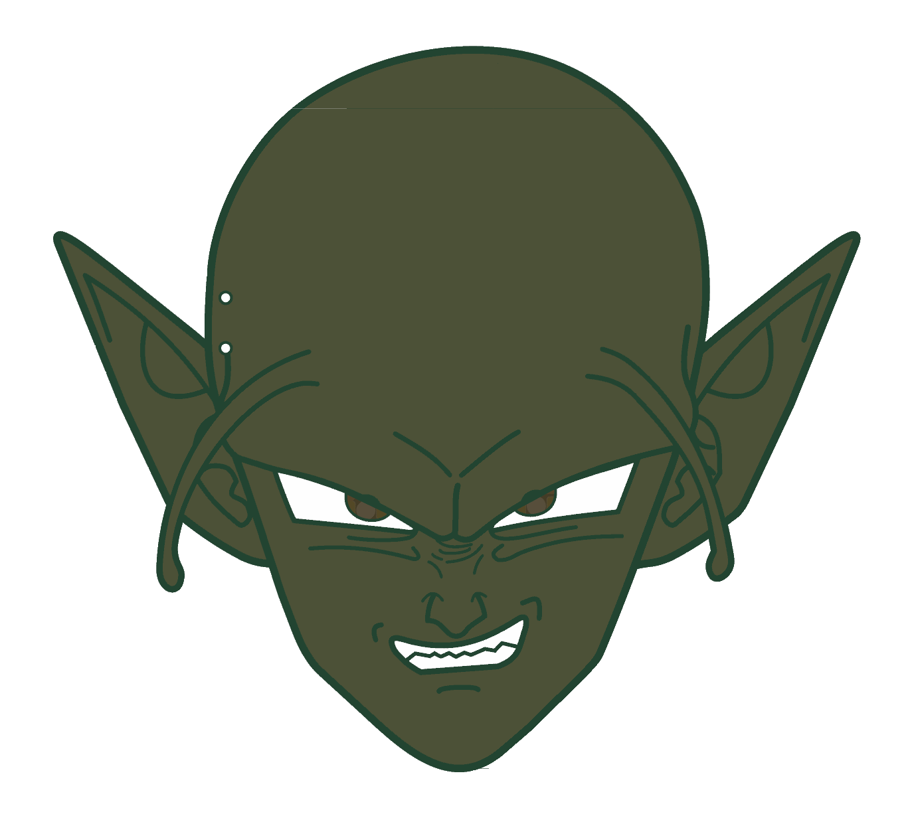
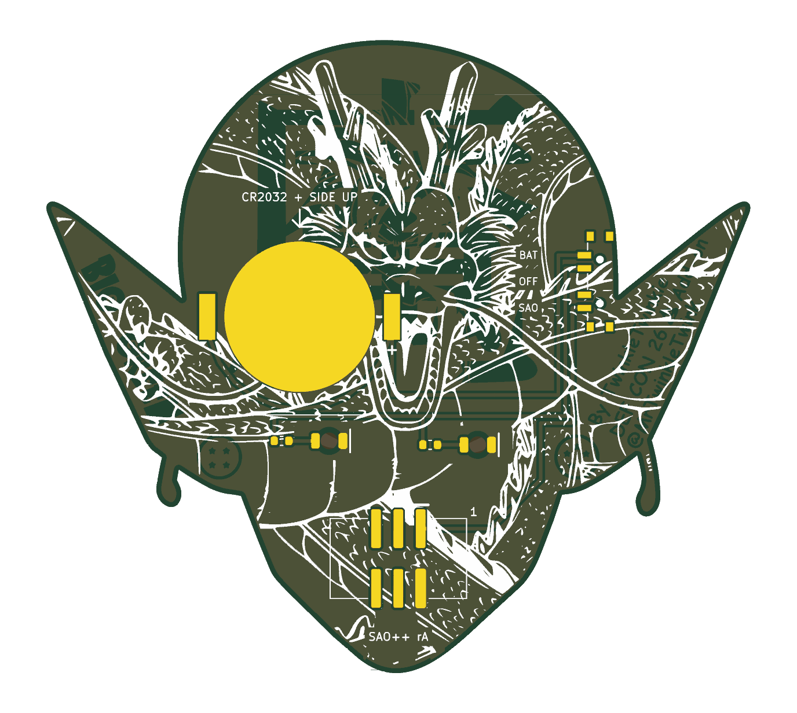

# Big Green — SAO++ edition

Originally **Big Green** (TwinkleTwinkie's DC 26 Shitty Add-on #3) by **TwinkleTwinkie**, made for DEF CON 26 (2018): https://hackaday.io/project/159522-big-green

> **Permission pending — this board is not open-licensed.** The original hackaday.io page states no license, and TwinkleTwinkie has not yet been asked or answered (draft request covering this board, Fat Pika and Mad Cat: [../fat-pika/docs/permission-request.md](../fat-pika/docs/permission-request.md)). The repo owner chose on 2026-11-10 to publish this port anyway. Until the maker says otherwise:
> - the original design in `original/`, the outline and all artwork remain **© TwinkleTwinkie, all rights reserved**; the repo's CERN-OHL-S / CC-BY-SA licenses cover only the SAO++ additions (new parts placement, routing, scripts, documentation), not the original work
> - do not treat these files as cleared for manufacture or sale
>
> **TwinkleTwinkie, or anyone with rights in this design:** open an issue and it will be changed or removed.
>
> **Third-party characters.** The front is the head of the green Namekian from *Dragon Ball*, and the back art also comes from the series (the dragon in white ink, a portrait of the series' hero and a kanji in the copper, two dragon balls). Those characters belong to Toei Animation / Bird Studio / Shueisha. That is a separate question from TwinkleTwinkie's permission: he can clear his own drawing and design, not the characters. Fan-made add-ons like this are common at cons, but nobody has licensed these characters to this project.

 

The two pupils light up white from behind, through the bare board.

## What changed from the 2018 board

| | 2018 original | SAO++ rev A |
|---|---|---|
| Connector | 4-pin through-hole on the point of the chin (pins visible on the art side) | 6-pin SAO v1.69bis, surface-mount shrouded and keyed, on the chin, 9 mm higher than before. The chin is only 14 mm wide where the old header sat and the new connector is 15 mm wide, so it moved up to where it sits 3 mm clear of the jaw edges. Nothing shows on the front |
| Power | Badge only | Slide switch on the left side of the head (seen from the front), knob in the notch between the head and the left ear: **SAO / OFF / BAT**. Runs from the badge or from its own CR2032, which clips to the back of the forehead |
| LEDs | 2 × OSRAM TOPLED (obsolete), both sharing one 51 Ω resistor | 2 × white reverse-mount 1206 in the same spots, one 1.3 kΩ resistor each |
| Brightness and current | not measured; the shared 51 Ω resistor ran them far brighter than this version | about 0.45 mA per LED on badge power (~0.9 mA total), about 0.2 mA per LED on a fresh cell. **Much dimmer than the original on purpose**, so a coin cell lasts weeks of evenings. See the prototype checklist |
| Front art | — | Unchanged, apart from two 0.9 mm holes on the left side of the forehead, 2 mm in from the edge (the switch's locating pegs). The four header holes on the chin are gone and the bare window around them is now filled to match the face. The eye outlines lose about 1 mm² of copper where they reached into the light window round each LED |
| Back art | — | The credit "By TwinkleTwinkie / DEF CON 26 Add-on / @MrTwinkleTwink", the title "BIG GREEN", both dragon balls and the portrait's face stay visible. The coin cell and its clip now cover the right half of the forehead on the back (seen from the back: the left half), hiding the lower half of the kanji's right-hand strokes (including the long sweep) and the portrait's right shoulder; the cell's edge just reaches the portrait's jaw line; under the cell the copper is made solid (it is the cell's contact). The white dragon loses ink only where the new parts' pads, the cell and the LED lenses sit, and behind the new labels. Six small labels are added (SAO, OFF, BAT, the cell type, the revision, the connector's pin 1) |

**Parts shared with the rest of SAO++:** connector, switch, cell clip, LED and resistor are all the same reels as Mad Cat. Nothing new.

**Battery life (calculated, not measured):** two white LEDs at about 0.2 mA each is about 0.4 mA, so a CR2032 should last several hundred hours, getting dimmer toward the end. White LEDs need most of a coin cell's voltage, so this board is **best on badge power**.

## Things to check on the first prototype

1. **Brightness.** The big unknown. Check both pupils in room light on badge power, then on a fresh cell, then on a half-used cell. If too dim, change both resistors from 1.3 kΩ to 330 Ω (already on the approved list as SAOPP-R-02): about 1.5 mA per LED on the badge, and a shorter but brighter life on the cell.
2. **Pin 1 position.** The new connector keeps VCC and GND in the same corner as the 2018 header (which worked on DC26 badges). Confirm against a v1.69bis badge before a production run.
3. **Switch labels.** The datasheet says position 1 joins pins 1–3 but does not draw which way the knob sits for position 1. The silkscreen assumes "knob toward the SAO label = badge power" (SAO is the label nearest the ear). If it is the other way round, swap the SAO and BAT labels (nothing electrical changes; OFF is the middle either way).
4. **Knob reach.** The knob tip ends about 0.7 mm past the side of the head, down in the notch between head and ear. The edge there curves slightly, so the switch could not go any closer without its solder tabs running off the board. Check it can be slid with a fingernail from the back, with the board plugged into a badge.
5. **Battery clip direction.** The clip fits its pads both ways round. The open side must face the top of the head (the arrow on the back silkscreen); the cell slides in from the top edge. Tell the assembler.
6. **Weight and balance.** The board is 80 × 72 mm and hangs from a surface-mount connector on the chin. The cell sits 27 mm above the connector and 11 mm to one side of the centre line (the only place on the back with room that is not the credit, the title or the portrait's face), so the board may lean a little. Check it sits firmly in a badge and that the connector's solder joints survive being knocked.
7. **Peg holes.** Two small holes show on the left side of the forehead. Check they do not bother you; there was no straight edge free of lettering anywhere else.
8. **Pupils from the front.** The LEDs sit behind the pupils, which were made as bare windows for light in 2018. Check the light fills the pupil evenly.

## Files

- `hardware/big-green.kicad_pro` — KiCad 10 project (schematic + board). ERC: 0 issues. DRC: 0 errors, 0 unconnected, schematic matches board. 26 warnings remain, all from the art (20 silkscreen-overlap warnings from the dragon drawing, 5 "art library not installed", 1 copper sliver in the art).
- `hardware/circuit.json` — the circuit as data; `tools/gen_schematic.py big-green` and `hardware/build_board.py` both read it.
- `hardware/build_board.py` — rebuilds the board from `original/` plus the SAO++ changes; every placement and routing decision is in there with a comment. It checks that no new wire runs through the lettering or the drawn art.
- `hardware/big-green.kicad_dru` — one extra rule: fine gaps inside the artwork are allowed.
- `production/` — everything a board house needs, for one board (`single/`) and a 2×2 panel (`panel/`). Start with [production/README.md](production/README.md). Panel DRC: 0 errors, 0 unconnected; 132 warnings, all the same art warnings repeated four times. `production/panel/big-green-panel.kicad_dru` is a copy of the art rule so the panel is checked the same way as the single board.
- `original/` — the untouched 2018 KiCad 4 project and zip from hackaday.io.

## Parts cost (parts only, list prices checked 2026-11-10)

| Part | Qty | Each @ ~100 boards |
|---|---|---|
| Connector XFCN BH254VS-6P (LCSC C492445) | 1 | $0.12 |
| Switch C&K PCM13SMTR (Digikey) | 1 | ~$0.90 |
| CR2032 clip TE BAT-HLD-001 (LCSC C7501066) | 1 | $0.61 |
| LED Lite-On LTW-C230DS white (LCSC C575513) | 2 | $0.055 |
| Resistor 0603 1.3 kΩ (LCSC C22767) | 2 | <$0.01 |
| **Total** | | **about $1.75** |

The CR2032 cell and the bare board (80 × 72 mm) are not included.
