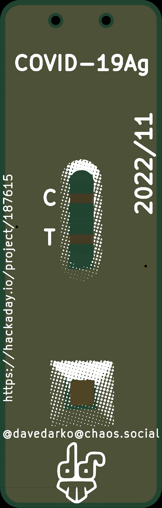
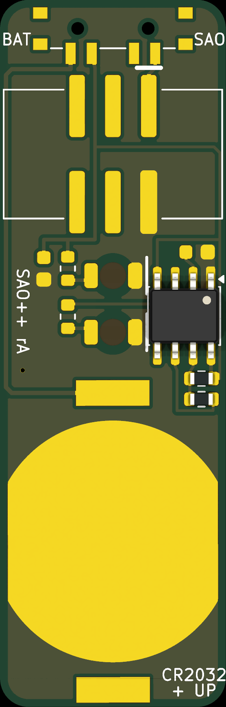

# COVID-19 Test — SAO++ edition

Originally the **COVID-19 Test SAO** by **davedarko (Dave Darko)**, 2022: https://github.com/davedarko/Simple-Add-ons-SAO/tree/main/COVID-19%20Test%20SAO (project page https://hackaday.io/project/187615-covid-19-sao-simple-add-on)

> **Permission pending — this board is not open-licensed.** davedarko's repository and project page state no license, and he has not yet been asked or answered (draft request: [../han-saolo/docs/permission-request.md](../han-saolo/docs/permission-request.md)). Whether to publish this port before he answers has **not been decided** yet; it was built locally on 2026-11-11. Until the maker says otherwise:
> - the original design in `original/`, the outline and all artwork remain **© davedarko, all rights reserved**; the repo's CERN-OHL-S / CC-BY-SA licenses would cover only the SAO++ additions (new parts placement, routing, scripts, documentation), not the original work
> - do not treat these files as cleared for manufacture or sale
>
> **davedarko, or anyone with rights in this design:** open an issue and it will be changed or removed.

 

A rapid antigen test cassette, 16 × 50 mm. The control line **C** stays lit; the test line **T** blinks, positive, negative, positive: the maker's joke about not knowing.

## What changed from the 2022 board

| | 2022 original | SAO++ rev A |
|---|---|---|
| Connector | 2×3 through-hole IDC header (pins visible on the front) | 6-pin SAO v1.69bis, surface-mount shrouded and keyed, 0.6 mm higher than the old header. Nothing shows on the front |
| Power | Badge only | Slide switch on the top edge, knob up: **SAO / OFF / BAT**. Runs from the badge or from its own CR2032, which clips over the lower half of the back |
| Timer | Readme: LMC555. Schematic and board: NE555D | **LMC555**. The NE555 needs 4.5 V and will not run from 3.3 V or a coin cell; the LMC555 runs down to 1.5 V, same pins |
| LEDs | 2 ordinary red LEDs soldered upside down | 2 red LEDs made to be mounted upside down (same Lite-On family the other boards use), in the same spots, one 1.3 kΩ resistor each |
| Blink | see below: three different answers in the maker's files | T on 0.46 s, off 0.23 s, about 1.5 times a second |
| Front art | — | Window, C and T lines, sample well, shading and "COVID-19Ag" unchanged. **Added:** the maker's credits (moved from the back, same words and size), two 0.9 mm holes above "COVID-19Ag" (the switch's pegs), two tiny dimples from covered vias |

**Parts shared with the rest of SAO++:** connector, switch, cell clip, red LED, 1.3 kΩ resistor and 100 nF capacitor. **New parts:** the LMC555 timer and one resistor value (3.3 MΩ, used twice). The clip is the shared part on a board-specific footprint (see "The coin cell").

### The blink, and the three sets of values

The maker's readme, schematic and board file each list different parts. In a 555 blinker two resistors and one capacitor set the speed (R1 and R2 with C1 here); the other two resistors only limit LED current (R3 for C, R4 for T).

| Source | Timing parts | T blinks | LED resistors | Side effect |
|---|---|---|---|---|
| Readme | 100 Ω, 390 kΩ, 1 µF | 0.27 s on / 0.27 s off | 150 Ω (C), 100 Ω (T): ~10 mA each | 33 mA wasted in R1 every off half |
| Schematic | 100 Ω, 39 kΩ, 10 µF | 0.27 s on / 0.27 s off (same speed) | 100 Ω each | same 33 mA waste |
| Board file, iBOM (what was built) | 1 kΩ, 470 kΩ, 1 µF | 0.33 s on / 0.33 s off | 1 kΩ each: ~1.5 mA | 3.3 mA wasted every off half |
| **SAO++** | **3.3 MΩ, 3.3 MΩ, 100 nF** | **0.46 s on / 0.23 s off** | **1.3 kΩ each: ~1 mA** | under 1 µA |

Why not keep the built board's 50/50 rhythm: with a 555, an even blink needs a small R1, and a small R1 is a short from the supply to ground half of the time. With the shared 1.3 kΩ there it would waste about 1.2 mA on average, nearly doubling the drain on the coin cell. Making R1 equal to R2 removes that waste and needs only one new resistor value; the price is a longer "on" than "off". The capacitor is the shared 100 nF, so the speed varies about ±15 % between boards.

**Battery life (calculated, not measured):** C lit ~0.9 mA + T on two-thirds of the time ~0.6 mA + timer ~0.1 mA ≈ 1.6 mA, so a CR2032 should last roughly 100–130 hours, dimming toward the end. Both LEDs still glow at 2.4 V.

### The coin cell: the board is narrower than the cell

The board is 16 mm wide; a CR2032 is 20 mm across. The clip's two solder pads are 22.8 mm apart, so the clip can only lie lengthwise. As built:

- the cell overhangs **both long edges by 2.0 mm**, over the lower 20 mm of the board;
- the clip's closed end sticks out **3.1 mm** past the right edge (front view); the cell slides in from the left;
- the clip footprint's 17 mm contact disc is wider than the board, so this board uses a copy of it with the disc cut to a 14.9 mm band (owner decision needed, below). The clip pads are unchanged;
- the cell covers the back of the sample well, which used to be see-through bare board.

Alternatives considered:

| Option | Width | What it costs |
|---|---|---|
| **As built: overhang** | 16 mm board, 21.4 mm with cell and clip | cell 2 mm past each side, clip 3.1 mm past one side; credits moved to the front |
| Badge power only (as the maker did) | 16 mm | no switch, no clip, no cell (saves ~$1.50 a board); the maker's back credits could stay where they were |
| Wider outline | 21.6 mm (+5.6 mm) to hold cell **and** clip; 20.5 mm (+4.5 mm) for the cell alone | changes the maker's cassette proportions; the full 17 mm disc then fits |

### Where things are on the back

From the top: the switch; the connector (its 15.3 mm body leaves 0.37 mm to each long edge, so the house "3 mm from the edge" rule cannot be met); the timer and its three timing parts left of the LEDs (front view), the two LED resistors and the supply capacitor right of them; then the coin cell.

The board is routed on the back copper only, plus **two vias** (0.3 mm hole, covered by solder mask both sides): one under the timer at (-6.35, -2.65) mm and one right of the T line at (6.4, 1.2) mm, both where the front is plain dark copper. The front copper (the maker's pour) now serves as ground between them: the timing capacitor and the timer's ground pin are boxed in by other tracks and had no other way to reach ground.

## Things to check on the first prototype

1. **Blink and brightness.** Both LEDs at about 1 mA through 1.6 mm of board. Check C and T in room light, on badge power and on a cell. If too dim, R3/R4 can drop to the shared 330 Ω (about 3–4 mA each, shorter cell life).
2. **Coin cell fit.** The cell overhangs 2 mm each side and the clip's end 3.1 mm on the right. Check the cell seats firmly on the narrowed contact, slides in from the left, and that nothing snags when worn.
3. **Pin 1 position.** VCC is top left in front view, as on Mad Cat. Confirm against a v1.69bis badge.
4. **Switch labels.** Only SAO and BAT are printed (no room for OFF; it is the middle). The labels assume the knob points at the label for that position; if wrong, swap them.
5. **Connector at the edges.** Its body comes within 0.37 mm of both long edges. Check it looks right and is solid.
6. **Vias.** Check the two covered vias do not show as more than a dimple on the front.
7. **Front credits.** The maker's URL, date, handle and logo are now on the front (owner decision, below).

## Decisions for the owner

1. **Publish or not before davedarko answers** (not decided).
2. **Credits on the front.** The back is covered by the switch, connector and cell, so the maker's credits moved to blank spots on the front, unchanged in words and size. Alternative: badge-power-only version with the credits back where they were.
3. **Narrowed cell contact disc** (local copy of the shared clip footprint). Alternative: a wider outline.
4. **Front copper as ground with two vias.** Alternative: none found without moving parts off the board.

## Files

- `hardware/covid-test.kicad_pro` — KiCad 10 project. ERC: 0 violations. DRC: 0 errors, 0 unconnected, schematic matches board. 25 warnings, none electrical: 17 the maker's shading dots crossing his own mask windows (as in 2022), 4 timer and LED outline marks touching, 3 art libraries not installed, 1 "clip footprint differs from library" (its silk moved to the fab layer).
- `hardware/circuit.json` — the circuit as data; `tools/gen_schematic.py covid-test` and `hardware/build_board.py` both read it.
- `hardware/build_board.py` — rebuilds the board from `original/` plus the SAO++ changes.
- `hardware/parts_local.py`, `hardware/covid-test-local.pretty/` — the three board-only parts (timer, 3.3 MΩ resistor, narrowed clip footprint).
- `hardware/covid-test.kicad_dru` — one extra rule: fine gaps inside the artwork are allowed.
- `production/` — files for one board and a 2×2 panel; see [production/README.md](production/README.md).
- `original/` — the maker's files, untouched. The three Gerber zips are three revisions: `CovidSAO.zip` (2022-09-06, back reads "2022/08", one long front window, different LED layout), `CovidSAO2.zip` (2022-09-21, "2022/09", same copper as the board file), `CovidSAO3.zip` (2022-11-14, "2022/11", Mastodon handle, URL, assembly note) — **the last one matches `drawing.kicad_pcb`**, which is what this port starts from. The iBOM (2022-09-21) lists the board file's values.

## Parts cost (parts only, list prices from docs/parts.md, 2026-11-10)

| Part | Qty | Each @ ~100 boards |
|---|---|---|
| Connector XFCN BH254VS-6P (LCSC C492445) | 1 | $0.12 |
| Switch C&K PCM13SMTR (Digikey) | 1 | ~$0.90 |
| CR2032 clip TE BAT-HLD-001 (LCSC C7501066) | 1 | $0.61 |
| LED Lite-On LTST-C230KRKT red (LCSC C125107) | 2 | $0.037 |
| Resistor 0603 1.3 kΩ (LCSC C22767) | 2 | <$0.01 |
| Capacitor 0603 100 nF (LCSC C14663) | 2 | <$0.01 |
| Timer TI LMC555CMX/NOPB | 1 | price not yet checked |
| Resistor 0603 3.3 MΩ (UNI-ROYAL 0603WAF3304T5E) | 2 | price not yet checked |
| **Total** | | **about $1.75 plus the timer** |

New reels for SAO++: the LMC555 and the 3.3 MΩ resistor (two new lines; every other part is shared).
