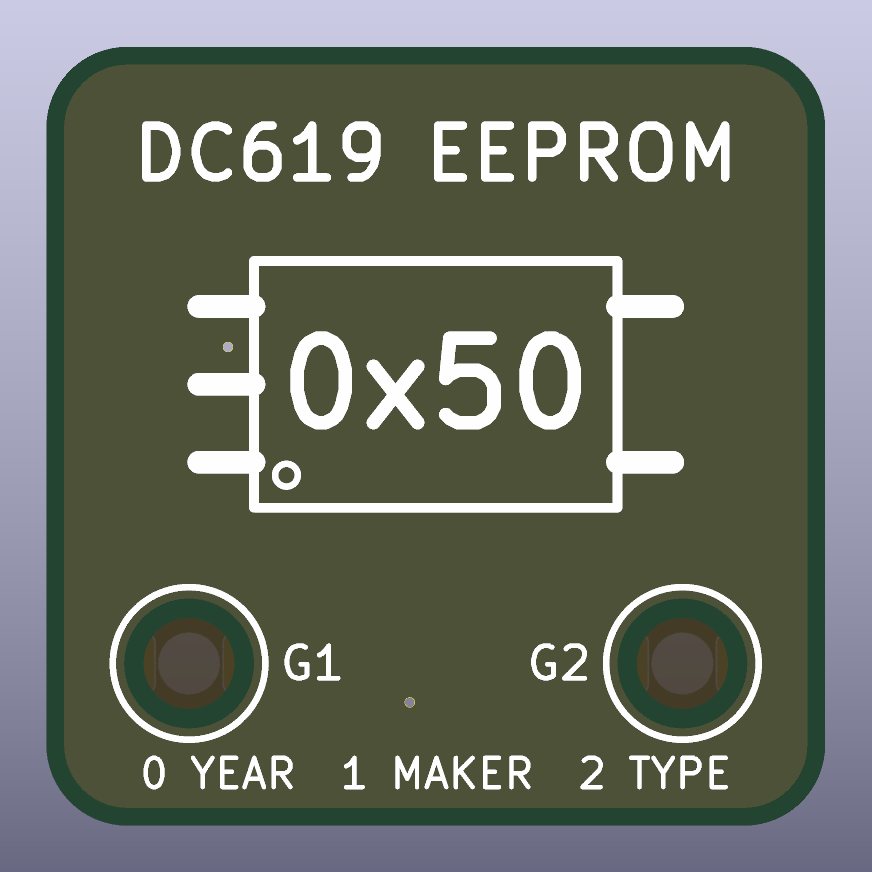
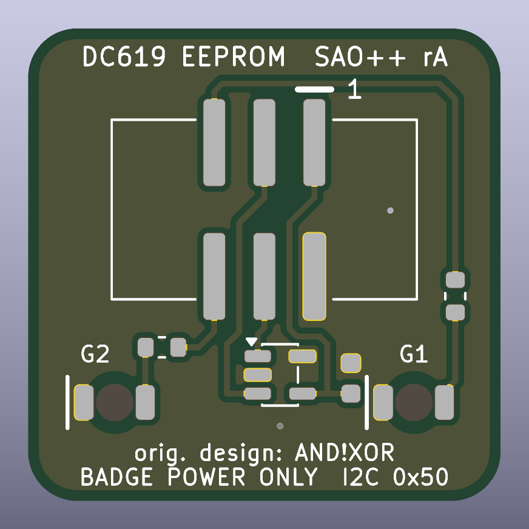

# DC619 EEPROM — SAO++ edition

From the **DC619 EEPROM SAO**, one of **AND!XOR**'s DEF CON 27 SAO reference designs: https://github.com/ANDnXOR/sao-reference-designs/tree/5bc113302ebc797442ec0beddea9254aa829aca6/DC27/DC619-EEPROM_sao1.69bis

> **License: Apache-2.0.** AND!XOR's repository carries the Apache License 2.0, which allows copying, changing and selling with credit. A copy of that license is in [`original/LICENSE`](original/LICENSE), next to the maker's files exactly as published. The repository has no NOTICE file. As the license asks, this page says what was changed (below).
>
> **Only the circuit is AND!XOR's.** They published a schematic picture and nothing else: no board, no outline, no artwork. **The board layout and everything drawn on it are SAO++'s own.** No AND!XOR or DC619 logo is used; there is none in the maker's files. "DC619" and "AND!XOR" appear as plain words only: the board's name and the maker's credit.

 

A 24 × 24 mm square that tells a badge **who it is**. It carries a tiny memory chip that a badge can read over the SAO connector's two data lines, and two red lights the badge can switch on.

## What the original actually is

Read from the maker's schematic picture ([`original/DC619-EEPROM_sao1.69bis/dc619-eeprom-schematic.png`](original/DC619-EEPROM_sao1.69bis/dc619-eeprom-schematic.png), titled "DC858/DC619 SAO", rev 2, 2 March 2019) and the two README files:

- **A memory chip** (U1, an AT24C02N: 256 bytes, in the 8-leg SOIC package) on the SAO's I2C lines. Its three address legs and its write-protect leg all go to ground, so it answers at **address 0x50** and can be written as well as read. No pull-up resistors and no supply capacitor are drawn.
- **Two LEDs, which the survey missed.** R1 (4.7 kΩ) runs from SAO pin 5 (GPIO1) to LED D2 and on to ground; R2 (4.7 kΩ) from pin 6 (GPIO2) to LED D1 and on to ground. So the lights are **not** powered by the add-on: each one lights only while the badge drives that GPIO line high. On a badge that ignores the GPIO pins they stay dark. No colour is given.
- **No battery and no switch.** Everything runs from the badge.
- **What the chip is for.** AND!XOR proposed that add-ons carry such a chip so a badge can recognise them. Their format: byte 0 = DEF CON year (0x1B for DC27), byte 1 = maker ID (AND!XOR uses 0x49), byte 2 = the maker's own number for this add-on type, bytes 3 onward = anything. This is the convention SAO++'s standard refers to (section 1, "Identification EEPROM").

## What changed

| | Maker's schematic | SAO++ rev A |
|---|---|---|
| Board | none published | **New**: 24 × 24 mm, rounded corners |
| Memory chip | AT24C02N, 8-leg SOIC | A 24C02 in the much smaller 5-leg SOT-23-5 package. Same memory size, same address 0x50, write-protect to ground as the maker drew it. The small package has no address legs, so those three links to ground disappear |
| Supply capacitor | none | 100 nF beside the chip (shared part) |
| Lights | 2 LEDs, colour not given, 4.7 kΩ each (about 0.3 mA) | 2 red LEDs on the back shining **through** the board, 1.3 kΩ each (about 1.15 mA): both shared parts. Same wiring: GPIO1 lights the left one (marked G1), GPIO2 the right one (G2) |
| Connector | SAO v1.69bis, 6 pins | The shared shrouded, keyed connector on the back, key slot up, centred |
| Power | badge only | **Badge only** (see below) |
| Front | — | Plain lettering: the name, a chip outline with "0x50", and "0 YEAR 1 MAKER 2 TYPE" as a reminder of the byte order. Two round bare-board windows where the lights show |
| Back lettering | — | "DC619 EEPROM SAO++ rA", "orig. design: AND!XOR", "BADGE POWER ONLY I2C 0x50", pin-1 mark, G1 / G2 |

### Badge power only: a recorded exception

The SAO++ standard gives every board a coin cell and an SAO / OFF / BAT switch. This board has neither, and says so on the back ("BADGE POWER ONLY"). The reason: **nothing on it can do anything without a badge.** The memory chip is only ever read by a badge, and the lights are switched by the badge's own GPIO lines, not by the board's supply. A coin cell would light nothing; it would only keep an idle chip powered. Leaving it out also removes the three most expensive parts (switch, cell clip, safety diode) and keeps the board small: the cell clip alone is 24 × 17 mm, as big as this whole board.

This is the board agent's recommendation and **still needs the owner's yes**. If the owner prefers the house-standard version, it would also need a decision on what the cell should light, because the maker's lights cannot run from it.

### Why nothing here can harm a coin cell

There is no coin cell on this board, so the coin-cell safety rules have nothing to protect. For the same reason there is no safety diode. The board adds no pull-up resistors to the data lines (the badge provides them), and its GPIO pins only ever receive current from the badge, through 1.3 kΩ, into an LED.

### Light current

| | Resistor | Current per light (red LED, about 1.8 V, badge GPIO at 3.3 V) |
|---|---|---|
| Maker | 4.7 kΩ | about 0.3 mA |
| SAO++ | 1.3 kΩ | about 1.15 mA |

That is four times the maker's current, still far below what a microcontroller pin can supply (several mA), and it is the current the other SAO++ boards use for a light seen through the board.

## Setting the ID

The chip arrives **blank** (every byte reads 0xFF). There is no program on this board; someone has to write the three ID bytes once, over the SAO connector, with any I2C tool (a badge, a Raspberry Pi, a Bus Pirate, a XIAO):

| Byte | Meaning | Example |
|---|---|---|
| 0 | DEF CON year | 0x1B = DC27 (the maker's example) |
| 1 | maker ID | AND!XOR's is 0x49; SAO++ has not chosen one |
| 2 | add-on type, numbered by the maker | — |
| 3 … 255 | free | — |

A badge built for the original only reads the first 256 bytes, which is all this chip has.

## Things to check on the first prototype

1. **The memory chip itself.** The part is a candidate, not yet approved: IDCHIP AD24C02 (LCSC C5125083). Its leg order was read from its own datasheet (version 1.1, May 2022, page 2: 1 SCL, 2 GND, 3 SDA, 4 VCC, 5 WP), which matches the well-known AT24C02C in the same package. Two things the datasheet does **not** spell out for the 5-leg package and a prototype must confirm: that it answers at **0x50** (scan the bus), and that write-protect tied to ground means **writable** (write a byte and read it back). The land pattern is KiCad's standard SOT-23-5; the datasheet's package drawing (2.9 × 1.6 mm body, 0.95 mm pitch) agrees.
2. **Brightness through the board** at about 1.15 mA (the same open question as on every board using the through-board LED).
3. **Connector fit and pin order** against a real v1.69bis badge socket (open on every SAO++ board).
4. **A badge that drives GPIO.** The lights need a badge that sets GPIO1 / GPIO2 high. Try one that does, and confirm G1 is the left light seen from the front.

## Files

- `hardware/dc619-eeprom.kicad_pro` — KiCad 10 project.
  - ERC: 0 errors, 0 warnings.
  - DRC: 0 errors, 0 warnings, 0 unconnected, 0 schematic mismatches.
  - Panel (3 × 2): 0 errors, 0 unconnected; 42 warnings, all "footprint library not configured" (the panel folder has no library table; 7 parts × 6 boards). Nothing electrical.
- `hardware/build_board.py` — draws the whole board in one run (a few seconds): outline, parts, routing, ground copper, lettering. It also writes the house check settings back into the project file, because kicad-cli 10.0.8 can reset them.
- `hardware/circuit.json` — the circuit as data; `tools/gen_schematic.py dc619-eeprom` and `build_board.py` both read it. `docs/schematic.svg` is the drawn result.
- `hardware/parts_local.py`, `hardware/make_local_footprints.py`, `hardware/dc619-eeprom-local.pretty/` — the memory chip, the one part the shared library does not have yet. It uses the same name as on the Floppy Disk board so both can move to the shared library together as `SAOPP-EE-01`.
- `hardware/outline.json` — the board outline as one polygon (written by the build script).
- `production/` — order files for one board and a 3 × 2 panel. Start with [production/README.md](production/README.md).
- `original/` — the maker's folder and repository README as published, with the Apache-2.0 `LICENSE`.

To rebuild everything, from the repository root:

```
python3 boards/dc619-eeprom/hardware/make_local_footprints.py
python3 tools/gen_schematic.py dc619-eeprom
flatpak run --filesystem=$PWD --command=python3 org.kicad.KiCad boards/dc619-eeprom/hardware/build_board.py
flatpak run --filesystem=$PWD --command=python3 org.kicad.KiCad tools/panelize.py dc619-eeprom
python3 tools/export_fab.py dc619-eeprom
```

## Parts

| Ref | Part | Qty | Shared? | LCSC list price each |
|---|---|---|---|---|
| J1 | SAO connector XFCN BH254VS-6P (`SAOPP-CONN-01`) | 1 | yes | $0.100 @340 (2026-11-10) |
| U1 | 24C02 EEPROM, SOT-23-5: IDCHIP AD24C02 (`SAOPP-EE-01` candidate) | 1 | new: this board and Floppy Disk | $0.0387 @100, $0.0237 @3,000 (2026-11-11) |
| C1 | 100 nF 0603 (`SAOPP-C-01`) | 1 | yes | $0.005 |
| R1, R2 | 1.3 kΩ 0603 (`SAOPP-R-01`) | 2 | yes | $0.002 |
| D1, D2 | Red through-board LED, Lite-On LTST-C230KRKT (`SAOPP-LED-10`) | 2 | yes | $0.037 @100 (2026-11-10) |

**Parts per board: about $0.22** at those list prices (bare board and assembly not included; get those from the fab's quote). One new part across the project: the memory chip, 30,090 in stock at LCSC on 2026-11-11, sold on reels of 3,000 (a full reel is about $71) or in tens.
