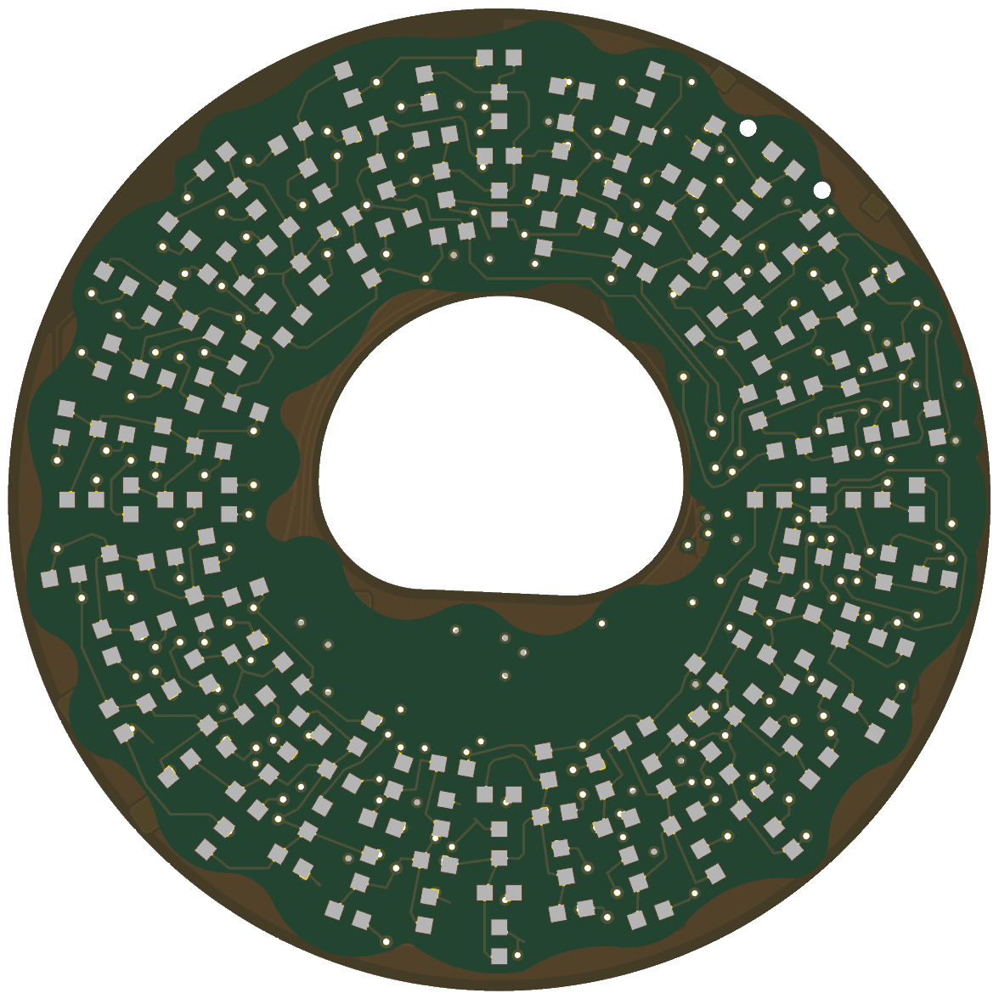
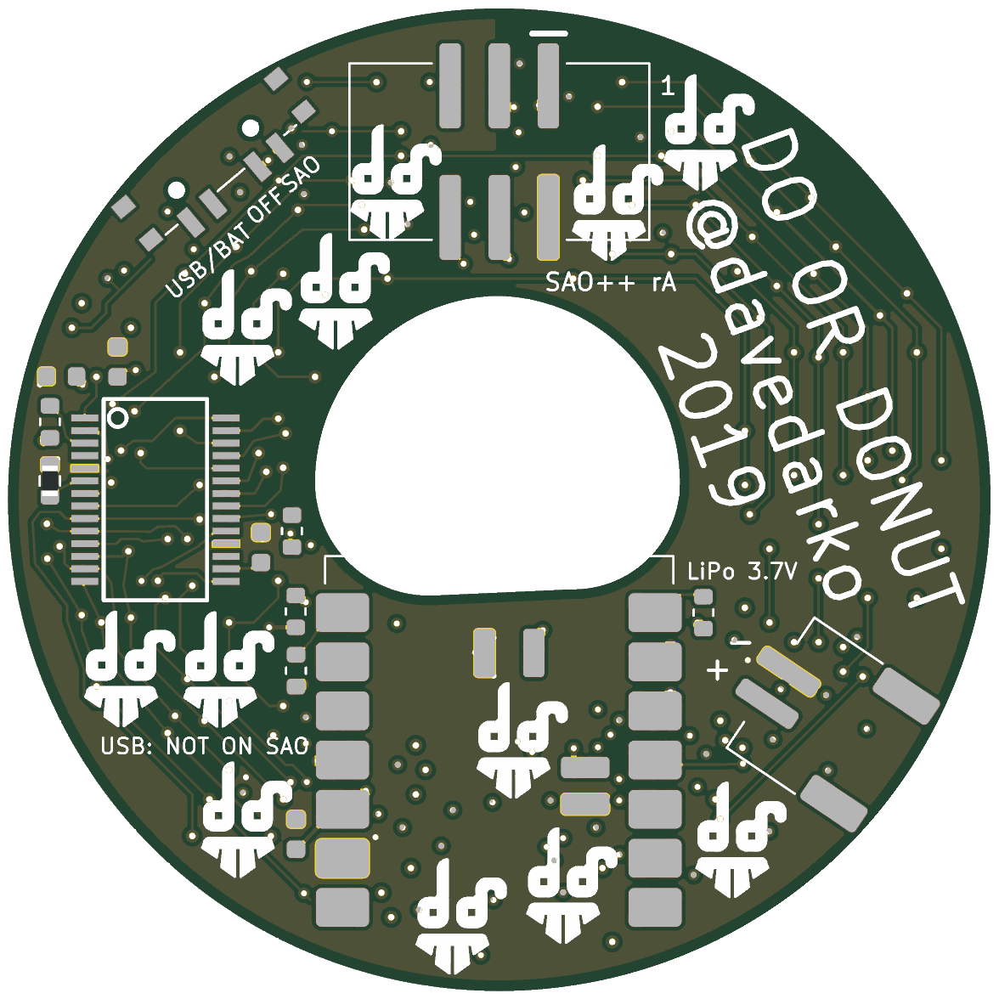

# Do Or Donut — SAO++ edition

Originally **Do Or Donut SAO** by **davedarko (Dave Darko)**, 2019: https://github.com/davedarko/Simple-Add-ons-SAO/tree/main/Do%20Or%20DoNut (project page: https://hackaday.io/project/168597-do-or-donut-sao)

> **Permission pending — this board is not open-licensed.** Nothing in the maker's repository states a license, and davedarko has not yet been asked (draft request: [../han-saolo/docs/permission-request.md](../han-saolo/docs/permission-request.md)). The repo owner chose on 2026-11-11 to publish this port anyway. Until the maker says otherwise:
> - the original design in `original/`, the outline, the LED layout, the matrix wiring and all artwork remain **© davedarko, all rights reserved**; the repo's CERN-OHL-S / CC-BY-SA licenses cover only the SAO++ additions (new parts placement, new routing, scripts, documentation)
> - do not treat these files as cleared for manufacture or sale
>
> **davedarko, or anyone with rights in this design:** open an issue and it will be changed or removed.

 

A 51 mm donut whose sprinkles are 144 tiny LEDs. **Four copper layers** (the maker's has two): see below. On the original, the badge drove them. On this version a small XIAO ESP32 module on the back drives them, so the donut can animate on its own: from the badge, from USB-C, or from a small LiPo cell.

## What changed from the 2019 board

| | 2019 original | SAO++ rev A |
|---|---|---|
| What drives the LEDs | The badge, over the SAO's I2C pins, talking straight to the LED driver chip | A **Seeed Studio XIAO ESP32** module (C3, S3 or C6) soldered flat on the back. It drives the LED chip on its own private connection, so the donut animates without a badge. The badge can still talk to the XIAO (firmware to be written) |
| LEDs and LED driver | 144 × 0603 LEDs on the front, IS31FL3731 on the back | **Unchanged**: same chip, same 144 LEDs at the same spots and angles, wired to the same driver pins. Every LED is listed in `hardware/matrix.json` |
| Connector | 6-pin through-hole shrouded header below the hole (its pins showed on the front) | 6-pin SAO v1.69bis, surface-mount, shrouded and keyed, on the back **above** the hole. Nothing shows on the front. It moved because the XIAO needs the only part of the ring wide enough for it, below the hole |
| Power | Badge only | Slide switch on the upper-right edge (seen from the front): **SAO** (badge power) / **OFF** / **USB-BAT** (the XIAO's own power: USB-C, or a LiPo on the new JST-PH connector on the lower-left edge, charged by the XIAO) |
| Front art | Bare-board "dough" rim and ring round the hole, icing in solder-mask colour, LEDs as sprinkles | Unchanged. The only change seen from the front: the old header's six gold pins are gone, 111 new tiny covered holes (vias, 0.3 mm, under the solder mask) sit among the LEDs, and the copper tracks inside the bare rim are now covered by a thin line of mask so no bare copper of two different lines can touch, and two 0.9 mm holes for the switch's pegs at the upper-right edge |
| Back art | DO OR DONUT / @davedarko / 2019 at the top, twelve "ds" logos | **The credit moved** (same words, same size) from the top, where the SAO connector now sits, to the left side of the back (upper right when you look at the back), its three lines turned to follow the ring. **Six of the twelve "ds" logos moved** to the nearest free spot (unchanged), and **six more could find no visible spot on this crowded back: they are still printed, unchanged, but under the XIAO, the SAO connector or the LiPo connector, where nobody will see them.** Owner decision: accept that, or drop those six. The AUDIO_IN label went with the audio pad it named. SAO++ labels added |
| Audio input | A test pad and capacitor to feed sound into the driver's audio mode | Removed (nothing on a badge feeds it; the XIAO can make its own effects) |

## Four copper layers instead of two (owner decision to confirm)

**The maker's board has two copper layers; this one has four.** All of his routing for the 144 LEDs stays on the outer two layers exactly as he drew it, apart from the short stretches the new parts sit on. Everything new (the XIAO's connections, the switch, the LiPo connector, the badge's lines, power, ground, and the bits of LED wiring that had to be lifted) runs on the two new inner layers, reached through small covered holes.

Why: the XIAO needs the bottom of the ring, which is exactly where nine of the maker's LED lines run round the donut on the back. On two layers every new connection has to squeeze through the same few gaps as those lines. A home-made router was tried for several hours (re-routing the lifted stretches and all the new connections, with rip-up and retry); it never closed: each attempt left 6–10 connections unrouted, chasing each other through the same spots. On four layers everything routed in about five minutes.

What it costs: a four-layer board is roughly 2–3 times the price of a two-layer one at small quantities at JLCPCB or PCBWay, and the order form changes (see production/README.md). The options if four layers is not acceptable: (a) a larger board, which changes the maker's outline; (b) drop the badge connection lines and the LiPo connector so the XIAO only powers and drives the LEDs (still unlikely to close on two layers, as the bus crossing under the XIAO remains); (c) no XIAO at all, the board as the maker designed it, driven by the badge.

**Parts shared with the rest of SAO++:** connector, switch, XIAO, LiPo connector, the 1.3 kΩ and 330 Ω resistors and the 100 nF capacitor. **New, only on this board so far** (each needs its own reel): the 0603 LED (one part number, colour to be chosen), the IS31FL3731 driver, and the 20 kΩ current-setting resistor.

## How the XIAO talks to the LEDs (design decision)

The SAO's two I2C pins belong to the badge: on them, the badge is in charge and the XIAO only answers. The LED driver chip needs something in charge of it too. Two ways were possible:

- **A (chosen): a private connection.** The driver sits on its own two wires to the XIAO (XIAO pins D10 and D3, which are safe at start-up on all three XIAO types), with its own 1.3 kΩ pull-up resistors (the shared part). The badge's I2C wires go only to the XIAO (pins D4/D5, the house habit). The badge and the XIAO can never fight over the driver, and the badge's bus is not loaded by our pull-ups (the SAO standard says the add-on must not add any).
- **B: share the badge's wires**, so a badge could drive the LEDs directly. Rejected: two controllers on one bus (the badge and the XIAO) need careful firmware on both, and the driver's pull-ups would sit on the badge's bus.

Driver settings: its address is fixed at **0x74** (address pin tied to ground; the maker had it at 0x77 through a resistor, which is no longer needed on a private connection). Its shutdown pin is **held on** through a 1.3 kΩ resistor (as the maker did); firmware turns the LEDs off with the chip's own software shutdown. Its interrupt pin is not used.

## Power and current (calculation, not measured)

The driver's current per LED is set by one resistor, R6. It is **20 kΩ**, the value in the IS31FL3731 datasheet's typical circuit (to be confirmed against the datasheet). How much current that gives is the datasheet's figure; from memory it is in the region of 20–40 mA per LED **while that LED is lit**. Each LED is lit at most one ninth of the time (the chip scans the matrix), so one LED at full brightness averages roughly 2–4.5 mA.

**The whole donut at full brightness would draw far more than a badge can give:** at any instant 8 or 16 LEDs are lit (depending on how the chip interleaves the two halves of the matrix, to be confirmed), so roughly **0.2–0.65 A**, against the 50 mA SAO++ allows from a badge. **The firmware must cap the brightness**: as a rough guide, all 144 LEDs at about 10 % brightness, or about a dozen at full brightness, stays near 40 mA. On USB or a LiPo the cap can be higher, but the XIAO cannot tell SAO from USB-BAT power by itself (only OFF is wired to it), so the safe default is the badge cap everywhere. A larger R6 would lower the ceiling in hardware if the owner prefers; say so.

## How the power switch works here

| Knob | Badge 3.3 V | What runs the board |
|---|---|---|
| **SAO** | connected to the XIAO's 3V3 pin and the LED driver | the badge |
| **OFF** | disconnected | nothing from the badge. If USB or a LiPo is attached the XIAO still has power, so the switch tells it (pin D1) to blank the LEDs and sleep |
| **USB-BAT** | disconnected | the XIAO's own regulator, from USB-C or the LiPo |

As on Hack-Man: OFF is a sleep, not a hard cut, with a LiPo attached; **never plug in USB while the knob is on SAO and the board is on a badge** (printed on the back); and feeding the XIAO through its 3V3 pin is the first thing to test.

## Pin map

| XIAO pin | Goes to |
|---|---|
| D10 | LED driver SDA (private connection), 1.3 kΩ pull-up R5 |
| D3 | LED driver SCL (private connection), 1.3 kΩ pull-up R4 |
| D4 / D5 | SAO SDA / SCL (the badge's bus; no pull-ups on this board) |
| D7 / D6 | SAO GPIO1 / GPIO2, each through 330 Ω (R7 / R8) |
| D1 | high when the switch is on OFF |
| 3V3, GND | the board's 3.3 V rail and ground |
| BAT+ / BAT− (under the module) | the JST-PH LiPo connector J2 |
| D0, D2, D8, D9, 5V | not connected (start-up "strapping" pins on one module or another) |

| Driver (U1, IS31FL3731) pin | Goes to |
|---|---|
| CA1–CA9, CB1–CB9 | the 144 LEDs, exactly as the maker wired them (`hardware/matrix.json`) |
| SDA / SCL | XIAO D10 / D3 |
| AD | ground (address 0x74) |
| SDB (shutdown) | 3.3 V through R1 (1.3 kΩ): always on |
| INTB, AUDIO_IN | not connected |
| R_EXT | R6 20 kΩ to ground (sets LED current) |
| C_FILT | C1 100 nF to ground |
| VCC | 3.3 V, with C3, C4 (100 nF) beside the chip; C5 (100 nF) at the XIAO's 3V3 pin |

## The LED map (`hardware/matrix.json`)

One entry per LED: its new reference (DA1–DA72 = the maker's LED1–LED72, DB1–DB72 = his LED73–LED144), its position seen from the front (millimetres from the centre, and as an angle and radius, handy for spinning animations), which driver pins its anode and cathode go to, and where it sits in the driver's memory (`frame`: register row, column, the on/off register and bit, and the brightness register). The file was extracted from the maker's Eagle board and checked: every LED sits between two different pins of the same half of the matrix, all 144 pin pairs are different, and every pin is the anode of 8 LEDs and the cathode of 8.

**One thing to confirm:** whether the chip's "row" is the LED's cathode pin (as the maker's schematic groups them, and as `frame` assumes) or its anode. The file gives both (`frame_if_row_is_anode`), so firmware only flips one switch if the first test shows LEDs lighting in the wrong places.

## Firmware

The maker published **no firmware** (`original/` has the Eagle files, PDFs, Gerbers and a readme only). Firmware for this board is being written separately in `firmware/` (not part of this hardware port; see its README). What it needs from the hardware: an IS31FL3731 driver on the private connection (D10/D3, address 0x74), the LED map above, a brightness cap, D1 for OFF, the BOOT button for modes, and optionally an I2C target on D4/D5 so a badge can pick animations (as Hack-Man's firmware does). Rust, per the house rule.

## Things to check on the first prototype

1. **Badge power into the XIAO's 3V3 pin** (as Hack-Man): boots and runs from a badge, nothing warm.
2. **The LED current** (R6) and the decoupling and filter capacitor values against the IS31FL3731 datasheet. All component values in the maker's files were blank; the values here are from the datasheet's typical circuit as remembered, and must be confirmed before ordering.
3. **Brightness cap**: measure the current from a badge with the cap the firmware uses.
4. **LED order**: light the LEDs one by one and check `matrix.json` (row = cathode or anode, see above).
5. **LED colour**: the maker's files do not say. Choose one; blue and white need more voltage and may be dim at 3.3 V on this chip.
6. **Silkscreen:** the "XIAO C3/S3/C6" label found no free spot and was left off.
7. **The XIAO overhangs the hole by about 1.7 mm** at its inner end, and its USB end is level with the bottom edge (corners about 0.2 mm out, socket mouth about 0.1 mm out). Check a USB-C plug goes fully in and the module's end does not show much through the hole from the front.
7. **Battery pads need reflow** (under the module), and **LiPo polarity**: + is marked; cells from other sellers are often reversed. Check with a meter.
8. **Switch knob**: about 0.35 mm of knob shows past the round edge. Labels assume "knob toward the SAO label = badge power".
9. **Pin 1 position** of the SAO connector against a known v1.69bis badge.
10. **The driver's part number** (IS31FL3731-SALS2-TR is taken to be the SSOP-28 version) against ISSI's ordering table.

## Files

- `hardware/do-or-donut.kicad_pro` — KiCad 10 project (schematic + board). ERC: 0. DRC: 0 errors, 0 unconnected, 0 schematic-parity issues; 25 warnings: 12 short dead-end track stubs and 7 vias of the maker's left where a stretch of his routing was lifted (harmless copper, not connected to anything else of another net), 4 places where a moved logo touches a connector's printed outline, the XIAO footprint's printed outline crossing the hole edge (1), and the switch footprint flagged as differing from the library (1, from turning it to an odd angle)
- `hardware/matrix.json` — every LED: position, driver pins, frame register. Made by `hardware/extract_matrix.py` from `original/donut.brd`.
- `hardware/circuit.json` — the circuit as data (made by `hardware/make_circuit.py`); `tools/gen_schematic.py do-or-donut` and `hardware/build_board.py` both read it.
- `hardware/build_board.py` — rebuilds the board from the maker's Eagle file plus the SAO++ changes; `hardware/router.py` routes the new and broken connections (its result is saved in `hardware/routes.json` and replayed; `DONUT_REROUTE=1` routes again); `hardware/eagle.py` reads the Eagle file.
- `hardware/parts_local.py`, `hardware/do-or-donut-local.pretty/` — the three parts only this board uses (footprints from the maker's own Eagle land patterns, and KiCad's stock 0603 resistor; see `hardware/make_local_footprints.py`).
- `hardware/do-or-donut.kicad_dru` — the house art rule; this board's 5 mil minimum is set in the board setup.
- `production/` — everything a board house needs, for one board (`single/`) and a 2×2 panel (`panel/`). Start with [production/README.md](production/README.md).
- `original/` — the maker's untouched Eagle files.
