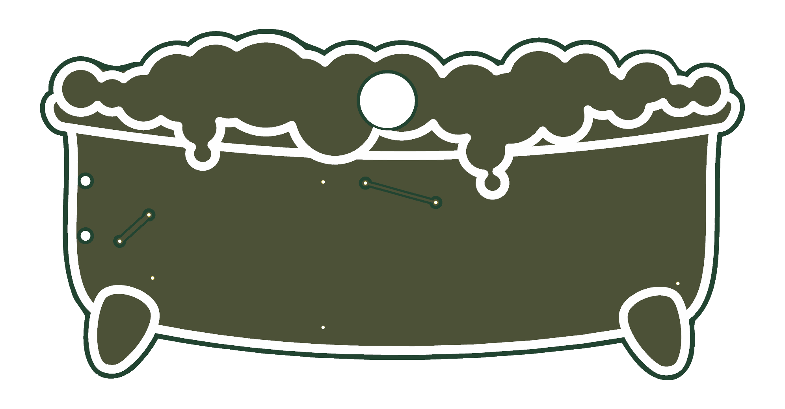
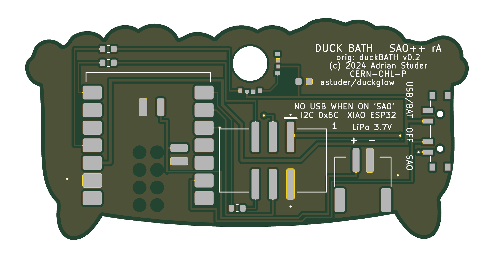

# Duck Bath — SAO++ edition

Originally **duckBATH**, one of the two **duckGLOW** add-ons by **Adrian Studer (astuder)**, 2024: https://github.com/astuder/duckglow (project page: https://hackaday.io/project/198918-duckglow-sao).

> **Licence: open.** The maker's repository carries the MIT licence and the CERN Open Hardware Licence v2 Permissive in one file ([original/LICENSE.md](original/LICENSE.md)), © 2024 Adrian Studer, and his schematic sheet is marked CERN-OHL-P. Both allow changing, making and selling with credit. His files, as downloaded (commit `f58ce25`), are in [original/](original/); the notice is kept there, in this README and on the back of the board.

 

*(The pictures use KiCad's default green. The maker's own boards are **white with black lines**: see the ordering notes.)*

A bathtub full of foam with a real toy rubber duck sitting in it. A light inside the duck makes it glow, slowly breathing yellow. A badge can change the colour and the breathing over I2C.

## What the original really is

- A 40 × 20 mm two-layer board. The front is only a drawing (silkscreen lines over a plain copper plate).
- **One ordinary 5 mm RGB LED standing up on the front**, in the foam. A small hollow rubber duck is pushed over it. That LED is the only light.
- A WCH CH32V003 chip that dims the LED's three colours, a small boost converter so it runs from 0.9 to 5 V, a transistor against reversed power, two I2C pull-up resistors, and two solder jumpers that change the I2C address.
- It answers on I2C (address 0x6C) with a table of settings: brightest and dimmest value, fading speed and starting point for each colour. It can also be driven like one addressable LED through the GPIO2 pin, and it can store settings.
- **Shared design:** the maker's other board, duckJAWS, has the same circuit and the same firmware with a different outline, different art and extra red lights behind the picture. Only duckBATH is ported here.

The survey called it "CH32V003 + RGB", which is right; it did not say that the light is a through-hole LED on the art side with a toy duck over it, which is the hard part for this project.

## Why the board is bigger

**Everything is enlarged 1.6 times: 64.1 × 32.0 mm instead of 40.0 × 20.0 mm.** The outline and the art grow together; the parts keep their real size.

The XIAO module is 21 × 17.8 mm and its USB socket has to stick out over an edge. On this shape the only edge that works is the bottom, between the two feet: at the side walls the rim of the tub sticks out further than the socket would, and a plug would hit it. Standing upright under the foam, the module needs most of the tub's height.

- Below about 1.4 the module does not fit between the foam and the bottom edge with its plug clear of the foot (checked against the outline by a script).
- At 1.4 to 1.5 the parts fit only edge to edge, and at 1.5 just 2 mm is left between the duck hole and the module, where five tracks have to pass. This was worked out from the part sizes; no board was drawn at those sizes.
- 1.6 is the size that was drawn and routed: every part has its own space and the tracks fit. Factors between 1.5 and 1.6 were not tried.

The duck does not grow: it is a bought toy. It will look smaller against the tub than on the maker's board unless a bigger duck is used.

## What changed from the original

| | Original (v0.2) | SAO++ rev A |
|---|---|---|
| Size | 40.0 × 20.0 mm | 64.1 × 32.0 mm (1.6×) |
| Light | One 5 mm RGB LED standing on the front, inside the duck | **A 5 mm hole** where that LED stood, and **two small RGB LEDs on the back** at the hole's edge (one to the left, one below), lying on their sides and shining into the hole. The duck sits over the hole. Both LEDs always show the same colour |
| Controller | CH32V003 | **Seeed Studio XIAO ESP32** module soldered flat on the back: C3, S3 or C6 all fit the same pads. USB-C at the bottom edge, between the feet |
| Power | Badge only, 0.9–5 V through a boost converter | Slide switch on the left wall: **SAO** (badge power) / **OFF** / **USB-BAT** (USB-C, or a LiPo cell on the new JST-PH connector at the bottom edge, which the XIAO charges). The boost converter and the reverse-power transistor are gone: the board now needs the badge's normal 3.3 V |
| Connector | 6-pin SMD pin header | 6-pin SAO v1.69bis, surface-mount, shrouded and keyed, 3.3 mm left of the duck's centre line |
| I2C address | 0x6C, or 0x6D–0x6F with two solder jumpers | 0x6C only. The jumpers are not on the board; the address is one line in the firmware |
| I2C pull-ups | Two 10 kΩ on the add-on | None (the house rule: the badge provides them) |
| Front | Silkscreen art over a copper plate; the LED's four pads and sixteen small holes (vias) show | The same art, scaled, over a copper plate. The duck hole, the switch's two 0.9 mm peg holes at the left wall, eight covered 0.3 mm vias, and **two short tracks under the solder mask**: 6.6 mm in the middle of the tub and 3.5 mm near the left wall. On a white board they should be all but invisible |
| Back text | "duckBATH", version, I2C address, pin notes | Board name, "orig: duckBATH v0.2 (c) 2024 Adrian Studer, CERN-OHL-P, astuder/duckglow", switch and battery labels, the USB warning |

**No new part types.** Everything is already on the shared list: connector, switch, XIAO, LiPo connector, the RGB LED, the 330 Ω resistor and the 100 nF capacitor.

### Why two tracks are on the front

All other chip boards so far keep every track on the back. Here the XIAO's pins and the SAO connector's pins are in opposite orders (the XIAO has SCL above SDA, the connector wants them the other way round), and the switch's three contacts are in the opposite order to the three lines that reach it. On one layer two lines would have to cross. Each crossing is a short hop on the front, under the mask, through two covered vias. Every attempt to avoid them needed something worse (a track between the pads of the module for the whole supply, or a much bigger board).

## The duck and the light: read this before building

This is the part of the port with the least backing.

- On the original the LED is **inside** the duck. Here the two LEDs are **behind the board**, at the rim of a 5 mm hole, and shine across it. Only part of their light turns the corner and goes forward through the hole into the duck.
- Expect to need a **light guide in the hole**: a blob of clear hot glue filling the hole and the duck's opening (the Hack-Man maker did exactly this with the same LEDs), or a short piece of 5 mm clear plastic rod pushed through the hole into the duck. Neither has been tried.
- The duck is glued on the front over the hole. The maker's duck was held by the LED it was pushed onto; here nothing holds it but glue.
- Each LED gives at most 5 mA per colour, 30 mA for both at full white, roughly what the maker's single LED drew through its 100 Ω resistors (an estimate, not a measurement). Through a hole from behind it will be dimmer than an LED inside the duck.

If the first prototype is too dim, the fall-back is the maker's own way: a 5 mm through-hole RGB LED soldered on the front in place of the hole. That part is not on the shared list and breaks the "nothing on the front" rule, so it is a decision for the owner (see "Decisions").

## How the power switch works here

| Knob | Badge 3.3 V | What runs the board |
|---|---|---|
| **SAO** (lowest, seen from the front) | connected to the XIAO's 3V3 pin and the LEDs | the badge |
| **OFF** (middle) | disconnected | nothing from the badge. If USB or a LiPo is attached the XIAO still has power, so the switch tells it to blank the LEDs and sleep |
| **USB-BAT** (highest) | disconnected | the XIAO's own regulator, from USB-C or the LiPo |

- **OFF is a sleep, not a hard cut, when a LiPo is attached.** Unplug the cell for storage.
- **Do not plug in USB while the knob is on SAO and the board is on a badge.** Two 3.3 V regulators would be joined. It is printed on the back.
- **The original ran from 0.9 to 5 V; this one needs 3.3 V.** A badge that feeds its add-ons straight from two AA cells will not run it.
- **No coin cell on this board.**

## Things to check on the first prototype

1. **Light in the duck** (above). The first thing to look at.
2. **Firmware.** It has **never been compiled**, let alone run: see [firmware/README.md](firmware/README.md).
3. **Badge power into the XIAO's 3V3 pin**, on each module type you plan to use, as on Hack-Man.
4. **USB plug.** The module's end sits 0.5 mm inside the bottom edge at the middle of the socket, so the socket sticks out 1.0 mm (Hack-Man: 1.5 mm). A 12.6 mm wide plug body ends level with the notch beside the right foot, and the foot itself is about 1.5 mm further out at that height. Check a real cable seats fully. One corner of the module hangs 0.3 mm over the small notch between the tub and the right foot; it has no pad there.
5. **LED land pattern** (the shared footprint's body position is an estimate) and that both lenses point into the hole. D1 is below the hole, D2 to its left (seen from the front).
6. **LiPo polarity**: + is the pad nearer the middle of the board, marked on the back. Check the cell with a meter. There is no protection.
7. **Battery pads need reflow**: they are under the module, as on the other XIAO boards.
8. **Switch labels**: if SAO and USB/BAT turn out swapped the silkscreen is wrong, not the wiring. The knob comes out of the left wall, which bends by 0.3 mm along the switch; the knob stands 0.8 mm proud in the middle.
9. **Pin 1 position** against a known v1.69bis badge.
10. **Height** of the module and a plugged LiPo lead behind the board.
11. **The two front tracks**: that they do not show through the mask colour you order.

## Pin map

| XIAO pin | Goes to |
|---|---|
| D10 | LED data, through 330 Ω. LED 1 is below the hole, LED 2 to its left |
| D4 / D5 | SAO SDA / SCL |
| D7 / D6 | SAO GPIO1 / GPIO2, each through 330 Ω (not used by the firmware) |
| D1 | High when the switch is on OFF |
| 3V3, GND | the board's 3.3 V rail and ground |
| BAT+ / BAT− (under the module) | the JST-PH LiPo connector |
| D0, D2, D3, D8, D9, 5V | not connected |

## Decisions for the owner

1. **Light: hole and two LEDs from behind (as drawn), or the maker's 5 mm LED on the front?** Recommendation: build rev A as drawn and try it with hot glue in the hole. Go to the front LED only if that is too dim.
2. **Front tracks:** accept two short tracks under the mask on the art side? Recommendation: yes on a white board. The alternative is a bigger board again.
3. **I2C address jumpers:** the maker's board could be set to four addresses; this one has one. Recommendation: leave it; add one jumper on spare pin D3 only if someone wants two ducks on one badge.
4. **Board colour:** white mask with black print, like the maker's? Recommendation: yes.
5. **Scale 1.6** (64 × 32 mm): accept, or ask for a try at 1.55? Recommendation: accept.

## Files

- `hardware/duck-bath.kicad_pro`: KiCad 10 project (schematic + board). ERC: 0. DRC: 0 errors, 0 unconnected, schematic matches the board; 1 warning, a "copper sliver" in the back ground copper where it squeezes between tracks (KiCad gives no position for it; harmless).
- `hardware/circuit.json`: the circuit as data; `tools/gen_schematic.py duck-bath` and the build script both read it.
- `hardware/build_board.py`: builds the board from the maker's file in `original/` and `circuit.json`; every placement and track is in there with a comment. `labels.json` holds the back lettering, `severities.json` the rule settings it re-applies to the project file.
- `hardware/duck-bath.kicad_dru`: no extra rules (the art is silkscreen, so nothing needs an exception).
- `original/`: the maker's board, schematic, footprints, drawing and licence, unchanged. His firmware and photos are not copied: see his repository.
- `firmware/`: new Rust firmware. **Never compiled.** No licence chosen for it yet, as for Hack-Man.
- `production/`: files for a board house, one board (`single/`) and a 2×2 panel (`panel/`). Start with [production/README.md](production/README.md).

## Parts cost (parts only, LCSC list prices from docs/parts.md, checked 2026-11-10)

| Part | Qty | Each @ ~100 boards |
|---|---|---|
| Connector XFCN BH254VS-6P (LCSC C492445) | 1 | $0.10 |
| Switch C&K PCM13SMTR (Digikey) | 1 | ~$0.90 |
| RGB LED OPSCO SK6805-EC3210R (LCSC C5378735) | 2 | $0.068 |
| LiPo connector JST S2B-PH-SM4-TB (LCSC C295747) | 1 | $0.16 |
| Capacitor 100 nF 0603 (LCSC C14663) | 1 | <$0.01 |
| Resistor 330 Ω 0603 (LCSC C23138) | 3 | <$0.01 |
| **Total without the module and the duck** | | **about $1.30** |
| Seeed Studio XIAO ESP32-C3 / S3 / C6 | 1 | not priced here |
| Toy rubber duck, hollow soft vinyl, about 40 mm wide judging by the maker's photo | 1 | not priced here, and not sourced: the maker's project page was not read for which duck he used |

The bare board and the optional LiPo cell are not included.
