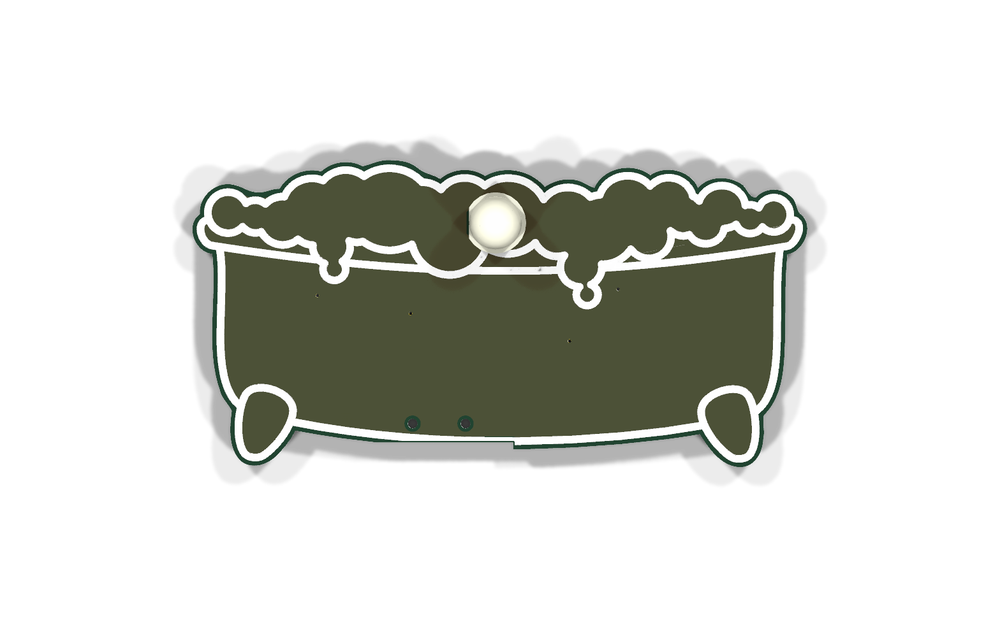
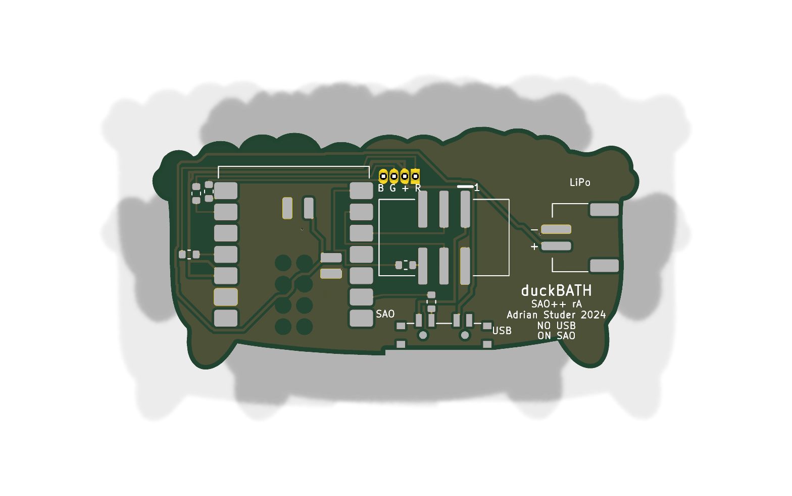

# Duck Bath — SAO++ edition

Originally **duckBATH**, one of the two **duckGLOW** SAOs by **Adrian Studer (astuder)**, 2024: https://github.com/astuder/duckglow (write-up: https://hackaday.io/project/198918-duckglow-sao). A bathtub full of bubbles with a 5 mm RGB LED standing in the foam; a little rubber duck sits on the LED and glows. Its sister board, the shark-mouth **Duck Jaws**, is in [`../duck-jaws/`](../duck-jaws/).

> **Open licence — credit kept.** The maker's repository is MIT-licensed: "MIT License, Copyright (c) 2024 Adrian Studer". The same `LICENSE.md` also carries the full text of the CERN Open Hardware Licence v2 – Permissive (CERN-OHL-P), without saying which part applies to what; both are permissive. His licence file is kept unchanged in [`original/LICENSE.md`](original/LICENSE.md), and this note records what was changed (CERN-OHL-P section 3.3 asks for that): on 2026-11-11 the board was rebuilt for SAO++ as listed below, and the firmware was rewritten in Rust. Nothing else is needed before publishing.
>
> The art is the maker's own drawing; nothing on the board belongs to a third party. The rubber duck is a separate, bought toy.

 

The renders use green; the maker's boards are **white with black silkscreen** (see `production/README.md`).

## What changed from the original

| | Original (2024, v0.2) | SAO++ rev A |
|---|---|---|
| Size | 40.3 × 20.3 mm | **Scaled up 1.45×** (outline and drawing together): **58.1 × 29.0 mm** (see "Why it is 45 % bigger") |
| The LED | 5 mm RGB LED standing in the bubbles, legs soldered on the back | **Same LED, same footprint, true size**, centred where it was |
| Controller | WCH CH32V003 chip with a boost converter (runs from 2–3.3 V) | **Seeed Studio XIAO ESP32** module soldered flat on the back (C3, S3 or C6 all fit). Its USB-C socket comes out of the tub bottom, between the feet |
| Connector | 2×3 SMD pin header | 6-pin SAO v1.69bis, shrouded and keyed, under the LED, 5.7 mm left of the middle |
| Power | Badge only | Slide switch, knob out of the tub bottom: **SAO** / **OFF** / **USB-BAT** (USB-C, or a LiPo cell on the new JST-PH socket at the left wall, which the XIAO charges) |
| Front | Copper pour under the mask, silkscreen drawing of tub, bubbles and feet | All kept, scaled. Two 0.9 mm holes in the tub bottom (the switch's pegs), four small covered holes (ground vias) in the tub, and the tub bottom is cut flat by at most 0.5 mm over 11 mm under the switch so its knob sticks out |
| Back | Board name, I2C address and GPIO notes, address jumpers | Board name, "SAO++ rA", "Adrian Studer 2024", "NO USB ON SAO", switch ends (SAO / USB), "+"/"−" and "LiPo" at the socket, "1" at the connector |
| Dropped | — | CH32V003, boost converter (ME2188 + 22 µH + three 22 µF), reverse-polarity transistor, two 10 k I2C pull-ups (SAO++ boards leave the pull-ups to the badge), 1 k on GPIO1, 100 nF, two address jumpers, test pad |

**Parts shared with the rest of SAO++:** connector, switch, XIAO footprint, LiPo socket, 330 Ω resistor. **New, kept in this board's folder:** the maker's 5 mm RGB LED and his 100 Ω LED resistor (three of them). The 100 Ω is kept rather than the shared 330 Ω because green and blue need about 3 V: through 330 Ω from a 3.3 V rail they would barely glow. The LED itself has no part number in the maker's files: one must be picked (any 5 mm, 4-leg, common-anode RGB LED with legs in the order red, anode, green, blue).

## Why it is 45 % bigger (owner rule of 2026-11-12)

The maker's tub is 20 mm tall; the XIAO alone is 21 mm long and 18 mm wide, and its USB-C plug (about 12.4 mm wide) must reach a straight bit of edge. The only straight edges are the tub bottom between the feet and the short side walls. Tried in 5 % steps:

- USB-C out of a side wall: needs about 1.52×, and the rim's little bulge then blocks the plug.
- USB-C out of the bottom, module under the LED: needs 1.55× (the module must clear the LED's legs).
- **USB-C out of the bottom, module beside the LED: fits at 1.45×** with 0.2 mm to spare between the module and the LED's legs on one side and the plug and the right foot on the other. 1.40× does not fit.

The connector, switch and LiPo socket then fit beside it. Board area is 2.1× the original. Line widths only get thicker.

## How it is wired (all on the back, no signal vias)

Everything electrical is on the back copper; nothing but the maker's art is on the front. Three tricks keep it to one layer:

- **Under the module.** Two wires (SCL and GPIO2) slip between the XIAO's edge pads, 0.17 mm from each (as on Mr. Robot), and reach their pads from underneath, so they never cross SDA. The battery wire also runs under the module to its two pad sets.
- **Resistors as bridges.** The badge's 3.3 V runs between the pads of R4 (OFF sense), and the 3.3 V for the LED runs between the pads of R1 (red resistor).
- **Ground on the front.** The front copper (the maker's pour) is joined to ground through **four tented vias**, which also joins up the bits of back ground that the wires cut apart. They show as four tiny dots on the white tub, like the dots on the maker's own board.

## Pin map

| XIAO pin | Goes to |
|---|---|
| D10 | red: R1 100 Ω → LED red leg. Low = on |
| D8 | green: R2 100 Ω → LED green leg. Low = on |
| D7 | blue: R3 100 Ω → LED blue leg. Low = on |
| D4 / D5 | SAO SDA / SCL (no pull-ups on the board; the badge provides them). The XIAO is the badge's I2C target |
| D6 | SAO GPIO2 through 330 Ω (R6): WS2812 data from the badge, as on the maker's board |
| D1 | switch OFF sense, through R4 (330 Ω): high when the knob is on OFF |
| 3V3, GND | the board's 3.3 V rail (switch common, LED anode) and ground |
| BAT+ / BAT− (under the module, both positions) | the JST-PH LiPo socket |
| D0, D2, D3, D9, 5V | not connected |
| SAO GPIO1 | **not connected** (see below) |

**Why D7 and D8, and no SAO GPIO1.** Only D10 and D3 are free, non-start-up pins on all three modules, and the LED needs three. The LED sits right above the gap between the connector and the XIAO's left-hand pads, where SDA, SCL and GPIO2 already cross, so its wires go round the top of the module to the right-hand pads: D7, D8, D10 and 3V3, in that order. That takes D7, the house pin for SAO GPIO1. The maker used GPIO1 only to program his chip, so nothing is lost on this board. D8 is a start-up ("strapping") pin on the C3: the LED pulls it up weakly at power-on, which is the level the C3 wants, but see the checklist.

## Current budget (badge power)

| | About | Note |
|---|---|---|
| XIAO, radio off, 80 MHz | 20–25 mA (C3/C6), more on the S3 | the firmware never starts Wi-Fi or Bluetooth |
| Red at full | 13 mA | (3.3 V − 2.0 V) / 100 Ω; LED forward voltages are typical values, not measured |
| Green, blue at full | 3–4 mA each | they need about 3 V, so little current flows from 3.3 V |
| **All white, full** | **about 45 mA** | inside the 50 mA SAO++ budget, just |
| Maker's default animation | about 25–30 mA | red and green breathing up to 31 %, blue off |

## Firmware

New Rust firmware for the XIAO is in [`firmware/`](firmware/), shared with Duck Jaws (43 tests pass; builds for the C3, C6 and S3; **never run on a real board**). It keeps the maker's I2C register map (badge code written for his boards works), his fading animation and default colours, his WS2812 mode on GPIO2, and saving settings to flash. It answers at **0x22** (house numbering), or the maker's **0x6C** as a build option. See its README for what is the same and what is not.

## Things to check on the first prototype

1. **Badge power into the XIAO's 3V3 pin**: boots from a badge alone, nothing warm, current under 50 mA with the LED white.
2. **LED colours and brightness** through the rubber duck, with the maker's 100 Ω; the duck should glow as in the maker's photos.
3. **D8 at start-up (C3):** flashing over USB and normal start-up must still work with the green LED on D8. If holding BOOT while plugging in no longer enters download mode, D8 needs a pull-up (a 1.3 k from D8 to 3V3 would do, at the cost of 2.5 mA when green is on).
4. **The wires between the XIAO's pads** (0.17 mm gaps): check for solder bridges after assembly, as on Mr. Robot.
5. **USB-C plug fit** at the tub bottom: the socket sticks out about 0.5 mm past the edge at its middle; the plug must seat fully.
6. **Switch knob** at the flattened tub bottom: it should slide with a fingernail; if SAO and USB turn out swapped, the silkscreen is wrong, not the wiring.
7. **LiPo polarity**: the socket follows the Adafruit / SparkFun convention, "+" printed beside it.
8. **Connector position and pin 1** against a v1.69bis badge, and how the wider board hangs with the connector 5.7 mm left of centre.
9. **The four ground vias** on the front: should be barely visible on a white board.

## Files

- `hardware/duck-bath.kicad_pro`: KiCad 10 project. ERC: 0. DRC: 0 errors, 0 unconnected, schematic matches the board; 2 warnings (the LED's "B G + R" leg label touching the connector's unused pin 5, and one copper-sliver warning in the art).
- `hardware/circuit.json` (written by `make_circuit.py`): the circuit as data; `tools/gen_schematic.py duck-bath` and `build_board.py` both read it.
- `hardware/extract_art.py`: pulls the outline, the front drawing and the LED position out of the maker's KiCad 8 board into `hardware/art.json`.
- `hardware/build_board.py`: rebuilds the whole board in one run (about 30 s): placement, the hand-routed wires, the battery / 3.3 V / ground routing by `router.py` (a copy of Knight Rider's small grid router), ground copper, labels.
- `hardware/parts_local.py`, `hardware/make_local_footprints.py`, `hardware/duck-bath-local.pretty/`: the LED and the 100 Ω resistor.
- `hardware/duck-bath.kicad_dru`: the art rule, plus three small parts allowed inside bigger parts' courtyards (each with its real gap).
- `production/`: everything a board house needs. Start with [production/README.md](production/README.md).
- `original/`: the maker's untouched files: KiCad 8 design, firmware (C), examples, design SVGs, licence.

## Parts cost (parts only, LCSC list prices checked 2026-11-10 unless noted)

| Part | Qty | Each @ ~100 boards |
|---|---|---|
| Connector XFCN BH254VS-6P (C492445) | 1 | $0.12 |
| Switch C&K PCM13SMTR (Digikey) | 1 | ~$0.90 |
| LiPo socket JST S2B-PH-SM4-TB (C295747) | 1 | $0.16 |
| Resistor 330 Ω 0603 (C23138) | 2 | <$0.01 |
| Resistor 100 Ω 0603 (maker's C22775) | 3 | not priced (orchestrator to check) |
| 5 mm RGB LED, common anode | 1 | not chosen yet |
| **Total without the module, LED and 100 Ω** | | **about $1.20** |
| Seeed Studio XIAO ESP32-C3 / S3 / C6 | 1 | not priced here |

The bare board, the rubber duck and the optional LiPo cell are not included.
