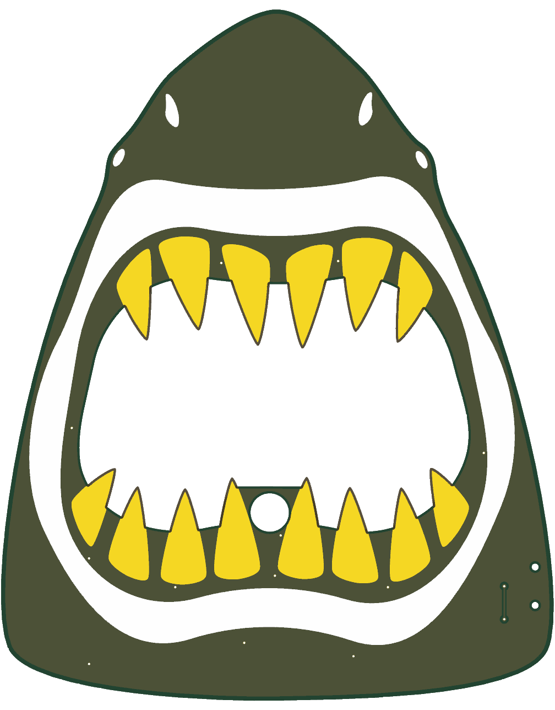
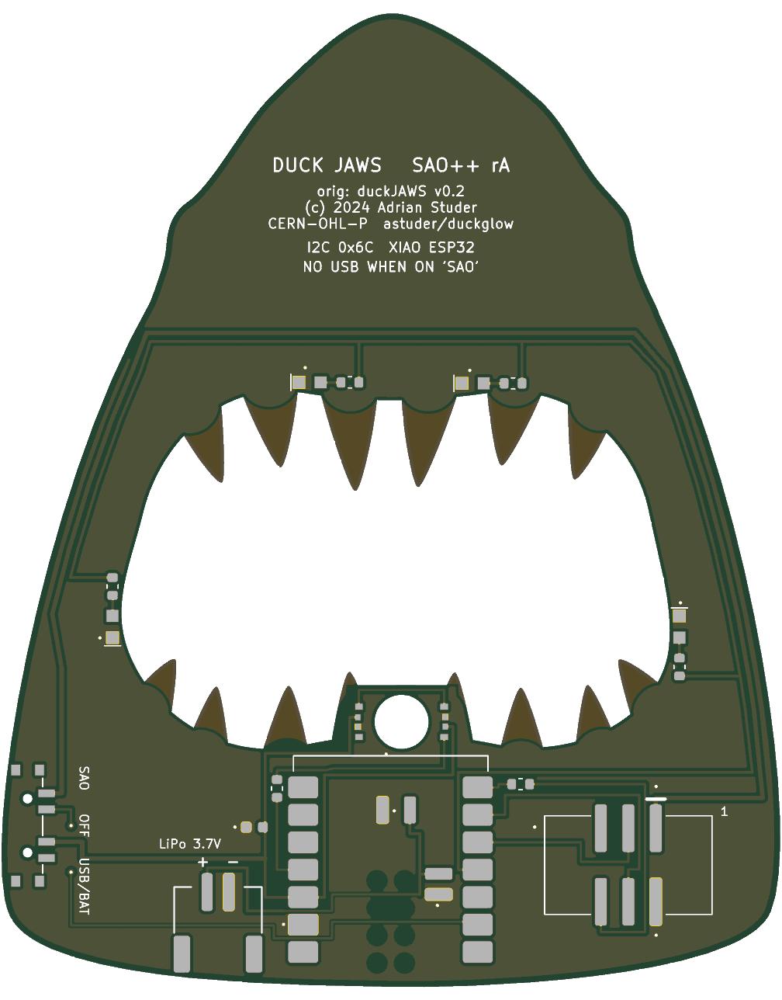

# Duck Jaws — SAO++ edition

Originally **duckJAWS**, one of the two **duckGLOW** add-ons by **Adrian Studer (astuder)**, 2024: https://github.com/astuder/duckglow (project page: https://hackaday.io/project/198918-duckglow-sao). Its sister, duckBATH, is [Duck Bath](../duck-bath/).

> **Licence: open.** The maker's repository carries the MIT licence and the CERN Open Hardware Licence v2 Permissive in one file ([original/LICENSE.md](original/LICENSE.md)), © 2024 Adrian Studer, and his schematic sheet is marked CERN-OHL-P. Both allow changing, making and selling with credit. His files, as downloaded (commit `f58ce25`), are in [original/](original/); the notice is kept there, in this README and on the back of the board.

> **Art check.** The picture is a cartoon shark's head seen from straight in front with its mouth open: the maker's own drawing. It is not the JAWS film poster and there is no lettering or logo on the art side. Only the name plays on the film's title. Details in `board.yml` (`art_note`).

 

*(The pictures use KiCad's default green. The maker's own boards are **black with white print**: see the ordering notes.)*

A shark's head with its mouth milled out and gold teeth. A real toy rubber duck sits in the mouth and glows, slowly breathing yellow, while the mouth behind it breathes red. A badge can change the colours and the breathing over I2C.

## What the original really is

- A 40 × 50 mm two-layer board. The mouth is a cut-out. The fourteen teeth are bare gold-plated copper; the lips, eyes and nostrils are white print.
- **One ordinary 5 mm RGB LED standing up on the front**, between the two middle lower teeth. A small hollow rubber duck is pushed over it.
- **Four small red LEDs on the back, at the rim of the mouth**, lying on their sides and shining into the opening: two in the upper gum, two in the lower corners. All four hang on one pin of the chip through 680 Ω each, so they dim together. The maker calls this the "background" channel. These are the "extra red lights".
- The same circuit as Duck Bath otherwise: a WCH CH32V003 chip, a small boost converter (0.9 to 5 V), a transistor against reversed power, two I2C pull-ups, two address jumpers.
- A nice trick that is **not** carried over: eight of the lower teeth were wired to the circuit (supply, the LED's three colours, two spare chip pins) so they could be used as test points.
- The same firmware as Duck Bath: I2C address 0x6C, a table of brightest / dimmest / speed / starting point for red, green, blue and background.

The survey said "check the Jaws art"; that is done above. It did not mention the cut-out mouth or the red lights.

## Why the board is bigger

**Everything is enlarged 1.8 times: 72.1 × 90.1 mm instead of 40.1 × 50.0 mm.** The outline, the mouth, the teeth and the print grow together; the parts keep their real size. (Duck Bath needed 1.6.)

The XIAO module is 21 × 17.8 mm and its USB socket has to stick out over an edge. The mouth takes up the middle of the board, the forehead narrows to a point and the side strips are a few millimetres wide, so the only place is the lower jaw, standing upright on the centre line with the socket at the bottom edge. The jaw then has to be as tall as the module is long.

- At 1.75 the module fits, but its top end comes level with the edge of the duck hole (this size was drawn and checked).
- At 1.8 there is 0.7 mm between the module and the hole, and the module's top end stays 1.1 mm below the lower gum line, so it cannot be seen between the teeth.
- Sizes between were not tried.

The duck does not grow: it is a bought toy. It will look smaller in the mouth than on the maker's board unless a bigger duck is used.

## What changed from the original

| | Original (v0.2) | SAO++ rev A |
|---|---|---|
| Size | 40.1 × 50.0 mm | 72.1 × 90.1 mm (1.8×) |
| Duck light | One 5 mm RGB LED standing on the front, inside the duck | **A 5 mm hole** where that LED stood (0.9 mm lower, to leave a wall above it), and **two small RGB LEDs on the back**, left and right of the hole, lying on their sides and shining into it. The duck sits over the hole. Both LEDs always show the same colour. Same answer as Duck Bath |
| Red mouth lights | Four red side-firing LEDs, 680 Ω each, on one chip pin | **Four red side-firing LEDs from the shared list, 1.3 kΩ each, on XIAO pin D3.** Two in the upper gum between teeth (4 mm nearer the middle than the maker's, where the gaps are); two on the side walls of the mouth shining straight across (the maker's sat in the lower corners and shone diagonally) |
| Controller | CH32V003 | **Seeed Studio XIAO ESP32** module soldered flat on the back of the lower jaw: C3, S3 or C6 all fit the same pads. USB-C at the bottom edge, in the middle |
| Power | Badge only, 0.9–5 V through a boost converter | Slide switch on the right edge of the lower jaw (left as you look at the back): **SAO** (badge power) / **OFF** / **USB-BAT** (USB-C, or a LiPo cell on the new JST-PH connector at the bottom edge, which the XIAO charges). The boost converter and the reverse-power transistor are gone: the board now needs the badge's normal 3.3 V |
| Connector | 6-pin SMD pin header, in the middle of the lower jaw | 6-pin SAO v1.69bis, surface-mount, shrouded and keyed, in the left half of the lower jaw (seen from the front), 22 mm left of the centre line. The board hangs a little lopsided on a badge |
| SAO GPIO pins | GPIO1 = programming pin of his chip, GPIO2 = "addressable LED" input | **GPIO1 not connected.** GPIO2 goes to the XIAO through 330 Ω (unused by the firmware, as on Duck Bath) |
| I2C address | 0x6C, or 0x6D–0x6F with two solder jumpers | 0x6C only; the address is one line in the firmware |
| I2C pull-ups | Two 10 kΩ on the add-on | None (the house rule: the badge provides them) |
| Teeth | Fourteen separate bare copper shapes; eight carried signals | Fourteen openings in the solder mask over **one ground plate**. A 0.3 mm rim of bare board runs round each tooth where the maker's copper went to the very edge. The backs of the tooth tips are bare board, as on his |
| Front | Art, the LED's four pads, 49 small holes (vias) | The same art. The duck hole, the switch's two 0.9 mm peg holes at the right edge, fourteen covered 0.3 mm vias, and **one 4.3 mm track under the solder mask** beside the switch |
| Back text | "duckJAWS", version, I2C address, pin notes | Board name, "orig: duckJAWS v0.2 (c) 2024 Adrian Studer, CERN-OHL-P, astuder/duckglow", switch and battery labels, the USB warning |

**No new part types on the shared list.** The red LED is `SAOPP-LED-01`, already chosen there but never used: this is the first board with it, so its footprint was drawn here and sits in this board's folder until the shared library takes it (see "Shared files").

### Why SAO GPIO1 is left off, and why one track is on the front

The tracks are all on the back, on one layer, as on the other chip boards. Three things would not go that way:

- **GPIO1** would have to cross from the XIAO's right-hand pins to the connector on its left, past the lines that feed the duck's LEDs. The maker used that pin only to program his chip, which this board does not have, and Duck Bath's firmware ignores it. It is not connected. (Duck Bath does connect it.)
- **The OFF line** reaches the switch below the 3.3 V line but has to end above it. It hops over on the front: 4.3 mm, under the mask, through two covered vias, in the plain area beside the switch.
- **The badge's 3.3 V** goes the long way round: from the connector up the left side, across the forehead and down the right side to the switch, 1.5 mm inside the outline. The red LEDs' line runs beside it.

Vias cannot go in a tooth (they would show as holes in the gold), which is what rules out shorter ways.

## The duck and the light: read this before building

As on Duck Bath, this is the part of the port with the least backing.

- On the original the LED is **inside** the duck. Here the two LEDs are **behind the board**, at the rim of a 5 mm hole, and shine across it. Only part of their light turns the corner and goes forward into the duck.
- Expect to need a **light guide in the hole**: a blob of clear hot glue filling the hole and the duck's opening, or a short piece of 5 mm clear plastic rod. Neither has been tried on either board.
- The duck is glued on the front over the hole. Nothing else holds it.
- **The hole sits 0.9 mm from the edge of the mouth**, and the line that joins the two LEDs runs through that strip, 0.35 mm from each edge. It passes the rule check; it is the most delicate spot on the board.
- The XIAO's top end, where its antenna is, is 0.7 mm below the hole and has ground copper under it, as on the other XIAO boards. Radio range is not something this board needs, and has not been looked at.
- The red LEDs get about 1.1 mA each (the maker gave his about 2 mA). They shine sideways into the opening, so what you see is their glow on whatever is behind the mouth and on the back of the duck.

If the duck is too dim, the fall-back is the maker's own way: a 5 mm through-hole RGB LED soldered on the front in place of the hole. That part is not on the shared list and breaks the "nothing on the front" rule: one decision for both duck boards.

## How the power switch works here

| Knob | Badge 3.3 V | What runs the board |
|---|---|---|
| **SAO** (highest, seen from the front) | connected to the XIAO's 3V3 pin and the LEDs | the badge |
| **OFF** (middle) | disconnected | nothing from the badge. If USB or a LiPo is attached the XIAO still has power, so the switch tells it to blank the LEDs and sleep |
| **USB-BAT** (lowest) | disconnected | the XIAO's own regulator, from USB-C or the LiPo |

- **OFF is a sleep, not a hard cut, when a LiPo is attached.** Unplug the cell for storage.
- **Do not plug in USB while the knob is on SAO and the board is on a badge.** Two 3.3 V regulators would be joined. It is printed on the back.
- **The original ran from 0.9 to 5 V; this one needs 3.3 V.**
- **No coin cell on this board.**

## Things to check on the first prototype

1. **Light in the duck** (above). The first thing to look at.
2. **Firmware.** It has **never been compiled**: see [firmware/README.md](firmware/README.md).
3. **The red LED's land pattern.** The pads are the datasheet's; where the body sits on them is an estimate, and no board has used this part yet. Check that all four lenses point into the mouth: D4 and D5 (upper gum) point down, D3 and D6 (side walls) point inward.
4. **Red brightness** at 1.1 mA. If too dim, R3–R6 can become 330 Ω (already on the board for other jobs) for about 4 mA each, 17 mA from one XIAO pin: check the pin's limit first.
5. **Badge power into the XIAO's 3V3 pin**, on each module type you plan to use, as on Hack-Man.
6. **USB plug.** The socket sticks out 1.3 mm past the bottom edge, which is bowed: the module's end is level with the edge at its two corners and 0.2 mm inside it in the middle.
7. **RGB LED land pattern** (the shared footprint's body position is an estimate) and that both lenses point into the hole. D1 is left of the hole, D2 right (seen from the front).
8. **LiPo polarity**: + is the pad nearer the switch (the one farther from the XIAO), marked on the back. Check the cell with a meter. There is no protection.
9. **Battery pads need reflow**: they are under the module, as on the other XIAO boards.
10. **Switch labels**: if SAO and USB/BAT turn out swapped the print is wrong, not the wiring. The edge bows by 0.6 mm along the switch; the switch is set against its innermost point.
11. **Pin 1 position** against a known v1.69bis badge, and how the board hangs with its connector off to one side.
12. **The front track** beside the switch: that it does not show through the mask colour you order.
13. **Size.** 72 × 90 mm is large for an add-on; check it against the badges you care about.

## Pin map

| XIAO pin | Goes to |
|---|---|
| D10 | Duck LED data, through 330 Ω. LED 1 is left of the hole, LED 2 right |
| D3 | The four red mouth LEDs, 1.3 kΩ each (high = on) |
| D4 / D5 | SAO SDA / SCL |
| D6 | SAO GPIO2, through 330 Ω (not used by the firmware) |
| D1 | High when the switch is on OFF |
| 3V3, GND | the board's 3.3 V rail and ground |
| BAT+ / BAT− (under the module) | the JST-PH LiPo connector |
| D0, D2, D7, D8, D9, 5V | not connected |

D3 is not a start-up (strapping) pin on any of the three modules.

## Decisions for the owner

1. **Size: accept 72 × 90 mm?** Recommendation: yes for a first batch; it is what the XIAO standard costs on this shape. The other way to a smaller board is a smaller controller, which is against the standard.
2. **The name.** The art is generic; the name "Duck Jaws" plays on a film title. Recommendation: keep it (it is the maker's name for his board), and think again only if boards are sold in numbers.
3. **Red lights: plain red LEDs on their own pin (as drawn), or four more of the RGB LEDs already on the board?** As drawn follows the maker and the brief, and costs one footprint the shared library does not have yet. Four more RGB LEDs would need no new footprint, no extra pin and could be any colour, at about 17 cents more per board. Recommendation: keep as drawn for rev A.
4. **SAO GPIO1 not connected:** accept? Recommendation: yes. Connecting it costs a second track on the front.
5. **Front track** (one, 4.3 mm, beside the switch): accept? Recommendation: yes; Duck Bath has two.
6. **Light: hole and two LEDs from behind, or the maker's 5 mm LED on the front?** Same question as Duck Bath; decide once for both. Recommendation: build as drawn and try hot glue in the hole first.
7. **Board colour:** black mask with white print, like the maker's? Recommendation: yes.
8. **I2C address jumpers:** none here, as on Duck Bath. Recommendation: leave.

## Files

- `hardware/duck-jaws.kicad_pro`: KiCad 10 project (schematic + board). ERC: 0. DRC: 0 errors, 0 warnings, 0 unconnected, schematic matches the board.
- `hardware/circuit.json`: the circuit as data; `tools/gen_schematic.py duck-jaws` and the build script both read it.
- `hardware/build_board.py`: builds the board from the maker's file in `original/` and `circuit.json`; every placement and track is in there with a comment. `labels.json` holds the back lettering, `severities.json` the rule settings it re-applies to the project file.
- `hardware/parts_local.py`, `hardware/duck-jaws-local.pretty/`, `hardware/duck-jaws-local.kicad_sym`: the red LED's symbol and footprint (see "Shared files").
- `hardware/duck-jaws.kicad_dru`: no extra rules.
- `original/`: the maker's board, schematic, footprints, drawings and licence, unchanged. His firmware and photos are not copied: see his repository.
- `firmware/`: new Rust firmware, built on Duck Bath's. **Never compiled.** No licence chosen for it yet, as for Hack-Man and Duck Bath.
- `production/`: files for a board house, one board (`single/`) and a 2×2 panel (`panel/`). Start with [production/README.md](production/README.md).

## Shared files (for whoever merges this)

Nothing outside this folder was changed. These would be:

- `lib/` and `tools/gen_footprints.py`, `tools/saopp_symbols.py`: a footprint and symbol for the side-firing LED family (LED-01 to LED-05). This board's local ones can be moved over as they are; then delete `parts_local.py` and the two `-local` items here.
- `docs/parts.md`: on the LED-01 row, "first used by Duck Jaws; footprint body position unproven". The family heading there says "1.6 × 1.2 mm, about 1.15 mm tall"; the datasheet drawing reads 1.65 mm long, 0.6 mm high off the board and 1.15 mm deep including the lens.
- `tools/export_fab.py`: add `"LTST-S270KRKT": "Lite-On"` to its maker table; until then the maker column for D3–D6 is empty in the PCBWay parts list.
- Root `README.md`: a row for this board.
- `boards/duck-bath/README.md` and `board.yml` say "Only duckBATH is ported here".

## Parts cost (parts only, LCSC list prices from docs/parts.md, checked 2026-11-10 unless noted)

| Part | Qty | Each @ ~100 boards |
|---|---|---|
| Connector XFCN BH254VS-6P (LCSC C492445) | 1 | $0.10 |
| Switch C&K PCM13SMTR (Digikey) | 1 | ~$0.90 |
| RGB LED OPSCO SK6805-EC3210R (LCSC C5378735) | 2 | $0.068 |
| Red LED Lite-On LTST-S270KRKT (LCSC C125114; 21,040 in stock on 2026-11-11) | 4 | $0.026 |
| LiPo connector JST S2B-PH-SM4-TB (LCSC C295747) | 1 | $0.16 |
| Capacitor 100 nF 0603 (LCSC C14663) | 1 | <$0.01 |
| Resistor 330 Ω 0603 (LCSC C23138) | 2 | <$0.01 |
| Resistor 1.3 kΩ 0603 (LCSC C22767) | 4 | <$0.01 |
| **Total without the module and the duck** | | **about $1.40** |
| Seeed Studio XIAO ESP32-C3 / S3 / C6 | 1 | not priced here |
| Toy rubber duck, hollow soft vinyl | 1 | not priced here, and not sourced |

The bare board (a large one, with a milled cut-out) and the optional LiPo cell are not included.
