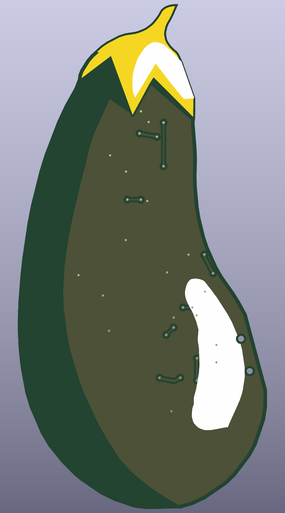
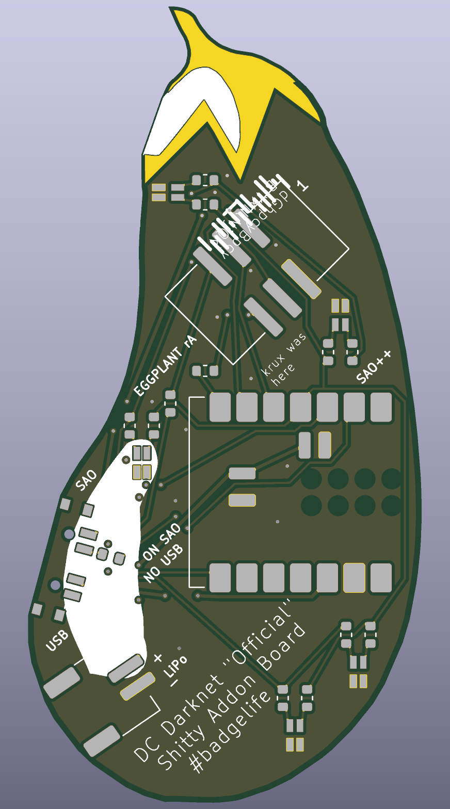

# Eggplant — SAO++ edition

Originally the **DC Darknet "Official" Eggplant Emoji Shitty Add-on** by **thedarknet (Darknet Industries)**, designed by **Krux**, for DEF CON 26 (2018): https://github.com/thedarknet/dc26-badge/tree/63ec6ed/hardware/dc26-sao/eggplant (firmware: `dc26-sao/eggplant`). An eggplant-shaped add-on with five blue/red LEDs that fade in purple patterns, an I2C "memory" with a name and serial number, and an infection game badges can play with it.

> **Open licence — credit kept.** The maker's repository is MIT-licensed: "MIT License, Copyright (c) 2017" (the notice gives no name; the sketch says "Designed by Krux - 2018"). His licence file is kept unchanged in [`original/LICENSE`](original/LICENSE), and his credit block, "krux was here" and his base64 line are all still printed on the back. No permission is needed to publish. On 2026-11-12 the board was rebuilt for SAO++ as listed below and the firmware was rewritten in Rust (also MIT, see [`firmware/README.md`](firmware/README.md)).
>
> The art is the maker's own drawing of the eggplant emoji; nothing on the board belongs to a third party.

 

## What changed from the original

| | Original (2018) | SAO++ rev A |
|---|---|---|
| Size | 27.6 × 55.9 mm | **Scaled up 1.35×** (outline and art together): **37.3 × 75.4 mm** (see "Why it is 35 % bigger") |
| Controller | ATtiny85 | **Seeed Studio XIAO ESP32** module soldered flat on the back (C3, S3 or C6 all fit), across the round bottom, USB-C out of the left-hand side |
| Connector | 2×2 SMD header (old 4-pin SAO), turned 45° | 6-pin SAO v1.69bis, shrouded and keyed, in the upper body, **turned 45° the same way**, so the eggplant still hangs leaning like the emoji |
| Power | Badge only | Slide switch, knob out of the right-hand side of the bulb: **SAO** / **OFF** / **USB-BAT** (USB-C, or a LiPo cell on the new JST-PH socket below the switch, which the XIAO charges) |
| LEDs | Five blue/red two-colour LEDs on the back, every blue on one ATtiny pin and every red on another, 22 Ω each | **Same LEDs, same land pattern**, same wiring (blue on XIAO D3, red on D2), one resistor per colour per LED: **330 Ω for blue, 1.3 k for red** (the shared values; see "LED current") |
| Front | Bare-gold stem and calyx, body copper under the mask, a copper-free light stripe down the left, leaf and highlight in silkscreen | All kept, scaled. His body copper (it was his ground pour) is now the ground plane. **33 tiny covered holes (vias)** sit in it, and 9 short covered links run under the mask (see "How it is wired"). Two 0.9 mm holes for the switch pegs. The bulb's right-hand side is **cut flat by at most 0.71 mm over 13 mm** where the switch knob comes out |
| Back | The same art again (stem, calyx, leaf, highlight), his credit, "krux was here", a base64 line with 16 short strokes | Art kept. **His credit moved 1.6 mm, "krux was here" 12.4 mm, both unchanged.** **The base64 line and its strokes stay exactly where he put them, which is now under the SAO connector's plastic shroud** (owner decision, below). Labels added: "EGGPLANT rA", "SAO++", "NO USB ON SAO", switch ends (SAO / USB), "+"/"−" and "LiPo" at the socket, "1" at the connector |
| Dropped | — | ATtiny85, its 10 k reset pull-up, his two 10 k I2C pull-ups (SAO++ boards leave the pull-ups to the badge), two 0 Ω links, the six programming pads |

**Parts shared with the rest of SAO++:** connector, switch, XIAO footprint, LiPo socket, the 330 Ω and 1.3 k resistors. **New, kept in this board's folder:** only the maker's two-colour LED, on his own land pattern. His BOM calls it "PHBM2012QBDSURKC" (a Kingbright-style blue/hyper-red 0805 part); the exact catalogue number and an LCSC source still have to be found.

## Why it is 35 % bigger (owner rule of 2026-11-12)

At the maker's size the only spot where the XIAO (21 × 18 mm, plus its pads) fits with its USB-C at an edge is the whole round bottom of the eggplant, and then the connector, switch and LiPo socket have nowhere to go. A search over every angle and position at 1.30× found room for the XIAO and the connector but never for the switch and the LiPo socket as well; **1.35× is the smallest step that fits all four**, with the XIAO's USB-C coming out of the left-hand side, where the outline is straight enough that no flattening is needed. Area is 1.8× the original. Lettering and line widths only get bigger.

What scaling did **not** fix: the bulb is still crowded, so four of the five LEDs and two of his three pieces of lettering had to move (below), and the board needs a few vias.

## The LEDs: where they are now

All five are the maker's part, on the back, facing away from the board as on his. Compared with his positions (scaled): LED2 is where he put it (in the light stripe); LED1 is 10.8 mm higher (the connector now covers his spot), LED3 8.5 mm up-left of his (the switch), LED4 6 mm lower (the XIAO), LED5 13.4 mm to the left (his credit and the LiPo socket). Each sits with its two resistors right beside it.

## LED current

His 22 Ω resistors let each colour draw tens of milliamps, limited only by the ATtiny's pins. SAO++ uses its two shared values instead: **blue through 330 Ω (about 1.5 mA per LED), red through 1.3 k (about 1.1 mA per LED)**, so one XIAO pin never feeds more than about 8 mA. All ten on: about 13 mA. That is in the range the house uses for LEDs lit from behind; it will be dimmer than his. If the first board is too dim, the resistors can be lowered (330 Ω on red gives about 4 mA each, 21 mA on one pin, still within the pin's rating).

**Which colour is which** is not certain: his schematic wires ATtiny pin PB3 to the anodes his LED footprint names "blue", but his sketch calls PB3 "red". This board follows the footprint's names (pad AB = blue gets 330 Ω on D3, pad AR = red gets 1.3 k on D2). The first board shows which is right; if the colours are swapped, swap the two resistor values and one line of firmware.

## How the power switch works

| Knob | Badge 3.3 V | What runs the board |
|---|---|---|
| **SAO** (toward the "SAO" label on the back) | connected to the XIAO's 3V3 pin | the badge |
| **OFF** (middle) | disconnected | nothing from the badge; if USB or a LiPo is attached, the switch pulls D1 high (through 330 Ω) and the firmware goes dark and sleeps |
| **USB-BAT** (toward "USB") | disconnected | the XIAO, from USB-C or the LiPo |

- **Do not plug in USB while the knob is on SAO and the board is on a badge.** Two 3.3 V regulators would be joined. It is printed on the back.
- **OFF is a sleep, not a hard cut, when a LiPo is attached.** Unplug the cell for storage.
- **Feeding the XIAO through its 3V3 pin** is how badge power reaches it, as on every SAO++ XIAO board; Seeed documents that pin as an output only. First thing to test.

## How it is wired

The back carries everything. On one copper layer the lines cross each other in nine places (the connector sits above the XIAO, the switch and battery on the right, and five LEDs all round, each needing both colour lines), so those nine crossings are made with **short links on the front, under the solder mask, each between two covered holes (vias)**: 18 vias. They sit in the dark copper body, never in the gold stem or the light stripe, and show only as faint lines under the mask (visible in the front render). The back ground copper is in 15 separate pieces; **15 more covered vias** join each piece to the front copper body, which is ground (as it was on the maker's board). In total 33 vias, all 0.3 mm holes covered by mask on both sides. The routing is done by `hardware/router.py` (a small router with hard time and rip-up limits).

## Pin map

| XIAO pin | Goes to |
|---|---|
| D2 | the five red anodes, through 1.3 k each. D2 rather than the house LED pin D10 so the two colour lines leave the module side by side; on the three modules D2 is a start-up pin only for the S3's JTAG choice, which is ignored unless a fuse is burnt |
| D3 | the five blue anodes, through 330 Ω each |
| D4 / D5 | SAO SDA / SCL (no pull-ups on the board). The XIAO is the badge's I2C **target**, address 0x28 (0x36, the maker's, as a firmware option) |
| D7 / D6 | SAO GPIO1 / GPIO2, each through 330 Ω (R2 / R3) |
| D1 | switch OFF sense, through R1 (330 Ω): high when the knob is on OFF |
| 3V3, GND | the board's 3.3 V rail (switch common) and ground |
| BAT+ / BAT− (under the module, both positions) | the JST-PH LiPo socket |
| D0, D8, D9, D10, 5V | not connected |
| BOOT button (on the module) | mode button |

## Firmware

New Rust firmware is in [`firmware/`](firmware/): his five light shows plus "off", his I2C commands and memory map, and his infection game, at address 0x28 (or his 0x36 as a build option). 31 tests pass on a PC and it builds for the C3, C6 and S3; **it has never run on a real board**, and one feature is missing: the name, mode and infections are not yet kept through a power-off. The maker's Arduino sketch, his protocol notes and his EEPROM script are in `original/dc26-sao/`.

## Decisions for the owner

1. **The base64 line and its strokes** ("dGhpcyBpcy BiYXNlNjQK", which decodes to "this is base64", with 16 short strokes over it) sit exactly where the maker put them, but the SAO connector now stands on that spot, so they are printed under its shroud and cannot be seen. No other spot on the back is big enough. Options: accept (as Do Or Donut's hidden logos), or move them to the back of the calyx, which means giving up part of the back's copy of his calyx art.
2. **His credit and "krux was here" are printed with his own thin strokes** (8 % of the letter height: 0.10 mm and 0.07 mm on this board). KiCad warns that 0.07 mm is below its 0.08 mm minimum, and many board houses print nothing under about 0.15 mm. They are kept exactly as he set them; thickening them to 0.15 mm would keep size, font and wording.
3. **The 45° tilt.** The connector is turned 45° as the maker had it, so the eggplant hangs leaning when worn. Turning it upright is one number in `hardware/build_board.py` but means re-routing and re-checking.

## Things to check on the first prototype

1. **Badge power into the XIAO's 3V3 pin** (above): boots from a badge alone, current under 50 mA with all LEDs on.
2. **LED colours and brightness** (above). The maker's LED part number is not confirmed.
3. **Connector pin 1 and the 45° hang** against a v1.69bis badge.
4. **USB-C plug** at the left-hand side: the socket sticks out 0.6 mm past the edge.
5. **Switch knob** at the 0.71 mm flat: it should stick out enough to slide. Which end is SAO is not drawn in the switch's datasheet; if SAO and USB turn out swapped, the silkscreen is wrong, not the wiring.
6. **LiPo polarity**: "+" printed beside the socket (Adafruit / SparkFun convention). Check with a meter first. The battery reaches the XIAO through pads **under** the module, which need paste and hot air, a hot plate, or the assembler.
7. **The front links and vias**: they should be hard to see under the mask.

## Files

- `hardware/eggplant.kicad_pro`: KiCad 10 project. ERC: 0. DRC: 0 errors, 0 unconnected, schematic matches the board; warnings only: 32 printed-outline overlaps (labels and the maker's art over part outlines), 22 "footprint differs from library" (parts turned to odd angles), 11 copper slivers in the ground copper, 6 places where the base64 line runs over the connector's pads (hidden there anyway), 2 thin-lettering warnings (decision 2).
- `hardware/circuit.json`: the circuit as data; `tools/gen_schematic.py eggplant` and `hardware/build_board.py` both read it.
- `hardware/extract_art.py`: pulls the outline, both sides' art, his lettering and his LED positions out of his Eagle file into `hardware/art.json`.
- `hardware/build_board.py`: rebuilds the whole board in one run (a few minutes); every placement and routing choice is commented there. `hardware/router.py`: the router it uses.
- `hardware/parts_local.py`, `hardware/make_local_footprints.py`, `hardware/eggplant-local.pretty/`: his two-colour LED.
- `hardware/eggplant.kicad_dru`: the art rule only.
- `production/`: everything a board house needs. Start with [production/README.md](production/README.md).
- `original/`: the maker's untouched Eagle files, BOM, licence and sketch.

## Parts cost (parts only, LCSC list prices from docs/parts.md, checked 2026-11-10/11)

| Part | Qty | Each @ ~100 boards |
|---|---|---|
| Connector XFCN BH254VS-6P (LCSC C492445) | 1 | $0.10 |
| Switch C&K PCM13SMTR (Digikey) | 1 | ~$0.90 |
| LiPo socket JST S2B-PH-SM4-TB (LCSC C295747) | 1 | $0.16 |
| Resistor 330 Ω 0603 (LCSC C23138) | 8 | <$0.01 |
| Resistor 1.3 k 0603 (LCSC C22767) | 5 | <$0.01 |
| Two-colour LED, maker's "PHBM2012QBDSURKC" | 5 | not priced yet (orchestrator to check) |
| **Total without the module and the LEDs** | | **about $1.20** |
| Seeed Studio XIAO ESP32-C3 / S3 / C6 | 1 | not priced here: check Seeed |
