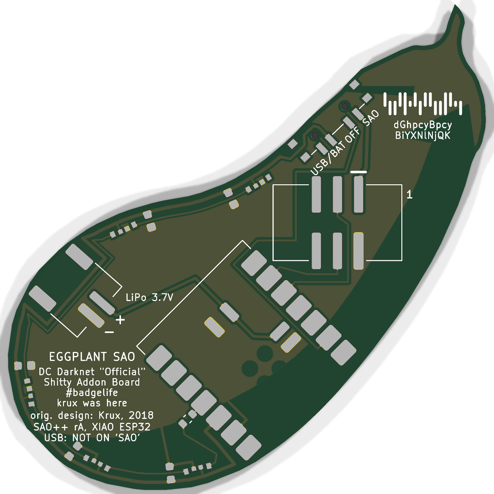

# Eggplant — SAO++ edition

Originally the **Darknet "Official" Eggplant Emoji Shitty Add-On**, designed by **Krux** for **DC Darknet**, DEF CON 26 (2018): https://github.com/thedarknet/dc26-badge/tree/63ec6ed78119f4a01306306670271d03764ec5c3/hardware/dc26-sao/eggplant

Licence of the original: **MIT** (the repository's `LICENSE`, copied to [original/LICENSE](original/LICENSE); "Copyright (c) 2017", no name given). The maker's Eagle files, parts list and Arduino sketch are kept unchanged in [original/](original/).

**Status: designed and rule-checked on a computer. No board has been built, and the firmware has never been compiled.** Everything below is unproven until a prototype exists.

 

(The renders use KiCad's default green. The maker's boards were purple; see "Ordering".)

## What the original is

A purple eggplant, 27.6 × 55.9 mm as drawn, that hangs tilted 45 degrees from a badge (44.3 × 45.0 mm as worn). The same art is on both faces: the body is copper under the solder mask, the stalk and leaves are bare metal, and a long stripe down one side has no copper at all, so the board is translucent there.

On the back:

- an **ATtiny85** chip
- **five two-colour LEDs** (red and blue in one package, Kingbright-style PHBM2012QBDSURKC), wired as two groups: all the reds on one chip pin, all the blues on another, each LED through 22 Ω
- a 4-pin add-on header (the 2018 kind), six bare pads for programming, and 10 kΩ pull-up resistors on reset and on both I2C lines

The chip fades the red and blue groups up and down at different speeds, so the eggplant glows purple, red and blue in turn (six patterns). It also **talks to the badge over I2C at address 0x36**: the Darknet 7 badge could read its type, serial number and name, rename it, change the light pattern, and play an "infection" game with it (the badge can infect or cure the eggplant, which flashes red or blue ten times). Name, pattern and infection were stored in the chip.

The import survey guessed "MCU + I2C firmware, Eagle + BOM, MIT": all correct. What it could not know: the header is the old 4-pin one and sits at 45 degrees, the LEDs are two-colour, and the art is on both faces.

## Why this version has a controller

The chip is what makes this add-on more than an eggplant-shaped light: it is the part the badge talks to, and the purple comes from mixing red and blue with moving brightness. A plain coin-cell version could only show a steady red (blue LEDs barely light on a coin cell), with no fading and nothing for a badge to talk to. So this board follows the SAO++ controller standard instead: a XIAO ESP32 module, RGB LEDs, a LiPo connector, and the SAO / OFF / USB-BAT switch.

That choice has a price: **the board is 1.3 times the maker's size**, the smallest at which the standard parts fit (see below).

## What changed from the original

| | Original | SAO++ edition |
|---|---|---|
| Size as worn | 44.3 × 45.0 mm | **57.5 × 58.5 mm** (everything enlarged 1.3 times; nothing reshaped) |
| Controller | ATtiny85 | **Seeed Studio XIAO ESP32** module (C3, S3 or C6 fit the same pads), soldered flat on the back, USB-C at the lower-left edge |
| Lights | 5 two-colour red + blue LEDs on the back, facing the badge | **5 SK6805 side-firing RGB LEDs** on the back, 1.7 mm inside the edge, firing outward along the board. Two are where the maker's were (to within 3 mm); one moved 5 mm, one 7 mm, and one 42 mm (see "Compromises") |
| Connector | 4-pin SMD header, 45 degrees to the eggplant | 6-pin v1.69bis shrouded SMD header, key slot up when worn, so the board still hangs tilted the same way. GPIO1 / GPIO2 are not connected (the original had no such pins) |
| Power | badge only | switch: **SAO** (badge power) / **OFF** / **USB-BAT** (the module's USB-C, or a LiPo on the new JST-PH connector, charged by the module). No coin cell |
| I2C pull-ups | 10 kΩ on SDA and SCL, on the add-on | none: the SAO standard leaves them to the badge |
| Front art | body copper under mask, bare-metal stalk, two white marks, copper-free stripe | the same, 1.3 times bigger. Two 0.9 mm holes (the switch's pegs) in the neck |
| Back art | a second copy of the front art | parts, ground copper and lettering. The copper-free stripe is kept copper-free on the back too, so it still lets light through |
| Back lettering | 'DC Darknet "Official" / Shitty Addon Board / #badgelife', 'krux was here', a two-line base64 joke, a block of tally marks | all kept word for word, moved to where there is room, plus the SAO++ labels |
| Firmware | Arduino sketch | new Rust program that gives the same I2C answers; see [firmware/README.md](firmware/README.md) |
| Memory | name, light pattern and infection survive power-off | **forgotten at power-off** in this first version |

## Compromises (each one is a choice the owner can reverse)

1. **Bigger board.** At the maker's size the XIAO (21 × 18 mm), the connector (which must sit square to the badge, so diagonally on the eggplant, and 3 mm from every edge) and the switch do not fit. 1.3 times is the smallest size that works: the connector's corners are only just 3 mm from the edge on both sides of the neck, and its shroud ends 0.7 mm from the module.
2. **Three lights moved.** The module and the connector now sit where three of the maker's five LEDs were. The upper-left of the body (near the stalk) has no light of its own any more; the lights are spread along the lower and right-hand edges. The light the maker had at the upper-left of the stripe is now at the far (lower) end of the stripe, 42 mm away.
3. **The module hides part of the stripe.** Behind the translucent stripe, 19 mm of its length is covered by the XIAO, and two LEDs with their tracks sit on it lower down. From the front, with the lights on, those will show as shadows in the stripe.
4. **Tight spots.** The connector's plastic shroud ends 0.7 mm from two of the XIAO's solder pads (D5 and D6), and one LED (D5) is 0.9 mm from the shroud's corner. A machine places this without trouble; by hand, solder the XIAO and D5 **before** the connector.
5. **Nothing is remembered.** A renamed or "infected" eggplant is back to "NonameEggie" and healthy after the power is removed.
6. **No GPIO.** The two extra v1.69bis pins are left unconnected, as the maker's 4-pin header had none. (Hack-Man wires them to the module through 330 Ω; here there was no room for the two tracks on one layer.)

## How the power switch works here

Standard SAO++ controller wiring ([docs/standard.md](../../docs/standard.md) section 3a):

- **SAO**: the badge's 3.3 V feeds the module and the lights.
- **OFF**: the badge is disconnected; the switch tells the module (pin D1) to blank the lights and sleep. With a LiPo attached this is a sleep, not a hard cut.
- **USB-BAT**: the badge is disconnected; the module runs from USB-C or its LiPo.
- **Never plug in USB with the switch on SAO while on a badge** (two regulators would share one rail). It is printed on the back.

The badge's I2C wires stay connected in every position. The firmware switches the module's own pull-ups off so a self-powered eggplant cannot push current into an unpowered badge.

## Things to check on the first prototype

1. **Does the firmware build at all** (`cargo test` in `firmware/eggplant-core`, then `cargo c3` in `firmware/eggplant-fw`). It was written without a compiler.
2. Connector pin 1 against a known-good v1.69bis badge (the open item in docs/standard.md).
3. Which way the switch knob sits for SAO and for USB-BAT (the labels follow the footprint; parts.md lists this as unverified).
4. The LEDs: the SK6805's side-mount footprint and its running at 3.3 V are both still "verify" in docs/parts.md.
5. **How the light looks.** The LEDs fire along the back of the board toward the edge, to make a glow on the badge behind and light the stripe. Whether that reads as a purple glow, and how bright it needs to be, is a guess.
6. Feeding the XIAO through its 3V3 pin from the badge (Seeed documents that pin as an output).
7. The LiPo connector's polarity (+ is marked on the back; many cells are wired the other way round).
8. I2C at 0x36 from a real badge, including the long reads the Darknet 7 badge does (33 bytes).
9. The clearance between the connector shroud and the XIAO (0.7 mm on paper).

## Pin map

| Job | XIAO pin |
|---|---|
| LED data (through R1, 330 Ω) | D10 |
| I2C SDA / SCL | D4 / D5 |
| Power switch "OFF" sense | D1 |
| Mode button | the module's own BOOT button |
| Not connected | D0, D2, D3, D6, D7, D8, D9, 5V |

LED order on the data line, seen from the front with the eggplant as worn (stalk upper left): D1 and D2 along the bottom edge, D3 at the right-hand end, D4 and D5 along the upper edge.

## Files

- `original/` — the maker's Eagle board and schematic, parts list, Arduino sketch and I2C notes, and the MIT licence text. Unchanged, except that one helper file by another author (`EEPROMAnything.h`) was left out.
- `art/art.json` — outline and art read from the Eagle board by `hardware/extract_art.py`, turned to the worn position.
- `hardware/build_board.py` — draws the whole board (art, parts, routing) from `art.json` and `circuit.json`. `hardware/eggplant.kicad_pro` is the KiCad 10 project.
- Rule checks (KiCad 10.0.8): schematic check (ERC) 0 issues. Board check (DRC) **0 errors, 0 unconnected, schematic matches board, 5 warnings**. The five warnings are all the same: "footprint does not match the library copy", once per LED. The build script moves each LED's lens mark off the silkscreen (it would be cut by the board edge) and KiCad notices the difference. Harmless.
- `hardware/eggplant.kicad_dru` — three allowed courtyard overlaps, each explained in the file: the data resistor against the module's D10 pad, and the connector's drawn margin against the module and against LED D5 (compromise 4).
- `docs/schematic.svg`, `docs/render-front.png`, `docs/render-back.png`.
- `firmware/` — Rust firmware. **Never compiled.**
- `production/` — fab files for one board and a 2 × 2 panel. Start with [production/README.md](production/README.md).

## Art and names

The eggplant is the maker's own drawing of the generic emoji shape; there is no logo or character on the board. "DC Darknet" is the makers' group and DEF CON the event; both appear only as words, in the maker's own lettering and in the credit. The maker's lettering calls the board "Official": that was his joke about his own group's add-on, and it could be misread on a board he did not make, so the line "SAO++ rA" sits in the same block. The "infection" game in the firmware names two sexually transmitted diseases (in the code and its README, not on the board).

## Parts cost

Parts only, prices as listed in [docs/parts.md](../../docs/parts.md) (LCSC, checked 2026-11-10; not re-checked for this board):

| Part | Qty | Each | Total |
|---|---|---|---|
| SAO connector (CONN-01) | 1 | $0.100 | $0.10 |
| Power switch (SW-01) | 1 | about £0.70 (Digikey) | about $0.90 |
| LiPo connector (CONN-10) | 1 | $0.18 | $0.18 |
| RGB LED (LED-20) | 5 | $0.056 | $0.28 |
| 100 nF (C-01) | 5 | $0.005 | $0.03 |
| 330 Ω (R-02) | 1 | $0.002 | $0.00 |
| XIAO ESP32 module (MCU-01) | 1 | supplied by the owner; not priced in parts.md | — |

About **$1.50 plus the XIAO module**. No part is new to the project.
