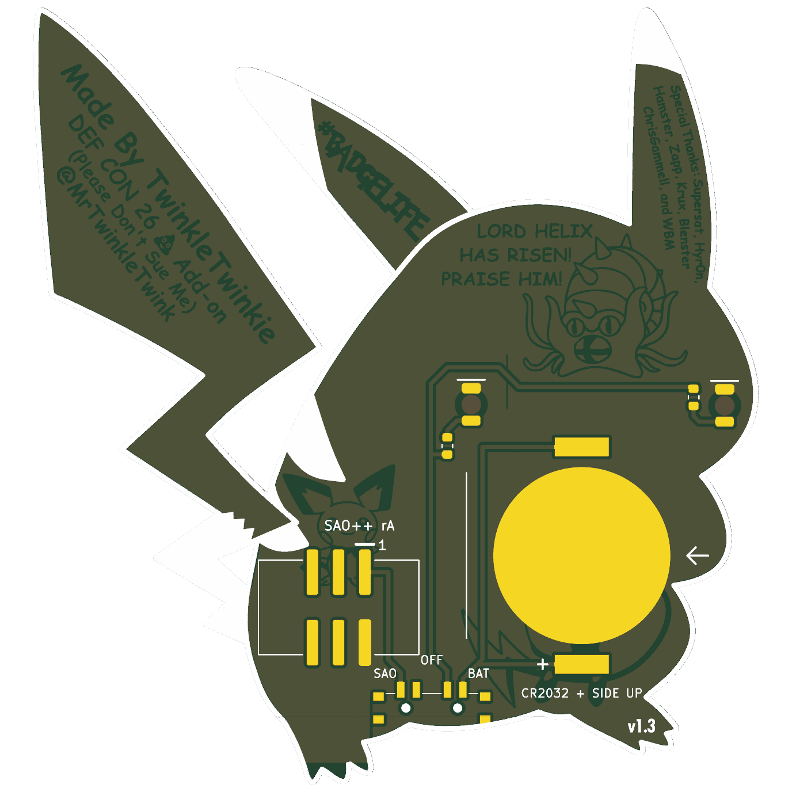

# Fat Pika — SAO++ edition

Originally **Fat Pika** by **TwinkleTwinkie**, made for DEF CON 26 (2018): https://hackaday.io/project/158665-fat-pika

> **Not cleared for publishing yet.** The original page states no license, so this port stays on a local branch until TwinkleTwinkie gives written permission (draft request: [docs/permission-request.md](docs/permission-request.md)). The art shows Pokémon characters, which is a separate question from the maker's permission; the owner's decision so far is to keep the art and decide before selling any.

 

## What changed from the 2018 board

| | 2018 original | SAO++ rev A |
|---|---|---|
| Connector | 4-pin through-hole at the foot (pins visible on the art side) | 6-pin SAO v1.69bis, surface-mount shrouded and keyed, on the lower belly. Nothing shows on the front |
| Power | Badge only | Slide switch on the bottom edge: **SAO / OFF / BAT**. Runs from the badge or from its own CR2032 |
| Cheek LEDs | 2 × OSRAM TOPLED (obsolete), one shared resistor | 2 × reverse-mount red 1206 in the same spots, one 1.3 kΩ resistor each (~1 mA per cheek) |
| Art | — | Front unchanged apart from two 0.9 mm holes near the bottom edge (the switch's locating pegs). Back: see below |

**Back art that was lost:** the coin cell sits over Raichu, the bare cell contact replaces the belly "DEF CON 26" lettering (the tail still says DEF CON 26), and the connector covers Pichu's feet. Lord Helix, the credits, and #BADGELIFE are untouched.

**Battery life (calculated, not measured):** two LEDs at ~1 mA on a CR2032 is roughly 70–100 hours.

## Things to check on the first prototype

1. **Pin 1 position.** The new connector keeps VCC/GND/SDA/SCL in the same positions as the 2018 board (which worked on DC26 badges) and adds GPIO1/GPIO2 beside them. Confirm against a v1.69bis badge before a production run.
2. **Switch labels.** The datasheet says position 1 joins pins 1–3 but does not draw which way the knob sits for position 1. The silkscreen assumes "knob toward the connector = SAO". If it is the other way round, swap the SAO and BAT labels (nothing electrical changes; OFF is the middle either way).
3. **Battery clip direction.** The clip fits its pads both ways round. The open side must face the board's left edge as seen from the front (the arrow on the back silkscreen), where the cell slides in. Tell the assembler.
4. **Battery clip body.** Its outline in the footprint is estimated from the drawing's overall size. Check it clears the cheek LED above it (D1) before ordering more than a few.
5. **Cheek brightness** at 1 mA through the board, on badge power and on a part-used cell. If dim, drop R1/R2 to 680 Ω (about 2 mA).
6. **Knob reach.** The knob tip ends about 0.5 mm past the board edge. Confirm it is comfortable to slide.

## Files

- `hardware/fat-pika.kicad_pro` — KiCad 10 project (schematic + board). ERC: 0 issues. DRC: 0 errors, 0 unconnected, schematic matches board. 17 warnings remain, all from the 2018 art (silkscreen over mask openings, art libraries not installed, copper slivers in line art).
- `hardware/circuit.json` — the circuit as data; `tools/gen_schematic.py fat-pika` and `hardware/build_board.py` both read it.
- `hardware/build_board.py` — rebuilds the board from `original/` plus the SAO++ changes; every placement and routing decision is in there with a comment.
- `hardware/fat-pika.kicad_dru` — one extra rule so DRC does not flag the fine gaps inside the artwork.
- `production/` — everything a board house needs, for one board (`single/`) and a 2×2 panel (`panel/`): Gerber zips, drill files, and JLCPCB and PCBWay assembly files. Start with [production/README.md](production/README.md).
- `original/` — the untouched 2018 KiCad 4 project and zip from hackaday.io.

## Parts cost (parts only, list prices checked 2026-11-10)

| Part | Qty | Each @ ~100 boards |
|---|---|---|
| Connector XFCN BH254VS-6P (LCSC C492445) | 1 | $0.12 |
| Switch C&K PCM13SMTR (Digikey) | 1 | ~$0.90 |
| CR2032 clip TE BAT-HLD-001 (LCSC C7501066) | 1 | $0.61 |
| LED Lite-On LTST-C230KRKT (LCSC C125107) | 2 | $0.04 |
| Resistor 0603 1.3 kΩ (LCSC C22767) | 2 | <$0.01 |
| **Total** | | **about $1.75** (about $1.30 at 1000) |

The switch is half the cost. A cheaper pin-compatible clone is an open item in [docs/parts.md](../../docs/parts.md). The CR2032 cell and the bare board (70 × 75 mm) are not included.
