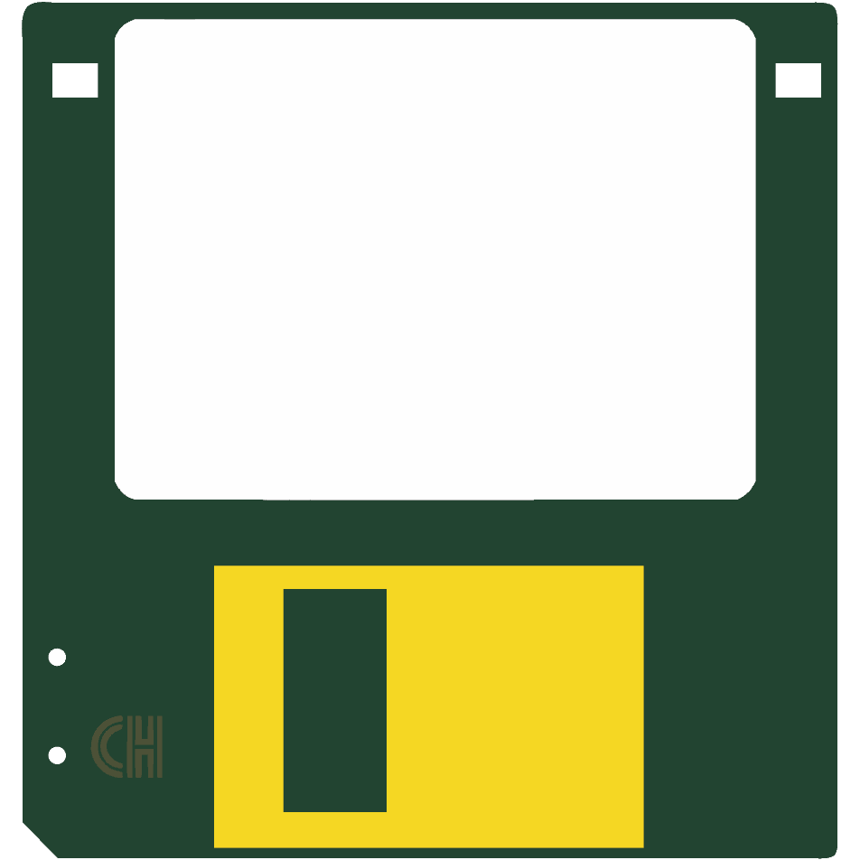
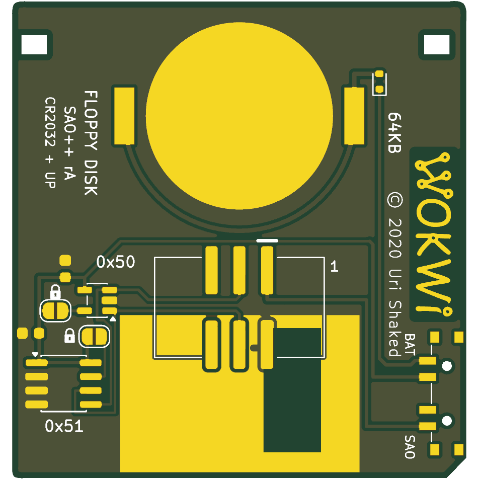

# Floppy Disk — SAO++ edition

Originally **The Floppy** (Floppy Disk SAO, SMD flavor) by **Uri Shaked**, 2020: https://github.com/urish/floppy-disk-sao

**Licence of the original: MIT.** The maker's README says, in full: *"Copyright (C) 2020, Uri Shaked. Released under the MIT License."* (There is no separate LICENSE file; the sentence and the commit it was read from are recorded in [original/PROVENANCE.md](original/PROVENANCE.md) and `board.yml`.) The maker's copyright line stays on the back of the board.

 

A 41.5 × 43.6 mm circuit board shaped like a 3.5 inch floppy disk: white label, gold shutter, the two little corner holes. It is not a blinking board. It is **storage**: a badge that speaks I2C can save and load files on it, like a real floppy. There are two memory chips on the back:

| Chip | Size | I2C address | What it is for |
|---|---|---|---|
| U1 | 256 bytes | 0x50 | a small "label" that tells the badge what is plugged in (the maker suggests his [Badge Add-on ID](https://github.com/urish/badge-addon-id) format) |
| U2 | 64 KB | 0x51 | the disk itself (about 47 KB of files when formatted as FAT, by the maker's figures) |

Each chip has a **write-protect solder bridge** next to a small padlock: put a blob of solder across the bridge and that chip can no longer be written, like the sliding tab on a real disk.

**There are no lights on this version.** The maker's through-hole flavor has an activity LED; the SMD flavor, which this port is built from, has none.

## What changed from the maker's board

| | Maker's SMD flavor | SAO++ rev A |
|---|---|---|
| Size and outline | 41.5 × 43.6 mm | **the same**: nothing had to be enlarged |
| Connector | 2×3 surface-mount header in the middle of the back | the shared 6-pin SAO v1.69bis connector, shrouded and keyed, key up, 5 mm lower so the cell fits above it |
| Coin cell | none | the shared CR2032 clip at the top of the back; the cell slides in from the top edge |
| Power switch | none (always on badge power) | **SAO / OFF / BAT** on the side edge, below the maker's logo |
| Cell safety | — | a series diode (D1) right beside the clip, as `docs/standard.md` section 3 requires for anything wired to SDA / SCL |
| I2C pull-ups | two 10 kΩ on the board | **removed**: the SAO standard has the badge provide them. On a badge with no pull-ups of its own this version will not answer |
| ID chip U1 (0x50) | M24C02 in the 8-pin SOIC package | a 24C02 in the smaller SOT-23-5 package (the project's shared ID-chip slot `SAOPP-EE-01`; candidate part AD24C02, see "Decisions") |
| Storage chip U2 (0x51) | M24512 in SOIC-8 | the same part, same footprint |
| Capacitors | two 100 nF, size 1206 | two of the shared 100 nF, size 0603 |
| Write-protect bridges | two, with padlock icons | both kept, same footprint, same icons |
| Front art | — | unchanged, apart from: the gold shutter now stops 0.55 mm short of the bottom edge (it ran right to the edge; the panel's break-off holes need the room), and **two 0.9 mm holes** at the lower left, beside the small two-letter mark (the switch's locating pegs) |
| Back art | — | "64KB", "© 2020 Uri Shaked" and the Wokwi logo are untouched and in place. The gold shutter is the same rectangle, but the connector's three lower pads now sit in its top edge, with a ring of solder mask round each. The chips, bridges, padlocks and the "0x50" / "0x51" labels moved from above the connector to the free column beside it. The rest of the back is now ground copper under the mask (the original had bare board with tracks). Labels added: SAO, BAT, pin 1, "CR2032 + UP", "FLOPPY DISK", "SAO++ rA" |
| Copper | back only, no vias | back only, no vias |

**Parts shared with the rest of SAO++:** connector, switch, cell clip, 100 nF capacitor, the cell diode (same as Knight Rider and Han SAOlo). **New to the project:** the two memory chips (see "Decisions for the owner"). The bridges are bare copper: nothing to buy.

### What the maker's files really say (the survey guessed)

- **Two** EEPROMs, not one. The survey's "EEPROM plus an LED" describes the through-hole flavor; the SMD flavor has no LED.
- The maker's README and schematic picture name the storage chip **M24512** (64 KB) and the back says "64KB"; the board file itself still labels that footprint "AT24C256C" (a 32 KB chip, apparently left over). This port follows the README.
- The repository has three boards: SMD (used here), through-hole, and a full-size 3.5 inch one. All three are kept in `original/` for reference.

## The coin cell on this board: safe, but it has no job

**Plain statement:** with no light and no processor, nothing on this board does anything by itself. On BAT, away from a badge, the cell powers two memory chips that sit idle (about 2 millionths of an amp: the cell would last for years). The switch and cell are here because every SAO++ board has them; the owner may prefer to drop them or to add a light (see "Decisions").

**Why nothing can push current into the coin cell** (`docs/standard.md` section 3):

1. The badge's 3.3 V and the cell sit on two **different contacts of the switch**. The knob connects the board to one or the other, never both, and the OFF position between them connects to nothing.
2. The memory chips are also wired to the badge's two data lines (SDA and SCL), and the badge pulls those lines up to 3.3 V through resistors. A chip's inputs have small protection diodes to its own supply pin (the AD24C02 datasheet limits its inputs to 0.3 V above the supply, which is how such diodes show). So a trickle from the badge's data lines can reach the board's supply rail **even when the switch is on BAT or OFF**. With the switch on BAT that rail is joined to the cell.
3. That is what **D1** is for: a one-way valve between the cell and the switch. Current can flow out of the cell, not into it. Whatever trickle arrives from the data lines stops at D1. (Its leakage the wrong way round is a fraction of a millionth of an amp by the catalogue; `docs/parts.md` still lists the exact figure at low voltage as "to verify".)
4. No pull-up resistors on this board, so there is no second path from the 3.3 V rail to the data lines here.

**What the board does to the badge's data lines** when it is plugged in and the switch is *not* on SAO:

- **OFF:** the chips have no supply, so the trickle through their protection diodes charges the two small capacitors (a thousandth of a second), and the rail settles about half a volt below the badge's 3.3 V. After that the lines sit at their normal level and the rest of the badge's I2C bus works as usual: **the floppy does not jam the bus.** But the chips are now half-powered *through the data lines*, and will probably still answer at 0x50 and 0x51 even though the switch says OFF. Reading may work; **writing in this state is unreliable** (a write needs a few milliamps, more than the pull-ups can give) and could store garbage. Calculated from the datasheets, not measured.
- **BAT:** the chips run from the cell (about 2.7–2.9 V after D1) while the badge talks to them at 3.3 V. That works, and the cell is protected by D1, but the data lines sit about half a volt above the chips' supply, right at the edge of what the 24C02's datasheet allows (supply + 0.5 V for a "high" input, supply + 0.3 V absolute limit). The current involved is millionths of an amp, limited by the badge's pull-up resistors, so no harm is expected; it is simply not the intended way to use it.
- **So: on a badge, set the switch to SAO.** That is the only position in which the chips are properly powered while being used.

## Decisions for the owner

1. **The 64 KB chip (U2) is a part the project does not have yet.** It is the maker's own choice, ST M24512-RMN6TP (LCSC C79991: 147,342 in stock, $0.39 at 10, $0.26 at 500, reel of 2,500, read from LCSC's search listing on 2026-11-11). Without it the board is a floppy that holds 256 bytes. It is drawn in and listed in the BOM; say no and it becomes an empty footprint.
2. **The ID chip (U1) uses the orchestrator's candidate for the open slot `SAOPP-EE-01`:** IDCHIP AD24C02, SOT-23-5 (LCSC C5125083: 30,090 in stock, $0.039 at 100, $0.024 at a full reel of 3,000, read from the LCSC product page on 2026-11-11). Its datasheet is thin (see "Things to check", items 1 and 2). A better-documented 24C02 in the same package and pinout would drop in without changing the board.
3. **What should the coin cell do?** As ported, nothing visible (see below). Options: keep it for uniformity; drop cell, switch and diode from this one board (saves about $1.50 in parts at list prices); or add one always-on red through-board light and its resistor (both already on the parts list) so the BAT position shows something. The last is a change to the maker's design and was not made.
4. **Changing U1 from SOIC-8 to SOT-23-5 costs:** the address can no longer be re-strapped (it is fixed at 0x50, which is what the maker used anyway), and the page size drops from 16 to 8 bytes with this candidate. The write-protect pin is still there, so the bridge still works.

## Layout notes (trade-offs)

1. **Order from the top:** cell clip, connector, shutter. The clip's closed end and the connector's top pads are 0.85 mm apart (their keep-out boxes overlap by 0.15 mm; allowed by a rule in `hardware/floppy-disk.kicad_dru`). The connector is therefore 6 mm below the middle of the board, and its three lower pads land in the top of the back shutter. Its plastic body hides most of that; a 1 mm strip of pad ends with a thin green ring shows below the body.
2. **The switch is on the side below the maker's logo** (the right-hand side seen from the back). On the other side the three power wires would have had to cross each other on one copper layer. Cost: the knob sticks out 1 mm beside the lower part of the disk, and two 0.9 mm peg holes go through the front at the lower left.
3. **Three power wires run between the maker's lettering and the cell clip / shutter** (0.3 mm wide, 0.3 mm apart). None touches the lettering or the logo (the build script checks).
4. **Under the connector**, between its two rows of pads, run 3.3 V (leftwards) and SDA, GND, SCL (rightwards), 0.25 mm wide and 0.25 mm apart. The supply to the chips runs through the 0.85 mm gap between the clip and the connector's top pads.
5. **Beside the 64 KB chip** three wires share 1.2 mm: SCL, SDA and write-protect at **0.2 mm wide, 0.2 mm apart** (the rest of the project uses 0.3). SDA passes under the small chip U1, and SCL under the big chip U2, to get to their pins without crossing.
6. **Capacitors:** C1 sits right at U1. C2 sits on the supply wire under 3 mm before it reaches U2's pin, with its ground end in the strip of ground copper along the board edge (the only ground within reach there).
7. Ground reaches everything through the back copper; the two halves of it join down the edge beside the chips (plus a drawn 0.25 mm ground wire there, so it does not depend on a thin strip). Six patches of copper that tracks wall in (about 140 mm² in all, mostly round the connector) are left as plain, unconnected copper under the mask for stiffness.

## Things to check on the first prototype

1. **U1's part is a candidate, not a proven choice.** Its datasheet (IDCHIP AD24C02 Ver 1.1, May 2022, read from the LCSC page) gives the SOT-23-5 pinout used here (1 SCL, 2 GND, 3 SDA, 4 VCC, 5 WP: the same as the common AT24C02C). It does **not** say (a) what address the SOT-23-5 version answers at (expected 0x50: that package has no address pins), or (b) what the WP pin does when left unconnected, which is the state with the bridge open, as on the maker's board. Check both: scan the bus, and write a byte with JP1 open.
2. **Page size.** The AD24C02 writes 8 bytes at a time; the maker's M24C02 wrote 16. Software that writes U1 in 16-byte blocks will scramble it. (U2 is the maker's own part: unchanged.)
3. **Write protect.** With JP1 / JP2 bridged, writes must fail; with them open, writes must work.
4. **OFF and BAT while plugged into a badge:** confirm the bus stays healthy and note whether the chips answer (see above).
5. **Reverse current into the cell:** switch on BAT, cell fitted, badge plugged in and talking. Measure the current in the cell lead: it must be out of the cell or zero.
6. **Cell fit:** the 20 mm cell stops 0.4 mm inside the top edge; check it slides in past the edge and that the diode D1 beside the clip is not in the way.
7. **Switch direction.** The labels assume "knob toward BAT = cell, toward SAO = badge"; the datasheet does not draw it (`docs/parts.md`). OFF is the middle either way.
8. **Pin 1 position** on a real v1.69bis badge (`docs/standard.md` section 1).
9. **Fine tracks:** the 0.2 mm wires beside U2 are within every board house's ordinary limits, but they are the finest in the project.

## Build notes

- `hardware/floppy-disk.kicad_pro` — KiCad 10 project. **ERC: 0 issues. DRC: 0 errors, 0 unconnected, schematic matches board; 1 warning**: the cell-clip footprint differs from the library copy because its printed arrow and "+" were moved to the fab layer (the arrow points off the top edge), as on other boards. Panel DRC: 0 errors, 0 unconnected; 40 warnings, all of them "library not configured" (the panel folder has no library table).
- Rebuild everything from the repo root:
  ```
  python3 boards/floppy-disk/hardware/make_local_footprints.py     # only if KiCad's stock footprints change
  flatpak run --filesystem=$PWD --command=python3 org.kicad.KiCad boards/floppy-disk/hardware/build_board.py
  python3 tools/gen_schematic.py floppy-disk && python3 boards/floppy-disk/hardware/fix_schematic.py
  flatpak run --filesystem=$PWD --command=python3 org.kicad.KiCad tools/panelize.py floppy-disk
  python3 tools/export_fab.py floppy-disk
  ```
- `hardware/build_board.py` reads the maker's board, takes his art out as shapes, cuts every old part out, and places and routes the SAO++ version; `hardware/circuit.json` is the circuit (the schematic is generated from it); `hardware/outline.json` is the maker's outline as one outer path and two holes.
- `hardware/parts_local.py` + `hardware/floppy-disk-local.pretty/` hold the four parts the shared library does not have yet (the two EEPROMs, the cell diode, the solder bridge), all on KiCad's stock footprints. `fix_schematic.py` marks the two bridges "not a part to buy".
- `hardware/project_rules.json` holds the project's rule settings; the build script writes them back into the `.kicad_pro` each time, because KiCad's command-line tool can drop them.
- `original/` — the maker's files as fetched (see `original/PROVENANCE.md` for what was left out and why).
- `production/` — Gerbers, BOM and placement files for one board and for a 2 × 2 panel. See [production/README.md](production/README.md).

## Credits and licence

Original design © 2020 Uri Shaked, MIT License. SAO++ changes: CERN-OHL-S (hardware) and CC-BY-SA (documentation), as the rest of this repository. The "Wokwi" name and logo on the back are the maker's own mark and are kept as his credit.
