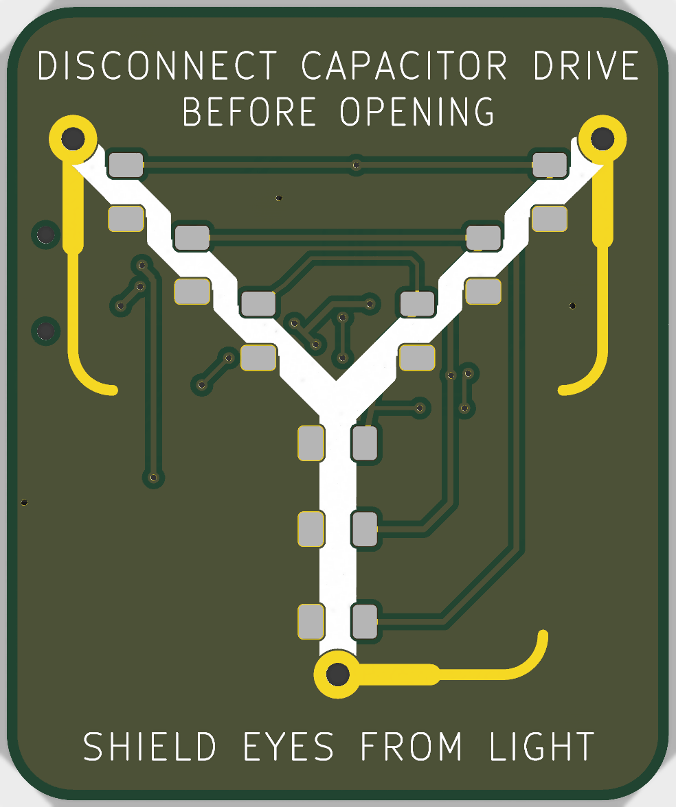
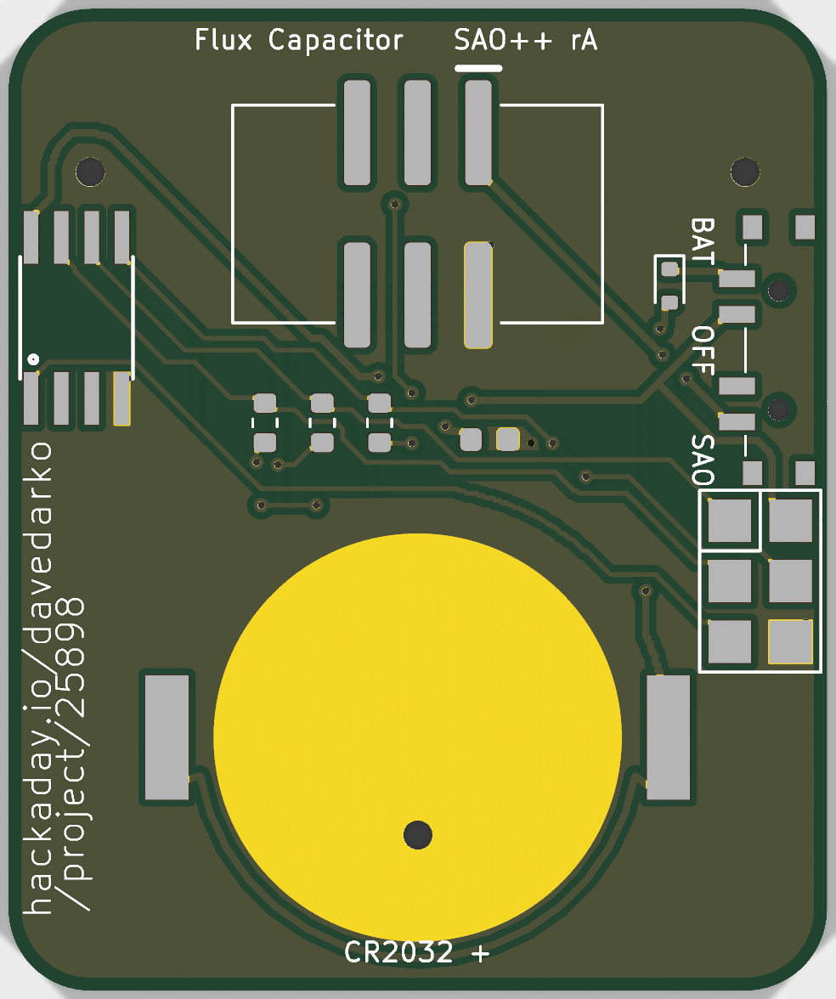

# Flux Capacitor — SAO++ edition

Originally the **Flux Capacitor trinket** by **davedarko (Dave Darko)**: https://hackaday.io/project/25898-flux-capacitor-trinket, files at https://github.com/davedarko/Simple-Add-ons-SAO/tree/main/FluxCapacitor

> **Permission pending — this board is not open-licensed.** The maker's repository states no license, and davedarko has not yet been asked or answered (draft request: [../han-saolo/docs/permission-request.md](../han-saolo/docs/permission-request.md)). Whether to publish this port before he answers has not been decided yet. Until the maker says otherwise:
> - the original design in `original/`, the outline and all artwork remain **© davedarko, all rights reserved**; the repo's licenses cover only the SAO++ additions (parts placement, routing, scripts, documentation), not the original work
> - do not treat these files as cleared for manufacture or sale
>
> **The flux capacitor belongs to someone else too.** The drawing is the flux capacitor from the film *Back to the Future* (Universal), with its warning lines. It is a third-party reference: not ours, and not davedarko's to license. That needs its own clearance before anything is sold, separately from davedarko's permission.
>
> **davedarko, or anyone with rights in this design:** open an issue and it will be changed or removed.

 

A small board with the flux capacitor's Y on the front: nine lights along the three arms, a tiny chip that runs them in three rings of three (outer, middle, inner), so the light can chase in toward the centre like the film prop. Three bare-gold "cables" run out from the three electrodes at the ends of the Y.

## Which of the maker's files this is built from

The maker's folder has one design: `attiny45.brd` / `attiny45.sch` (Eagle, 2017). Its readme is empty. It was a **pin** (brooch): no badge connector, a small CR1220 coin cell, an on/off switch, and two bare pads on the back for a brooch pin.

## The board is 35 % bigger than the maker's

**Scaled up 1.35 times: 25.4 × 30.5 mm became 34.3 × 41.1 mm.** Everything of the maker's grew together, in the same proportions: the outline, the Y, the warning lettering, the bare cables, the three electrode holes, where each light sits, and his credit on the back. The parts themselves (lights, chip, connector) keep their real sizes.

Why: the badge connector is 15 mm wide and 11 mm tall with its pads, and the CR2032 clip with its 20 mm cell needs about 24 × 22 mm. On the maker's board those two alone need about 34 mm of height, and the board is 30.5 mm tall; there would still be no room for the switch, the chip or the programming pads. The owner's rule (12 November 2026) is to scale the board up rather than let the cell hang over the edge. Factors were tried in small steps (1.20, 1.25, 1.28, 1.30, 1.32, 1.33, 1.35): up to 1.33 the switch, chip or programming pads still sit in the cell clip's keep-clear area; **1.35 is the smallest tried that fits cleanly** (1.34 was not tried). Line widths and lettering only got thicker, so nothing became harder to make.

## What changed from the maker's board

| | Maker's board | SAO++ rev A |
|---|---|---|
| Size | 25.4 × 30.5 mm | 34.3 × 41.1 mm (×1.35, see above) |
| Front | the Y in white, warning text, three bare cables, three electrode holes, nine lights | **The same**, scaled |
| Lights | nine 1206 lights facing forward, on the front, wired in three rings | **The same nine, in the same places, facing forward** (see "The lights") |
| Badge connector | none: it was a pin | The shared shrouded, keyed SAO connector, on the back, top centre, key slot up |
| Brooch pin | two bare pads on the back | dropped (it is an SAO now) |
| Power | CR1220 cell, on/off slide switch | **SAO / OFF / BAT** switch, knob out of the left edge; CR2032 clip on the back, bottom half |
| Chip | ATtiny45 (wide SOIC) | ATtiny85**V**: the same pins and package, more memory, rated down to 1.8 V. The same part Knight Rider uses, so one reel serves both |
| Resistors | three, values not written in the files | three shared 330 Ω (see "The lights") |
| New parts | — | Safety diode on the cell (D10), 100 nF capacitor beside the chip |
| Programming pads | six bare pads | kept, same pads |
| Wiring | both sides; tracks on the front join the three lights of each ring; 9 vias | both sides; **the maker's own front tracks for the rings are kept** (scaled); 20 small tented vias, plus the maker's three electrode holes |
| Back text | "hackaday.io/davedarko", "/project/25898" | kept, same words, same place along the right edge (scaled with the board). New small labels: "SAO OFF BAT", "CR2032 +", "SAO++ rA", "Flux Capacitor" |

### The lights

The lights are the art here, so they stay on the front, facing forward, exactly where the maker put them (scaled). The house usually puts lights on the back shining through the board; that would not look like this design.

The maker's circuit, kept as he drew it: one chip pin and one resistor drive each ring of three lights at once.

| Chip pin | Lights (maker's names) | Where |
|---|---|---|
| PB0 (MOSI) | D1, D4, D7 (L1, L4, L7) | the outer ring: the two arm tips and the bottom of the stem |
| PB1 (MISO) | D2, D5, D8 (L2, L5, L8) | the middle ring |
| PB2 (SCK) | D3, D6, D9 (L3, L6, L9) | the inner ring, next to the centre |

The maker's files do not say which colour he used, nor which resistor values. Chosen here:

- **Red** (Lite-On LTST-C150KRKT, 1206), because red runs well on a coin cell. The film prop glows white-blue; blue (LTST-C150TBKT, same size and pads) would look closer but runs well only on badge power. **The colour is the owner's choice** (see the checklist).
- **330 Ω**, the shared part. Each resistor feeds three lights at once, so the 1.3 kΩ the other boards use would leave each light at only about 0.4 mA.

| Supply | Current per light (red) | Per ring |
|---|---|---|
| Badge 3.3 V | about 1.4 mA | about 4.2 mA |
| Coin cell, after the diode (about 2.7 V) | about 0.8 mA | about 2.4 mA |

With one ring lit at a time, the cell should last about three days of continuous running (225 mAh at about 2.7 mA including the chip); blinking stretches it.

### Why the safety diode is needed

Nothing on this board connects to the badge's data lines. The diode D10 sits right after the cell anyway, as the house rule asks for any board with a chip: a programmer clipped onto the programming pads feeds 3.3 V into the same supply as the cell, and without the diode that current would flow into the cell if the switch were left on BAT. The diode makes that impossible.

### Parts and tracks on the front

The maker's own board had its lights and a few tracks on the art side, under the solder mask, and so does this one. What you would see up close: **20 small through-holes (vias)**, covered by solder mask on both sides, and thin tracks under the mask: the maker's own ring tracks along the arms and down the stem, a few short links between the rings and the back, and short hops where back wires had to cross. No hole goes through the white Y, the warning lettering, or the bare cables. The front copper is the maker's ground copper, as on his board.

## Firmware

**There is no program in the maker's folder** (`original/` holds only the board and circuit files). A program for this board needs:

- an ATtiny85 build (Arduino with the ATTinyCore board package, or avr-gcc) on the internal 1 MHz clock, so it runs from a coin cell, with the brown-out detector off or at 1.8 V;
- the light wiring above: set PB0, PB1, PB2 as outputs; HIGH lights a ring, LOW turns it off. A film-style chase lights outer, middle, inner in turn, over and over;
- PB3 and PB4 are not connected to anything, as on the maker's board;
- a 6-pin AVR programmer (USBasp, AVRISP mkII or Arduino-as-ISP) set to **3.3 V**, pressed onto the programming pads JP1, with the switch on **OFF** and the board not plugged into a badge. The programming lines are also the light lines, so the lights flicker while it programs; that is how the maker designed it.

## Things to check on the first prototype

1. **Light colour (owner to decide).** Red as built; blue LTST-C150TBKT fits the same pads and looks more like the film, but is dim on a coin cell. Either is a new part (one reel).
2. **Brightness.** Each ring of three shares one 330 Ω resistor. Check all three lights in a ring look even, on badge power and on a fresh cell.
3. **Switch labels.** "SAO OFF BAT" is printed beside the switch, assuming "knob toward the SAO label = badge power", as on every SAO++ board. Which end of the knob travel is the badge is not yet confirmed. The knob sticks about 0.8 mm out of the left edge.
4. **Cell insertion.** The clip's open end faces the bottom edge; the cell slides in from below. Its edge ends 0.6 mm inside the bottom edge.
5. **Chip on the cell.** The ATtiny85V should run down to about 2 V; check the lights keep chasing as the cell runs down.
6. **Front tracks.** Check the thin lines under the mask on the front are not distracting at arm's length.

## Files

- `hardware/flux-capacitor.kicad_pro` — KiCad 10 project.
  - ERC: 0.
  - DRC: 0 errors, 0 unconnected, 0 schematic mismatches.
  - 13 warnings, none electrical: 10 "footprint differs from library" (the nine front lights and the cell clip, whose silk outlines were moved to the fab layer so they do not print over the maker's Y or off the board) and 3 thin slivers in the back ground copper.
- `hardware/flux-capacitor.kicad_dru` — the art rule.
- `hardware/build_board.py` — rebuilds the board in one run (about four minutes): scale, art, parts, routing (via `router.py`), ground copper, labels.
- `hardware/router.py` — Knight Rider's small two-layer grid router, copied, with a faster shape test.
- `hardware/circuit.json` — the circuit as data; `tools/gen_schematic.py flux-capacitor` and `build_board.py` both read it.
- `hardware/extract_art.py` — reads the maker's Eagle file into `art/art.json` (outline, Y, lettering, cables, electrodes, light positions, his ring tracks), at his size.
- `hardware/parts_local.py`, `hardware/make_local_footprints.py`, `hardware/flux-capacitor-local.pretty/` — the four parts the shared library does not have: chip, front light, programming pads, diode.
- `production/` — order files for one board and a 2×2 panel. Start with [production/README.md](production/README.md).
- `original/` — the maker's files, untouched.

## Parts

| Part | Qty | Shared? |
|---|---|---|
| SAO connector XFCN BH254VS-6P | 1 | yes |
| Switch C&K PCM13SMTR | 1 | yes |
| CR2032 clip TE BAT-HLD-001 | 1 | yes |
| 330 Ω resistors, 100 nF capacitor | 3 / 1 | yes |
| ATtiny85V-10SU | 1 | shared with Knight Rider (still a board-only part in the library) |
| Schottky diode RB751S40T1G (SAOPP-D-01) | 1 | yes, the house cell diode |
| Red 1206 LED, front-facing, Lite-On LTST-C150KRKT | 9 | new (this board) |
| Programming pads | — | bare copper, nothing fitted |
