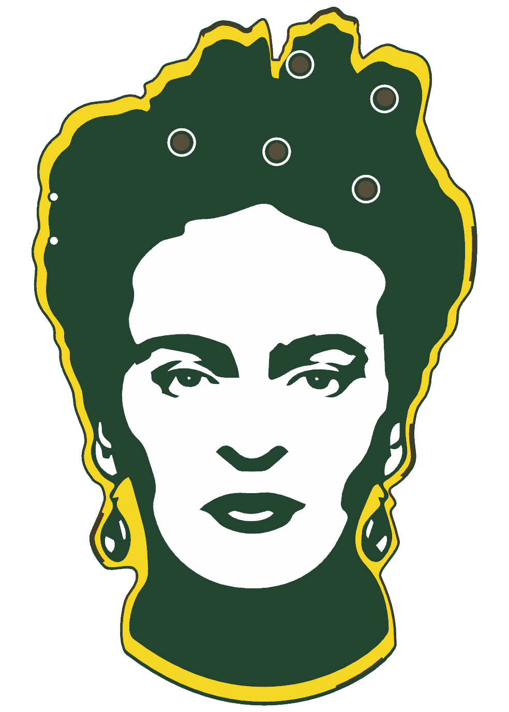
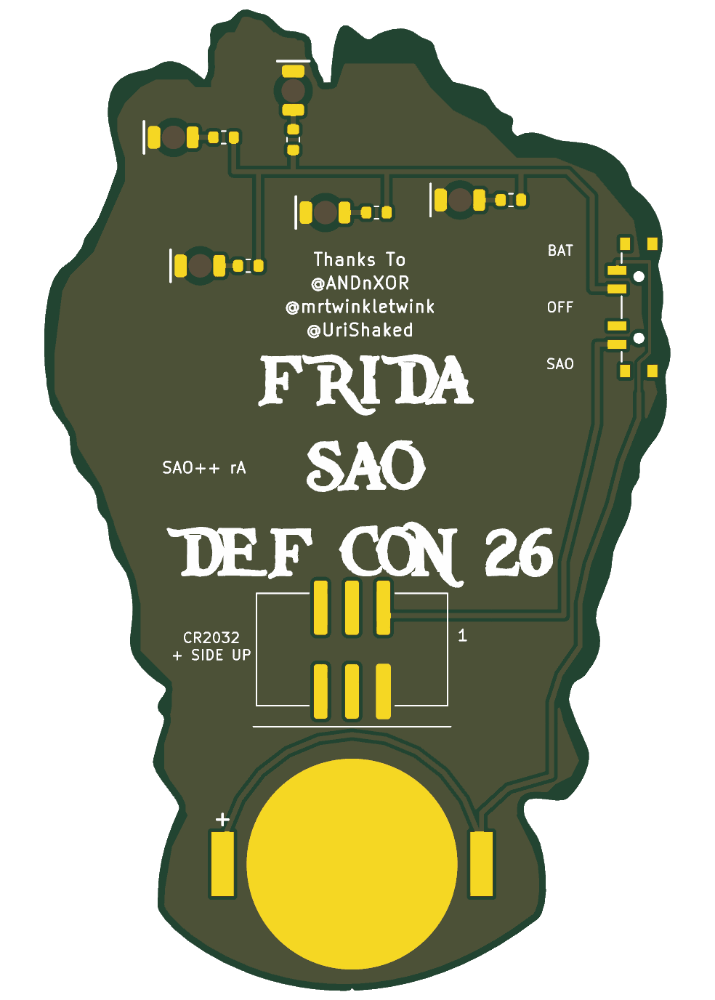

# Frida — SAO++ edition

Originally **Frida SAO** (DEF CON 26 Frida SAO Badge) by **lemons4all**, made for DEF CON 26 (2018): https://hackaday.io/project/161509-frida-sao

> **Permission pending — this board is not open-licensed.** The original hackaday.io page states no license, and lemons4all has not yet been asked or answered (draft request: ../rbg/docs/permission-request.md). The repo owner chose on 2026-11-10 to publish this port anyway. Until the maker says otherwise:
> - the original design in `original/`, the outline and all artwork remain **© lemons4all, all rights reserved**; the repo's CERN-OHL-S / CC-BY-SA licenses cover only the SAO++ additions (new parts placement, routing, scripts, documentation), not the original work
> - do not treat these files as cleared for manufacture or sale
>
> **A real person's likeness.** The art is a portrait of the painter Frida Kahlo. Her name and image are claimed as trademarks by the Frida Kahlo Corporation. That is a separate question from the maker's permission: a yes from lemons4all would not settle it, and it matters most if boards are ever sold.
>
> **lemons4all, or anyone with rights in this design:** open an issue and it will be changed or removed.

 

The five flowers in Frida's hair glow red from behind, through a small bare window in the middle of each flower.

## What changed from the 2018 board

| | 2018 original | SAO++ rev A |
|---|---|---|
| Connector | 4-pin through-hole at the chin (pins visible on the art side) | 6-pin SAO v1.69bis, surface-mount shrouded and keyed, on the back just under the "DEF CON 26" lettering, centred left-to-right like the old one. Nothing shows on the front |
| Power | Badge only | Slide switch on the left side of the hair (seen from the front): **SAO / OFF / BAT**. Runs from the badge or from its own CR2032, which clips to the back at the chin |
| LEDs | 5 × 3 mm through-hole LEDs pushed through the flowers from the back, sharing one through-hole resistor | 5 × red reverse-mount 1206 LEDs, surface-mounted on the back at the same spots, one 1.3 kΩ resistor each |
| The flowers (front) | Each flower was a white ring with two gold solder joints (the LED legs) inside it | Each flower is the same white ring with a plain 2 mm round window in the middle: no copper and no green solder mask, just bare board that the LED shines through. Unlit, it looks like a pale, slightly see-through dot inside the ring |
| Front art | — | Unchanged otherwise. The two gold dots in the hair to the left of the flowers are gone: they were the legs of the old resistor, not art. Two new 0.9 mm holes sit at the left edge of the hair, just inside the gold rim, where the switch's pegs go; the rim loses a hair's width of gold next to each |
| Back art | — | "FRIDA / SAO / DEF CON 26" is untouched. **The "Thanks To @ANDnXOR @mrtwinkletwink @UriShaked" credit has moved** (same words, same size) from under DEF CON 26 to above FRIDA, because the coin cell needed that spot (see below). The small + / − / VCC / GND marks for the removed parts are gone. Six small labels are added (SAO, OFF, BAT, the cell type, the revision, connector pin 1) |

**Why the credit moved.** The head is narrow (about 50 mm at its widest, 33–37 mm below the lettering), and the cell clip needs a clear 24 × 17 mm patch. Every place it could go covers either a flower or some of the lettering. The least-bad layout found: connector straight under DEF CON 26, cell under that at the chin, and the four-line thanks moved up into the empty hair above FRIDA. **This needs the owner's OK.** The alternative that keeps every letter where it was is to drop the coin cell (and the switch) from this board and run it from the badge only.

**Parts shared with the rest of SAO++:** connector, switch, cell clip, resistor and the red LED are all the same reels as Fat Pika and Mad Cat. No new parts.

**Battery life (calculated, not measured):** five red LEDs at about 1 mA each from a fresh cell is about 5 mA, so a CR2032 should last roughly 40 hours. About 1.2 mA each (6 mA total) on badge power.

## Things to check on the first prototype

1. **Brightness through the flower windows.** The LEDs run at about 1 mA. Check them in room light on badge power and on a cell. The windows are 2 mm across; the light spreads in the board, so the whole flower may glow a little.
2. **Pin 1 position.** The new connector keeps VCC and GND in the same corner as the 2018 header. Confirm against a v1.69bis badge before a production run.
3. **Switch labels.** The silkscreen assumes "knob toward the SAO label = badge power". If it is the other way round, swap the SAO and BAT labels (nothing electrical changes; OFF is the middle either way).
4. **A track under the switch.** On a single copper layer the battery line can only get past the switch by running underneath it, between its two pegs and the board edge (under solder mask, at least 0.25 mm from every switch pad and peg). Check the switch sits flat and that nothing under it shorts: with the cell in and the knob on OFF, the LEDs must stay dark.
5. **Battery clip direction.** The clip fits its pads both ways round. Its closed end must face the connector and its open side the chin, so the cell slides in from the bottom edge. The clip's own arrow falls off the board edge here, so tell the assembler in words.
6. **Connector and clip are close.** The clip's closed end is 0.75 mm from the connector's lower pads, and the connector's top pads are 0.3 mm below the DEF CON 26 lettering. Check the clip does not touch the connector's solder joints (that would short the cell), and that the connector body does not hide any letter.
7. **Weight on the connector.** The connector is now near the middle of the board with the cell below it, which should hang better than the 2018 chin header. Check it sits firmly in a badge.
8. **Knob reach.** The knob tip ends about 0.85 mm past the left edge of the hair. Confirm it is comfortable to slide.
9. **Flower 1 (top centre).** Its silkscreen ring was drawn 0.7 mm left of the 2018 LED, so the new LED is centred on the ring. Check it looks centred.

## Files

- `hardware/frida.kicad_pro` — KiCad 10 project (schematic + board). ERC: 0 issues. DRC: 0 errors, 0 unconnected, schematic matches board. 6 warnings remain: the clip's printed arrow falls off the board edge (3), the art libraries are not installed (2), and the connector's pin-1 bar was moved off the silkscreen because it would print over the bottom of "CON" (1).
- `hardware/circuit.json` — the circuit as data; `tools/gen_schematic.py frida` and `hardware/build_board.py` both read it.
- `hardware/build_board.py` — rebuilds the board from `original/` plus the SAO++ changes; every placement and routing decision is in there with a comment.
- `hardware/frida.kicad_dru` — two extra rules: fine gaps inside the artwork are allowed, and the connector's and clip's keep-clear boxes may overlap by 0.25 mm (the parts are 0.75 mm apart).
- `production/` — everything a board house needs, for one board (`single/`) and a 2×2 panel (`panel/`). Start with [production/README.md](production/README.md).
- `original/` — the untouched 2018 KiCad 5 project, Gerbers and zip.

## Parts cost (parts only, list prices checked 2026-11-10)

| Part | Qty | Each @ ~100 boards |
|---|---|---|
| Connector XFCN BH254VS-6P (LCSC C492445) | 1 | $0.12 |
| Switch C&K PCM13SMTR (Digikey) | 1 | ~$0.90 |
| CR2032 clip TE BAT-HLD-001 (LCSC C7501066) | 1 | $0.61 |
| LED Lite-On LTST-C230KRKT red (LCSC C125107) | 5 | $0.037 |
| Resistor 0603 1.3 kΩ (LCSC C22767) | 5 | <$0.01 |
| **Total** | | **about $1.85** |

The CR2032 cell and the bare board (50.8 × 79.6 mm) are not included.
