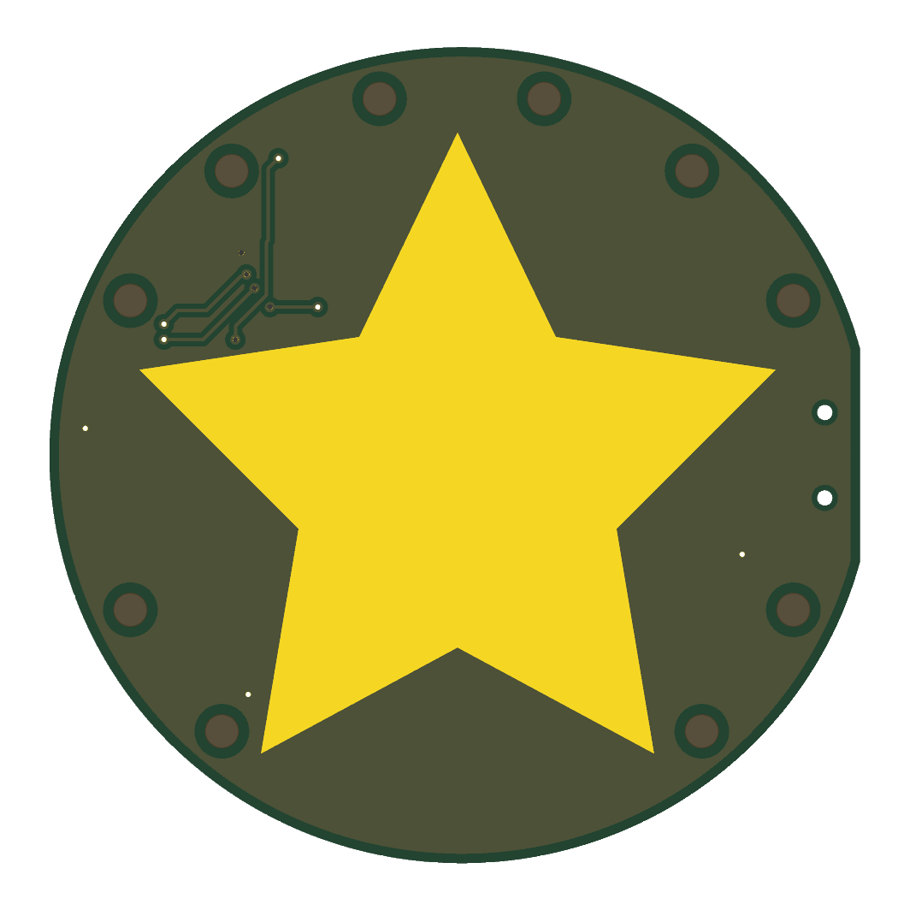
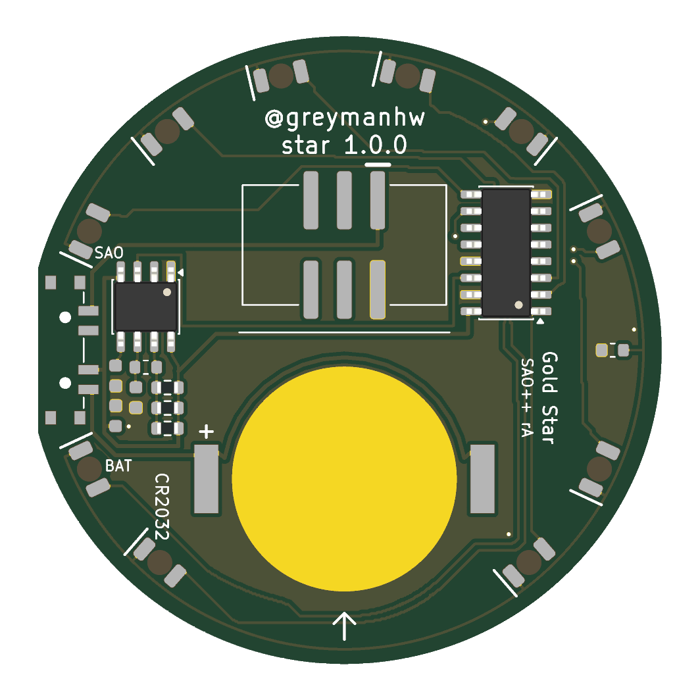

# Gold Star — SAO++ edition

From the **Gold Star Shitty Add-On** by **greymanhw**, 2019: https://github.com/greymanhw/gold-star (commit `eafa927`).

> **License:** the original is MIT-licensed, Copyright (c) 2019 greymanhw. The full notice is in [original/LICENSE](original/LICENSE) and must stay with any copy. Permission basis: the license.

> **This is a new layout, not a port of a board.** The maker published a circuit drawing (`gold-star.sch`), one picture (`star.svg`: a round outline, a star, two lines of text) and a one-line readme. The board file in his repo is a 51-byte placeholder: he never published a layout, and no photo of a built one was used here. The circuit and the star are his. Every part position, every track and the size are new.

 

A gold star on a round board, with ten red lights in a ring round it. One light is on at a time and the light runs round the ring, about thirteen steps a second (a full lap in three quarters of a second). No microcontroller and no firmware: two small logic chips do it.

## The maker's circuit, as read from his drawing

- **U1, a 555 timer**, wired as a free-running clock: R1 from the supply to the discharge pin (7), R2 from there to the threshold and trigger pins (6 and 2, joined), C2 from those to ground, C1 from the control pin (5) to ground, reset (4) tied to the supply. Output (3) goes to the counter.
- **U2, a 4017 decade counter**: clock input (14) from the timer; clock-enable (13) and reset (15) both tied to ground, so it counts for ever; carry output (12) unused. Outputs Q0 to Q9 go one each to LEDs D1 to D10. Exactly one output is high at any moment.
- **Ten LEDs sharing one resistor, R3**, to ground. Only one LED is ever lit, so one resistor is enough.
- **SAO connector, v1.69bis**: only power and ground are used. Nothing goes to SDA, SCL or the two GPIO pins, so the coin cell needs no series diode (house standard, section 3).
- **Two mistakes in the drawing**, both corrected here: every LED is drawn the wrong way round (cathode to the counter, so none could light), and the NE555 it names cannot run from 3.3 V.

The drawing was read against KiCad's stock symbols (the maker's own symbol cache file is not in his repo), and for the connector only "which pin goes to the chips' supply and which to ground" could be read.

## What is new in SAO++ rev A

| | Maker's files (2019) | SAO++ rev A |
|---|---|---|
| Size | a 100.5 × 99.5 mm disc with a 77.5 mm star, never laid out | the same shapes in the same proportions at 0.48 scale: a **48.3 × 47.7 mm** disc (47.4 mm wide across the switch flat) with a **37.2 mm** star |
| Star | on the white-print layer | **bare gold** (the board's own gold plating showing through a star-shaped opening in the solder mask). One setting in the build script puts it back to white print |
| Timer | NE555 (needs 4.5 V) | **LMC555**, the low-voltage version, same pins. Same part as the COVID-19 Test board |
| Counter | 4017 (CD4017: 3 V minimum, weak at 3 V) | **74HC4017**: same counter, same pins, works from 2 V. **Not yet checked at a distributor** (owner decision 1) |
| Speed | 220 kΩ, 220 Ω, 0.47 µF: 13.9 steps a second | three 3.3 MΩ side by side (1.1 MΩ), 330 Ω, 100 nF: **13.1 steps a second**, with no new reels. Fit two of the three for 8.7, or one for 4.4 |
| LEDs | type not given; all drawn backwards | 10 red LEDs made to be mounted upside down, shining through the board, each under a 2 mm dot of bare board |
| LED resistor | 470 Ω | the house 1.3 kΩ: about 1 mA |
| Power | badge only | slide switch on the right-hand edge (front view): **SAO / OFF / BAT**, and a CR2032 clip |
| Extra | — | C3, a 100 nF supply capacitor |

**Where the lights are.** A ring just outside the star's points, with three gaps: 3 o'clock (the switch), 9 o'clock (left empty to match) and the bottom (where the coin cell slides in). D1 is just right of the top; the light runs **anticlockwise** seen from the front: 1 and 2 across the top, 3 and 4 down the upper left, 5 and 6 lower left, 7 and 8 lower right, 9 and 10 up the upper right. The start point and direction were chosen for the fewest track crossings (next section).

**Why 48 mm.** The connector has to sit above the coin cell on the centre line (12 mm + 21 mm), the two chips beside the connector, and the LED ring outside all of that. 46 mm was tried on paper first: the counter chip's corner then touches the LED ring.

**Parts shared with the rest of SAO++:** connector, switch, cell clip, red LED, 1.3 kΩ and 330 Ω resistors, 100 nF capacitor. **Not on the shared list:** the LMC555 and the 3.3 MΩ resistor (both already used by COVID-19 Test, so no new reels), and the 74HC4017 (one new reel).

### Why there are tracks on the front

The 4017's outputs come out of the chip in a scrambled order (Q5, Q1, Q0, Q2, Q6, Q7, Q3 down one side; Q8, Q4, Q9 on the other), but the lights must run Q0, Q1, Q2 ... round the ring. A search over every start point and both directions showed that at most seven of the ten lines can be laid on one side without crossing. So three lines (to D3, D4 and D5) each hop over the others on the front: **four short tracks (27 mm in all) and eight covered vias, under the solder mask in the dark area between the star's top and left points**. Four more covered vias tie the ground. They will show as faint lines and small dimples; the 3D picture above exaggerates them. Nothing crosses the gold star.

### Battery life (calculated, not measured)

One red LED on all the time at about 0.8 mA from a cell (1.0 mA from a badge), the timer about 0.1 mA, the counter next to nothing: **about 0.9 mA**. A CR2032 should last roughly **150 to 220 hours**, two to three weeks of 12-hour days, dimming toward the end (both chips run down to 2 V; the red LEDs fade out a little above that).

## Things to check on the first prototype

1. **The counter chip.** Buy a 74HC4017 in the narrow 16-pin SOIC package and check it against the footprint. A CD4017 fits the same pads but will be dim or dead on a coin cell.
2. **Brightness.** Red LEDs at about 1 mA through 1.6 mm of board. If too dim, R3 can drop to the shared 330 Ω (about 3 mA, a third of the cell life).
3. **Speed.** Expect 13 steps a second, give or take 15 % (the capacitor's tolerance). The timing resistors are very high in value: leftover flux on the board near R1, R4, R5 can change the speed, so wash that corner if it runs odd.
4. **Start-up.** A 4017 can wake up showing two lights; it corrects itself within one lap. Check it does.
5. **Coin cell.** It slides in from the bottom edge, over solder mask that covers three tracks. Check it seats on the gold contact disc and that the mask is not scratched through after a few changes. The disc reaches ground through one 0.25 mm track and a via, which is plenty for 1 mA.
6. **Switch.** The knob sticks 0.75 mm past the flat on the right-hand edge (left, seen from the back). Only SAO and BAT are printed, beside the two ends of the switch; the middle is OFF. The labels assume the knob points at the label for that position: if wrong, swap them.
7. **Pin 1.** VCC is top left in front view, as on Mad Cat. Confirm against a v1.69bis badge.
8. **Front.** Check how visible the four hop tracks, twelve via dimples and two 0.9 mm switch-peg holes are, and that the ten bare dots glow evenly.
9. **Tight spots.** The timer's ground pin leaves through a 0.2 mm track between two of its own pins (0.235 mm each side) and then under R1, R4 and R5 between their pads. Check nothing bridges there.
10. **Connector height.** The connector sits 8 mm above the board's centre; check the board hangs straight.

## Decisions for the owner

1. **Which 74HC4017 to buy.** Nothing was looked up: no maker, part number, stock or price. Recommendation: any mainstream maker's 74HC4017 in narrow SOIC-16; check LCSC first since the rest of the board is there.
2. **Gold star or white star.** The maker's file has it as white print; this board makes it bare gold. Recommendation: gold (it is the name), on ENIG finish, which the coin-cell contact needs anyway.
3. **LED colour.** Red is on the shared list and is the best colour on a coin cell. Yellow from the same Lite-On family would suit a gold star and fits the same pads, but is one more reel and has not been looked up. White is on the list but weak on a cell. Recommendation: red for the first build.
4. **Speed.** Three 3.3 MΩ resistors give the maker's speed without a new reel. One 1 MΩ resistor would do the same job with two fewer parts and one more reel. Recommendation: as built.
5. **Tracks on the front.** Described above. The alternative with nothing on the front is to let the lights come on in the chip's own scrambled order (a twinkle rather than a chase); not laid out, not checked. Recommendation: keep the chase.
6. **Size.** 48 mm is large for an add-on. Smaller needs a smaller counter package (TSSOP) or giving up the coin cell. Recommendation: build one at 48 mm first.
7. **One supply capacitor, not one per chip.** There was no clean place for a second one beside the counter. Recommendation: accept; revisit only if the prototype misbehaves on a tired cell.

## Files

- `hardware/gold-star.kicad_pro` — KiCad 10 project. ERC: 0 violations. DRC: 0 errors, 0 unconnected, schematic matches board. 4 warnings, all "copper sliver": thin tongues of ground copper between tracks on the back, harmless.
- `hardware/circuit.json` — the circuit as data; `tools/gen_schematic.py gold-star` and `hardware/build_board.py` both read it. `docs/schematic.svg` is the drawing.
- `hardware/extract_art.py` — reads `original/star.svg`, writes `hardware/outline.json` and `art/art.json` (scale, flat, star).
- `hardware/build_board.py` — draws the whole board. Power, clock and timer tracks are written out by hand; the ten LED lines are finished by Knight Rider's small router, imported from `boards/knight-rider/hardware/router.py` (it should move to `tools/`). About 25 seconds, the same result every run, hard time limit 5 minutes.
- `hardware/parts_local.py`, `hardware/gold-star-local.pretty/` — the three parts not on the shared list.
- `production/` — files for one board and a 2×2 panel; see [production/README.md](production/README.md).
- `original/` — the maker's six files, untouched, with his LICENSE.

## Parts cost (parts only, list prices from docs/parts.md, 2026-11-10)

| Part | Qty | Each @ ~100 boards |
|---|---|---|
| Connector XFCN BH254VS-6P (LCSC C492445) | 1 | $0.10 |
| Switch C&K PCM13SMTR (Digikey) | 1 | ~$0.90 |
| CR2032 clip TE BAT-HLD-001 (LCSC C7501066) | 1 | $0.61 |
| LED Lite-On LTST-C230KRKT red (LCSC C125107) | 10 | $0.037 |
| Resistor 0603 1.3 kΩ (LCSC C22767), 330 Ω (LCSC C23138) | 1 + 1 | <$0.01 |
| Capacitor 0603 100 nF (LCSC C14663) | 3 | <$0.01 |
| Resistor 0603 3.3 MΩ (UNI-ROYAL 0603WAF3304T5E, LCSC C26096) | 3 | price not yet checked |
| Timer TI LMC555CMX/NOPB (LCSC C90760) | 1 | price not yet checked |
| Counter 74HC4017, SOIC-16 | 1 | **not yet checked at a distributor** |
| **Total** | | **about $2.00 plus the two chips** |

New reel for SAO++: the 74HC4017 only.
