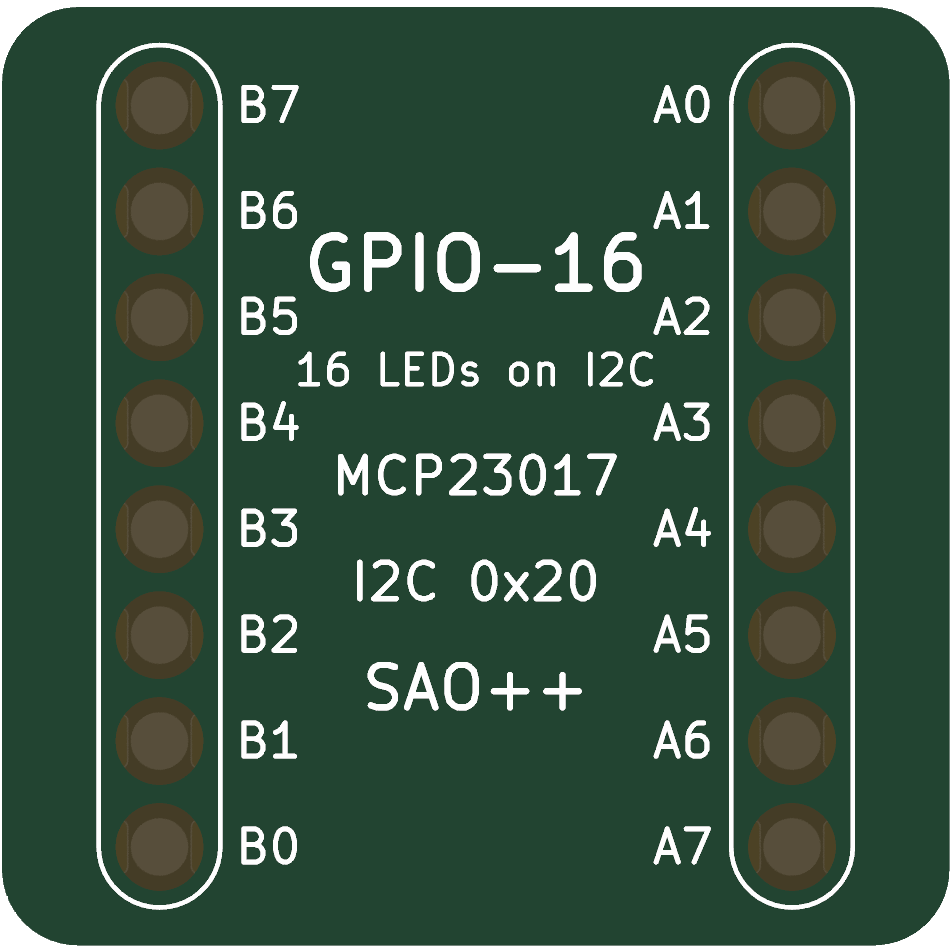
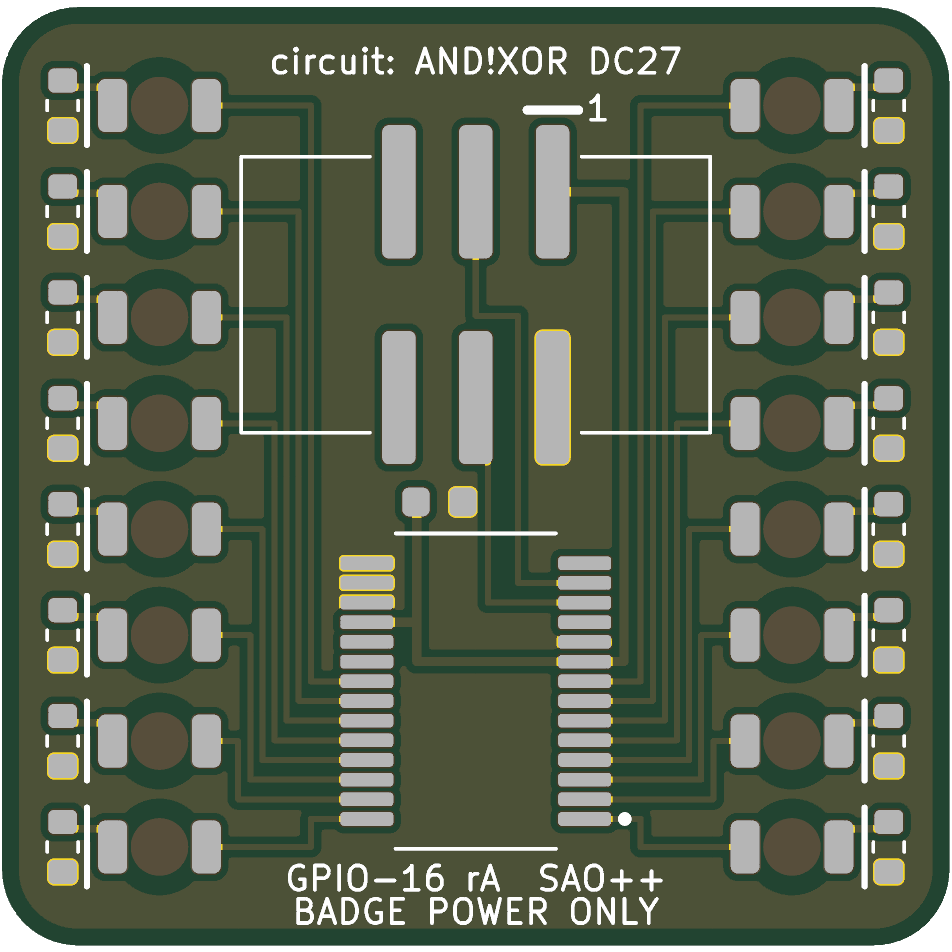

# GPIO-16 (MCP23017) — SAO++ edition

Circuit by **AND!XOR**: the "MCP23017 16 GPIO Reference Design" (rev1, 2019-03-15) from their DC27 SAO reference designs, https://github.com/ANDnXOR/sao-reference-designs/tree/5bc113302ebc797442ec0beddea9254aa829aca6/DC27/GPIO-16-MCP23017_sao1.69bis, licensed **Apache-2.0** (a copy of the licence is in [original/LICENSE](original/LICENSE); the repo has no NOTICE file).

> **The board is new; the circuit is theirs.** AND!XOR published this design as a schematic picture and a parts list only: there was never a board file or any artwork to port. The outline, the placement of the parts, the routing and every word printed on the board are SAO++'s own work. No AND!XOR logo or art is used; they are credited in words on the back.

 

Sixteen red lights that a badge switches on and off one by one over the add-on connector's two data wires (I2C). The chip is a Microchip MCP23017 "port expander": the badge sends it two bytes and each bit lights or darkens one LED. There is no program on the add-on. **On its own, or on a badge that does not know about it, it stays dark.**

## What the original is

Read from the maker's schematic picture ([original/mcp23017.png](original/mcp23017.png)) and parts list ([original/README.md](original/README.md)):

| | Maker's design | Kept? |
|---|---|---|
| Chip | MCP23017 in the 28-lead SSOP package ("-E/SS") | yes |
| I2C address | A0, A1, A2 all to ground: address **0x20** | yes |
| Reset pin | tied to 3.3 V (never reset by hand) | yes |
| Interrupt pins (INTA, INTB) | not connected | yes |
| Pins 11 and 14 | not connected (they do nothing on this chip) | yes |
| Lights | 16, one per chip pin: pin → LED → resistor → ground, so a pin set HIGH lights its LED | yes |
| Resistors | 16 × 1 kΩ | **1.3 kΩ** (the shared value) |
| Supply capacitor | one 0.1 µF | yes |
| Pull-up resistors on the data wires | none (the badge has them) | none |
| Power | straight from the badge's 3.3 V pin; no battery, no switch | yes: see "Power" below |
| Connector | "2x3 male pin header (keyed / shrouded preferred)" | the shared shrouded, keyed SMD connector |
| SAO GPIO1 / GPIO2 pins | not connected | not connected |

Two things in the source that are not quite right: the parts list calls the chip package "SSOP-20", but the "-E/SS" part is the 28-lead package and the schematic uses pin numbers up to 28; and the survey guessed there might be maker art, and there is none.

## What SAO++ did

- **Drew a board.** 31.3 × 31.0 mm, rounded corners. Everything is on the back; the front has no copper and no parts, only white lettering and sixteen round windows of bare board where the light comes through.
- **Two columns of eight** rather than a ring. A ring of sixteen has to go round the connector and the chip, which makes the board about 40 mm across; two columns down the sides, with the connector and chip between them, is the smallest shape the parts allow. It also shows what the chip is: two 8-bit ports, port B down the left and port A down the right, each light labelled with its pin (B7 … B0, A0 … A7). Going clockwise from the bottom left the lights are in pin order B0 … B7, A0 … A7, so a "chase" pattern runs smoothly round the board.
- **Red through-board LEDs** (the shared reverse-mount part): each sits on the back with its lens against the board and lights the bare window in front of it.
- **1.3 kΩ resistors** instead of 1 kΩ, so the board uses the same resistor reel as every other SAO++ board. The lights get about 1.2 mA each instead of about 1.5 mA.
- **One new part: the chip** (Microchip MCP23017T-E/SS). It is not on the shared parts list; it is kept as a part only this board uses.

## Power: badge only (a recorded exception to the house standard)

The house standard gives every board a coin cell and an SAO / OFF / BAT switch. **This board has neither**, and says "BADGE POWER ONLY" on the back. Reasons:

1. **A battery would light nothing.** When the chip gets power, all sixteen pins start as inputs and every LED is dark. They stay dark until a badge tells the chip what to do. Away from a badge there is nothing on this board to do that, so on a coin cell alone you would see a dark board.
2. **An OFF position would be a nuisance to the badge.** With the board plugged in but its chip unpowered, the badge's two data wires leak a little current into the dead chip through its input protection. The chip half-wakes on that trickle, and when the badge tries to light LEDs it drags the data wires down, which can upset the badge's other add-ons. Without a switch, the chip is simply powered whenever it is plugged in.
3. **It keeps the cost and size down.** The switch (out of stock at LCSC), the cell clip and the cell diode are the three dearest and biggest standard parts. Leaving them off keeps the board at 31 mm square; the cell clip alone is 24 × 17 mm.

If the owner prefers the standard power block anyway, the numbers are: all sixteen lit is about 16 mA from a cell, more than half of the cell diode's 30 mA rating and about eight times the 2 mA the standard's "70–100 hours" figure assumes, so a CR2032 would last well under ten hours with everything lit (calculated, not measured). It would be a larger board (rev B).

**Coin-cell safety:** there is no cell on this board, so nothing can push current into one.

**What it does to the badge's data wires:** it adds one chip input to each wire (a leakage of at most 1 µA) and no pull-up resistors. It answers at address **0x20** and nowhere else. Two of these on one badge, or any other add-on that also uses 0x20, will clash: the address is fixed, as on the maker's design.

## Current (calculated, not measured)

| | |
|---|---|
| Each LED | about 1.2 mA at 3.3 V (shared 1.3 kΩ resistor, red LED) |
| All 16 lit | about 19 mA |
| The chip itself | 1 mA at most while the badge is talking to it; about 1 µA idle |
| **Worst case, whole board** | **about 20 mA** |
| House budget from the badge | 50 mA: this uses 40 % |
| Chip limit per pin | 25 mA: this uses about 5 % |
| Chip limit for all pins together (through its supply pin) | 125 mA: this uses about 16 % |

Chip figures are from Microchip's data sheet DS20001952C, section 1.0.

## How a badge drives it

Standard MCP23017, address 0x20, registers in their power-up layout:

1. Write `0x00` to register `0x00` (IODIRA) and to register `0x01` (IODIRB): all sixteen pins become outputs.
2. Write a byte to register `0x12` (GPIOA) and one to `0x13` (GPIOB). A 1 bit lights that LED: bit 0 of port A is the light marked A0, and so on.

The maker's parts list points to AND!XOR's DC26 badge firmware for an example driver. No badge has been tried with this board.

## How it is wired

All tracks are on the back copper; there are no vias and no holes anywhere in the board. The chip stands upright under the connector with its power and data end toward the connector. Its eight port-B pins come out of its left side and fan out to the left column, the eight port-A pins out of its right side to the right column, each line in its own lane, so nothing crosses. The two data wires and ground run under the chip's body straight up to the connector. The badge's 3.3 V comes down the left of the connector to the chip's supply pin, and from there under the chip to the reset pin and the capacitor. The rest of the back is one piece of ground copper, including a ring round the board edge that every LED resistor ends in. The build script checks that this ground is one piece and reaches every ground pad by copper at least 0.5 mm wide.

## Pin map

| Light | Chip pin | Part | Light | Chip pin | Part |
|---|---|---|---|---|---|
| A0 | 21 | D1 / R1 | B0 | 1 | D9 / R9 |
| A1 | 22 | D2 / R2 | B1 | 2 | D10 / R10 |
| A2 | 23 | D3 / R3 | B2 | 3 | D11 / R11 |
| A3 | 24 | D4 / R4 | B3 | 4 | D12 / R12 |
| A4 | 25 | D5 / R5 | B4 | 5 | D13 / R13 |
| A5 | 26 | D6 / R6 | B5 | 6 | D14 / R14 |
| A6 | 27 | D7 / R7 | B6 | 7 | D15 / R15 |
| A7 | 28 | D8 / R8 | B7 | 8 | D16 / R16 |

Connector: pin 1 = 3.3 V, 2 = ground, 3 = SDA (chip pin 13), 4 = SCL (chip pin 12), 5 and 6 unused. U1 = MCP23017, C1 = 100 nF, J1 = connector.

## Things to check on the first prototype

1. **Does a badge light it?** Plug it into a badge that drives an MCP23017 at 0x20 (or a test rig that sends the four writes above). Nothing has been tried.
2. **Connector pin order.** Same open question as every SAO++ board (see docs/standard.md): confirm 3.3 V and ground are where the badge expects before trusting it.
3. **Brightness through the board** at about 1.2 mA. The shared red through-board LED is still marked "verify" for this on the parts list.
4. **Chip land pattern.** Drawn from Microchip's own recommended pattern; the pads are 0.2 mm apart, which is normal for this package but the finest pitch on any SAO++ board so far. Look for solder bridges between chip pins.
5. **Measure the current** with all sixteen lit (expected about 20 mA).

## What is unproven

Everything physical: no board has been built. The current and brightness figures are calculated. The connector's "verify" items on the parts list (fit against a real badge socket) apply here too.

## Files

- `hardware/gpio-16.kicad_pro` — KiCad 10 project (schematic + board). ERC: 0 issues. DRC: 0 errors, 0 warnings, 0 unconnected, schematic matches board.
- `hardware/circuit.json` — the circuit as data; the schematic and the board script both read it.
- `hardware/build_board.py` — rebuilds the board from scratch (placement and every track written out by hand; no auto-router).
- `hardware/parts_local.py`, `hardware/make_local_footprints.py`, `hardware/gpio-16-local.pretty/` — the MCP23017 symbol and its land pattern.
- `docs/` — front and back pictures, schematic drawing.
- `production/` — ordering files for one board and a 2 × 2 panel; see [production/README.md](production/README.md).
- `original/` — the maker's schematic picture, parts list, the repo's front page and the Apache-2.0 licence text, unchanged.

### Where the chip's numbers come from

Microchip, "MCP23017/MCP23S17 Data Sheet", document **DS20001952C** (July 2016), fetched from microchip.com on 2026-11-12: pin numbers (page 1 and Table 2-1), limits (section 1.0), package size (page 34, drawing C04-073B) and recommended land pattern (page 35, drawing C04-2073A: pad spacing 7.20 mm, pads 0.45 × 1.75 mm, pitch 0.65 mm). Checked against the current revision **DS20001952D** (June 2022): same pinout and limits; it adds that pins GPA7 and GPB7 can only be outputs, which is all this board uses them for.

## Parts cost (parts only; LCSC list prices)

| Part | Each | Per board |
|---|---|---|
| U1 MCP23017T-E/SS, LCSC C558584 (2,840 in stock, reel of 2,100; checked on the live page 2026-11-12, with a 9 % discount showing that day) | $1.31 @10, $0.92 @500 | $1.31 / $0.92 |
| D1–D16 red through-board LED (LED-10) | $0.037 @100 | $0.59 |
| R1–R16 1.3 kΩ (R-01) | $0.002 | $0.03 |
| C1 100 nF (C-01) | $0.005 | $0.01 |
| J1 connector (CONN-01) | $0.10 | $0.10 |
| **Total** | | **about $2.05 for a first batch, about $1.65 at 500** |

The chip is the only part here that other SAO++ boards do not already use: one more reel (2,100 pieces) if bought by the reel, or cut tape for small runs. Board and assembly prices are not included: get a live quote.

## Licence

The circuit is AND!XOR's, used under the Apache License 2.0 ([original/LICENSE](original/LICENSE)). Changes from their design are listed above and in `board.yml`. The SAO++ board files are under this repository's licences.
