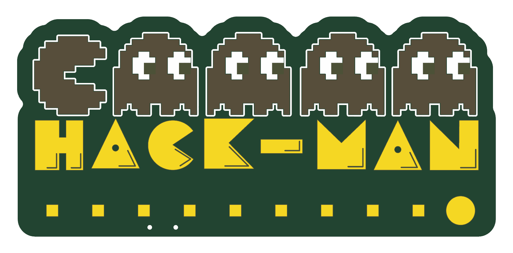
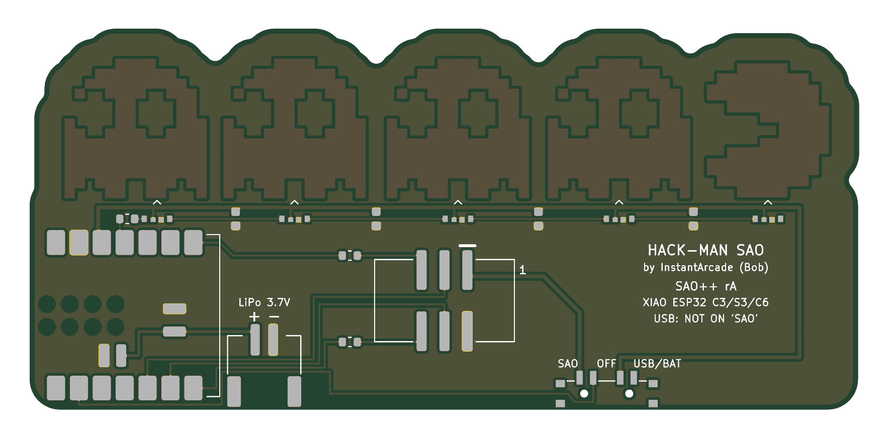

# Hack-Man — SAO++ edition

Originally **Hack-Man SAO** by **InstantArcade (Bob)**, 2024, an entry in the Supercon 8 SAO contest: https://hackaday.io/project/198301-hack-man-sao

> **Permission pending — this board is not open-licensed.** The original hackaday.io page states no license, and the maker has not yet been asked (draft request: [docs/permission-request.md](docs/permission-request.md)). The repo owner chose on 2026-11-10 to publish this version anyway. Until the maker says otherwise:
> - the design idea, the look and the artwork remain **© InstantArcade, all rights reserved**; the repo's CERN-OHL-S / CC-BY-SA licenses cover only the SAO++ work (layout, routing, scripts, firmware, documentation)
> - do not treat these files as cleared for manufacture or sale
>
> **Separately:** Pac-Man and the ghosts are Bandai Namco's characters. That does not depend on the maker's answer and matters most if boards are sold.
>
> **InstantArcade, or anyone with rights in this design:** open an issue and it will be changed or removed.

 

Pac-Man and four ghosts, each lit from behind in its own colour by a colour-changing LED. Plugged into a badge it plays the arcade machine's attract mode; a button steps through three more light shows, and a badge can take over the LEDs with simple commands.

## This is a recreation, not a port

The maker published pictures and a write-up, but **no design files and no code**. So, unlike Fat Pika and Mad Cat:

- the art was **redrawn** as clean shapes from his "Design in Inkscape" picture (`art/art.json`); sizes were scaled from the 2.54 mm header pitch in his photo of a built board (one sprite pixel ≈ 1.1 mm). Expect small differences from a real one
- the board was laid out from scratch
- the firmware is **new** (Rust), written to do what his page describes. It is not his code

## What changed from the original

| | Original (v1.1) | SAO++ rev A |
|---|---|---|
| Connector | 6-pin through-hole on a tab sticking out of the bottom edge | 6-pin SAO v1.69bis, surface-mount shrouded and keyed, on the back inside the outline. **No bump-out**, nothing shows on the front |
| Controller | Puya PY32F002A (8-pin, about $0.10), programmed over SWD | **Seeed Studio XIAO ESP32** module soldered flat on the back: C3, S3 or C6 all fit the same pads. USB-C at the right-hand edge (seen from the front) for power and programming |
| Size | about 92 × 33 mm plus the tab | 92.0 × 42.3 mm. **9.4 mm taller**: the XIAO is 17.8 mm wide and has to sit below the LEDs, clear of the glowing sprites |
| Power | Badge only | Slide switch on the bottom edge: **SAO** (badge power) / **OFF** / **USB-BAT** (the module's own power: USB-C, or a LiPo cell on the new JST-PH connector, which the XIAO charges from USB) |
| Mode button | Separate push button | The XIAO's own BOOT button (no extra part) |
| LEDs | 5 × SK6805-EC3210R side-firing RGB | Same part, same idea: one under each character's feet, firing up along the back of the board |
| Front art | — | Redrawn to match. **Added:** a row of pellets in the new strip under the lettering. Two 0.9 mm holes near the bottom edge (the switch's locating pegs) |

**Parts shared with the rest of SAO++:** connector, switch and the 330 Ω resistor. **New to the shared list** (and meant to be reused by every future board with a controller): the XIAO footprint, the JST-PH LiPo connector, the RGB LED and a 100 nF capacitor.

## How the power switch works here

| Knob | Badge 3.3 V | What runs the board |
|---|---|---|
| **SAO** | connected to the XIAO's 3V3 pin and the LEDs | the badge |
| **OFF** | disconnected | nothing from the badge. If USB or a LiPo is attached the XIAO still has power, so the switch tells it to blank the LEDs and sleep |
| **USB-BAT** | disconnected | the XIAO's own regulator, from USB-C or the LiPo |

Things to know:

- **OFF is a sleep, not a hard cut, when a LiPo is attached.** The XIAO has no off switch of its own, and the standard switch has one pole, so it cannot break both the badge and the battery. The five LEDs also draw a little even when dark. Unplug the cell for storage. A second switch in the battery lead would make it a true off; say so if you want it.
- **Do not plug in USB while the knob is on SAO and the board is on a badge.** Two 3.3 V regulators (the badge's and the XIAO's) would be joined. It is printed on the back.
- **Feeding the XIAO through its 3V3 pin** is how badge power reaches it. Seeed's documentation describes that pin only as an output, and neither allows nor forbids this. It is common practice, but it is the first thing to test, on each module type you plan to use (the C6 uses a different kind of regulator from the C3).
- **No coin cell on this board:** these LEDs and an ESP32 need far more than a CR2032 gives.

## Things to check on the first prototype

1. **Badge power into the 3V3 pin** (above). Check it boots and runs from a badge with nothing else attached, and that nothing gets warm.
2. **LED land pattern.** The LED's datasheet gives pad sizes for side mounting but does not dimension them against the body. The pads are placed by estimate. Check the LEDs sit square and the lens points at the sprite.
3. **Brightness.** The maker found these side-firing LEDs "lackluster" through the board and fixed it with a blob of hot glue over each LED as a diffuser. Expect to do the same. They are also rated for 3.7 V minimum and run here (as on his board) from 3.3 V.
4. **LiPo polarity.** The connector follows the Adafruit / SparkFun convention (looking at the back with the socket opening toward you, **+ is on the left**; it is printed on the board). Cells from other sellers are often wired the other way round. **Check with a meter before plugging one in.** There is no reverse-polarity protection.
5. **Battery pads need reflow.** The LiPo reaches the XIAO through pads *underneath* the module (in two places, because the C6 has them somewhere else than the C3 and S3). A soldering iron cannot reach them: the module has to be soldered with paste and hot air, a hot plate, or by the assembler. Hand-soldered by its edge pads only, everything works except the LiPo connector.
6. **Height.** Seeed does not publish the module's height. Check the XIAO, its USB-C socket and a plugged-in LiPo lead clear the badge behind.
7. **USB plug clearance.** The module's USB end is flush with the board edge so the socket overhangs by 1.5 mm and a cable's plug body does not hit the board.
8. **Switch labels.** As on the other boards, which way the knob sits for "position 1" is not drawn in the datasheet. If SAO and USB-BAT turn out swapped, the silkscreen is wrong, not the wiring.
9. **Pin 1 position** against a known v1.69bis badge.
10. **Firmware on real hardware**: see [firmware/README.md](firmware/README.md). Nothing in it has run on a board.
11. **Art against a real Hack-Man**, if you can borrow one: overall size and the letter shapes.

## Pin map

| XIAO pin | Goes to |
|---|---|
| D10 | LED data, through 330 Ω. LED 1 is the pink ghost (right, seen from the front), LED 5 is Pac-Man |
| D4 / D5 | SAO SDA / SCL (the XIAO family's usual I2C pins) |
| D7 / D6 | SAO GPIO1 / GPIO2, each through 330 Ω (the family's RX / TX pins, matching the UART role in the house standard) |
| D1 | High when the switch is on OFF |
| 3V3, GND | the board's 3.3 V rail and ground |
| BAT+ / BAT− (under the module) | the JST-PH LiPo connector |
| D0, D2, D3, D8, D9, 5V | not connected (D0, D2, D8, D9 are start-up "strapping" pins on one module or another, so they were left alone) |

## Files

- `hardware/hack-man.kicad_pro` — KiCad 10 project (schematic + board). ERC: 0 issues. DRC: 0 errors, 0 warnings, 0 unconnected, schematic matches board.
- `hardware/circuit.json` — the circuit as data; `tools/gen_schematic.py hack-man` and `hardware/build_board.py` both read it.
- `hardware/build_board.py` — builds the whole board from `art/art.json` and `circuit.json`; every placement and routing decision is in there with a comment.
- `hardware/hack-man.kicad_dru` — two extra rules: fine gaps inside the artwork are allowed, and the data resistor may sit close beside the first LED.
- `art/art.json` — the redrawn sprites and lettering.
- `firmware/` — the Rust firmware.
- `production/` — everything a board house needs, for one board (`single/`) and a 2×2 panel (`panel/`). Start with [production/README.md](production/README.md).

## Parts cost (parts only, LCSC list prices checked 2026-11-10)

| Part | Qty | Each @ ~100 boards |
|---|---|---|
| Connector XFCN BH254VS-6P (LCSC C492445) | 1 | $0.12 |
| Switch C&K PCM13SMTR (Digikey) | 1 | ~$0.90 |
| RGB LED OPSCO SK6805-EC3210R (LCSC C5378735) | 5 | $0.068 |
| LiPo connector JST S2B-PH-SM4-TB (LCSC C295747) | 1 | $0.16 |
| Capacitor 100 nF 0603 (LCSC C14663) | 4 | <$0.01 |
| Resistor 330 Ω 0603 (LCSC C23138) | 3 | <$0.01 |
| **Total without the module** | | **about $1.55** |
| Seeed Studio XIAO ESP32-C3 / S3 / C6 | 1 | not priced here: check Seeed. It will cost several times everything else on the board |

The bare board and the optional LiPo cell are not included.
