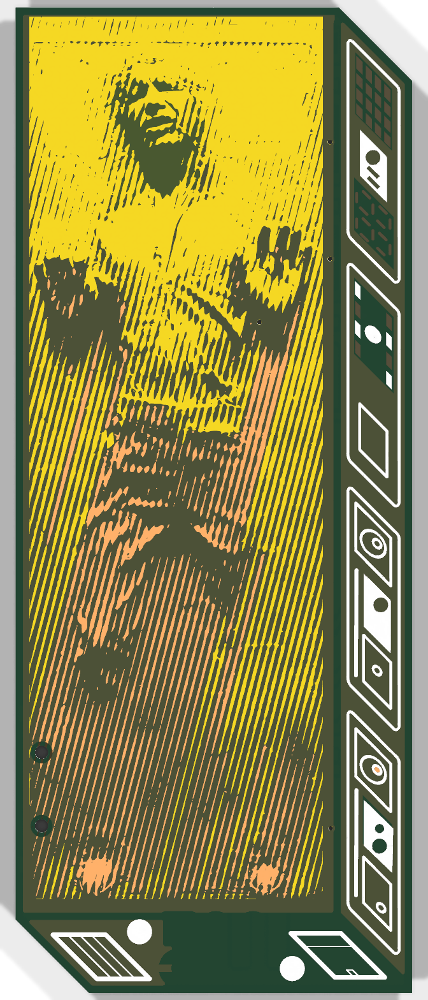
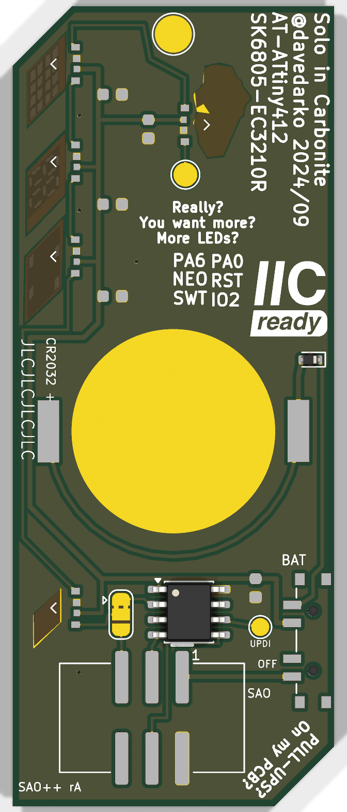

# Han SAOlo — SAO++ edition

Originally **Han SAOlo** ("Solo in Carbonite") by **davedarko (Dave Darko)**, 2024: https://github.com/davedarko/Simple-Add-ons-SAO/tree/main/SoloCarbonite (project page: https://hackaday.io/project/197803-han-saolo)

> **Permission pending — this board is not open-licensed.** Neither the maker's repository nor the project page states a license, and davedarko has not yet been asked or answered (draft request: [../han-saolo/docs/permission-request.md](../han-saolo/docs/permission-request.md)). This port was built locally on 2026-11-11; the repo owner has **not yet decided** whether to publish it before permission. Until the maker says otherwise:
> - the original design in `original/`, the outline and all artwork remain **© davedarko, all rights reserved**; the repo's CERN-OHL-S / CC-BY-SA licenses cover only the SAO++ additions (new parts placement, routing, scripts, documentation), not the original work
> - do not treat these files as cleared for manufacture or sale
>
> **davedarko, or anyone with rights in this design:** open an issue and it will be changed or removed.
>
> **The picture itself is a third-party character.** Han Solo frozen in carbonite is a Lucasfilm / Disney character and scene (Star Wars). The board's art is the maker's own rendering in tinned copper and solder mask, but the subject belongs to Lucasfilm / Disney. That is a separate question from the maker's permission, and it matters most if boards are ever sold.

 

A 27 × 67 mm slab of carbonite with Han Solo's face and hands in shiny tinned copper. A small chip (ATtiny412) runs five tiny colour LEDs: four light the control panels down the right-hand side, and one lights the face from behind. Every few seconds the face "thaws" (red fading to white) and the panel lights blink, as in the film.

## What changed from the 2024 board

| | 2024 original | SAO++ rev A |
|---|---|---|
| Connector | 2×3 through-hole header on the "floor" at the bottom (pins show on the front) | 6-pin SAO v1.69bis, surface-mount, shrouded and keyed, on the back near the bottom, 1.8 mm right of centre. Nothing shows on the front |
| Power switch | 2-position slide switch on the right edge (badge / cell, no off) | **SAO / OFF / BAT** switch on the **left edge**, just below the cell (see "Fitting it on a 27 mm board") |
| Coin cell | BS-08 holder on the back | the shared CR2032 clip, same place (middle of the back). The cell slides in from the top |
| Cell safety | nothing between the cell and the chip | a series diode (D6) right after the clip, as `docs/standard.md` requires for any board with a chip on SDA/SCL |
| I2C pull-ups | two 10 kΩ on the board (the back silk asks "PULL-UPS? On my PCB?") | removed: the badge provides them (`docs/standard.md` section 1). The joke text stays |
| Chip, LEDs | ATtiny412, 5 × SK6805-EC3210R side-firing RGB, 5 × 100 nF | the same chip, same LEDs in the same places, same capacitors |
| LED-data jumper (maker's JP2) | ATtiny drives the LEDs, or cut and re-bridge so the badge drives them on SAO GPIO1 | kept unchanged (now called JP1) |
| UPDI jumper (maker's JP1) | joined the chip's programming pin to SAO GPIO2, so it could be programmed through the header | **removed**: it cannot be routed on one copper layer here (see below). Replaced by a 1.5 mm **UPDI programming pad** (TP2). SAO GPIO2 is now unconnected |
| Chain-out and ground pads | 2 mm pad after the last LED ("Really? You want more? More LEDs?"), 3 mm ground pad at the top | both kept, same places (now TP1 and TP3) |
| Vias | 5 ground vias and 1 signal via, visible on the front | 4 ground vias, **tented** (covered by mask), each on a spot where the front art is already dark |
| Front art | — | unchanged, apart from: the six header holes on the floor (gone), the old switch's lower peg hole in the side panel (filled in), and **two new 0.9 mm holes** low on the left side of the slab (the new switch's locating pegs) |
| Back art | — | unchanged, apart from the maker's jumper legend (PA6 / NEO / SWT, PA0 / RST / IO2): same words, same letter size, same layout, moved from where the switch now sits up to the gap between "Really? You want more? More LEDs?" and the top of the cell. Small labels added: SAO / OFF / BAT, UPDI, pin 1, "CR2032 +", "SAO++ rA" |

**Parts shared with the rest of SAO++:** connector, switch, cell clip, the RGB LED (same as Hack-Man) and the 100 nF capacitor. Two parts are new to the project and kept in this board's own folder for now: the **ATtiny412** (the maker's chip) and the **RB751S40 diode** (the same diode Knight Rider uses, so the two boards share one reel). The jumper and the three pads are bare copper: nothing to buy.

## Please read: five colour LEDs on a coin cell

`docs/parts.md` says the addressable RGB LED is **"never on a coin cell"** in this project. This board breaks that rule, because the maker designed it that way and the owner asked for the standard treatment (switch + coin cell) rather than a XIAO. Here is what that means, **calculated, not measured**:

- **Current.** Each LED's little driver chip draws current even when dark (assumed about 0.5 mA each from the WS2812-class family; not in our datasheet notes). With the maker's animation the LEDs average roughly 18 mA (D1 red and yellow, D2 red and grey, D3 dim red, D4 green blinking, the face off for 10 s then red-to-white for 4 s, at about 5 mA per colour at full), plus about 2.5 mA idle and a few mA for the chip: **about 20–25 mA on average, 35–45 mA at the brightest moments.**
- **Battery life.** A CR2032 is rated about 225 mAh at a 0.2 mA load; at 20–25 mA it delivers much less, perhaps 100–150 mAh before the voltage collapses. That is **roughly 4 to 7 hours**, not days.
- **Colour.** The cell gives about 3.0 V, minus about 0.3–0.5 V across the safety diode at this current, minus the cell's own sag: the LEDs see roughly 2.4–2.7 V. They are rated 3.7–5.5 V. Red should still light; **green and blue will be weak or missing**, so yellow, white and green effects will look wrong, and it gets worse as the cell drains.
- **On badge power** it should look as the maker intended (3.3 V, the same as Hack-Man, which worked). Peak draw of about 45 mA is just inside SAO++'s 50 mA budget.

**Bottom line: on the coin cell, battery life and colour will be poor.** It is a board to wear on a badge, with the cell as a short-lived backup. This needs the owner's decision (keep as is, or give it the XIAO treatment instead).

Also flagged: the RB751S40 diode is a small-signal part, rated about 30 mA continuous. This board's average cell current is near that and its peaks are above it. Before ordering, the diode choice (`SAOPP-D-01`, still "open" in parts.md) should be checked against a 50 mA load, or a larger low-leakage Schottky chosen for this board.

## The chip and the firmware

- **Which chip.** The board file is the truth: **ATtiny412** (Microchip ATTINY412-SSN, 8-pin SOIC). The maker's write-up (`original/2411_Hans_SAOLO.md`) says "ATtiny13", and the back silk says "AT-ATtiny412". The firmware (`original/Sketchbook/soloMain/soloMain.ino`) uses the `tinyNeoPixel_Static` library from **megaTinyCore**, which only runs on the newer tinyAVR 0/1/2-series (ATtiny412, 202, 402 …), never on an ATtiny13. So: ATtiny412.
- **Will the maker's firmware run unchanged?** Yes, as far as the wiring goes: LED data is still on PA6 (Arduino "A6"), through the jumper to D1, and the five LEDs are chained D1 → D5 in the order the sketch expects (D1 small lower panel, D2 cross panel, D3 "segment display", D4 oscilloscope, D5 the face). Build it with megaTinyCore for the ATtiny412. On the coin cell, pick an 8 MHz clock rather than 20 MHz (calculated from the datasheet's speed grades: 20 MHz is only in spec above 4.5 V, 10 MHz above 2.7 V, roughly 8 MHz above 2.4 V; the tinyNeoPixel library supports 8 MHz).
- **Programming (UPDI).** The chip is programmed through **TP2, the round pad labelled "UPDI"** on the back, just left of the chip. Power the board (badge plugged in with the switch on SAO, or a cell with the switch on BAT), connect a UPDI programmer (for example a serialUPDI adapter, which has its own series resistor) to TP2, and its ground to the 3 mm pad at the top (TP3) or the connector's GND pin. A pogo pin or a fine clip on the pad is enough. The maker could also program it through the SAO header's GPIO2 pin; that is not possible on this version.
- **I2C.** The chip's SDA/SCL pins are still wired to the SAO header ("IIC ready"), but the maker's firmware does not use them.

## Fitting it on a 27 mm board (trade-offs)

The board is 27 mm wide; the cell clip alone is 24 × 17 mm, the connector 15.3 mm, the switch needs 12 mm of straight edge. What was done, and what it costs:

1. **The cell** stays in the middle, as high as it can go without covering the "IIC ready" logo (the cell's edge is 0.2 mm clear of the logo's corner). The clip's closed end points down; the cell goes in from the top.
2. **The switch moved from the right edge to the left edge.** On the right, the coin-cell wire, the 3.3 V wire and the LED-data wire would all have had to cross each other on one copper layer; there is no way round that without running a wire across the front art. On the left edge, just below the cell, everything fits. Costs: the knob sticks out of the left side of the slab instead of the side panel, and **two 0.9 mm peg holes go through the lower slab art** (about 2 mm in from the left edge, at the height of Han's lower legs).
3. **The jumper legend moved** (it sat exactly where the switch now is): same words, same size, same layout, now between "Really? You want more? More LEDs?" and the top of the cell, the only free gap big enough. It is close to that text (about 0.15 mm) and no longer next to a jumper (it was not next to one on the original either).
4. **The connector** sits 2.95 mm above the bottom edge and 1.8 mm right of the board's middle. Further left, its plastic body would cover the end of the maker's "PULL-UPS? On my PCB?" lettering along the bottom-left corner; further right, it would run out of board. The shroud now covers only bare back (and one tented via).
5. **The UPDI-over-GPIO2 jumper was dropped**: its wire would have had to cross the SCL wire or the badge-power wire. Programming moves to the TP2 pad.
6. **Four ground vias.** Each LED on the right-hand column sits in a pocket fenced off by its own 3.3 V and data wires, so its ground cannot reach the rest of the back copper; the maker solved this the same way (five vias). The four vias are tented and sit where the front art is dark, three of them in the narrow dark border between the slab and the side panel.
7. **The two LED-data links** between the right-hand LEDs run just right of the LED pads (still clear of the light windows), to leave room for those vias.
8. The coin-cell, 3.3 V and LED-data wires pass under the maker's "JLCJLCJLCJLC" marking on the right edge (that marking only tells JLCPCB where to print its order number; it is not art).

## Things to check on the first prototype

1. **Colours and battery life on the cell** (see above). Measure the current on BAT and SAO; note how long the cell lasts and when green/blue fade.
2. **The SK6805 footprint.** The shared footprint and the maker's own footprint have the **same pin order** in the same places (checked by placing both on the back: DOUT, GND, VDD, DIN from top to bottom on D1, exactly as on the maker's board). They differ in pad size: the maker's outer pads are 1.0 mm long along the row (shared: 0.55 mm), his outer pads sit 0.1 mm further out, and they reach 0.25 mm further toward the lens than his inner pads (shared: 0.1 mm). The shared footprint was placed so its ground/power pads sit exactly on the maker's. The first board shows whether the LEDs solder and aim well.
3. **The diode** (D6) at this current (see above).
4. **Switch direction.** The silkscreen assumes "knob toward the BAT label = cell, toward SAO = badge"; the datasheet does not draw it. If it is the other way round, swap the labels (OFF is the middle either way).
5. **Pin 1 position** on a real v1.69bis badge.
6. **Cell clip direction.** The open side faces the top of the board (where the cell slides in); the closed end faces the connector. Tell the assembler.
7. **The two peg holes** on the front: check they are acceptable to the eye.
8. **Vias from the front.** Check the four tented vias really disappear into the dark art.

## Files

- `hardware/han-saolo.kicad_pro` — KiCad 10 project (schematic + board). ERC: 0 issues. DRC: 0 errors, 0 unconnected, schematic matches board; 24 warnings (silkscreen art over copper and over itself, small text, five thin slivers in the ground copper, and the cell-clip footprint differing from the library copy because its silkscreen arrow was moved to the fab layer, as on other boards). Panel DRC: 0 errors, 0 unconnected; mouse-bite holes at least 0.27 mm from any copper.
- `hardware/circuit.json` — the circuit as data; `tools/gen_schematic.py han-saolo` and `hardware/build_board.py` both read it. After generating the schematic run `hardware/fix_schematic.py` (marks the bare pads and the jumper "not in BOM").
- `hardware/build_board.py` — rebuilds the board from `original/` plus the SAO++ changes; every decision is commented there.
- `hardware/parts_local.py`, `hardware/han-saolo-local.pretty/` — the parts the shared library does not have yet (chip, diode, jumper, pads), all KiCad stock footprints.
- `hardware/han-saolo.kicad_dru` — one extra rule: fine gaps inside the artwork are allowed.
- `production/` — everything a board house needs, for one board and a 2×2 panel. Start with [production/README.md](production/README.md).
- `original/` — the maker's untouched KiCad 8 project, firmware and write-up.

## Parts cost (parts only; list prices from `docs/parts.md`, checked 2026-11-10, except where marked)

| Part | Qty | Each @ ~100 boards |
|---|---|---|
| Connector XFCN BH254VS-6P (LCSC C492445) | 1 | $0.12 |
| Switch C&K PCM13SMTR (Digikey) | 1 | ~$0.90 |
| CR2032 clip TE BAT-HLD-001 (LCSC C7501066) | 1 | $0.61 |
| RGB LED OPSCO SK6805-EC3210R (LCSC C5378735) | 5 | $0.068 |
| Capacitor 100 nF 0603 (LCSC C14663) | 5 | $0.005 |
| ATtiny412 | 1 | not yet priced (orchestrator) |
| Diode RB751S40 | 1 | not yet priced (orchestrator) |
| **Total without the two unpriced parts** | | **about $2.00** |
