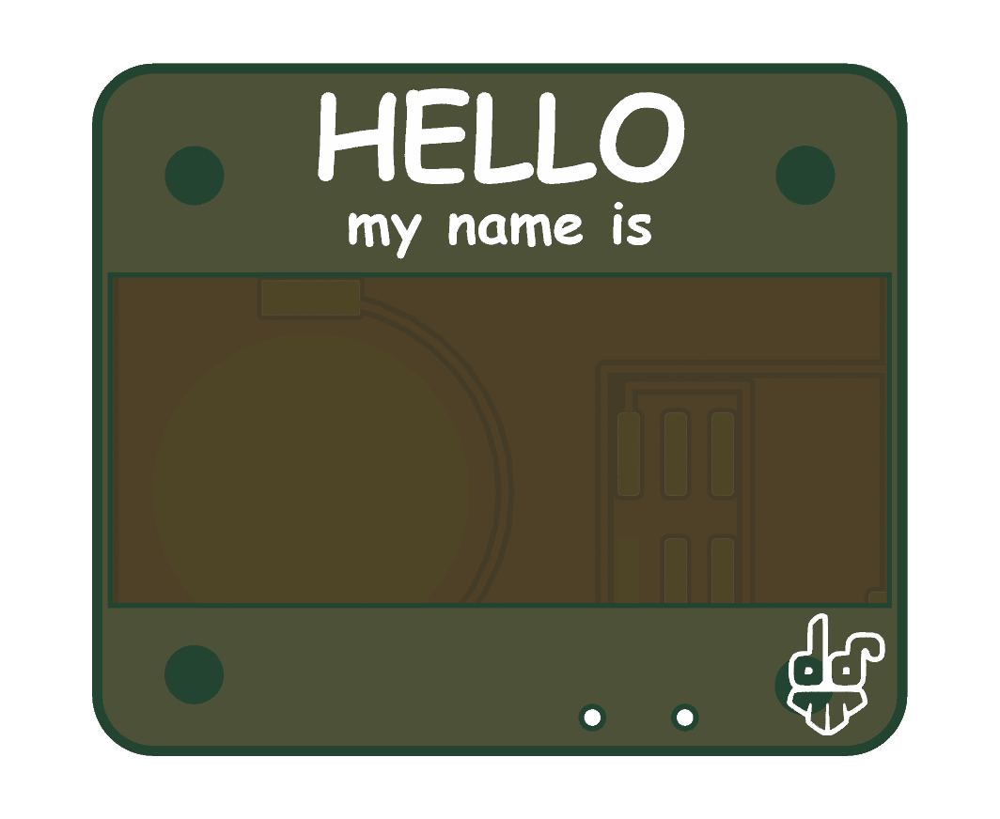
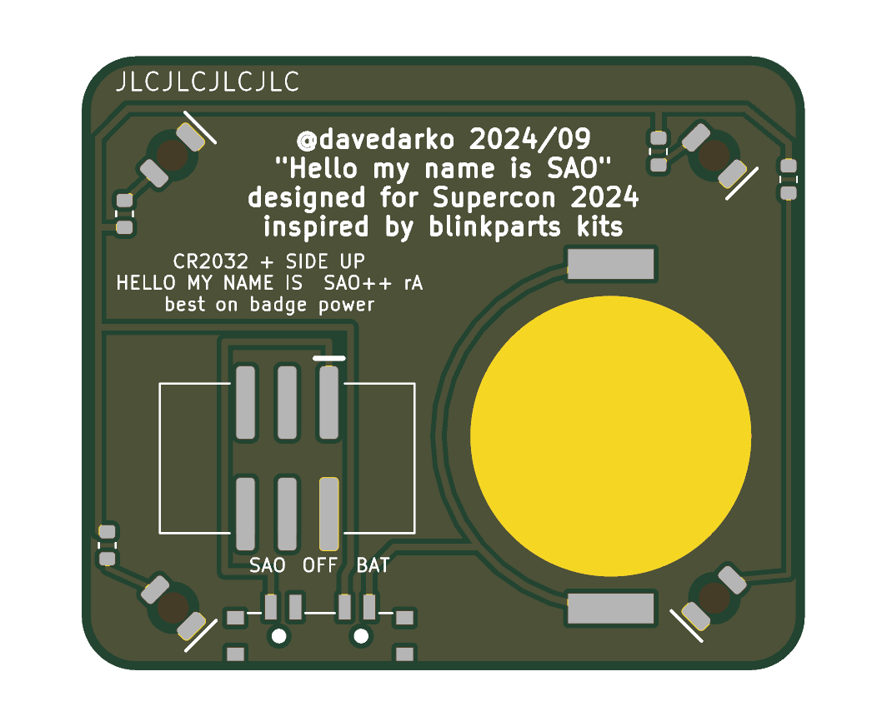

# Hello My Name Is — SAO++ edition

Originally the **"Hello My Name Is" SAO** (2024, LED version) by **davedarko (Dave Darko)**, his entry to Hackaday's Supercon 2024 simple add-on contest: https://github.com/davedarko/Simple-Add-ons-SAO/tree/main/HelloMyNameIs (project page: https://hackaday.io/project/197693-hello-my-name-is-sao)

> **Permission pending — this board is not open-licensed.** davedarko's repository states no license, and he has not yet been asked or answered (draft request: [../han-saolo/docs/permission-request.md](../han-saolo/docs/permission-request.md)). This port was built locally on 2026-11-12; the repo owner has **not yet decided** whether to publish it before permission arrives. Until the maker says otherwise:
> - the original design in `original/`, the outline and all artwork remain **© davedarko, all rights reserved**; the repo's CERN-OHL-S / CC-BY-SA licenses would cover only the SAO++ additions (new parts placement, routing, scripts, documentation), not the original work
> - do not treat these files as cleared for manufacture or sale
>
> **davedarko, or anyone with rights in this design:** open an issue and it will be changed or removed.

 

## What the original is

A name-tag sticker you wear on your badge: a rounded rectangle, 40 × 34 mm, with **HELLO** and **my name is** in Comic Sans across the top, a big blank strip below to write your name in, and davedarko's logo in the bottom corner. The blank strip is bare board on both sides (no copper, no solder mask), so you write on the fibreglass itself. Everything else is copper under solder mask.

The maker drew two versions. His ReadMe says the LED one, `henlo_blinkyparts_style/`, is the interesting one ("inspired by blinkyparts kits", says the back): **that is the one ported here.** It adds four LEDs, one in each corner of the back, set at 45 degrees.

**His errata:** "All of them only have one of the LEDs correctly connected, for the other three you have to botch a bit."

What his schematic says he intended: **four LEDs side by side, each lit whenever the board has power** (every LED's + side on the supply, every − side on ground). In the files he published, the board does wire all four that way: the tracks, the ground copper and the Gerbers in his own `production/` zip all agree, and KiCad finds nothing unconnected. So the fault on his nine boards is **not visible in the files** and I can only guess at it (the four LEDs sit at four different 45-degree angles on the back, which makes it easy to solder three of them the wrong way round). What this port does about it:

- all four LEDs are wired the same, intended way: **+ side through its own resistor to the switched supply, − side to ground**, checked by KiCad against the schematic;
- his LEDs had **no resistor** at all (straight across the badge's 3.3 V); each now has one;
- the placement file gives every LED its rotation, and the assembler places them, so nobody has to work out which way round they go.

## What SAO++ makes of it

The same name tag, now with its own coin cell and a switch, and four white corners that glow through the board.

| | Original (2024) | SAO++ rev A |
|---|---|---|
| Size | 40 × 34 mm | **44.0 × 37.4 mm** (everything scaled up 1.1×, see below) |
| Connector | 2×3 through-hole header on the back, below the middle; its pins show on the front | 6-pin SAO v1.69bis shrouded, keyed SMD connector on the back, right of centre, key slot up. Nothing shows on the front |
| Power | Badge only | Slide switch at the bottom edge: **SAO / OFF / BAT**. The shared CR2032 clip sits on the left half of the back; the cell slides in from the left edge |
| LEDs | Four 1210 LEDs, no resistor, facing away from the board, only one working | Four **white** reverse-mount LEDs at the **same four positions and angles**, shining through the board so each corner glows on the front. Each has its own 1.3 kΩ resistor |
| Front | — | Unchanged apart from size: same lettering (the Comic Sans letter shapes stored in his file, so they do not depend on the font), same logo, same bare name window. New: four small round copper-free spots in the corners (where the light comes through, all outside the name window) and two 0.9 mm switch-peg holes in the bottom strip |
| Back | — | His credit block and his "JLCJLCJLCJLC" order-number marker kept exactly, scaled, in place. Small labels added: SAO / OFF / BAT at the switch, "CR2032 + SIDE UP", "HELLO MY NAME IS SAO++ rA", "best on badge power" |

**The name area** stays as the maker drew it: **bare board, no copper, no solder mask, no ink**. Write your name with a permanent marker (Sharpie or similar); isopropyl alcohol wipes it off for the next event. It is the colour of the board itself (a pale see-through yellow-green, whatever solder-mask colour is chosen elsewhere). One thing to know: the back of that strip is no longer bare (the cell, the connector and ground copper are behind it), so their outlines may show faintly through it when held against light. If that looks bad on the prototype, one line in `hardware/build_board.py` (`NAME_FINISH = "white"`) fills the strip with solid white silkscreen instead, like a real paper name sticker, which hides everything behind it and still takes marker.

**LED colour.** The maker's files record no colour. White was chosen (brief default), on the same 1.3 kΩ resistor as every other board: about 0.45 mA each on badge power, about 0.2 mA on a fresh cell. White fades early on a coin cell, so this board is **best on badge power** (printed on the back). Red (SAOPP-LED-10) fits the same pads and would last better on the cell: an owner's choice, no layout change.

**Battery life (calculated, not measured):** four white LEDs at about 0.2 mA each is under 1 mA, so a CR2032 should keep them lit for well over a week of 12-hour days, getting dimmer as it goes.

**Parts shared with the rest of SAO++:** connector, switch, cell clip, white LED and 1.3 k resistor are all existing reels. **No new part, no local part.**

## Why it is 10 % bigger

The owner's rule of 2026-11-12: when the shared parts are a tight fit, scale the whole board up rather than squeeze. This one is tight at its own size:

- The cell clip (24 × 17 mm, with the round cell spilling 4 mm past it) and the connector (15.3 mm wide) side by side need almost the full 40 mm width, and the maker's credit block fills the top of the back, so the cell can only go below it on the left.
- At 40 × 34 mm the cell then covers the maker's bottom-left LED position, and the only ways to the rest of the board from that corner run under the cell's edge (an LED wire there would sit one coat of solder mask away from the cell's + side). The LED would have had to move into a different place, the connector would have ended 2.4 mm from the edge (the house rule asks for 3 mm), and the clip and connector would have sat closer than their keep-out zones allow.
- At **1.1×** (44.0 × 37.4 mm) every part fits with room to spare: all four LEDs keep the maker's corner positions (the bottom-left one ends 0.58 mm outside the cell), the connector is 4.9 mm from the right edge, the clip clears the maker's credit by 0.35 mm, and a thin wire runs down the left edge outside the cell to the bottom-left LED. Smaller factors were worked out on paper: the gap between the bottom-left LED and the cell is 0.08 mm at 1.05× and 0.39 mm at 1.08×, against 0.58 mm at 1.1×. 1.1× is the smallest round factor that leaves at least half a millimetre for a cell that sits slightly off-centre in its clip.

Line widths and lettering grow by the same 10 %: nothing gets thinner. The maker's credit is 1.1 mm text with 0.22 mm strokes.

Other things that moved, and why:

- **The connector is right of centre** (31.5 mm across a 44 mm board), not under the middle like the maker's header: the cell takes the left half. The board will hang slightly tilted toward the cell side. Nothing else could fix that without a much bigger board.
- **The maker's two small edge vias are gone.** The new board has **no vias**: everything is wired on the back.
- **The front copper** is a plain sheet under the mask, not connected to anything (on the maker's board it was ground, through those two vias). It looks the same.
- **The bottom-right LED shines from behind the maker's logo** (that is where his LED was). The logo stays fully printed; its left half will have a soft glow behind it.

## Things to check on the first prototype

1. **Name window from the front.** Look at the bare strip in daylight and against a lamp: can you see the cell, connector and wiring behind it? If it is distracting, rebuild with `NAME_FINISH = "white"` (see above).
2. **Writing.** Permanent marker on bare board: check it takes cleanly and that alcohol removes it.
3. **Brightness.** White at about 0.45 mA (badge) and 0.2 mA (cell) through 1.6 mm of board, at the corners. If too dim, R1–R4 can become 330 Ω (SAOPP-R-02, already approved): about 1.8 mA each on badge power, badge power only. Red LEDs are the other route.
4. **Switch labels.** The datasheet does not draw which way the knob sits for position 1. The silkscreen assumes "knob toward the SAO label = badge power". If it is the other way round, swap the SAO and BAT labels (nothing electrical changes; OFF is the middle either way).
5. **Cell clip direction.** The clip fits its pads both ways round. Its **open** side must face the **left** edge (front view), where the cell slides in; the closed end faces the connector. Tell the assembler.
6. **The bottom-left LED and the cell.** The LED's nearest pad is 0.58 mm outside a 20.0 mm cell held centred. Check a cell sits flat and does not touch it.
7. **Pin 1 position.** The connector keeps VCC in the same corner as Mad Cat and Fat Pika. Confirm against a v1.69bis badge before a production run.
8. **Tilt.** With a cell fitted, check how far the tag tilts when hanging from the badge.

## Files

- `hardware/hello-my-name-is.kicad_pro` — KiCad 10 project (schematic + board). ERC: 0 issues. DRC: 0 errors, 0 unconnected, schematic matches board; 1 warning (the cell clip differs from the library copy because its silkscreen arrow and "+", which landed on the maker's credit, moved to the fab layer).
- `hardware/circuit.json` — the circuit as data; `tools/gen_schematic.py hello-my-name-is` and `hardware/build_board.py` both read it.
- `hardware/build_board.py` — builds the whole board from `original/henlo_blinkyparts_style/` in one run (scale, art, parts, wiring, ground copper); every placement and wiring decision is in there with a comment.
- `hardware/hello-my-name-is.kicad_dru` — the art rule plus one keep-out exception (bottom-left LED beside the cell clip, with the real gap).
- `production/` — everything a board house needs, for one board (`single/`) and a 2×2 panel (`panel/`). Start with [production/README.md](production/README.md).
- `original/` — davedarko's untouched files from his repository (commit 1a08593): both KiCad 8 versions, his production zip, and the sticker SVG.

## Parts cost (parts only, list prices from docs/parts.md, checked 2026-11-10)

| Part | Qty | Each @ ~100 boards |
|---|---|---|
| Connector XFCN BH254VS-6P (LCSC C492445) | 1 | $0.10 |
| Switch C&K PCM13SMTR (Digikey) | 1 | ~$0.90 |
| CR2032 clip TE BAT-HLD-001 (LCSC C7501066) | 1 | $0.61 |
| White LED Lite-On LTW-C230DS (LCSC C575513) | 4 | $0.055 |
| Resistor 0603 1.3 kΩ (LCSC C22767) | 4 | <$0.01 |
| **Total** | | **about $1.85** |

Not included: the CR2032 cell and the bare board (44.0 × 37.4 mm).
