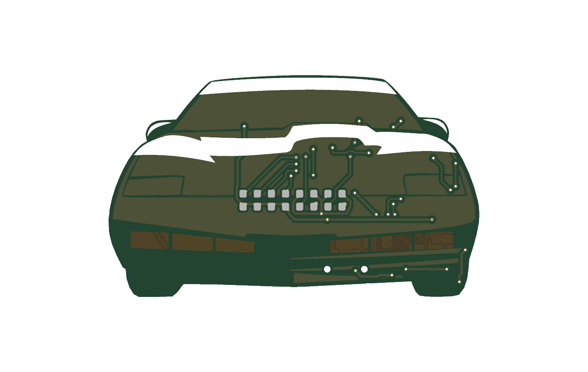
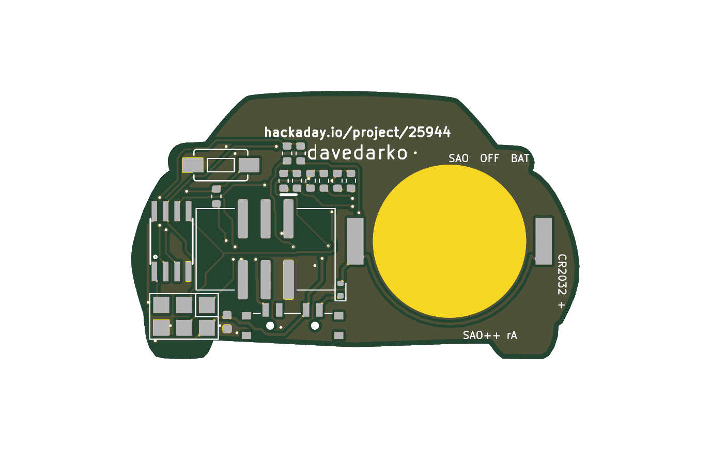

# Knight Rider (K.I.T.T.) — SAO++ edition

Originally the **KITT Knight Rider badge/brooch** by **davedarko (Dave Darko)**: https://hackaday.io/project/25944-kitt-knight-rider-badgebrooch, files at https://github.com/davedarko/Simple-Add-ons-SAO/tree/main/Knight%20Rider%20Badge

> **Permission pending — this board is not open-licensed.** The maker's repository states no license, and davedarko has not yet been asked or answered (draft request: [../han-saolo/docs/permission-request.md](../han-saolo/docs/permission-request.md)). The repo owner has **not yet decided** whether to publish this port before permission. Until the maker says otherwise:
> - the original design in `original/`, the outline and all artwork remain **© davedarko, all rights reserved**; the repo's licenses cover only the SAO++ additions (parts placement, routing, scripts, documentation), not the original work
> - do not treat these files as cleared for manufacture or sale
>
> **The car belongs to someone else too.** The drawing is the front of K.I.T.T. from the TV series *Knight Rider*, with its red scanner. The car's look and the names *Knight Rider* and *K.I.T.T.* belong to Universal (NBCUniversal). That needs its own clearance before anything is sold, separately from davedarko's permission.
>
> **davedarko, or anyone with rights in this design:** open an issue and it will be changed or removed.

 

A 50 × 30 mm car front. A small chip sweeps eight red lights back and forth across the nose, like the car on TV; a push button on the back changes the pattern (once a program is written — see Firmware).

## Which of the maker's files this is built from

The maker's folder has seven versions. The newest is the **KiCad 8 version (2024)**: its order files are dated 5 September 2024, while the six Eagle versions (REV1, REV2, REV2 reversed, REV3, REV3.1, REV3 programTester) are from 2017. It is the REV3.1 circuit (one resistor per light) redrawn, with the old 4-pin header replaced by a 6-pin SAO header. That is the one rebuilt here. It ran from the badge only; the 2017 versions had a CR2032 holder. SAO++ adds the coin cell back.

## What changed from the maker's 2024 board

| | Maker's 2024 board | SAO++ rev A |
|---|---|---|
| Which side is the art | Car on the back copper, parts on the other side | Board turned over: the car is the front, drawn exactly as the maker drew it |
| Scanner lights | 8 small red LEDs facing forward, on the art side, in the nose | **The same: 8 forward-facing red LEDs in the same spots, on the front** (see below) |
| Wiring | Both sides; 12 small through-holes and short tracks on the art side | **Both sides too: 36 small through-holes, covered with solder mask on both sides, and short tracks on the art side** (see below) |
| Connector | 2×3 pin header | The shared shrouded, keyed SAO connector, on the back, key slot up, right of centre |
| Power | Badge only, 2-position slide switch on the side | **SAO / OFF / BAT** switch, knob out of the bottom edge between the wheels; CR2032 clip on the back, left half |
| Chip | ATtiny85 (wide SOIC) | ATtiny85**V**: the same chip and pins, rated down to 1.8 V. On the cell the chip sees only about 2.7 V (after the safety diode), the very bottom of the ordinary ATtiny85's range |
| Resistors | 1 kΩ per light | 1.3 kΩ per light (the shared part) |
| New parts | — | Safety diode on the cell (required), a 330 Ω resistor on the badge's GPIO2 line, a 100 nF capacitor |
| Programming pads, button | 6 pads, 1 button | Kept: the maker's own pads and button footprints |
| Back text | "davedarko", "hackaday.io/project/25944", "JLCJLCJLCJLC" | The two credit lines are kept, same words, size and place. "JLCJLCJLCJLC" only told the factory where to print its order number; it is left off. New small labels: "SAO OFF BAT", "CR2032 +", "SAO++ rA" |

### An agreed exception: parts and tracks on the front

SAO++ normally keeps the front for art only. This board is a recorded exception (orchestrator decision, 11 November 2026), for two reasons:

- **The lights.** The maker's LEDs are visible parts on the art side, in the middle of the nose. That is exactly where the coin cell must sit on the back. A 20 mm cell does not fit beside the scanner (17 mm free either side), above it (15 mm) or below it (11 mm). Lights mounted on the back would need the cell to stick out about 3 mm past the side of the car, and the clip's pads would land off the board. So the lights stay where the maker put them.
- **The wiring.** With every other part on the back, the wires could not all be laid on one side without crossing. The maker's own 2024 board used both sides (12 through-holes, tracks on the art side), so this one does too.

What that looks like on the front: **36 small through-holes (vias)**, all covered by solder mask on both sides, and thin tracks under the mask. The tracks are in three places:

- around the scanner and the nose just above it: the eight light connections, and a ground wire from the four left-hand lights up through the hood;
- across the hood and the bottom of the windshield, between the scanner and the right-hand headlight (the chip's programming and light lines crossing over);
- along the bumper stripes and the right wheel (power and switch lines).

No through-hole goes through the maker's credit lettering or the white paint on the front. Where a track crosses the maker's copper painting, the painting is cut back 0.3 mm around it, like the original 2024 board. Up close the lines show; at arm's length the car reads as before.

### Why the safety diode is needed

The maker wired the chip's button pin to the badge's GPIO2 line. A badge can push current into that pin; without a diode that current could reach the coin cell, which is unsafe. So the diode D9 sits right after the cell. The 330 Ω resistor R9 protects the pin and the badge if both drive the line at once: on the maker's board, pressing the button shorted that badge line straight to ground.

### Light current

With 1.3 kΩ and a red LED (about 1.8 V):

| Supply | Current per light |
|---|---|
| 3.0 V | about 0.9 mA |
| 3.3 V (badge) | about 1.15 mA |
| Coin cell, after the diode (about 2.7 V) | about 0.7 mA |
| Maker's 1 kΩ (for comparison) | about 1.2–1.5 mA |
| 2017 boards' 150 Ω (for comparison) | about 8–10 mA |

A scanner lights only one or two LEDs at a time, so the cell should last days; how many depends on the program.

## Firmware

**There is no program in the maker's folder** (`original/` holds only board and circuit files). A program for this board needs:

- an ATtiny85 build (Arduino with the ATTinyCore board package, or avr-gcc), running at 1 MHz on the internal clock so it runs from a coin cell, with the brown-out detector off or set to 1.8 V;
- the light wiring: four pins drive eight lights. Each pin lights one LED when set HIGH (D1–D4) and another when set LOW (D5–D8), and lights neither when set as an input:

  | Pin | Lit when HIGH | Lit when LOW |
  |---|---|---|
  | PB0 | D1 | D5 |
  | PB1 | D2 | D6 |
  | PB2 | D3 | D7 |
  | PB3 | D4 | D8 |
- the button on PB4 (pressed = low; turn on the internal pull-up). The same pin goes to the badge's GPIO2 through 330 Ω, so the program should not drive it hard;
- a 6-pin AVR programmer (USBasp, AVRISP mkII or Arduino-as-ISP) set to **3.3 V**, pressed onto the programming pads JP1, with the power switch on **OFF**. MOSI, MISO and SCK are also light pins, so the lights flicker while it programs; that is how the maker designed it.

## Things to check on the first prototype

1. **Button part number (owner to-do).** The button uses the maker's land pattern, SparkFun's "1101NE" 6 × 3.5 mm two-pad switch with 6.3 mm pad spacing. No exact manufacturer part number is confirmed yet; one with that pad spacing has to be chosen before ordering assembly.
2. **Front LED.** Lite-On LTST-C191KRKT on the maker's 0603 land pattern; the maker's files do not name a part. Check brightness at about 1 mA.
3. **Chip on the cell.** The ATtiny85V should run down to about 2 V; check the scanner keeps sweeping as the cell runs down.
4. **Switch labels.** "SAO OFF BAT" is printed above the cell (there is no room beside the switch), in the order the knob positions sit as seen from the back. Which end of the knob travel is SAO is not yet confirmed (as on every SAO++ board). The knob sticks about 0.7 mm out of the bottom edge between the wheels.
5. **Cell insertion.** The clip opens upward; the cell slides in from the roof's left side, over bare board (only flat through-holes there).
6. **Tight spots.** Several parts sit close to the connector and the clip (keep-clear boxes overlap; the real gaps are listed in `hardware/knight-rider.kicad_dru`, the smallest being 0.17 mm from R9's pad to the connector's plastic body). Check the first assembled boards.

## Files

- `hardware/knight-rider.kicad_pro` — KiCad 10 project.
  - ERC: 0.
  - DRC: 0 errors, 0 unconnected, 0 schematic mismatches.
  - 13 warnings, none electrical:
    - 10 thin slivers in the front copper painting where tracks cut it;
    - 2 overlapping footprint outlines (connector and diode) on the back silkscreen;
    - 1 "footprint differs from library" on the cell clip (its silk arrow was moved to the fab layer because it landed on the maker's credit line).
- `hardware/knight-rider.kicad_dru` — the art rule, plus one commented rule for the keep-clear boxes that overlap around the connector and the clip, with the real gaps.
- `hardware/build_board.py` — rebuilds the board in one run (about a minute): art, parts, routing (via `router.py`), ground copper, labels.
- `hardware/router.py` — the small two-layer router used for this board.
- `hardware/circuit.json` — the circuit as data; `tools/gen_schematic.py knight-rider` and `build_board.py` both read it.
- `hardware/extract_art.py` — pulls the car art out of the maker's 2024 KiCad file, turned over, into `art/art.json`.
- `hardware/parts_local.py`, `hardware/make_local_footprints.py`, `hardware/knight-rider-local.pretty/` — the five parts the shared library does not have: chip, front LED, button, programming pads, diode.
- `production/` — order files for one board and a 2×2 panel. Start with [production/README.md](production/README.md).
- `original/` — the maker's files, untouched.

## Parts

| Part | Qty | Shared? |
|---|---|---|
| SAO connector XFCN BH254VS-6P | 1 | yes |
| Switch C&K PCM13SMTR | 1 | yes |
| CR2032 clip TE BAT-HLD-001 | 1 | yes |
| 1.3 kΩ / 330 Ω resistors, 100 nF capacitor | 8 / 1 / 1 | yes |
| ATtiny85V-10SU | 1 | new (this board) |
| Red 0603 LED, front-facing, Lite-On LTST-C191KRKT | 8 | new |
| 6 × 3.5 mm push button | 1 | new, part number to be chosen |
| Schottky diode RB751S40T1G (the house's planned SAOPP-D-01) | 1 | new to the library; will be shared by every board with a chip |

Prices and LCSC numbers for the new parts are not filled in yet.
