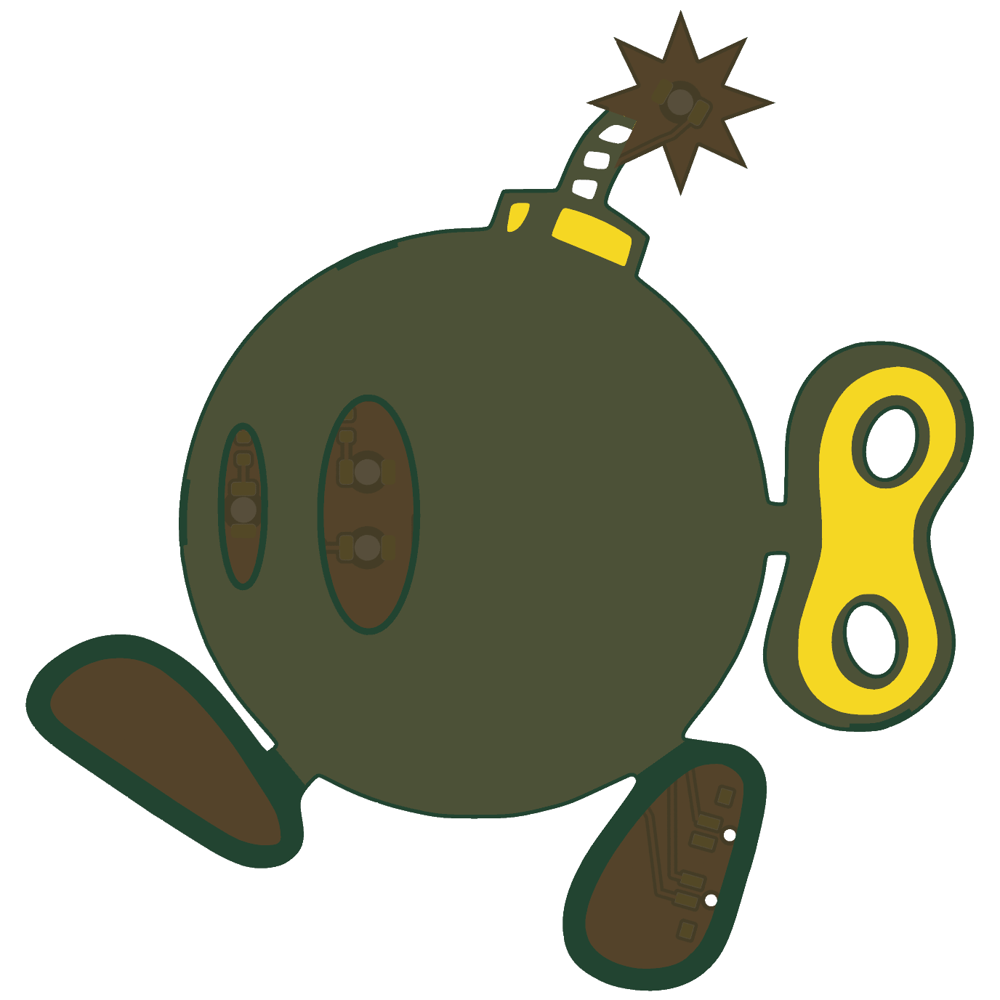
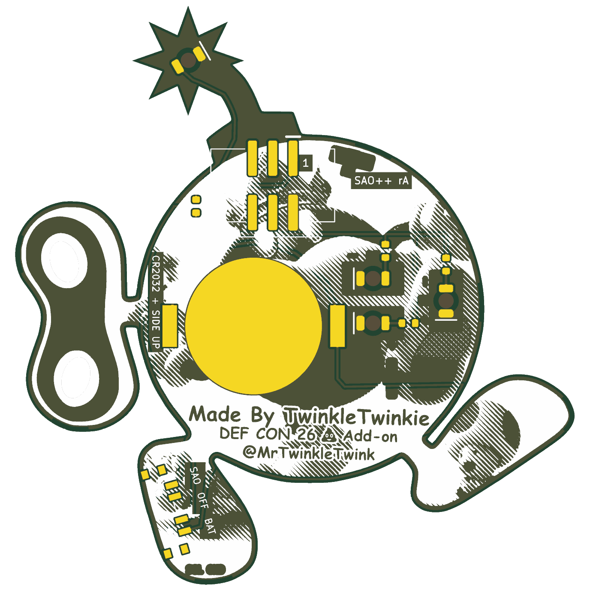

# La Bomba — SAO++ edition

Originally **La Bomba** (TwinkleTwinkie's DC26 Shitty Add-on #6) by **TwinkleTwinkie**, made for DEF CON 26 (2018): https://hackaday.io/project/159751-la-bomba

> **Permission pending — this board is not open-licensed.** The original hackaday.io page states no license, and TwinkleTwinkie has not yet been asked or answered (draft request covering all of the maker's boards in this repo: [../fat-pika/docs/permission-request.md](../fat-pika/docs/permission-request.md)). The repo owner chose on 2026-11-10 to publish this port anyway. Until the maker says otherwise:
> - the original design in `original/`, the outline and all artwork remain **© TwinkleTwinkie, all rights reserved**; the repo's CERN-OHL-S / CC-BY-SA licenses cover only the SAO++ additions (new parts placement, routing, scripts, documentation), not the original work
> - do not treat these files as cleared for manufacture or sale
> - the art shows a Bob-omb, a character from Nintendo's Mario games; the character belongs to Nintendo, which is a separate question from the maker's permission (the maker can only give permission for their own drawing and board)
>
> **TwinkleTwinkie, or anyone with rights in this design:** open an issue and it will be changed or removed.

 

A walking wind-up bomb (70 × 72.5 mm). Both eyes light up white from behind, through the bare board, and the spark at the end of the fuse glows red.

## What changed from the 2018 board

| | 2018 original | SAO++ rev A |
|---|---|---|
| Connector | 4-pin through-hole in the right foot (pins visible on the art side) | 6-pin SAO v1.69bis, surface-mount shrouded and keyed, at the top of the body just under the fuse cap. Nothing shows on the front. It had to move: the new connector's plastic body is 15 mm wide and the foot is 12 mm |
| Power | Badge only | Slide switch on the outer edge of the right foot: **SAO / OFF / BAT**. Runs from the badge or from its own CR2032, which clips to the back of the body |
| LEDs | 4 × OSRAM TOPLED (obsolete), two resistors | 4 × reverse-mount 1206 in the same spots, one 1.3 kΩ resistor each: white behind the near eye (two) and the far eye (one), red in the spark |
| Brightness and current | several mA per LED | white about 0.45 mA each and red about 1.2 mA on badge power (~2.6 mA total); on a fresh cell about 0.2 mA per white LED and 1 mA for the red one. **Dimmer than the original on purpose**, so a coin cell lasts days. See the prototype checklist |
| Front art | — | Unchanged, apart from two 0.9 mm holes in the right shoe (the switch's locating pegs). The old header's four holes in that shoe are gone and the shoe's bare area is filled in where they were |
| Back art | — | "Made By TwinkleTwinkie / DEF CON 26 Add-on / @MrTwinkleTwink" is untouched (the build script checks that no track, part, label or the cell touches it). The coin cell covers part of the half-tone drawing in the middle of the body. Five small labels are added (SAO, OFF, BAT, the cell type, the revision) plus a "1" by the connector's pin 1 |

What the far-eye LED (D3) lights: the 2018 board put it behind the narrow oval left of the big eye, which is the bomb's far eye, so it is white like the near eye.

**Parts shared with the rest of SAO++:** connector, switch, cell clip and resistor are the same reels as Fat Pika and Mad Cat; the white LED is Mad Cat's and the red one is Fat Pika's. No new part.

**Battery life (calculated, not measured):** three white LEDs at about 0.2 mA and the red one at about 1 mA is about 1.6 mA, so a CR2032 should last roughly 80–120 hours, the white eyes getting dimmer toward the end. The white LEDs are best on badge power.

## Things to check on the first prototype

1. **Brightness.** The LEDs run at a fraction of the 2018 current. Check the eyes and the spark in room light on badge power, then on a fresh cell. If the eyes are too dim, change R1–R3 from 1.3 kΩ to 330 Ω (already on the approved list as SAOPP-R-02).
2. **Pin 1 position.** The connector keeps VCC and GND in the same corner as the 2018 header (VCC top-left seen from the front). Confirm against a v1.69bis badge.
3. **Connector at the top edge.** The connector's top-left pin ends about 1 mm from the board edge, beside the fuse cap, and one corner of its plastic body overhangs the small notch where the fuse cap meets the body by about 0.2 mm. Check it looks acceptable from the front and that the solder joints hold. There was no spot on the body where both the coin cell and the connector fit fully; this is the least bad one.
4. **Coin cell next to the lettering.** The cell's edge stops about 0.2 mm above the top of "Made By TwinkleTwinkie". Check that the credit is fully visible with a cell fitted, and that the cell slides in and out downward, over the lettering.
5. **Switch labels.** The silkscreen assumes "knob toward the SAO label = badge power". If the real part is the other way round, swap the SAO and BAT labels (nothing electrical changes).
6. **Knob reach.** The knob tip ends about 0.64 mm past the right foot's edge (the edge bulges slightly, so the switch sits a little further in than on Mad Cat). Confirm it is comfortable to slide.
7. **Battery clip direction.** The clip fits its pads both ways round. Its closed end must point up, toward the connector; the open side faces the lettering. Tell the assembler.
8. **Lines behind the eyes.** Three thin tracks run behind the bare-board eyes (as the 2018 tracks did). Check they do not show as lines when the eyes are lit.
9. **Track under R4.** The badge-power track passes between the two pads of resistor R4 (the usual way to cross on a one-sided board without a via). Check the resistor sits flat and nothing bridges.

## Files

- `hardware/la-bomba.kicad_pro` — KiCad 10 project (schematic + board). ERC: 0 issues. DRC: 0 errors, 0 unconnected, schematic matches board. 44 warnings remain, all from the art or expected: silkscreen art lines crossing each other (33), art libraries not installed (2), three placed parts differ from the library copy (the switch and spark LED sit at an angle, and the clip's arrow was moved off the silkscreen; 3), silkscreen touching an edge (3: two pieces of 2018 art at the key holes and the connector outline at the fuse-cap notch), narrow points in the ground copper (2), front silkscreen on a mask opening in the 2018 art (1).
- `hardware/circuit.json` — the circuit as data; `tools/gen_schematic.py la-bomba` and `hardware/build_board.py` both read it.
- `hardware/build_board.py` — rebuilds the board from `original/` plus the SAO++ changes; every placement and routing decision is in there with a comment.
- `hardware/la-bomba.kicad_dru` — one extra rule: fine gaps inside the artwork are allowed.
- `production/` — everything a board house needs, for one board (`single/`) and a 2×2 panel (`panel/`). Start with [production/README.md](production/README.md).
- `original/` — the untouched 2018 KiCad 4 project and zip from hackaday.io.

## Parts cost (parts only, list prices checked 2026-11-10)

| Part | Qty | Each @ ~100 boards |
|---|---|---|
| Connector XFCN BH254VS-6P (LCSC C492445) | 1 | $0.12 |
| Switch C&K PCM13SMTR (Digikey) | 1 | ~$0.90 |
| CR2032 clip TE BAT-HLD-001 (LCSC C7501066) | 1 | $0.61 |
| LED Lite-On LTW-C230DS white (LCSC C575513) | 3 | $0.055 |
| LED Lite-On LTST-C230KRKT red (LCSC C125107) | 1 | $0.037 |
| Resistor 0603 1.3 kΩ (LCSC C22767) | 4 | <$0.01 |
| **Total** | | **about $1.85** |

The CR2032 cell and the bare board (70 × 72.5 mm) are not included.
