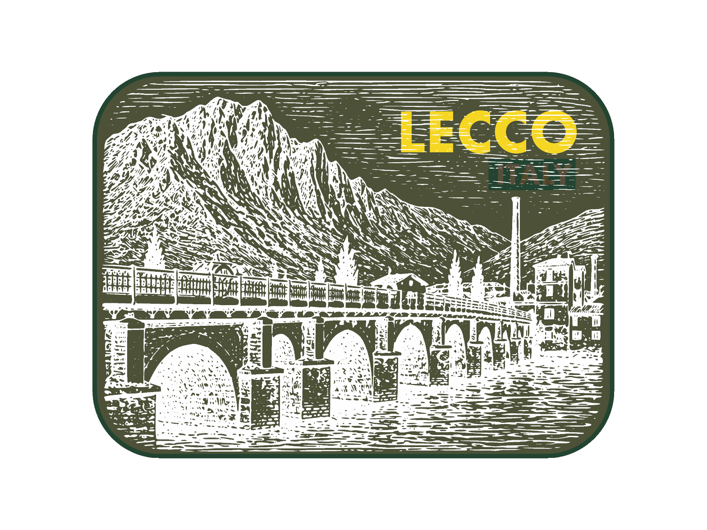
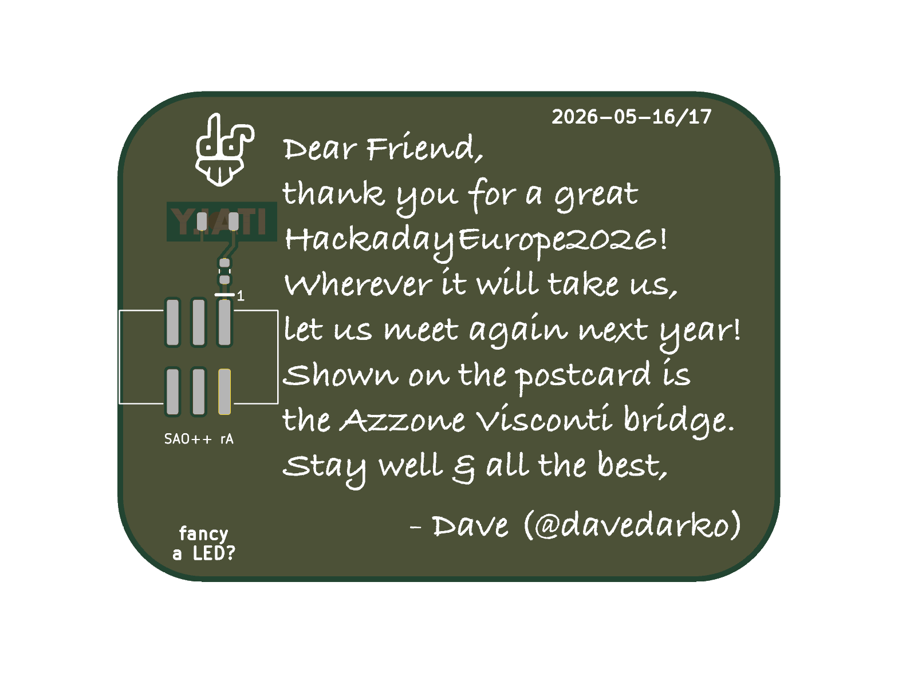

# Lecco Postcard — SAO++ edition

Originally the **LECCO postcard** SAO by **davedarko (Dave Darko)**, a souvenir of Hackaday Europe 2026 in Lecco, Italy: https://github.com/davedarko/Simple-Add-ons-SAO/tree/main/Lecco

> **Permission pending — this board is not open-licensed.** davedarko's repository states no license, and he has not yet been asked or answered (draft request: [../han-saolo/docs/permission-request.md](../han-saolo/docs/permission-request.md)). The repo owner has **not yet decided** whether to publish this port before he answers. Until the maker says otherwise:
> - the original design in `original/`, the outline and all artwork remain **© davedarko, all rights reserved**; the repo's CERN-OHL-S / CC-BY-SA licenses would cover only the SAO++ additions (new parts placement, routing, scripts, documentation), not the original work
> - do not treat these files as cleared for manufacture or sale
>
> **davedarko, or anyone with rights in this design:** open an issue and it will be changed or removed.

> **A real place and a real event.** The front shows the Azzone Visconti bridge in Lecco with the mountains behind it, and the handwritten message on the back names Hackaday Europe 2026. Hackaday's names and marks belong to their owners; SAO++ adds nothing of theirs. Everything of the maker's (engraving, LECCO / ITALY lettering, message, signature, date, logo) is kept exactly as drawn.

 

## What the original actually is

- **A postcard.** 54 × 40 mm with rounded corners. The front is his engraving of the bridge, with **LECCO** in gold (bare copper showing through the mask) and **ITALY** cut out of the solder mask on *both* sides with no copper behind it: a little window of bare board. The back is the "written" side: "Dear Friend, thank you for a great HackadayEurope2026! …", signed "- Dave (@davedarko)", dated 2026-05-16/17, with his logo.
- **The LED that never got a footprint.** His readme apologises for "the footprint fail" and says you need "an LED and a simple 2 row SMD header", but "you have to botch the LED on it somehow". The files show why: where the LED should be there are only two round 2 mm pads marked VCC and GND, just under the ITALY window, a resistor from the header's supply ("bridge or add resistor"), and the note "fancy a LED?". You were meant to solder a loose LED across the two pads so that it lit ITALY from behind.
- **The header footprint is the wrong kind.** He used KiCad's 2×3 SMD *socket* footprint for the *pin header* the readme asks for. KiCad draws those two with their pad rows mirrored, so a header soldered there does not match the footprint's pin numbering. We cannot tell for certain which mistake his apology means; both are fixed here.
- **Badge power only.** No battery, no switch.

## What SAO++ makes of it

The same postcard, with the LED he intended now built in: **ITALY glows** whenever the postcard is plugged into a badge.

| | Original | SAO++ rev A |
|---|---|---|
| Size | 54 × 40 mm | **64.8 × 48 mm (whole board scaled up 1.2×)**, see below |
| Connector | 2×3 socket footprint, centre left (back view) | The shared 6-pin SAO v1.69bis shrouded, keyed SMD connector, key slot up, in the strip beside the message. Nothing shows on the front |
| Light | Two bare pads; bodge an LED on yourself | One shared **white** reverse-mount LED on the back, centred behind ITALY, shining through the bare board |
| Resistor | "bridge or add resistor", no value | The shared 1.3 kΩ: about 0.45 mA through the white LED from the badge's 3.3 V |
| Power | Badge only | Badge only (see "Why no battery") |
| Front art | — | Unchanged, just larger |
| Back | — | Message, signature, date, logo and "fancy a LED?" unchanged (larger). The maker's "VCC", "GND" and "bridge or add resistor" labels are gone (the pads they described are gone). Added: "SAO++ rA" and a pin-1 mark |

**Why white:** the art is a white engraving on a dark sky, and ITALY sits in that sky like a lit sign; white makes it read as light, not as a warning lamp. White is the weakest colour on a coin cell, but this board runs only on the badge's 3.3 V, where that does not matter. If the owner prefers red (SAOPP-LED-10), it is the same footprint and resistor: change one word in `hardware/circuit.json`.

**Parts:** three, all shared with the rest of SAO++ (connector, white LED, 1.3 kΩ resistor). **No new part, no switch, no cell clip.**

## Why the board is 1.2× bigger

The handwritten message fills the back from the right edge (back view) to 13.4 mm from the left edge. The connector's plastic body is 15.3 mm wide with its key slot pointing up, so at the original size it would either cover the first letters of three lines of the message or stick out past the edge. Scaling the whole board up uniformly (owner rule, 2026-11-12) widens that strip: 1.18× is the bare minimum, **1.2×** leaves 0.5 mm between the connector body and the message and 0.3 mm to the edge. Everything grows the same, so the postcard looks identical, only larger; lines and lettering get thicker, not thinner.

## Why no battery (needs the owner's decision)

The standard SAO++ treatment adds a CR2032 clip and an SAO / OFF / BAT switch. On this board the cell does not fit anywhere without covering the message: the cell is 20 mm across and the clip 23 mm, and the only clear strip on the back is 13.4 mm wide (16.1 mm after the 1.2× scale). Laying the cell over the message would also put the clip's 17 mm bare-copper contact disc under it, which erases that part of the lettering from the board.

| Option | What it costs | Numbers |
|---|---|---|
| **A. Built: badge power only, 1.2× scale** | No battery mode (the maker's original had none either) | 64.8 × 48 mm; 3 parts |
| **B. Full standard treatment, scaled until the cell fits beside the message** | A much bigger board: about the size of a credit card, heavy on one SMD connector | about **1.6×**: 87 × 64 mm; adds the clip and the switch |
| **C. Cell over the message** | Loses the middle of "Dear Friend …": the clip's contact disc removes the silkscreen under it | 64.8 × 48 mm; not recommended |
| **D. Cell overhanging the edge** | 20 mm cell in a 16 mm strip: about 5 mm of cell past the edge, and its clip tabs would still reach the lettering | not recommended |

## Things to check on the first prototype

1. **Is one LED enough?** One white LED at about 0.45 mA lights the board from behind the middle of a 9.3 mm wide word. The ends (the "I" and the "Y") may be dimmer. If too dim: R1 to 330 Ω (SAOPP-R-02, already approved) gives about 2 mA. Calculated, not measured.
2. **Mask colour.** Not recorded in the maker's files. His renders and the art suggest dark green mask with white silkscreen; the window only glows if the board under ITALY is bare (it is: no mask, no copper, both sides).
3. **The back ITALY window** now has the LED sitting on it. It was trimmed about 1.1 mm² (of 12.2 mm²) so the two short LED tracks are not left bare; most of that is under the LED itself.
4. **Pin 1 position.** The connector keeps VCC in the same corner as Mad Cat and Fat Pika. Confirm against a v1.69bis badge before a production run.
5. **LED direction.** The LED's cathode mark is on the assembly drawing (fab layer), not the silkscreen, because the silkscreen would land on the bare ITALY window. The placement file carries the rotation; check it in the assembler's preview.

## Files

- `hardware/lecco.kicad_pro` — KiCad 10 project (schematic + board). ERC: 0 violations. DRC: 0 errors, 0 unconnected, schematic matches board. Warnings, all art: 126 "silkscreen over copper" (the maker's engraving lines run across the gold LECCO and the ITALY window, as in his original), 2 for the maker's art and logo footprints not being in an installed library, 1 for the LED's cathode mark moved to the fab layer.
- `hardware/circuit.json` — the circuit as data; `tools/gen_schematic.py lecco` and `hardware/build_board.py` both read it.
- `hardware/build_board.py` — rebuilds the board from `original/` plus the SAO++ changes in one run (scale, parts, routing, copper), with every decision commented.
- `hardware/lecco.kicad_dru` — the art rule only.
- `hardware/outline.json` — the maker's outline at original size (the script scales it).
- `production/` — files for one board (`single/`) and a 2×2 panel (`panel/`). Start with [production/README.md](production/README.md).
- `original/` — davedarko's untouched KiCad 9 project and both art footprints, from his repository (commit 1a08593). His board uses `leccoPostcard_40mm`; the full-size `leccoPostcard.kicad_mod` is not used.

## Parts cost (parts only, list prices from docs/parts.md, 2026-11-10)

| Part | Qty | Each |
|---|---|---|
| Connector XFCN BH254VS-6P (LCSC C492445) | 1 | $0.10 @340 |
| White reverse-mount LED Lite-On LTW-C230DS (LCSC C575513) | 1 | $0.055 @100 |
| Resistor 0603 1.3 kΩ (LCSC C22767) | 1 | $0.002 |
| **Total** | | **about $0.16** |

Not included: the bare board (64.8 × 48 mm).
