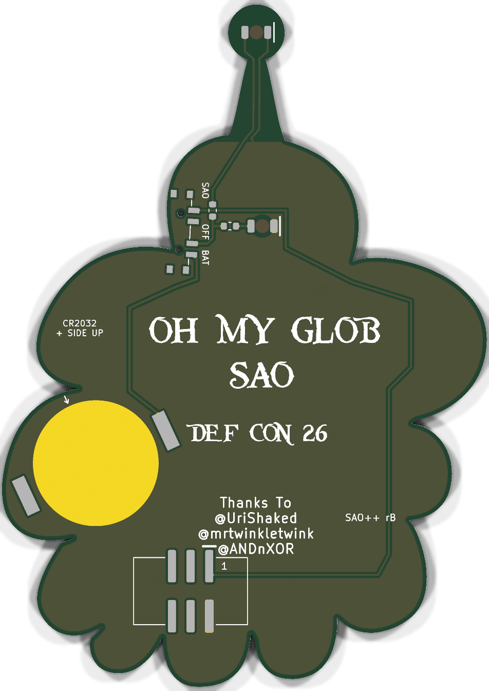

# Oh My Glob (LSP) — SAO++ edition

Originally the **LSP SAO** ("Oh My Glob SAO") by **lemons4all**, made for DEF CON 26 (2018): https://hackaday.io/project/161510-lsp-sao

> **Permission pending — this board is not open-licensed.** The original hackaday.io page states no license, and lemons4all has not yet been asked or answered (draft request: ../rbg/docs/permission-request.md). The repo owner chose on 2026-11-10 to publish this port anyway. Until the maker says otherwise:
> - the original design in `original/`, the outline and all artwork remain **© lemons4all, all rights reserved**; the repo's CERN-OHL-S / CC-BY-SA licenses cover only the SAO++ additions (new parts placement, routing, scripts, documentation), not the original work
> - do not treat these files as cleared for manufacture or sale
>
> **The character belongs to someone else too.** The board is drawn as Lumpy Space Princess from the cartoon *Adventure Time*, owned by Cartoon Network / Warner Bros. Discovery. That is separate from the maker's permission: even with lemons4all's blessing, selling boards with her likeness needs the rights holder's permission or new art.
>
> **lemons4all, or anyone with rights in this design:** open an issue and it will be changed or removed.

 

The star on her forehead glows white and the ball on the tip of her crown glows red, both lit from behind through the bare board.

**Rev B is the whole board scaled up 1.3 times** (owner decision 2026-11-12: scale up rather than squeeze). Outline and all of lemons4all's art grew together, keeping their proportions: **50.8 × 71.4 mm became 66.0 × 92.8 mm**. The parts did not grow; only the two LEDs, which are part of the picture, moved with it.

## What changed from the 2018 board

| | 2018 original | SAO++ rev B |
|---|---|---|
| Size | 50.8 × 71.4 mm | 66.0 × 92.8 mm (everything × 1.3) |
| Connector | 4-pin through-hole in the middle bottom lobe (pins visible on the art side) | 6-pin SAO v1.69bis, surface-mount, shrouded and keyed, in the bottom lobes just below the credits. Nothing shows on the front |
| Power | Badge only | Slide switch on the right side of the head: **SAO / OFF / BAT**. Runs from the badge or from its own CR2032, clipped to the right lobe on the back |
| Star LED | OSRAM TOPLED (obsolete) on the back | White reverse-mount 1206 LED in the same spot, 1.3 kΩ resistor |
| Crown-tip LED | 3 mm LED standing up on the **front**, legs through the board | Red reverse-mount 1206 LED on the **back**, shining through a 2 mm bare window (no copper, no solder mask) at the same spot. Nothing sticks out of the art any more |
| Front art | — | Unchanged apart from the scale and: two 0.9 mm holes on the right side of the head (the switch's pegs), a 2 mm window at the crown tip, and the old header's holes gone |
| Back art | — | "OH MY GLOB / SAO / DEF CON 26" and the "Thanks To" credits are where the maker put them, scaled with the art, and nothing covers them. Labels added: SAO / OFF / BAT, "CR2032 + SIDE UP", an arrow for the cell, "SAO++ rB", "1" at the connector |

## Rev A's trade-offs, and what scaling did to each

| Rev A (2018 size) | Rev B (× 1.3) |
|---|---|
| Two tiny covered holes (vias) in the mouth, so the badge-power wire could hop over the LED-supply wire | **Gone.** No holes at all; one copper layer carries everything. Scaling alone did not do this: the switch's middle pin always fences one supply off from the other on one layer, at any size. The badge-power wire now passes between the two pads of R1 (a resistor that sits in the LED-supply wire), under R1's solder mask, 0.3 mm clear of each pad. Scaling gave the room to put R1 right beside the switch |
| The coin cell hid the end of "DEF CON 26" and overhung the edge by about 1 mm | **Gone.** The cell is wholly on the board (0.4 mm from the edge at its closest) and covers no lettering. The clip's solder pads are 1.3 mm from the edge |
| Switch knob about 0.4 mm past the edge | **Better, not perfect.** About 1.15 mm of knob shows in the middle position and at least 0.95 mm at either end of its travel. The head is a curved lobe; no spot on this outline gives more without moving the switch onto the gold crown (see below) |
| Connector shroud 0.1 mm from the clip's solder pad, needing a special design-rule exception | **Gone**, and the exception is deleted. The connector and the clip are now well apart |
| Connector body overhung the bottom notches (parts past the edge) | **Gone.** The whole connector, pads included, is at least 1.1 mm inside the edge. It is not the 3 mm the house standard asks for: with the cell in place and no lettering covered, no spot is that far from the edge at this size (the search found at most 1.8 mm even at 1.35 ×) |
| Two wires ran through gaps between the words | **Gone.** No wire comes within 0.5 mm of any of the maker's lettering: the badge supply goes round the left of the lettering, the cell supply round the right of "OH" |
| Cell clip turned to 269.9° to dodge a KiCad quirk | **Changed, still a workaround.** The clip now sits at 335°, open side toward the notch above the cell so the cell slides in from the board edge. KiCad also calls its courtyard "malformed" at 325–332°, so the build checks the angle |

What a smaller scale would not do (from a search of each size): at 1.15 × the cell fits but the connector cannot sit fully on the board anywhere clear of the lettering and the cell; at 1.2 × the connector and the clip cannot both fit without overlapping; at 1.25 × they fit only with the connector moved to the left lobe, away from the old header spot (0.6 mm from the edge) or with the clip's open side facing into the board, straight at the connector.

**Not chosen:** a switch spot at the base of the crown spike would give about 1.5 mm of knob. It would put the switch's two peg holes through the gold crown art and crowd the two LED wires up the spike, so the head side was kept.

## Things to check on the first prototype

1. **Brightness.** Red tip: about 1.0 mA on a cell, 1.2 mA on the badge. White star: about 0.2 mA on a fresh cell, 0.45 mA on the badge; white is the weakest colour on a coin cell. If the star is too dim, change R2 alone to 330 Ω (SAOPP-R-02).
2. **Knob.** Check the switch slides comfortably with a thumb (about 1.15 mm of knob shows). The labels assume "knob toward the SAO label = badge power"; if it is the other way round, swap SAO and BAT on the silkscreen.
3. **Wire under R1.** The badge-power wire runs between R1's two pads. Check R1 is soldered cleanly with no solder bridging onto that wire (it is under solder mask, 0.3 mm from each pad).
4. **Cell clip.** The clip's open side faces up and to the right, toward the notch above the cell: the cell slides in from that edge (the small arrow on the cell's rim). Check a cell goes in and out easily.
5. **Pin 1 position.** VCC and GND are in the same corner as on the 2018 header. Confirm against a v1.69bis badge.
6. **Weight.** A 66 × 93 mm board hanging from one surface-mount connector near the bottom, with the cell on one side. It is about 70 % more board than rev A. Check it sits firmly in a badge and does not lever on the connector.
7. **Notches.** The outline has narrow notches between lobes (as in 2018). The router cannot cut them as narrow as drawn; they will come out slightly rounded.

**Battery life (calculated, not measured):** about 1.2 mA total on a cell, so roughly 150 hours from a CR2032, the white star fading first.

## Files

- `hardware/lumpy.kicad_pro`: KiCad 10 project (schematic + board). ERC: 0. DRC: 0 errors, 0 unconnected, schematic matches the board. Warnings left: 3 for the art footprints' libraries not being installed; 2 because BT1 and SW1 differ from their library copies (both sit at angles that are not multiples of 90°).
- `hardware/circuit.json`: the circuit as data; `tools/gen_schematic.py lumpy` and `hardware/build_board.py` both read it. Standard switch wiring: pin 1 badge, pin 3 LEDs, pin 4 cell. The circuit is unchanged from rev A.
- `hardware/build_board.py`: rebuilds the board from `original/` plus the SAO++ changes. `SCALE` at the top sets the size. Board-specific details, all explained in comments there:
  - the art is scaled in the KiCad 5 file text before loading (the three svg2mod art footprints and the credits text), about the centre of the outline's bounding box;
  - the badge-power wire crosses the LED-supply wire between R1's pads (no vias);
  - the clip's two "+" pads are declared joined inside the part (`SetDuplicatePadNumbersAreJumpers`); only the upper one is wired;
  - the clip's own silkscreen moved to the fab layer; the board carries its own labels;
  - the maker's 2 mm back mask window behind the star was dropped: the new LED brings its own window;
  - the build stops if any part pad, part body or wire comes near the maker's lettering, if the cell would overhang or cover lettering, or if the ground copper is not one piece.
- `hardware/lumpy.kicad_dru`: only the art rule now (rev A's connector/clip exception is gone).
- `production/`: everything a board house needs, for one board and a 2×2 panel. Start with [production/README.md](production/README.md).
- `original/`: the untouched 2018 KiCad 5 project and zip from hackaday.io.

## Parts cost (parts only, list prices checked 2026-11-10)

| Part | Qty | Each @ ~100 boards |
|---|---|---|
| Connector XFCN BH254VS-6P (LCSC C492445) | 1 | $0.12 |
| Switch C&K PCM13SMTR (Digikey) | 1 | ~$0.90 |
| CR2032 clip TE BAT-HLD-001 (LCSC C7501066) | 1 | $0.61 |
| LED Lite-On LTST-C230KRKT red (LCSC C125107) | 1 | $0.037 |
| LED Lite-On LTW-C230DS white (LCSC C575513) | 1 | $0.055 |
| Resistor 0603 1.3 kΩ (LCSC C22767) | 2 | <$0.01 |
| **Total** | | **about $1.73** |

The CR2032 cell and the bare board (66 × 93 mm, about 1.7 times the area of rev A's 51 × 71 mm, so it costs more) are not included. No new parts: everything is already on the SAO++ list.
