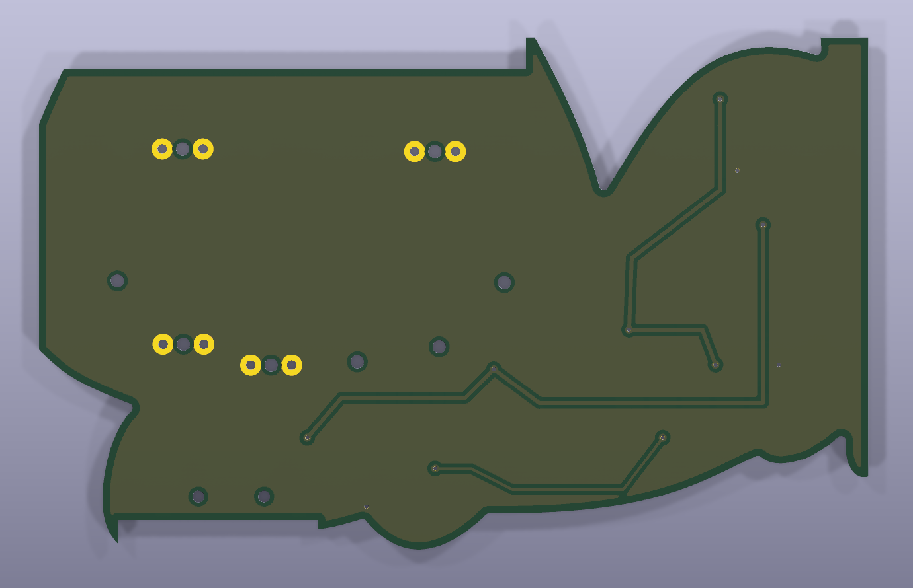
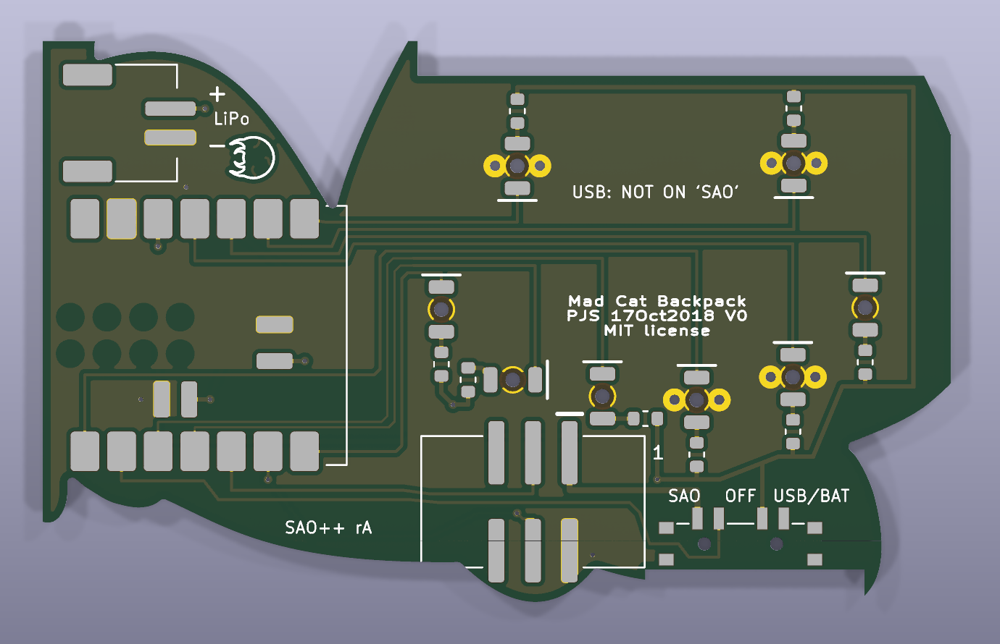

# Mad Cat Backpack — SAO++ edition

Originally the **Mad Cat Backpack** by **Wireb (Peter Shabino)**, 2018: https://github.com/Wireb/Mad_Cat_Backpack (commit f247c92). It is a small board that is soldered flat against the **back** of TwinkleTwinkie's Mad Cat SAO and makes the cat's eyes and teeth move: they fade, blink, "talk", lick their lips and sparkle.

> **Open licence (MIT).** The maker's design and firmware are MIT-licensed, so they may be copied, changed and sold, as long as his notice goes with them:
>
> *Copyright (c) 2018 Peter Shabino.* Permission is hereby granted, free of charge, to any person obtaining a copy of this hardware, software, and associated documentation files (the "Product"), to deal in the Product without restriction, including without limitation the rights to use, copy, modify, merge, publish, distribute, sublicense, and/or sell copies of the Product, and to permit persons to whom the Product is furnished to do so, subject to the following conditions: The above copyright notice and this permission notice shall be included in all copies or substantial portions of the Product. THE PRODUCT IS PROVIDED "AS IS", WITHOUT WARRANTY OF ANY KIND (full text: [original/LICENSE](original/LICENSE)).
>
> **Two things that are not his to license.** The little icon he drew on the back is a **Metroid**, a Nintendo character; it is kept exactly as he drew it, and whether to keep it is the owner's call. And this board exists to light **TwinkleTwinkie's Mad Cat** ([../mad-cat](../mad-cat)), whose own permission is still pending: this board carries none of the Mad Cat's art (only its outline and LED positions), but it is no use without one.

 

The renders show this board alone. The "front" is the side that is pressed against the back of the Mad Cat, so in use it is never seen; all the parts are on the other side, facing the badge.

## How it goes together with the Mad Cat

1. Build an SAO++ Mad Cat (**boards/mad-cat**) as a **bare board: fit none of its parts** (no connector, switch, cell clip, LEDs or resistors). It becomes the face plate.
2. Lay the bare Mad Cat face down and put this board on its back, parts side up. Line them up: each of this board's eight 1.0 mm light holes sits over one of the Mad Cat's bare eye or tooth windows, and the outlines match (this board is the Mad Cat's own outline, 0.35 mm smaller all round, so nothing shows from the front).
3. Solder the **eight bond holes** (the bare gold rings beside the eyes and the two middle-left teeth) from this side: solder fed into each hole runs down and joins the Mad Cat's unused LED pad underneath.
4. Plug the pair into a badge with this board's connector. It sits exactly where a plain Mad Cat's connector would, so the cat hangs the same way, just 1.6 mm further out.

The maker did the same thing in 2018 with an unmodified Mad Cat: he moved its eight LEDs onto his backpack, cut four of the Mad Cat's traces, and soldered four pads under the backpack's edge. On the SAO++ Mad Cat nothing has to be cut: leaving its parts off is enough.

**Can our Mad Cat still be driven by it?** Yes, that is what it is built for: the SAO++ Mad Cat kept the 2018 LED positions, and its back copper is already cleared around each one, so this board's LEDs shine through the same windows the Mad Cat's own LEDs would. A **2018** Mad Cat (with its LEDs and header removed) should light up the same way, but the bond holes would not land on its pads (its LED pads are 2.4 mm from each centre, not 1.55 mm), so it would need glue instead of solder. That has not been checked.

## What changed from the original

| | Original (2018) | SAO++ rev A |
|---|---|---|
| Size and shape | 33.5 × 31.2 mm plate behind the face only | **63.0 × 39.0 mm**: the Mad Cat's own outline, 0.35 mm smaller all round, covering the face, the haunch and the root of the tail. Bigger because the XIAO module (21 × 18 mm) does not fit behind the face with the eight LEDs |
| Controller | PIC16F1503 | **Seeed Studio XIAO ESP32** (C3, S3 or C6) on the back of the haunch, USB-C at the haunch's right-hand edge |
| Firmware | his PIC assembly | **new Rust firmware** that replays his eight animations with his timing and his random weights ([firmware/](firmware/)) |
| LEDs | the eight white TOPLEDs taken off the Mad Cat, on the side facing the cat | eight white **reverse-mount** LEDs (the shared SAO++ part) on the back, each over a 1.0 mm hole; same eight spots, same order |
| LED resistors | 8 × 200 Ω 0805 | 8 × **330 Ω** 0603 (shared part): about 1.5 mA per LED on 3.3 V, much like his board on badge power (he warned 200 Ω was "borderline too bright" on 5 V USB) |
| Power and connector | 4-pin header pushed through both boards (badge power), or his mini-USB socket | **6-pin SAO v1.69bis** shrouded connector on the back, in the Mad Cat connector's exact spot; **SAO / OFF / USB-BAT** slide switch with its knob out of the bottom edge under the left paw; **LiPo socket** (JST-PH) at the root of the tail, charged by the XIAO |
| Joining the boards | four pads soldered under the backpack's edge, four Mad Cat traces cut | **eight bond holes** over eight unused Mad Cat LED pads; nothing cut |
| I2C | none (his SDA/SCL holes went nowhere) | the XIAO is an I2C target at **0x24**: a badge can set the LEDs or start any animation |
| Dropped | — | the PIC, its programming header, mini-USB socket and 10 µF capacitor (the XIAO has its own) |
| Maker's art | "Mad Cat Backpack / PJS 17Oct2018 V0 / MIT license" lettering and a Metroid icon, both on the back near the old 4-pin header | **Both kept, unchanged in wording, size and shape, but moved**: the lettering to the middle of the face area (now horizontal), the icon to the root of the tail. Their old spot is under the new connector. He also drew the whole MIT notice in copper and silkscreen **outside** the board outline (it would never have been made); it is not on the board, and lives in `original/LICENSE` and above |

**Parts:** all shared SAO++ parts: the connector, switch, XIAO footprint, LiPo socket, the white reverse-mount LED (same as the Mad Cat's) and the 330 Ω resistor. **No new parts.** The bond holes and light holes are just holes.

## Power

| Knob | Badge 3.3 V | What runs the board |
|---|---|---|
| **SAO** | feeds the XIAO's 3V3 pin and the LEDs | the badge |
| **OFF** (middle) | disconnected | nothing from the badge. With USB or a LiPo attached, the switch pulls D1 high and the firmware puts everything dark and sleeps |
| **USB/BAT** | disconnected | the XIAO's own regulator, from USB-C or the LiPo |

- **Do not plug in USB while the knob is on SAO and the board is on a badge** (two 3.3 V regulators would be joined). It is printed on the back.
- **Current from the badge:** LEDs at most about 12 mA (all eight full on, which is the cat's resting face) plus the XIAO with its radio off, about 15–25 mA for a C3 or C6 at 80 MHz (more for an S3). About 30–40 mA in all, inside the 50 mA SAO++ budget. Prefer a C3 or C6 for badge power.
- No coin cell (house rule for boards with a XIAO).

## Pin map

| XIAO pin | Goes to | Why this pin |
|---|---|---|
| D8 | left eye (D1) | free pin. On the C3 it is a start-up pin that must not be held low at power-on; the LED can only pull it **up** toward 3.3 V, the safe direction |
| D7 | right eye (D2) | house job is SAO GPIO1, unused here (the 2018 board had a 4-pin SAO), so it drives an LED |
| D9 | tooth 1 (D3) | on the C3 this is also the module's **BOOT button**; the firmware drives it open-drain (only ever pulls low) and reads the button between dimming frames. Same start-up note as D8 |
| D10 | tooth 2 (D4) | house job is addressable-LED data; there are none here |
| D0 | tooth 3 (D5) | free pin (C3 start-up pin: same note as D8) |
| D2 | tooth 4 (D6) | free pin |
| D3 | tooth 5 (D7) | free pin |
| D6 | tooth 6 (D8) | house job is SAO GPIO2, unused here. On the C3 and S3 this is the chip's serial-console TX pin, so tooth 6 may flicker for a moment while the module starts up |
| D4 / D5 | SAO SDA / SCL | house pins; the XIAO is the badge's I2C target (no pull-ups on the board) |
| D1 | switch OFF sense | house pin: high when the knob is on OFF |
| 3V3, GND | the 3.3 V rail (switch common, the eight LED resistors) and ground | |
| BAT+ / BAT− (under the module, both positions) | the LiPo socket | |
| 5V | not connected | |

**Why every pin is used, and why there is no expander chip:** eight LEDs that each fade on their own need eight pins (his animations dim every LED separately). The XIAO has eleven; I2C (D4/D5) and the OFF sense (D1) keep their house jobs, which leaves eight. To get there the two SAO GPIO pins are not connected (the original never had them), the addressable-LED pin drives a plain LED, and one LED shares a pin with the BOOT button. All four start-up ("strapping") pins of the C3 that are used here only ever see an LED to 3.3 V, which can never pull them low at power-on. An LED driver chip (the shared IS31FL3731 that Do Or Donut uses) would have freed the pins, but it is a 28-pin part that would not fit with the XIAO behind a cat's face, and would cost a part for no visible gain.

Each LED: 3.3 V → 330 Ω → LED → XIAO pin. A pin driven **low** lights the LED, as on the maker's board.

## How it is wired

Everything is on the back except a ground plane, three short tracks and **11 tented vias** on the hidden front: three for the 3.3 V rail (it reaches the two groups of LEDs and the XIAO's 3V3 pin over the front), two for SCL, three for the LiPo's plus (its pads are under the module, boxed in by tracks), and three ground vias. The eight bond holes are also ground connections between the two sides. The eight LED tracks run in one bundle from the XIAO across the haunch into the middle of the face and branch to each LED; the 3.3 V rail runs round the outside (over the eyes, down the left cheek, under the teeth). On a board whose front is art these vias would be avoided; here the front is pressed against the Mad Cat and is never seen.

## Firmware

New Rust firmware is in [`firmware/`](firmware/) (37 tests pass; it builds for the C3, C6 and S3; **it has never run on a real board**). The default mode is the maker's show, worked out from his PIC program (`original/mplab/mad_cat_backpack_v0.asm`): after power-on the smile fades in and then the eyes; then, over and over, all eight stay lit for a random 0–33 s and one of his eight animations plays, chosen with his weights (blink most often, sparkles least). The BOOT button steps through two extra modes (all eight animations in turn; all steadily on), and a badge can take over through I2C. His readme says the wait is "0 to 8 minutes"; his code waits at most about 33 s, and the firmware follows the code.

## Things to check on the first prototype

1. **Light through two boards.** Each LED shines through its 1.0 mm hole into the back of the Mad Cat and out through the Mad Cat's bare-board window. Check the eyes and teeth are bright enough in room light, and that light does not leak sideways into the neighbouring windows. 330 Ω is already the lowest shared resistor; if the eyes are too dim, a lower value would be a new part (the firmware already runs them at full when they are "on").
2. **Bonding the two boards.** Solder fed into the eight bond holes must reach the Mad Cat's pads; the boards must sit flat against each other (nothing fitted on the Mad Cat's back). Check the joint holds when the stack is knocked. If not, add a thin layer of double-sided tape between the boards before soldering.
3. **Alignment.** Look through the light holes before soldering: each should show the Mad Cat's window. The two boards share coordinates, so the holes and outlines line up if the boards do.
4. **Badge power into the XIAO's 3V3 pin** (as on Hack-Man and Mr. Robot): boots from a badge alone, nothing gets warm, under 50 mA with all LEDs on.
5. **Switch knob** under the left paw: it ends within about 0.1 mm of the paws' bottom edge, so it is reached from below, between the cat and the badge. Check it is easy to slide and does not show from the front. Which way is SAO is not drawn in the switch's datasheet; if SAO and USB/BAT turn out swapped, the silkscreen is wrong, not the wiring.
6. **The switch's two locating pegs** go through this board toward the Mad Cat. If they stick out past 1.6 mm they will press on the Mad Cat's back; trim them if so.
7. **USB-C plug** at the haunch's right edge: it goes in between the cat and the badge. The socket stays about 0.5 mm inside the Mad Cat's outline. Check a plug seats fully.
8. **LiPo polarity**: the socket follows the Adafruit / SparkFun convention ("+" printed beside it). Check each cell with a meter first. Its pads under the XIAO only solder with paste and hot air, a hot plate or the assembler.
9. **Connector and pin 1** against a v1.69bis badge (same spot and orientation as the SAO++ Mad Cat's).
10. **BOOT button on the C3**: it shares a pin with tooth 1. Pressing it lights that tooth (harmless) and should step the mode.

## Files

- `hardware/mad-cat-backpack.kicad_pro`: KiCad 10 project (schematic + board). ERC: 0. DRC: 0 errors, 0 unconnected, schematic matches the board; 4 warnings: 3 silkscreen lines of the connector and the XIAO clipped at the board edge, and the maker's lettering is 0.635 mm tall (below the 0.8 mm the board setup asks for; kept at his size).
- `hardware/circuit.json`: the circuit as data; `tools/gen_schematic.py mad-cat-backpack` and `hardware/build_board.py` both read it.
- `hardware/build_board.py`: builds the whole board in one run from the Mad Cat's outline (`../mad-cat/hardware/outline.json`), the Mad Cat's LED positions and the maker's lettering and icon (read from `original/`). Every placement and routing choice is commented there.
- `hardware/mad-cat-backpack.kicad_dru`: two extra rules: the maker's copper icon, and the connector's courtyard overlapping tooth LED D6 and its resistor R6 (the parts themselves are 0.9 mm and more apart).
- `production/`: everything a board house needs. Start with [production/README.md](production/README.md).
- `firmware/`: the new Rust firmware.
- `original/`: the maker's untouched KiCad 5 project, PIC firmware (`mplab/`), hex file, readme, licence and his photo of the 2018 Mad Cat modification.

## Parts cost (parts only, LCSC list prices from docs/parts.md, checked 2026-11-10)

| Part | Qty | Each @ ~100 boards |
|---|---|---|
| Connector XFCN BH254VS-6P (LCSC C492445) | 1 | $0.12 |
| Switch C&K PCM13SMTR (Digikey) | 1 | ~$0.90 |
| LiPo socket JST S2B-PH-SM4-TB (LCSC C295747) | 1 | $0.16 |
| LED Lite-On LTW-C230DS white (LCSC C575513) | 8 | $0.055 |
| Resistor 330 Ω 0603 (LCSC C23138) | 8 | <$0.01 |
| **Total without the module** | | **about $1.66** |
| Seeed Studio XIAO ESP32-C3 / S3 / C6 | 1 | not priced here: check Seeed |

Not included: the bare backpack board (63 × 39 mm), the bare Mad Cat board it lights, and the optional LiPo cell.
