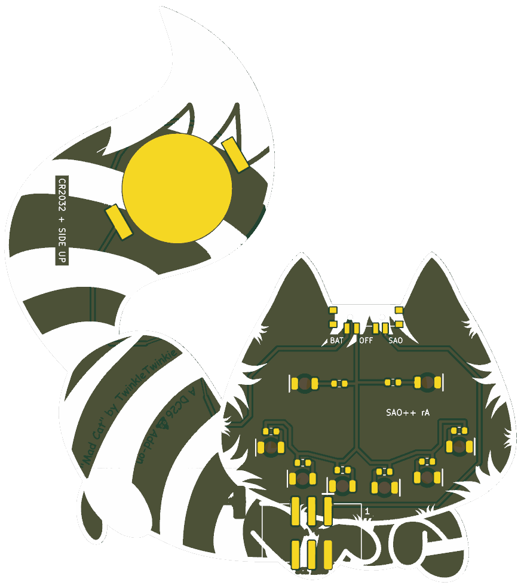

# Mad Cat — SAO++ edition

Originally **Mad Cat** (Cheshire Cat SAO) by **TwinkleTwinkie**, made for DEF CON 26 (2018): https://hackaday.io/project/159523-mad-cat

> **Permission pending — this board is not open-licensed.** The original hackaday.io page states no license, and TwinkleTwinkie has not yet been asked or answered (draft request covering all five of the maker's boards in this repo: [../fat-pika/docs/permission-request.md](../fat-pika/docs/permission-request.md)). The repo owner chose on 2026-11-10 to publish this port anyway. Until the maker says otherwise:
> - the original design in `original/`, the outline and all artwork remain **© TwinkleTwinkie, all rights reserved**; the repo's CERN-OHL-S / CC-BY-SA licenses cover only the SAO++ additions (new parts placement, routing, scripts, documentation), not the original work
> - do not treat these files as cleared for manufacture or sale
>
> **TwinkleTwinkie, or anyone with rights in this design:** open an issue and it will be changed or removed.

 

The cat's two eyes and six of its teeth light up white from behind, through the bare board.

## What changed from the 2018 board

| | 2018 original | SAO++ rev A |
|---|---|---|
| Connector | 4-pin through-hole at the paws (pins visible on the art side) | 6-pin SAO v1.69bis, surface-mount shrouded and keyed, in the same place. Nothing shows on the front |
| Power | Badge only | Slide switch on top of the head, between the ears: **SAO / OFF / BAT**. Runs from the badge or from its own CR2032, which clips to the back of the tail |
| LEDs | 8 × OSRAM TOPLED white (obsolete), all sharing one 15 Ω resistor | 8 × white reverse-mount 1206 in the same spots, one 1.3 kΩ resistor each |
| Brightness and current | about 6 mA per LED, ~50 mA total from the badge | about 0.45 mA per LED on badge power (~3.6 mA total), about 0.2 mA per LED on a fresh cell. **Much dimmer than the original on purpose**, so a coin cell lasts days, not hours. See the prototype checklist |
| Front art | — | Unchanged, apart from two 0.9 mm holes on the forehead just under the top edge (the switch's locating pegs). The four header holes on the paw are gone |
| Back art | — | The PCBWay logo is removed from the tail (owner decision); the coin cell sits there. "Mad Cat by TwinkleTwinkie / A DC26 Add-on" is untouched. Five small labels are added (SAO, OFF, BAT, the cell type, the revision) |

**Parts shared with the rest of SAO++:** connector, switch, cell clip and resistor are the same reels as Fat Pika. The only new part is the white LED, which is the same Lite-On family and footprint as Fat Pika's red one.

**Battery life (calculated, not measured):** eight white LEDs at about 0.2 mA each is about 1.6 mA, so a CR2032 should last roughly 80–100 hours, getting dimmer toward the end.

## Things to check on the first prototype

1. **Brightness.** This is the big unknown. The LEDs run at a fraction of the 2018 current. Check the eyes and teeth in room light on badge power, then on a fresh cell, then on a half-used cell. If too dim, change all eight resistors from 1.3 kΩ to 330 Ω (already on the approved list as SAOPP-R-02): about 1.5 mA per LED on the badge, and a shorter but brighter life on the cell.
2. **Pin 1 position.** The new connector keeps VCC and GND in the same corner as the 2018 header (which worked on DC26 badges). Confirm against a v1.69bis badge before a production run.
3. **Switch labels.** The datasheet says position 1 joins pins 1–3 but does not draw which way the knob sits for position 1. The silkscreen assumes "knob toward the SAO label = badge power". If it is the other way round, swap the SAO and BAT labels (nothing electrical changes; OFF is the middle either way).
4. **Battery clip direction.** The clip fits its pads both ways round. The open side must face the gap between the tail and the head (the arrow on the back silkscreen), where the cell slides in. Tell the assembler.
5. **Weight on the connector.** This is a big board (80 × 90 mm) hanging from a surface-mount connector at its bottom edge, with the coin cell out on the tail. Check that it sits firmly in a badge and that the connector's solder joints survive being knocked. If not, the fallback is to move the cell to the haunch (which costs the credit lettering) or the connector to the middle of the face.
6. **Connector at the edge.** The connector's lower pads end 0.4 mm from the board edge and one corner of its plastic body is flush with the edge. Check it looks right from the front.
7. **Knob reach.** The knob tip ends about 0.75 mm past the top edge, between the ears. Confirm it is comfortable to slide.
8. **Eyes from the front.** A thin wire runs behind each eye from the LED toward the nose. Check it does not show as a line through the eye when lit.

## Files

- `hardware/mad-cat.kicad_pro` — KiCad 10 project (schematic + board). ERC: 0 issues. DRC: 0 errors, 0 unconnected, schematic matches board. 22 warnings remain, all from the art (silkscreen touching the edge, art libraries not installed, art lines crossing each other on the silkscreen).
- `hardware/circuit.json` — the circuit as data; `tools/gen_schematic.py mad-cat` and `hardware/build_board.py` both read it.
- `hardware/build_board.py` — rebuilds the board from `original/` plus the SAO++ changes; every placement and routing decision is in there with a comment.
- `hardware/mad-cat.kicad_dru` — two extra rules: fine gaps inside the artwork are allowed, and the connector may sit 0.24 mm inside one tooth LED's keep-clear box (the parts themselves are 0.9 mm apart).
- `production/` — everything a board house needs, for one board (`single/`) and a 2×2 panel (`panel/`). Start with [production/README.md](production/README.md).
- `original/` — the untouched 2018 KiCad 4 project and zip from hackaday.io.

## Parts cost (parts only, list prices checked 2026-11-10)

| Part | Qty | Each @ ~100 boards |
|---|---|---|
| Connector XFCN BH254VS-6P (LCSC C492445) | 1 | $0.12 |
| Switch C&K PCM13SMTR (Digikey) | 1 | ~$0.90 |
| CR2032 clip TE BAT-HLD-001 (LCSC C7501066) | 1 | $0.61 |
| LED Lite-On LTW-C230DS white (LCSC C575513) | 8 | $0.055 |
| Resistor 0603 1.3 kΩ (LCSC C22767) | 8 | <$0.01 |
| **Total** | | **about $2.10** |

The CR2032 cell and the bare board (80 × 90 mm, noticeably more than Fat Pika's because of its size) are not included.
