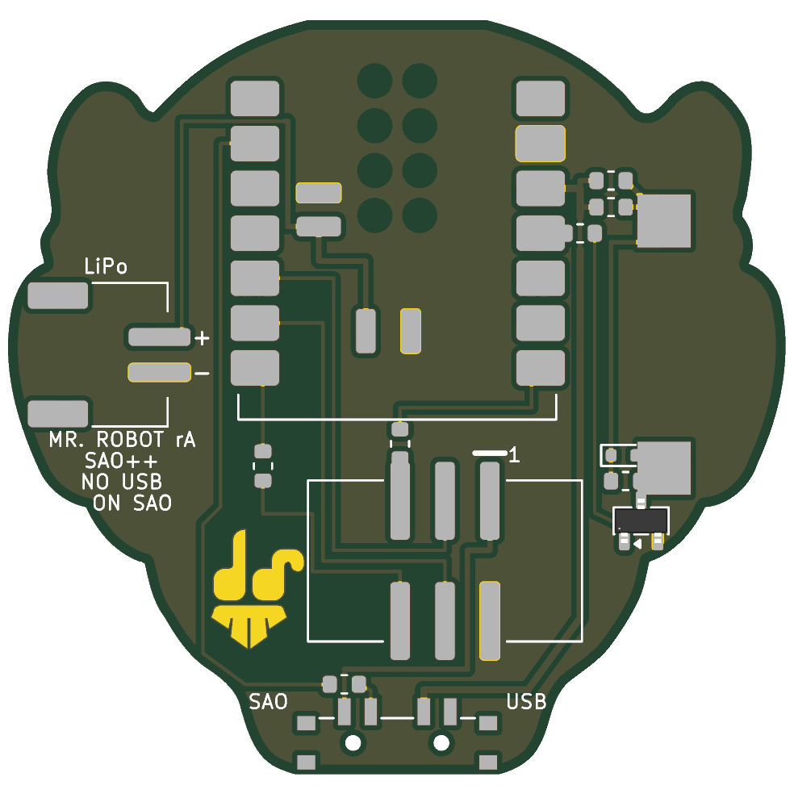

# Mr. Robot — SAO++ edition

Originally the **Mr. Robot Simple Add-on** by **davedarko (Dave Darko)**, 2019: https://github.com/davedarko/Simple-Add-ons-SAO/tree/main/Mr%20Robot%20Badge (write-up: https://hackaday.io/project/168037-mr-robot-shitty-addon). His write-up says it was inspired by Brian Benchoff's big Mr. Robot badge.

> **Permission pending — this board is not open-licensed.** The maker's repository states no license anywhere, and he has not yet been asked (draft request: [../han-saolo/docs/permission-request.md](../han-saolo/docs/permission-request.md)). Whether to publish this port before he answers is **not yet decided** (built locally on 2026-11-12). Until the maker says otherwise:
> - the original design in `original/`, the outline and all artwork remain **© davedarko, all rights reserved**; the repo's CERN-OHL-S / CC-BY-SA licenses cover only the SAO++ additions (new parts placement, routing, scripts, documentation), not the original work
> - do not treat these files as cleared for manufacture or sale
>
> **The face belongs to someone else too.** It is the mask from the TV series *Mr. Robot* (Universal Content Productions / USA Network). That is a third-party likeness: not ours, and not the maker's to license. Even with davedarko's blessing, selling boards with it needs the rights holder's permission or new art.
>
> **davedarko, or anyone with rights in this design:** open an issue and it will be changed or removed.

 

The fsociety-style mask, as an add-on that makes sounds. The maker meant it as an "I2C sound card": the badge sends a note number, the add-on plays it. His readme says the sound part of his board never worked as intended ("the amplifier section is not working like the bodged Version 1 did"), so this edition keeps his sounder but drives it a different, simpler way.

## What changed from the original

| | Original (2019) | SAO++ rev A |
|---|---|---|
| Size | 40.0 × 39.8 mm | **Scaled up 1.10×** (outline and art together): **44.0 × 42.7 mm** (see "Why it is 10 % bigger") |
| Which side is the face | The face was on the **bottom** of his board; his parts were on top | Turned over: the face is now the **front**, all parts on the back. Seen from the front it looks exactly as before |
| Controller | ATtiny85 | **Seeed Studio XIAO ESP32** module soldered flat on the back (C3, S3 or C6 all fit). Its USB-C socket is at the top of the head |
| Sound | His sounder (KMTG-1102) behind an amplifier stage that did not work | **Same sounder, same footprint**, now in the left cheek (front view), driven by a plain on/off transistor switch (below) |
| Connector | 2×3 surface-mount header, old 4-pin SAO wiring | 6-pin SAO v1.69bis, surface-mount, shrouded and keyed, on the back below the XIAO, 2.7 mm left of centre |
| Power | Badge only | Slide switch with its knob out of the chin: **SAO** (badge power) / **OFF** / **USB-BAT** (the module's own USB-C, or a LiPo cell on the new JST-PH socket in the right cheek, which the XIAO charges) |
| Outline | His head shape | His head shape, scaled. Two small flats: the **top of the head** is cut flat by 0.64 mm over 9 mm (so a USB-C plug fits), and the **chin** by 0.48 mm over 11 mm (so the switch knob sticks out) |
| Front art | Face copper, white moustache, brows and ears, "dave" and "darko" hidden in the eyes as gaps in the solder mask | All kept, scaled 1.10×. Two 0.9 mm holes in the chin (the switch's locating pegs) |
| Back | His gold "ds" logo (a gap in the mask over copper) | **Logo kept**, scaled with the board, in the same place. Labels added: "MR. ROBOT rA", "SAO++", "NO USB ON SAO", the switch ends (SAO / USB), "+"/"−" and "LiPo" at the socket, "1" at the connector |
| Dropped | — | ATtiny85, its 4.7 k reset resistor, 100 nF, his amplifier (22 µF, 2.2 k, BC847), the six programming pads, two test pads, a jumper |

**Parts shared with the rest of SAO++:** connector, switch, XIAO footprint, LiPo socket, the 330 Ω and 1.3 k resistors, and the 30 mA Schottky diode already chosen as SAOPP-D-01. **New to SAO++, kept in this board's folder:** the maker's sounder (KMTG-1102) and one small transistor (BC847B). No 100 nF capacitor: the XIAO has its own supply capacitors.

## Why it is 10 % bigger (owner rule of 2026-11-12)

Everything has to fit in a column down the middle of the face: the XIAO (21 mm long, its USB-C end at the top of the head), the SAO connector under it, and the switch knob out of the chin. At the maker's size that column was 1.6 mm too short, and the 11 × 9 mm sounder could not fit in either cheek beside the XIAO. Tried in 5 % steps: 1.05× is still 1.6 mm short; **1.10× fits with 0.5 mm to spare** and room for the sounder, its driver and the LiPo socket. Line widths and lettering only get bigger.

## How the sound works (plain version)

The sounder is switched on and off thousands of times a second by a small transistor, the way a light switch turns a lamp on and off; how fast it is switched sets the note. A resistor between the XIAO's pin and the transistor (1.3 k) keeps the pin's current small. Two 330 Ω resistors side by side (165 Ω) sit in the sounder's supply and make sure it can never draw more than about **19 mA**, whatever kind of sounder is fitted, which keeps the add-on inside the badge's 50 mA budget. A small diode across the sounder soaks up the electrical "kick" a coil-type sounder gives each time it is switched off, so it cannot damage the transistor; a 1.3 k resistor across it lets a piezo-type sounder discharge between beats so it keeps clicking. Each of those two parts is harmless if the sounder turns out to be the other type. There is no amplifier: louder needs more current, and 19 mA is the budget.

**Which kind is the KMTG-1102?** The maker's files do not say: his BOM calls it "the speaker", his readme calls it a "piezo", and the footprint (two 3 × 3 mm pads 14 mm apart, 11 × 9 mm body) fits either. The name follows Kingstate's pattern for magnetic (coil) transducers, but that is from memory, not from his files, so **the driver is designed to be safe for both** (above). The first prototype settles it: a coil type measures some tens of ohms across its pads; a piezo measures open circuit.

**What it means for volume:** at 19 mA a coil-type sounder is quieter than at its full rated current (often 50–100 mA). If the prototype is too quiet on USB/LiPo power, one 330 Ω (R6) can be swapped for 0 Ω on boards that never run from a badge; that is a decision for later, not built in.

## Current budget (badge power)

| | Peak | Note |
|---|---|---|
| Sounder through 165 Ω | 19.4 mA | (3.3 V − 0.1 V) / 165 Ω, if the sounder itself had no resistance. Half that on average while a note plays (50 % duty) |
| Base resistor | 2 mA | only while the pin is high |
| XIAO, radio off | about 20–40 mA | depends on the module (C3 lowest, S3 highest) |

**What the firmware must do:** keep Wi-Fi and Bluetooth **off on badge power** (they draw hundreds of mA in bursts); play notes as a square wave of at most 50 % duty and never leave the pin high between notes (a steady "on" draws 19 mA for nothing); prefer the C3 or C6, or run the S3 at a lower clock, to stay inside 50 mA. On USB or LiPo none of that limits it.

## How the power switch works here

| Knob | Badge 3.3 V | What runs the board |
|---|---|---|
| **SAO** (toward the "SAO" label on the back) | connected to the XIAO's 3V3 pin and the sounder driver | the badge |
| **OFF** (middle) | disconnected | nothing from the badge. If USB or a LiPo is attached, the switch pulls D1 high (through 330 Ω) and the firmware should go quiet and sleep |
| **USB-BAT** (toward "USB") | disconnected | the XIAO's own regulator, from USB-C or the LiPo |

- **Do not plug in USB while the knob is on SAO and the board is on a badge.** Two 3.3 V regulators would be joined. It is printed on the back.
- **OFF is a sleep, not a hard cut, when a LiPo is attached** (one switch pole cannot break both supplies). Unplug the cell for storage.
- **Feeding the XIAO through its 3V3 pin** is how badge power reaches it, as on Hack-Man. Seeed documents that pin only as an output. First thing to test on each module type.

## How it is wired on one copper layer

Everything is on the back copper, with **no vias**: nothing electrical shows on the face. Three resistors double as bridges, letting one other track pass between their pads: R1 (the D10 base resistor) lets the 3.3 V feed through, R4 (OFF sense) lets the badge 3.3 V through, and R2 (SAO GPIO1) lets a strip of ground copper through. The ground copper on the back is one connected piece.

## Pin map

| XIAO pin | Goes to |
|---|---|
| D10 | sounder driver: R1 1.3 k → transistor Q1. Chosen because it is not a start-up ("strapping") pin on any of the three modules (it is GPIO10 on the C3, GPIO9 on the S3, GPIO18 on the C6), and this board has no addressable LEDs, so the house LED pin is free. High = sounder on |
| D4 / D5 | SAO SDA / SCL (no pull-ups on the board; the badge provides them). The XIAO is the badge's I2C **target** |
| D7 / D6 | SAO GPIO1 / GPIO2, each through 330 Ω (R2 / R3) |
| D1 | switch OFF sense, through R4 (330 Ω): high when the knob is on OFF |
| 3V3, GND | the board's 3.3 V rail (switch common, sounder driver) and ground |
| BAT+ / BAT− (under the module, both positions) | the JST-PH LiPo socket |
| D0, D2, D3, D8, D9, 5V | not connected (D0, D2, D8, D9 are start-up pins on one module or another) |
| BOOT button (on the module) | mode button |

## Firmware

New Rust firmware for the XIAO is in [`firmware/`](firmware/) (60 tests pass, builds for the C3, C6 and S3; **it has never run on a real board**). It answers at I2C address 0x1D by default, or the maker's 0x08 as a build option, accepts the maker's note commands unchanged, and adds a few original jingles. See its README for what the first board must be checked for, including a possible click at power-up (the transistor has no hold-off resistor) and the pitch on a C6. The maker's two Arduino sketches are in `original/Arduino/` and show the I2C protocol he intended:

- **The add-on** (`SlaveMrRobot`) listens at **7-bit I2C address 0x08**. Every write ends in one byte that matters (any earlier bytes in the same write are read and thrown away): **0 = silence**; **1–89 = play a note** from a table of 89 notes, B0 (31 Hz) up to D♯8 (4978 Hz), in semitone steps (1 = B0, 2 = C1, … 89 = D♯8). It plays the note as a 50 % square wave on its sounder pin and holds it until the next byte. Nothing is ever sent back.
- **The badge side** (`MasterMrRobot`) is a demo: it sends 1, then 0 100 ms later, then 2, then 0, … up to 69 (a rising scale of short beeps), and repeats.

The new firmware does this on D4/D5 and D10, and treats D1 high as "off". The note table is the standard equal-tempered one in his `pitches.h`.

## Things to check on the first prototype

1. **Coil or piezo?** Measure across the sounder's pads (some tens of ohms = coil; open = piezo), and listen at a few notes. Check Q1 and the sounder stay cool with a note held for a minute.
2. **Loudness** at 19 mA (see above).
3. **Badge power into the XIAO's 3V3 pin** (above): boots from a badge alone, nothing gets warm, current under 50 mA with a note playing.
4. **USB-C plug fit** at the flattened top of the head: the plug body must seat fully.
5. **Switch knob** at the flattened chin: it should stick out enough to slide with a fingernail. Which way is "position 1" (SAO) is not drawn in the datasheet; if SAO and USB turn out swapped, the silkscreen is wrong, not the wiring.
6. **LiPo polarity**: the socket follows the Adafruit / SparkFun convention, "+" printed beside it. Many cells are wired the other way. Check with a meter first. The battery reaches the XIAO through pads **under** the module, which only solder with paste and hot air, a hot plate, or the assembler.
7. **Connector position and pin 1** against a v1.69bis badge, and that the board hangs straight with the connector 2.7 mm left of centre.
8. **Mask colour.** The maker ordered OSH Park "After Dark" (black board, clear solder mask), so his copper face shows as bare copper on black. The renders here use green; see `production/README.md`.

## Files

- `hardware/mr-robot.kicad_pro`: KiCad 10 project (schematic + board). ERC: 0. DRC: 0 errors, 0 unconnected, schematic matches the board; 3 warnings, all "copper sliver" in the maker's face art on the front.
- `hardware/circuit.json`: the circuit as data; `tools/gen_schematic.py mr-robot` and `hardware/build_board.py` both read it.
- `hardware/extract_art.py`: pulls the outline, the face art, the "dave"/"darko" lettering and the logo out of the maker's KiCad 8 import into `hardware/art.json`, turned over.
- `hardware/build_board.py`: rebuilds the whole board from `art.json` in one run; every placement and routing choice is commented there.
- `hardware/parts_local.py`, `hardware/make_local_footprints.py`, `hardware/mr-robot-local.pretty/`: the three parts the shared library does not have (sounder, transistor, and the shared diode's footprint).
- `hardware/mr-robot.kicad_dru`: the art rule, plus rules letting the driver parts sit inside the sounder's courtyard and R1, R2, R4, R7 sit inside their neighbours' courtyards (each with its real gap).
- `production/`: everything a board house needs. Start with [production/README.md](production/README.md).
- `original/`: the maker's untouched Eagle files, his KiCad 8 import, readme, write-up and sketches.

## Parts cost (parts only, LCSC list prices checked 2026-11-10 unless noted)

| Part | Qty | Each @ ~100 boards |
|---|---|---|
| Connector XFCN BH254VS-6P (LCSC C492445) | 1 | $0.12 |
| Switch C&K PCM13SMTR (Digikey) | 1 | ~$0.90 |
| LiPo socket JST S2B-PH-SM4-TB (LCSC C295747) | 1 | $0.16 |
| Resistor 330 Ω 0603 (LCSC C23138) | 5 | <$0.01 |
| Resistor 1.3 k 0603 (LCSC C22767) | 2 | <$0.01 |
| Diode RB751S40T1G (LCSC C232576, checked 2026-11-11) | 1 | $0.04 |
| Transistor BC847B,215 | 1 | not priced yet (orchestrator to check) |
| Sounder Kingstate KMTG1102-A1 | 1 | not priced yet (orchestrator to check) |
| **Total without the module, sounder and transistor** | | **about $1.27** |
| Seeed Studio XIAO ESP32-C3 / S3 / C6 | 1 | not priced here: check Seeed |

The bare board and the optional LiPo cell are not included.
