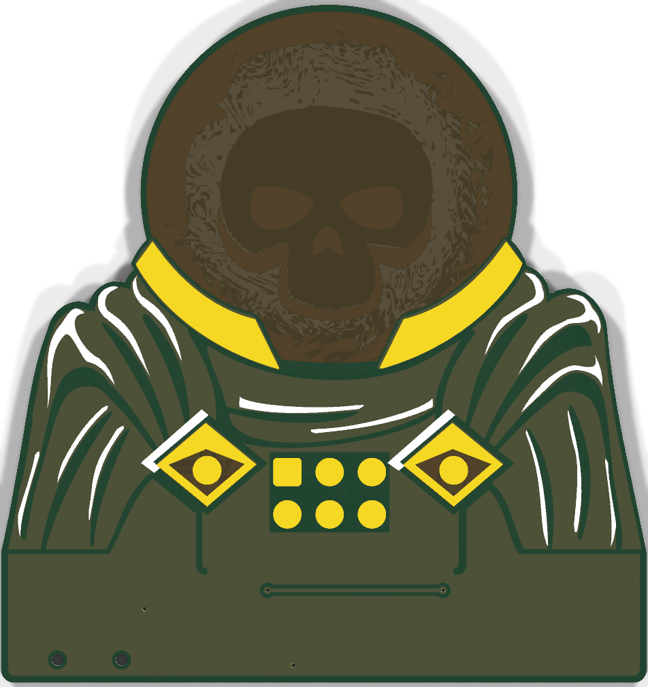
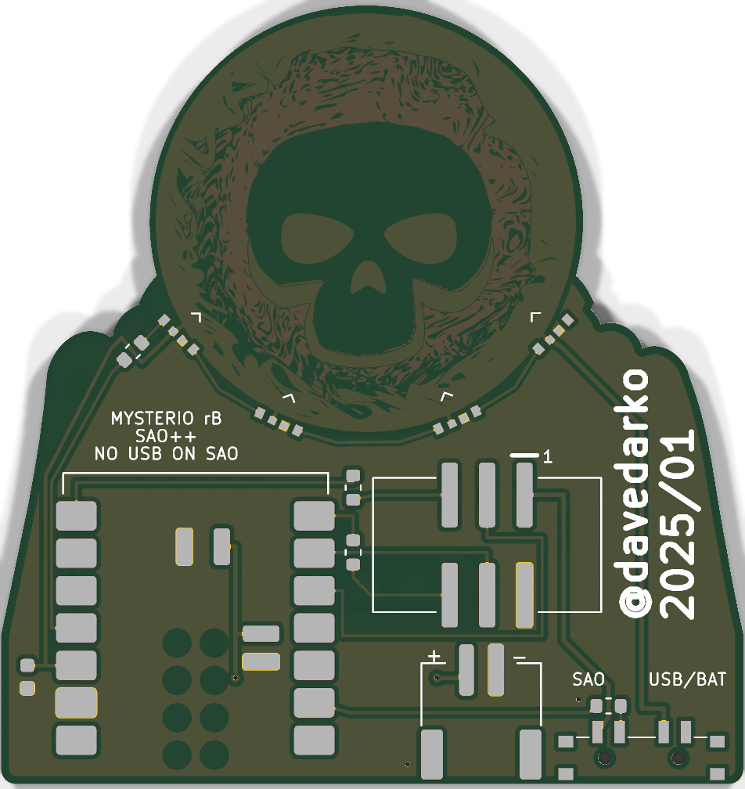

# Mysterio — SAO++ edition

Originally **Mysterio SAO** by **davedarko (Dave Darko)**, January 2025: https://github.com/davedarko/Simple-Add-ons-SAO/tree/main/MysterioSAO

> **Permission pending — this board is not open-licensed.** The maker's repository states no license anywhere, and he has not yet been asked (draft request: [../han-saolo/docs/permission-request.md](../han-saolo/docs/permission-request.md)). The repo owner chose on 2026-11-11 to publish this port anyway. Until the maker says otherwise:
> - the original design in `original/`, the outline and all artwork remain **© davedarko, all rights reserved**; the repo's CERN-OHL-S / CC-BY-SA licenses cover only the SAO++ additions (new parts placement, routing, scripts, documentation), not the original work
> - do not treat these files as cleared for manufacture or sale
>
> **The character belongs to someone else too.** Mysterio, the Spider-Man villain with the glass-bowl helmet, is a Marvel character, owned by Marvel / Disney. That is separate from the maker's permission: even with davedarko's blessing, selling boards with his likeness needs the rights holder's permission or new art.
>
> **Credit where the maker gives it:** his write-up says the design was heavily inspired by the Marvel hero simple add-ons by Simen (https://mastodon.social/@simenzhor/).
>
> **davedarko, or anyone with rights in this design:** open an issue and it will be changed or removed.

 

Mysterio's fishbowl helmet glows from inside: four colour-changing LEDs round the bottom of the helmet shine across the back of the board, and the light comes through the bare board on the front, with the skull and the smoky swirl drawn in copper as shadows.

## What changed from the original

| | Original (2025) | SAO++ rev A |
|---|---|---|
| Controller | WCH CH32V003 (8-pin chip, programmed by the Supercon badge) | **Seeed Studio XIAO ESP32** module soldered flat on the back: C3, S3 or C6 all fit the same pads. USB-C at the bottom edge for power and programming |
| Board | 4 copper layers. 38.8 × 34.1 mm | **2 copper layers**, like every SAO++ board. **40.7 × 46.2 mm** (see "Why the board grew") |
| Helmet art | Skull and swirl in copper on the inner layer nearest the back | The same shapes, on the back copper (0.1 mm further from the front). The back's solder mask is open only where the maker's was open **and** no copper is behind it, so light gets into the board in the same places |
| Connector | 2×3 through-hole IDC header, its six pads showing on the chest | 6-pin SAO v1.69bis, surface-mount, shrouded and keyed, on the back, lower down. The six round pads stay on the chest as plain copper "buttons" (no holes) |
| Power | Badge only | Slide switch on the left edge: **SAO** (badge power) / **OFF** / **USB** (the module's own USB-C power). **No LiPo connector** (see below) |
| LEDs | 4 × SK6805-EC3210R side-firing RGB, chained right to left (seen from the front) | Same part, same order, same directions. D2 and D3 are exactly where they were; D1 and D4 sit **0.74 mm and 0.60 mm further out** along their own aim line (see below) |
| Other parts | two 10 kΩ, one 100 nF | 100 nF kept (now beside LED D1). The two 10 kΩ were I2C pull-ups to the chip's supply; the SAO standard leaves those to the badge, so they are gone. Four 330 Ω resistors added (all one part, see below) |
| Front art | Robe, collar, chest plate, diamonds, helmet window; seven tiny via dots | All unchanged, plus a plain **base strip** below the figure (copper under the mask, the same green as the robe, joined to the chest plate). The maker's seven via dots are gone; two new covered vias instead (below); two 0.9 mm holes on the base strip (the switch's pegs). The art steps back from the edge at three panel tabs (about 0.3 mm, over 5 mm each) |
| Back | Maker's credit "@davedarko 2025/01" | The credit is untouched and in the same place. Labels added: "NO USB ON SAO", "MYSTERIO rA", "SAO++", the switch legend, "1" at the connector |

**Parts shared with the rest of SAO++:** connector, switch, XIAO footprint, RGB LED, 100 nF capacitor and the 330 Ω resistor. **No new parts.**

## Why the board grew (owner, please look)

The original is a small bust: a 22 mm helmet sitting on 15 mm of shoulders. Nothing may sit behind the helmet, because the LEDs light it across the back of the board, so all the parts have to fit below and beside it. The maker's 8-pin chip fitted there. The XIAO (21 × 17.8 mm), the connector (15.3 × 8.9 mm body, 11.2 mm with its pads) and the switch (12 mm of straight edge) do not: the free space under the helmet is about 35 × 10 mm. The maker's credit also fills the whole left arm on the back.

What was built (the least-bad option found):

- **A 12 mm base strip under the figure** (bottom edge from 48.5 to 60.6 mm). The XIAO stands upright on the right, its USB-C end flush with the new bottom edge. The connector sits bottom-left, just below the credit. The switch knob comes out of the left edge, below the credit.
- **The right arm is straightened.** Its outer edge runs straight down from the shoulder instead of slanting in; it is up to 3.4 mm wider at the elbow and 1.75 mm wider at the bottom. Two tracks run up that edge. On the front this shows as a wider dark rim on the right arm.
- **The left edge** below the arm moves out 0.26 mm (straight instead of a slight slant).
- **No LiPo connector.** There was no spot for it that the wiring could reach on one copper layer. The board runs from the badge or from USB-C. The XIAO's two battery-pad positions are still joined to each other, so a LiPo can be soldered to them by hand later if wanted.
- **The connector sits about 7.5 mm left of the middle and low on the board** (its centre is 9 mm above the bottom edge). The board is light, but check it sits straight in a badge.

Alternatives, with numbers, if you prefer one of them:

| Option | Board size | Gives | Costs |
|---|---|---|---|
| **A. As built** | 40.7 × 46.2 mm | everything except the LiPo connector | right arm straightened; no LiPo connector |
| B. Keep the LiPo connector | about 40.7 × 53 mm | LiPo connector, connector in the middle | a 19 mm base strip instead of 12 mm: connector centred under the helmet where the old header was, XIAO lying across below it, LiPo connector beside the XIAO |
| C. Move the maker's credit | about 40.7 × 46 mm in theory | might free the left arm for the connector | the credit (14 × 5 mm) has no other free spot on the back that is not behind the helmet; not found workable |
| D. Keep the original 4-layer board | same as A | the helmet art 0.1 mm closer to the front, exactly as the maker built it | a 4-layer order (dearer per board); does not help the space problem |
| E. XIAO overhanging the edge | — | — | only about 1.8 mm of the module's 21 mm length has no pads, so it can overhang by at most that much: not enough to matter |

## How the power switch works here

| Knob (as printed, "SW UP"/"SW DN" seen on the back) | Badge 3.3 V | What runs the board |
|---|---|---|
| **SAO** (down, toward the bottom edge) | connected to the XIAO's 3V3 pin and the LEDs | the badge |
| **OFF** (middle) | disconnected | nothing from the badge. If USB is plugged in, the switch tells the XIAO to blank the LEDs and sleep |
| **USB** (up) | disconnected | the XIAO's own regulator, from USB-C |

- **Do not plug in USB while the knob is on SAO and the board is on a badge.** Two 3.3 V regulators would be joined. It is printed on the back.
- **Feeding the XIAO through its 3V3 pin** is how badge power reaches it, as on Hack-Man. Seeed documents that pin as an output only. First thing to test on each module type.
- **No coin cell:** these LEDs and an ESP32 need far more than a CR2032 gives.

## How it is wired on one copper layer

Everything is on the back copper. To get there without extra parts:

- The helmet's solid outer ring of art copper (it was copper on the maker's board too) now **carries the LEDs' 3.3 V**: each LED's supply pad reaches into it. Ground comes from the copper outside the ring. That is why D1 and D4 moved out 0.74 / 0.60 mm: at their old spots their pads sat on the ring, and clearing round them would have cut it.
- Three of the 330 Ω resistors let one other track pass between their two pads: R2 (SAO GPIO1) lets SDA through, R3 (SAO GPIO2) lets SCL through, R4 (the switch's OFF sense line) lets the badge 3.3 V through. R4 exists only for this; a 330 Ω in a sense line changes nothing.
- **Two vias** (0.3 mm holes, covered by solder mask both sides) join the two halves of the back ground through the front copper: one between the connector and the XIAO, one under the connector. On the front they sit on the chest plate / base strip and may show as pinprick bumps. The maker's board had seven such dots in the art.

## Things to check on the first prototype

1. **Badge power into the XIAO's 3V3 pin** (above). Check it boots from a badge with nothing else attached, and that nothing gets warm.
2. **The glow.** The helmet art is now on the back copper instead of 0.1 mm inside the board. Compare with a built original if you can: the skull and swirl should look the same from the front, perhaps very slightly softer.
3. **LED land pattern.** The shared LED footprint's pads are smaller than the maker's (which he built and which worked): see "LED footprint" below. Check the LEDs sit square and the lenses point at the helmet's centre. The maker's write-up does not mention a diffuser; Hack-Man's maker needed a blob of hot glue over each LED.
4. **LED supply.** They are rated 3.7–5.5 V and run here from 3.3 V, as on the original.
5. **Switch labels.** Which way the knob sits for "position 1" (SAO) is not drawn in the datasheet. If SAO and USB turn out swapped, the silkscreen is wrong, not the wiring.
6. **Connector position and pin 1** against a v1.69bis badge, and that the board hangs straight with the connector left of centre.
7. **USB plug clearance** at the bottom edge, and that the XIAO, its USB-C socket and the connector clear the badge behind.
8. **XIAO pads underneath.** The ground pad under the module (and the unused battery pads) only solder with paste and hot air or a hot plate. Hand-soldered by its edge pads only, everything works.
9. **Tracks along the right edge.** Two tracks run 0.26 mm inside the straightened right edge. Check the board house's routing did not nick them.

## Pin map

| XIAO pin | Goes to |
|---|---|
| D10 | LED data, through R1 (330 Ω). LED 1 is the right-hand LED seen from the front (lower right of the helmet), then D2, D3, D4 round to the left, as on the original |
| D4 / D5 | SAO SDA / SCL (no pull-ups on the board) |
| D7 / D6 | SAO GPIO1 / GPIO2, each through 330 Ω (R2 / R3) |
| D1 | switch OFF sense, through R4 (330 Ω): high when the knob is on OFF |
| 3V3, GND | the board's 3.3 V rail (switch common, LEDs) and ground |
| BAT+ (two positions under the module) | joined to each other only (no LiPo connector) |
| D0, D2, D3, D8, D9, 5V | not connected (D0, D2, D8, D9 are start-up strapping pins on one module or another) |

## Firmware

There is no SAO++ firmware for this board yet. The maker's sketch for it is `original/Sketchbook/strandtest/strandtest.ino` (Arduino, Adafruit NeoPixel library, 4 LEDs; the other four sketches in that folder are for other projects: an 84-LED "hexaFlower", an SD-card test and a WAV player). What it does, so it can be reproduced:

- brightness 200 of 255; colours from a 12-step palette running from deep blue (#000b2d) through cyan to white (#ffffff)
- every 40 ms it repaints one LED, in order 1→4, with palette entry (LED number + a counter) mod 12, and adds one to the counter
- after each pass over the four LEDs the counter jumps to a random value 0–7

The effect is an icy blue-to-white shimmer that keeps changing. To run something like it here: drive the four LEDs from XIAO D10 (GRB order, 800 kHz), and treat D1 high as "off".

## LED footprint: maker's vs shared

Both put the four pads in a row (DOUT, GND, VDD, DIN) with their back edges level and the longer outer pads reaching toward the lens. The differences:

| | Maker's footprint (built) | Shared `LED_RGB_Side_SK6805` |
|---|---|---|
| Outer pads (DOUT, DIN) | 0.70 × 1.00 mm, centres 3.01 mm apart | 0.55 × 0.70 mm, centres 2.81 mm apart |
| Inner pads (GND, VDD) | 0.50 × 0.50 mm, centres 0.85 mm apart | 0.55 × 0.50 mm, centres 0.85 mm apart |
| Overall width of the pad row | 3.71 mm | 3.36 mm |
| Where it draws the lens face | 0.88 mm in front of the pads' back edge | 1.17 mm in front |

The shared pads sit almost entirely inside the maker's (within 0.03 mm), so a part that solders on his pads should solder on these. The two footprints disagree by about 0.3 mm about where the body sits; neither drawing is dimensioned in the datasheet. The maker's board being built is evidence for his pad sizes, not for his body outline. This board aligns the pads' back edges with the maker's.

## Files

- `hardware/mysterio.kicad_pro`: KiCad 10 project (schematic + board). ERC: 0. DRC: 0 errors, 0 unconnected, schematic matches the board. 4 warnings, all "copper sliver" in the art (thin points in the maker's swirl and robe copper).
- `hardware/circuit.json`: the circuit as data; `tools/gen_schematic.py mysterio` and `hardware/build_board.py` both read it.
- `hardware/build_board.py`: rebuilds the whole board from the maker's file in `original/` in one run; every placement and routing choice is commented there.
- `hardware/mysterio.kicad_dru`: the art rule, plus two rules letting R2, R3, R4 and the XIAO sit inside the connector's keep-out box (it includes the long pads; the parts are 0.3–0.6 mm clear of the plastic body and pads), and R4 0.3 mm beside the switch.
- `production/`: everything a board house needs, for one board and a 2×2 panel. Start with [production/README.md](production/README.md).
- `original/`: the maker's untouched KiCad 8 project, art and sketches.

## Parts cost (parts only, LCSC list prices checked 2026-11-10)

| Part | Qty | Each @ ~100 boards |
|---|---|---|
| Connector XFCN BH254VS-6P (LCSC C492445) | 1 | $0.12 |
| Switch C&K PCM13SMTR (Digikey) | 1 | ~$0.90 |
| RGB LED OPSCO SK6805-EC3210R (LCSC C5378735) | 4 | $0.068 |
| Capacitor 100 nF 0603 (LCSC C14663) | 1 | <$0.01 |
| Resistor 330 Ω 0603 (LCSC C23138) | 4 | <$0.01 |
| **Total without the module** | | **about $1.32** |
| Seeed Studio XIAO ESP32-C3 / S3 / C6 | 1 | not priced here: check Seeed |

The bare board is not included.
