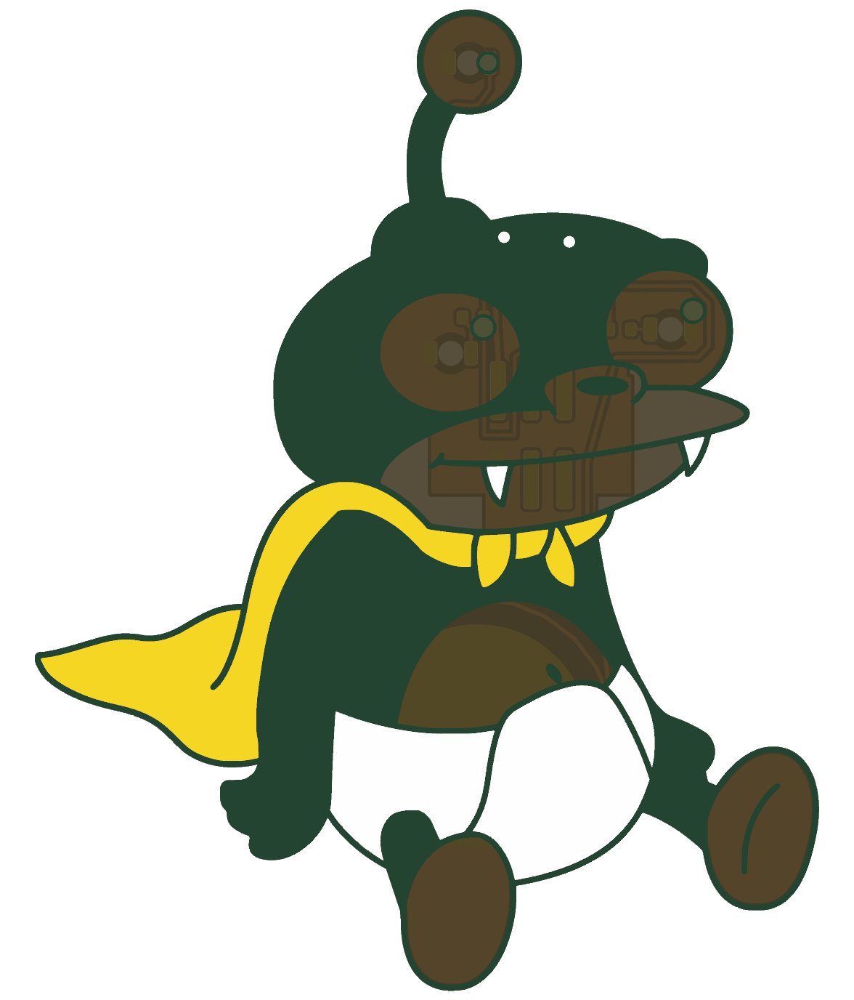
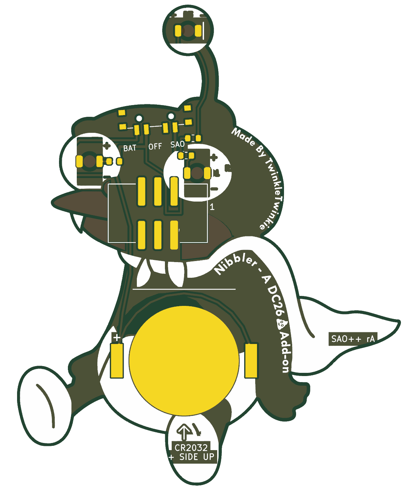

# Nibbler — SAO++ edition

Originally **Nibbler** by **TwinkleTwinkie**, made for DEF CON 26 (2018): https://hackaday.io/project/161117-nibbler ("I only had a small handful of these at DEF CON. Now I'm making the files public so you can have your own made.")

> **Permission pending — this board is not open-licensed.** The original hackaday.io page states no license (making the files public is not the same as licensing them), and TwinkleTwinkie has not yet been asked or answered (draft request covering this board and the other DC26 ports: [../fat-pika/docs/permission-request.md](../fat-pika/docs/permission-request.md)). The repo owner chose on 2026-11-10 to publish this port anyway. Until the maker says otherwise:
> - the original design in `original/`, the outline and all artwork remain **© TwinkleTwinkie, all rights reserved**; the repo's CERN-OHL-S / CC-BY-SA licenses cover only the SAO++ additions (new parts placement, routing, scripts, documentation), not the original work
> - do not treat these files as cleared for manufacture or sale
>
> **TwinkleTwinkie, or anyone with rights in this design:** open an issue and it will be changed or removed.
>
> **The character is someone else's too.** Nibbler is a character from *Futurama*, created by Matt Groening; the show belongs to 20th Television (Disney). That is a separate question from the maker's permission, and it matters most before anyone sells these.

 

Nibbler's two eyes and the third eye on his stalk light up white from behind, through the bare board.

## What changed from the 2018 board

| | 2018 original | SAO++ rev A |
|---|---|---|
| Connector | 4-pin through-hole in the foot (pins visible on the art side) | 6-pin SAO v1.69bis, surface-mount shrouded and keyed, on the back of the chest under the mouth. Nothing shows on the front. It had to move: the foot is 9 mm wide and the new connector is 15.3 mm wide, and the only spot big enough for the coin cell is the lower body |
| Power | Badge only | Slide switch on top of the head, just right of the stalk: **SAO / OFF / BAT**. Runs from the badge or from its own CR2032, which clips to the back of the lower body (the diaper) |
| LEDs | 3 × OSRAM TOPLED (obsolete), all sharing one resistor | 3 × white reverse-mount 1206 in the same spots, one 1.3 kΩ resistor each |
| Brightness and current | several mA per LED from the badge | about 0.45 mA per LED on badge power, about 0.2 mA per LED on a fresh cell. **Dimmer than the original on purpose**, so a coin cell lasts days, not hours. See the prototype checklist |
| Front art | — | Unchanged, apart from two 0.9 mm holes in the top of the head (the switch's locating pegs). The foot loses the four header holes and the little masked "socket" shape the maker drew round them, so the foot is now plain bare board with its toe line |
| Back art | — | "Made By TwinkleTwinkie" and "Nibbler - A DC26 Add-on" are untouched. The bare mouth is now copper under the connector (most of it is hidden by the connector anyway); the left corner of the mouth, the lower lip and the snout stay bare. The bare belly is covered by the coin cell and is masked there. On the foot, the gap in the ink the maker left round the old header pins is filled in (as on the front). Seven small labels are added (SAO, OFF, BAT, "1" by the connector's pin 1, the cell type and "+ SIDE UP", and the revision) |
| Outline | 10,700 short lines that crossed themselves by 2 µm where the path closed, at the top of the stalk (KiCad could not read it as one outline) | The same shape as one clean closed path of 1,837 corners (`hardware/fix_outline.py`); no point moved more than 1 µm, checked against the maker's own outline Gerber |

**Parts shared with the rest of SAO++:** connector, switch, cell clip, resistor and white LED are all the same reels as Mad Cat. No new parts.

**Battery life (calculated, not measured):** three white LEDs at about 0.2 mA each is about 0.6 mA, so a CR2032 should last roughly 200–300 hours, getting dimmer toward the end. White is the weakest colour on a coin cell: it is brightest on badge power.

## Things to check on the first prototype

1. **Brightness.** The LEDs run at a fraction of the 2018 current. Check the eyes in room light on badge power, then on a fresh cell, then on a half-used cell. If too dim, change all three resistors from 1.3 kΩ to 330 Ω (already on the approved list as SAOPP-R-02): about 1.5 mA per LED on the badge, and a shorter but brighter life on the cell.
2. **Pin 1 position.** The new connector keeps VCC and GND in the same corner as on Mad Cat. Confirm against a v1.69bis badge before a production run.
3. **Switch labels.** The datasheet says position 1 joins pins 1–3 but does not draw which way the knob sits for position 1. The silkscreen assumes "knob toward the SAO label = badge power". If it is the other way round, swap the SAO and BAT labels (nothing electrical changes; OFF is the middle either way).
4. **Knob reach.** The top of the head is a curve, not a straight edge, so the switch is tilted 4° to follow it and sits at the left end of the curve, against the stalk. The knob tip reaches about 0.75 mm past the edge (the same as Mad Cat). Confirm it is comfortable to slide.
5. **Battery clip direction.** The clip fits its pads both ways round. The open side must face down, toward the foot (the arrow on the back silkscreen), where the cell slides in. Tell the assembler.
6. **Weight on the connector.** The connector is in the chest, close to the middle of the board, with the coin cell just below it. Check that the board sits firmly in a badge and that the connector's solder joints survive being knocked.
7. **Connector beside the left eye.** The connector's plastic body ends about 1 mm below the left eye's LED. Check that the LED is not knocked or shaded when the connector is soldered.
8. **The stalk.** The stalk is 2.7 mm wide at its narrowest and carries one thin track plus a ground strip to the third eye. It is the weakest part of the board: check it survives handling, and that the third eye lights.
9. **Eye glints.** On the front, the maker drew a small copper "glint" in each eye. The third eye's glint sits partly inside the 1.6 mm circle the LED shines through, and so does part of the right eye's; this is the maker's art and was left as drawn. Check it does not shade the light too much.
10. **Shadows through the bare areas.** The front's mouth, belly and eyes are bare board, which lets some light through. The 2018 back kept the mouth and belly bare too; now the connector, its copper and tracks sit behind the mouth and the coin cell's copper disc behind the belly, so they may show as faint shadows from the front (KiCad's render shows them). Check in daylight and with the LEDs on.
11. **Thin tracks.** The LED supply runs between the connector's pins, past the left eye and up the stalk as a 0.25 mm track; the closest gap between any two pieces of copper on the board is about 0.3 mm. Both are well inside ordinary 2-layer fab limits, but check the stalk track is intact on the first boards.

## Files

- `hardware/nibbler.kicad_pro` — KiCad 10 project (schematic + board). ERC: 0 issues. DRC: 0 errors, 0 unconnected, schematic matches board. 8 warnings remain: 7 where the new parts' outline marks overlap the maker's white eye art on the back silkscreen, and 1 "footprint does not match the library" because the switch is tilted 4° (KiCad stores a tilted rectangle as a polygon; the footprint is otherwise identical).
- `hardware/circuit.json` — the circuit as data; `tools/gen_schematic.py nibbler` and `hardware/build_board.py` both read it.
- `hardware/fix_outline.py` — repairs the 2018 outline into `hardware/outline.json` (what was wrong is explained at the top of the script).
- `hardware/build_board.py` — rebuilds the board from `original/` plus the SAO++ changes; every placement and routing decision is in there with a comment.
- `hardware/nibbler.kicad_dru` — two extra rules: fine gaps inside the artwork are allowed, and the connector's keep-clear box may overlap the left eye LED's (the parts themselves are 0.94 mm apart).
- `production/` — everything a board house needs, for one board (`single/`) and a 2×2 panel (`panel/`). Start with [production/README.md](production/README.md).
- `original/` — the untouched 2018 KiCad 4 project and zip from hackaday.io.

## Parts cost (parts only, list prices checked 2026-11-10)

| Part | Qty | Each @ ~100 boards |
|---|---|---|
| Connector XFCN BH254VS-6P (LCSC C492445) | 1 | $0.12 |
| Switch C&K PCM13SMTR (Digikey) | 1 | ~$0.90 |
| CR2032 clip TE BAT-HLD-001 (LCSC C7501066) | 1 | $0.61 |
| LED Lite-On LTW-C230DS white (LCSC C575513) | 3 | $0.055 |
| Resistor 0603 1.3 kΩ (LCSC C22767) | 3 | <$0.01 |
| **Total** | | **about $1.80** |

The CR2032 cell and the bare board (60 × 75 mm) are not included.
