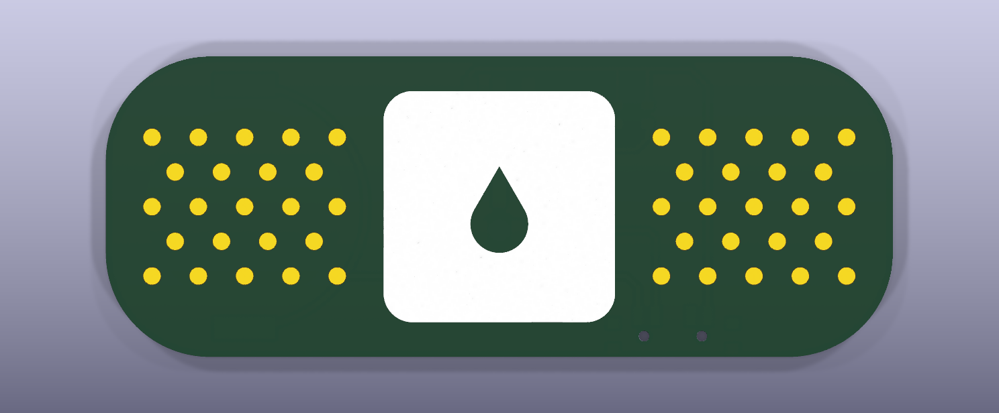
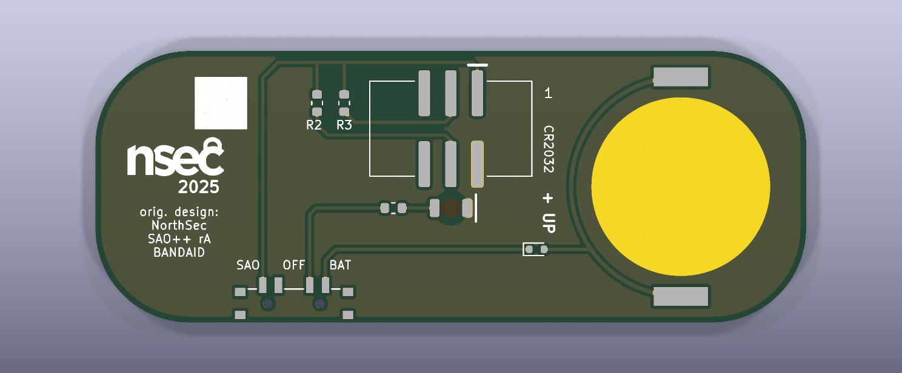

# NorthSec Bandaid — SAO++ edition

The circuit is **Sao_Bandaid**, one of the add-ons published with the **NorthSec 2025** conference badge by the NorthSec badge team: https://github.com/nsec/nsec-badge/tree/nsec25/hw/2025/sao/Sao_Bandaid (ported from commit `0ea779f`, 2025-07-14). **The plaster on the front and the board outline are SAO++'s own drawing**, not NorthSec's.

**Licence of the original: MIT** (the repository's root `LICENSE`, copied to `original/LICENSE`; it applies "except otherwise stated in respective files", and no file of this board states an exception). The MIT notice must stay with the design; it is kept here. SAO++'s plaster drawing is CC-BY-SA-4.0 like the rest of this project's art.

> **Why the art was redrawn.** NorthSec's plaster was traced from a picture embedded in their board file: a large flat-colour illustration of a sticking plaster (peach strip, navy outline, cream pad, 13 air holes each side), with nothing to say who drew it or under what licence. NorthSec's MIT licence cannot be assumed to cover a picture that may not be theirs. So neither that picture nor the outline, pad and dot positions traced from it are in this repository, not even in `original/` (see `original/README.md` for exactly what was cut).

> **The logo is NorthSec's.** The back carries the "nsec 2025" mark, small, as the credit. The MIT licence covers the design files, not the right to trade under NorthSec's name. Before selling boards with the logo on them, ask NorthSec, or drop the logo and keep the text credit (a few lines in the build script).

 

## What the original actually is

The maker left no description, so this is read from the files. **It is not a puzzle and it has no touch pads. It is a repair.**

- **The name is the function.** The NorthSec 2025 badge has two SAO sockets and an I2C bus (the two data lines, SDA and SCL), but its design files show **no pull-up resistors on that bus**: nothing but chips and sockets hang on those two lines. An I2C bus does not work without pull-ups. This add-on carries exactly the missing pair: **two 1 kΩ resistors, one from SDA and one from SCL to the badge's 3.3 V.** Plug it in and the bus works. A band-aid.
- **One LED** (1206, hand-soldered, colour not recorded) on the **front**, in the middle of the gauze pad, with a 330 Ω resistor. It is on whenever the badge is.
- **The 26 round pads on the front are decoration**: the plaster's air holes. Each is a loose 1.35 mm copper pad connected to nothing at all (the first survey guessed they were joined to SDA / SCL; they are not).
- **An SMD 2×3 SAO connector on the back.** GPIO1 and GPIO2 are unconnected. No battery, no switch.
- **A 47.5 × 14 mm board** with half-round ends. Back silkscreen: the "nsec 2025" logo and a blank 5 × 5 mm white box.

## The SAO++ plaster

Generated in `hardware/build_board.py` from a few numbers (`PLASTER`) and saved on its own as `art/bandage.svg`:

- a **68 × 26 mm strip with 9 mm corners**, so each end has an 8 mm flat (a fabric plaster rather than a pill shape);
- a **20 mm square gauze pad** in white silkscreen in the middle, corners rounded;
- a **drop-shaped window** in the middle of the pad, left clear of white ink. The red light sits behind the round part of the drop, so the drop glows red;
- **46 air holes**, 23 each side, as bare copper dots (gold with ENIG finish) in a regular lattice: columns 2 mm apart, alternately three dots and two.

## What SAO++ makes of it

| | Original (2025) | SAO++ rev A |
|---|---|---|
| Shape | 47.5 × 14 mm plaster (traced; not reproduced) | 68 × 26 mm plaster, SAO++'s own drawing |
| Connector | SMD 2×3 header, middle of the back | 6-pin SAO v1.69bis shrouded, keyed SMD connector, top centre of the back, key slot up, body 3.0 mm from the top edge |
| Power | Badge only | Slide switch **SAO / OFF / BAT** on the bottom edge, and a CR2032 in the shared clip at one end. The cell slides in over that end |
| Light | One 1206 LED soldered on the front | One **red** LED on the back, shining through the board inside the drop-shaped window |
| LED resistor | 330 Ω 1206 | 1.3 kΩ 0603 (the shared value) |
| I2C pull-ups | Two 1 kΩ 1206, always fitted | **Pads R2 and R3, wired the same way, not fitted by default** (see next section) |
| Cell safety | — | Series diode D2 right after the cell clip |
| Front | Copper strip, pad, 26 pads, an LED and its solder joints, 4 vias | White pad with the drop, 46 gold dots. Two 0.9 mm holes below the right-hand dots (the switch's locating pegs). Nothing soldered |
| Back | Logo, white box, tracks | Logo at 0.7 size, white box at full size; ground copper everywhere; labels SAO / OFF / BAT, pin 1, CR2032, + UP, R2, R3, BANDAID, SAO++ rA, orig. design: NorthSec |

**Parts shared with the rest of SAO++:** connector, switch, cell clip, red through-board LED, 1.3 kΩ resistor, cell diode. **No new part.** (The diode's footprint is kept in this board's folder only because the shared library does not have one yet; three other boards do the same.)

**Light level (calculated, not measured):** about 1.1 mA on badge power and about 0.6 mA on a fresh cell (the diode takes about 0.3 V). Red is the best colour on a coin cell. At that current a CR2032 lasts roughly 300 hours.

## The pull-ups: what they do to a badge's bus, and why they are left off

Every I2C bus needs one pair of pull-up resistors, and the SAO standard says the **badge** provides them. The SAO++ house rule follows that: no pull-ups on an add-on (`docs/standard.md` section 1). NorthSec's board exists to break that rule on purpose, for a badge that forgot them.

So this board keeps the two resistor positions (R2 for SCL, R3 for SDA), wired exactly as NorthSec had them, and **leaves them empty by default**. The same board is then one of two things:

- **As shipped (R2, R3 empty): a light-up plaster.** SDA and SCL go to two empty pads and nowhere else. The board does nothing to the badge's bus.
- **With two 1.3 kΩ resistors fitted (the same part as R1): NorthSec's band-aid.** Each data line is pulled up to the badge's own 3.3 V pin. They work whenever the board is plugged in, whatever the switch says, because they are fed from the badge's pin ahead of the switch.
  - On a badge with **no** pull-ups (NorthSec 2025): the bus starts working. 1.3 kΩ instead of NorthSec's 1 kΩ makes each line carry 2.5 mA when pulled low instead of 3.3 mA, which is inside the 3 mA the I2C standard allows (1 kΩ was slightly over).
  - On a badge that **already has** pull-ups (most do): the two sets act together and the lines are pulled harder than the standard allows (about 3.2 mA with a typical 4.7 kΩ badge, more with two such add-ons). Nothing is damaged and most chips still work, but it is out of specification, which is why the house rule exists.

## Why nothing can push current into the coin cell

A CR2032 must never be charged. On this board:

1. **The badge's 3.3 V and the cell are on two different contacts of the switch.** The knob joins the light to one or the other, never both; the OFF position between them connects to nothing.
2. **The light's side of the switch touches nothing but the light.** After the switch there is one resistor and one LED to ground. No chip, and no connection to SDA, SCL or the GPIO pins, so the badge has no second way in.
3. **The pull-up positions are on the badge's side of the switch.** If fitted, R2 and R3 join the badge's 3.3 V pin to the badge's data lines. Current through them goes from the badge back to the badge. They are not connected to the cell or to the light in any switch position.
4. **D2, a one-way valve right after the cell clip**, as `docs/standard.md` section 3 requires for any board wired to SDA / SCL. Current can leave the cell, not enter it. On this board points 1 to 3 already close every path, so D2 is a second lock on a door that is already shut; it costs four cents and 0.3 V of light on battery.

## Why it is bigger than NorthSec's board

The house standard asks for the 20 mm coin cell in its clip, the 15 mm connector and the switch, all on the back. NorthSec's plaster is 14 mm wide; the clip alone is 22.8 mm across its two solder tabs. So the plaster was drawn round the parts, with nothing squeezed:

- **Width 26 mm:** the clip's tabs plus 1.6 mm of board outside each. This also puts the connector's plastic body exactly 3.0 mm from the top edge with room for the light below it.
- **Length 68 mm:** cell clip (24 mm), connector (15 mm) in the exact middle of the length, then the switch, the pull-up pads and the credit. Real plasters of this width are about this long.
- **Switch:** on the straight bottom edge; its whole 11.8 mm keep-out is 4 mm clear of the nearest corner curve.
- **Cell path:** the cell slides in over the flat end, 2 mm inside it, with nothing in the way.

If the owner would rather have a board of NorthSec's size, the only way is **badge power only** (connector, light, pull-ups; no cell, no switch), which breaks the house rule that every board has both.

## Layout notes

- **The light is 2 mm below the middle of the pad**, not dead centre: the connector sits above it and their keep-out boxes must not overlap. The drop-shaped window is drawn so that this is where its round part is, and the drop as a whole is centred on the pad.
- **SDA and SCL run under the connector's plastic body**, between its two rows of pads, out to the right. That is normal for a surface-mount header (the tracks are under solder mask).
- **The badge-supply track runs along the top edge above the connector**, 0.95 mm inside the edge, then down to the switch. The panel has no break-off tab there.
- **LED colour is a guess.** The maker's is not recorded. Red suits a plaster and is the strongest colour on a coin cell. White (SAOPP-LED-11) drops into the same pads but would be very dim on battery behind the diode.

## Things to check on the first prototype

1. **Brightness through the board.** The LED shines through 1.6 mm of board and solder mask. Check on badge power and on a fresh cell. If too dim: a 330 Ω resistor (SAOPP-R-02, already approved) at R1.
2. **Reverse current into the cell:** switch on BAT, cell fitted, board on a powered badge. Measure the current in the cell lead: it must be out of the cell or zero. Repeat with R2 and R3 fitted.
3. **With R2 and R3 fitted, on a NorthSec 2025 badge:** the badge's I2C bus works. On a badge with its own pull-ups: the bus still works.
4. **Switch labels.** The datasheet does not show which way the knob sits for position 1. The silkscreen assumes knob toward "SAO" = badge power. If it is the other way round, swap the two labels (nothing electrical changes; OFF is the middle either way).
5. **Knob reach.** The knob ends 0.97 mm past the bottom edge.
6. **Cell clip direction.** The clip fits its pads both ways round. Its open side must face the **near short end**; the closed end goes toward the connector. Tell the assembler.
7. **Ground path round the cell clip.** The ground copper reaches the cell's contact disc through two strips 0.75 mm wide, outside the clip's solder tabs. Ample for a few milliamps; check they survive breaking the board out of the panel.
8. **Pin 1 position.** The connector keeps VCC in the same corner as Mad Cat and Fat Pika. Confirm against a v1.69bis badge.
9. **The two peg holes** below the right-hand dots: check they are acceptable on the front.
10. **Mask colour.** Owner's choice. The pad is white ink and the dots are gold, so the mask colour is the colour of the strip and of the drop when the light is off. Any colour but white works.

## Decisions for the owner

1. **Pull-ups fitted or not?** As built: not fitted, so the board obeys the house rule and is safe on every badge, but it is then only a light. Fitting them (two more of a resistor already on the board) makes it what NorthSec made. One board, one line in the BOM either way.
2. **Keep the cell diode D2?** The standard's wording makes it mandatory here, so it is in. Electrically this board does not need it (see above). Dropping it would make the light a little brighter on battery.
3. **NorthSec's logo:** ask them, or replace it with text.
4. **Size:** 68 × 26 mm with everything, or NorthSec's size with badge power only.

## Files

- `hardware/nsec-bandaid.kicad_pro` — KiCad 10 project (schematic + board). ERC: 0 issues. DRC: 0 errors, 0 unconnected, schematic matches board. 1 warning remains, "footprint does not match the library copy": the cell clip (its silkscreen arrow and "+" are moved to the fab layer, as on other boards).
- `hardware/circuit.json` — the circuit as data; `tools/gen_schematic.py nsec-bandaid` and `hardware/build_board.py` both read it. `hardware/fix_schematic.py` then marks R2 and R3 "not fitted".
- `hardware/build_board.py` — draws the plaster and builds the board; every placement and routing decision is in there with a comment. It also writes `hardware/outline.json` and `art/bandage.svg`, and re-applies the house rule settings in `hardware/project_rules.json` to the project file.
- `hardware/parts_local.py`, `hardware/nsec-bandaid-local.pretty/`, `hardware/make_local_footprints.py` — the cell diode's symbol and footprint (KiCad's stock SOD-523, unchanged).
- `art/bandage.svg` — the plaster on its own (SAO++, CC-BY-SA-4.0).
- `production/` — everything a board house needs, for one board (`single/`) and a 2 × 2 panel (`panel/`). Start with [production/README.md](production/README.md).
- `original/` — NorthSec's circuit (schematic, board file without its outline, front art and embedded picture, footprints) with their MIT licence. `original/README.md` lists exactly what was cut.

## Parts cost (parts only, list prices checked 2026-11-10 / 11 in docs/parts.md)

| Part | Qty | Each @ ~100 boards |
|---|---|---|
| Connector XFCN BH254VS-6P (LCSC C492445) | 1 | $0.10 |
| Switch C&K PCM13SMTR (Digikey) | 1 | ~$0.90 |
| CR2032 clip TE BAT-HLD-001 (LCSC C7501066) | 1 | $0.61 |
| Red LED Lite-On LTST-C230KRKT (LCSC C125107) | 1 | $0.037 |
| Cell diode onsemi RB751S40T1G (LCSC C232576) | 1 | $0.039 |
| Resistor 0603 1.3 kΩ (LCSC C22767) | 1 (3 with the pull-ups) | <$0.01 |
| **Total** | | **about $1.70** |

Not included: the CR2032 cell and the bare board.
