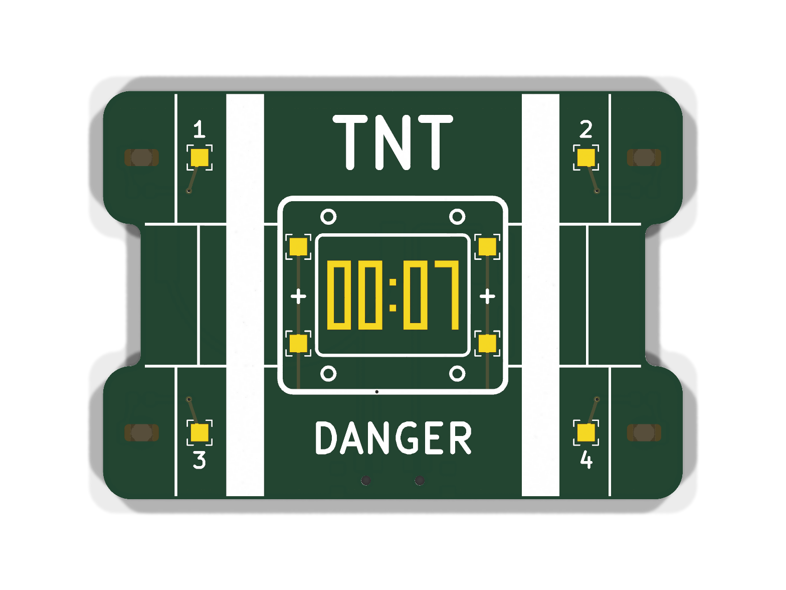
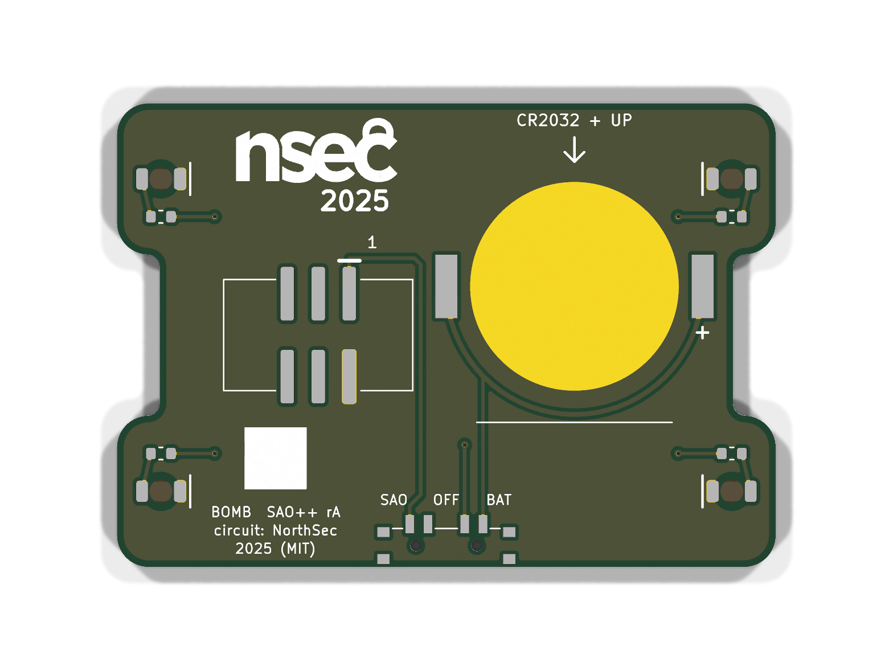

# NorthSec Bomb — SAO++ edition

The circuit is **Sao_Bomb**, one of the add-ons made for the **NorthSec 2025** badge by the **NorthSec badge team**: https://github.com/nsec/nsec-badge/tree/nsec25/hw/2025/sao/Sao_Bomb (commit 0ea779f, 2025-07-14). Licence: **MIT** (their `LICENSE` is kept in [original/LICENSE](original/LICENSE); no file of this board states an exception).

**The outline and the front art are SAO++'s own drawing** (CC-BY-SA-4.0, [art/nsec-bomb-front.svg](art/nsec-bomb-front.svg)), not NorthSec's. NorthSec drew their board over a picture of a cartoon time bomb whose owner nobody here can identify, so their outline and art are not used and not kept in this repository ([original/README.md](original/README.md) lists exactly what was cut).

> **One art question is still open, and it is the owner's call before anything is sold:** the "nsec 2025" logo on the back is NorthSec's event branding. The MIT licence covers the file, not the use of their name and mark on boards someone else sells. Ask NorthSec, or take the logo off.

 

## What NorthSec's original is

Their repository does not describe it, so this is read from the files:

- A 53 × 38 mm add-on shaped like a bundle of dynamite with a clock, badge power only: a 2×3 SMD header, four LEDs soldered on the front by hand, each with a 330 Ω resistor.
- **Eight small plated holes, not nine and not sockets.** The survey read them as "pin sockets" because the maker used a socket footprint, but their parts list gives them a quantity of 0: nothing was fitted. Four holes are on the 3.3 V supply ("3v3") and four each lead to one LED ("Conn1" … "Conn4").
- **No LED is connected to anything until you add a wire.** A wire from a 3v3 hole to a Conn hole lights that LED. Those are the bomb's wires; cut one and its light goes out. There is no chip and no game logic: whatever game was played with it at the event was played by people.
- On the back, the "nsec 2025" logo and a 5 × 5 mm white square (purpose not recorded).

## What SAO++ makes of it

The same circuit and the same wire trick on a newly drawn board, working from **either** the badge **or** its own coin cell.

**The drawing (front):** three sticks of dynamite stacked flat, 54 × 38 mm, the middle one 3.5 mm shorter at each end. Two white bands of tape hold them together. "TNT" on the top stick, "DANGER" on the bottom one. Strapped across the middle is a timer box: a white frame with four screws and a display reading **00:07** in bare (gold-plated) copper. Each end of the top and bottom sticks is a detonator: a small bare window with a red LED glowing behind it and, beside it, a numbered wire terminal (1–4). The timer carries four "+" terminals. The builder's own wires, from timer to detonators, finish the picture.

| | NorthSec original (2025) | SAO++ rev A |
|---|---|---|
| Outline and art | Traced by the maker from a third-party picture | Drawn from scratch by `hardware/build_board.py` |
| Connector | 2×3 SMD header, centre of the back | 6-pin SAO v1.69bis shrouded, keyed SMD connector, key slot up, mid-height, 10.5 mm right of centre (front view) |
| Power | Badge only | Slide switch in the middle of the bottom edge: **SAO / OFF / BAT**. CR2032 clip on the back; the cell slides in from the top edge |
| Lights | Four hand-soldered 1206 LEDs on the front | Four **red** LEDs on the back, shining through the board at the four detonators |
| Resistors | 330 Ω (about 4 mA per LED) | 1.3 kΩ (about 1 mA per LED, so a cell lasts) |
| Wire points | Eight 0.7 mm plated holes | Eight **1.6 mm square solder pads, no hole** |
| Back | Logo, white square | Same logo and square, same size. Labels: SAO / OFF / BAT, "CR2032 + UP", pin 1, "BOMB SAO++ rA", "circuit: NorthSec 2025 (MIT)" |

**How to arm it:** solder a short piece of wire on the front from any **+** pad on the timer to a numbered pad. Wire 1 lights the upper-left detonator, 2 upper right, 3 lower left, 4 lower right. Leave the wires looped up off the board so they can be cut. A wire can only ever join the supply to a resistor, so no wiring mistake between these pads can short anything or reach the coin cell.

**Why pads instead of holes:** a wire soldered through a hole leaves a stub on the back, where the coin cell has to slide along the board and rest. Pads keep the back flat. Wires soldered on a pad are easier to fit but may be weaker when tugged; that is untested.

**Parts shared with the rest of SAO++:** connector, switch, cell clip, red through-board LED and 1.3 kΩ resistor: all reels other boards already use. **No new part.** The wire pads are bare copper.

**Battery life (calculated, not measured):** four red LEDs at about 1 mA each is about 4 mA, so a CR2032 should last roughly 35–50 hours with all four wires in place.

## How it fits

Drawing the outline ourselves removed the squeeze the traced outline had:

- **Switch:** the bottom edge is straight for 49 mm, so the switch sits in the middle of it with its knob 1.05 mm past the edge.
- **Cell:** the top edge is straight too. The cell slides in 5 mm from it, between the upper-left LED (0.9 mm clear of the cell's path) and the logo.
- **Clip and connector** sit side by side with 1.8 mm between the clip and the connector's shroud; no keep-out boxes overlap, so the board needs no rule exceptions.
- **LEDs** lie along their sticks, 3.6 mm in from each end, each with its resistor 3.1 mm toward the middle of the board.
- **Front copper:** the supply reaches the four + pads by a thin track that runs under the bottom line of the timer's frame and up each side of the display between the pads; each numbered pad has a 3 mm track to a tiny covered via. Under solder mask these show only faintly.

## Things to check on the first prototype

1. **Wire pads.** Solder four wires, tug them, cut them. If pads lift, make the pads larger or go back to plated holes with badge power only.
2. **Light through the board.** Each LED shines through 1.6 mm of board into a 3.2 × 1.6 mm bare window. `SAOPP-LED-10` is still marked "verify: brightness through 1.6 mm board at 1 mA" in the parts list; this board does not settle that until one is built. If dim, R1–R4 can become 330 Ω (SAOPP-R-02, already approved): about 4 mA each, NorthSec's own value, and well under a day per cell.
3. **Display digits.** The 00:07 is bare copper with strokes 0.6 mm wide, each in its own opening in the solder mask. Check they come out crisp, and that the fab does not object to copper that is connected to nothing.
4. **Switch.** Which way the knob sits for position 1 (the labels assume "knob toward SAO = badge power"; if not, swap the SAO and BAT labels).
5. **Cell clip direction.** The clip fits its pads both ways round; its open side must face the **top** edge. Tell the assembler.
6. **Pin 1 position** against a real v1.69bis badge (same corner as every other SAO++ board).
7. **Hanging.** The connector is 10.5 mm right of centre (front view) with the cell on the other side; check how the board hangs and that it does not strain the badge socket.
8. **Mask colour.** Red is the obvious choice (the SVG in `art/` shows it); the renders above use KiCad's default green.

## Files

- `hardware/nsec-bomb.kicad_pro` — KiCad 10 project. ERC: 0 issues. DRC: 0 errors, 0 warnings, 0 unconnected, schematic matches board.
- `hardware/build_board.py` — draws the whole board: the ART section holds every number of the outline and front art, the PLACEMENT section every part position. It reads only `circuit.json` and the footprint libraries, nothing from `original/`. It also writes `art/nsec-bomb-front.svg` and `hardware/outline.json`.
- `art/nsec-bomb-front.svg` — the front as a picture (red mask, white silkscreen, gold copper), written by the build script.
- `hardware/circuit.json` — the circuit as data; `tools/gen_schematic.py nsec-bomb` then `hardware/fix_schematic.py` (marks the eight bare pads "not in BOM") make the schematic.
- `hardware/nsec-bomb.kicad_dru` — one rule, so the copper display digits are not flagged for being art.
- `hardware/parts_local.py`, `hardware/nsec-bomb-local.pretty/` — the wire pad (bare copper, nothing to buy) and an unchanged copy of NorthSec's logo footprint.
- `production/` — everything a board house needs, for one board (`single/`) and a 2×2 panel (`panel/`). Start with [production/README.md](production/README.md).
- `original/` — NorthSec's circuit files (schematic, footprints, parts list, and the board file with the traced outline and art cut out). See [original/README.md](original/README.md).

## Parts cost (parts only; list prices as dated in docs/parts.md, not re-checked for this board)

| Part | Qty | Each @ ~100 boards |
|---|---|---|
| Connector XFCN BH254VS-6P (LCSC C492445) | 1 | $0.10 |
| Switch C&K PCM13SMTR (Digikey) | 1 | ~$0.90 |
| CR2032 clip TE BAT-HLD-001 (LCSC C7501066) | 1 | $0.61 |
| Red through-board LED LTST-C230KRKT (LCSC C125107) | 4 | $0.037 |
| Resistor 0603 1.3 kΩ (LCSC C22767) | 4 | <$0.01 |
| **Total** | | **about $1.80** |

Not included: the CR2032 cell, the bare board (54 × 38 mm) and the jumper wire.
