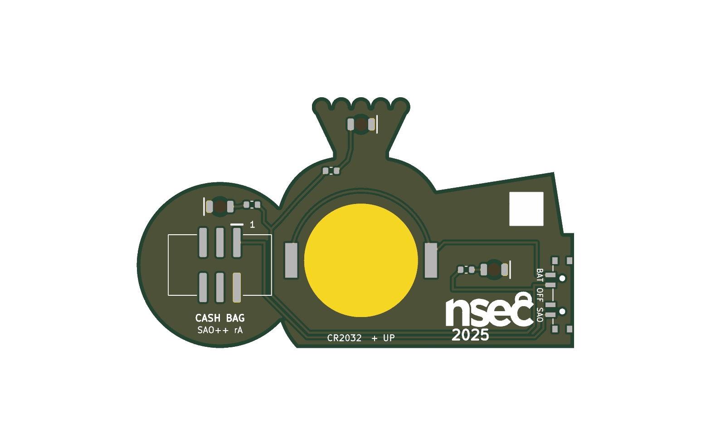

# Cash Bag — SAO++ edition

The circuit comes from **Sao_CashBag**, one of the add-ons made for the **NorthSec 2025** badge by the NorthSec badge team: https://github.com/nsec/nsec-badge/tree/0ea779f281ac538fa21b333b027250784b5d3cbf/hw/2025/sao/Sao_CashBag (MIT licence, copy in [original/LICENSE](original/LICENSE); no file of this board states an exception).

**The drawing is SAO++'s own** (CC-BY-SA-4.0, like the rest of this repo's art): [art/cash-bag.svg](art/cash-bag.svg), generated from a few numbers at the top of `hardware/build_board.py`.

> **Why the picture was redrawn.** NorthSec's outline and front art were traced from a stock illustration (a watermarked stock-library preview sat in the maker's folder and was embedded in the board file as a tracing layer). That drawing was not theirs to license, so none of it is used or kept here: see [original/README.md](original/README.md) for exactly what was cut. A tied sack with a "$", a coin and bank notes is a generic idea; the composition, proportions, outline and every line of this board are new.

> **The "nsec 2025" logo on the back is NorthSec's event branding.** It is kept as the maker's credit. Selling boards that carry it is a question for NorthSec, separate from the licence on the files.

 

## What the original actually is

The maker wrote nothing down, so this is read from the files:

- A **38.4 × 25.2 mm** add-on with **three ordinary 1206 LEDs soldered on the front**. The colour is not recorded.
- **Three 330 Ω 1206 resistors** on the back, one per LED. Each LED and resistor sits straight across the badge's 3.3 V and ground, so all three are simply on whenever the badge is.
- An SMD 2×3 header on the back. **SDA, SCL and both GPIO pins are not connected. No battery, no switch, no chip.**
- Back silkscreen: the "nsec 2025" logo and a 5 mm white square to write on. Six small vias.

## What SAO++ makes of it

| | Original | SAO++ rev A |
|---|---|---|
| Picture | traced from a stock illustration | SAO++'s own: a banded wad of bank notes with a second note tucked behind (left), a tied sack with a gold "$" (middle), one big gold-rimmed coin with a "$" (right) |
| Size | 38.4 × 25.2 mm | 65.7 × 37.8 mm |
| Lights | 3 LEDs on the front, about 4 mA each | 3 white LEDs **on the back, shining through the board**: the sack's gathered top, the bank note's round medallion, a glint at the top of the coin. 1.3 kΩ each |
| Power | Badge only, always on | Slide switch on the left edge (behind the notes): **SAO / OFF / BAT**. CR2032 behind the sack; the cell slides in from the bottom edge |
| Connector | SMD 2×3 header | 6-pin SAO v1.69bis shrouded, keyed connector behind the coin, key slot up, 3.6 mm of board all round it |
| Front | LEDs and 6 vias in the art | Art only. Two 0.9 mm switch-peg holes in the wad of notes. No vias |
| Back | logo, write-on square | Same logo and same square, real size, plus labels: SAO / OFF / BAT, CR2032 + UP, pin 1, CASH BAG, SAO++ rA |

**How the drawing is made on a circuit board.** Three "inks": green solder mask, bare gold, white silkscreen. The sack is copper under the mask, which shows as a lighter green than the bare-board green of the notes and the coin's face. Gold is copper with the mask opened: both "$", the coin's rim, the tie round the sack's neck and its two ends, the paper band round the notes. White lines draw the notes. Three dark creases below the tie are gaps in the sack's copper.

**Parts shared with the rest of SAO++:** connector, switch, cell clip, white through-board LED and the 1.3 kΩ resistor. **No new part.**

**Best on badge power.** White LEDs need most of what a coin cell gives. With the standard resistor each LED draws about 0.45 mA from the badge and about 0.2 mA from a fresh cell, and fades as the cell runs down. These numbers are calculated, not measured. The maker ran his LEDs about ten times harder.

**Coin-cell safety:** the badge's 3.3 V and the cell sit on separate switch contacts with OFF between them, and nothing is wired to SDA, SCL or GPIO, so nothing can push current into the cell. No series diode is needed.

## Why it is laid out this way

- **Size.** The maker's board (595 mm²) is smaller than the cell clip, connector and switch put together. The new drawing was sized round the parts: the sack is just wide enough for the cell clip, the coin just big enough for the connector with 3 mm of board round it, and the wad of notes gives the switch a straight edge.
- **The connector is right of the middle**, behind the coin, because the cell takes the sack. The board hangs from a point about 20 mm right of its middle. The keyed 2×3 connector stops it turning, but see the checklist.
- **LED colour is my choice: white.** The approved through-board LEDs are red and white. Red light is mostly swallowed by green mask; white comes through green as green.
- **The lit spot on the sack is a 3.2 mm round window** in the sack's copper, in the middle of the gathered top. Unlit, it shows as a darker dot.
- **Ground reaches the connector by one path**, round the top of the sack's LED, about 1 mm wide at its narrowest. That is plenty for the few milliamps this board draws.

## Things to check on the first prototype

1. **Brightness through the board**, on badge power and on a fresh cell, at all three spots (all three shine through green mask on the front; each LED has its own small mask opening on the back). If too dim, change R1–R3 to 330 Ω (SAOPP-R-02, already approved).
2. **Does it look right in the hand.** The two greens depend on the board house's mask; the creases in the sack are 0.6 mm gaps and may be faint.
3. **The cell sliding in** from the bottom edge, over two masked tracks and the "CR2032 + UP" label.
4. **How it hangs.** The connector is right of centre. Check the board sits straight on a badge.
5. **Switch labels.** The datasheet does not draw which way the knob sits for position 1. The silkscreen assumes knob toward "SAO" = badge power. If it is the other way round, swap the SAO and BAT labels (nothing electrical changes).
6. **Cell clip direction.** The clip fits its pads both ways round. Its open side must face the bottom edge. Tell the assembler.
7. **Pin 1 position.** Same corner as Mad Cat and Fat Pika. Confirm against a v1.69bis badge.
8. **Switch-peg holes** in the wad of notes: check they do not spoil the front.

## Files

- `art/cash-bag.svg` — the front drawing, written by the build script. To change the drawing, change the numbers in the script's "the drawing" section and run it again.
- `hardware/nsec-cashbag.kicad_pro` — KiCad 10 project (schematic + board). ERC: 0 issues. DRC: 0 errors, 0 unconnected, schematic matches board. 2 warnings remain: the maker's logo library (`footprints`) is not installed, and the cell clip differs from the library copy (its silkscreen arrow and "+" moved to the fab layer; the board has its own label).
- `hardware/circuit.json` — the circuit as data; `tools/gen_schematic.py nsec-cashbag` and `hardware/build_board.py` both read it.
- `hardware/build_board.py` — draws the art and builds the board; every dimension, placement and routing decision is in there with a comment. It takes only the logo and the write-on square from `original/`.
- `hardware/outline.json` — the outline as one polygon, written by the build script.
- `hardware/nsec-cashbag.kicad_dru` — one rule, so the front art copper is not flagged for being art.
- `docs/` — front and back renders, schematic.
- `production/` — everything a board house needs, for one board (`single/`) and a 2×2 panel (`panel/`). Start with [production/README.md](production/README.md).
- `original/` — the maker's circuit: schematic, footprints, parts list, and the board file with the traced art cut out. See [original/README.md](original/README.md).

## Parts cost (parts only, list prices from docs/parts.md, checked there 2026-11-10)

| Part | Qty | Each @ ~100 boards |
|---|---|---|
| Connector XFCN BH254VS-6P (LCSC C492445) | 1 | $0.10 |
| Switch C&K PCM13SMTR (Digikey) | 1 | ~$0.90 |
| CR2032 clip TE BAT-HLD-001 (LCSC C7501066) | 1 | $0.61 |
| White through-board LED LTW-C230DS (LCSC C575513) | 3 | $0.055 |
| Resistor 0603 1.3 kΩ (LCSC C22767) | 3 | <$0.01 |
| **Total** | | **about $1.80** |
