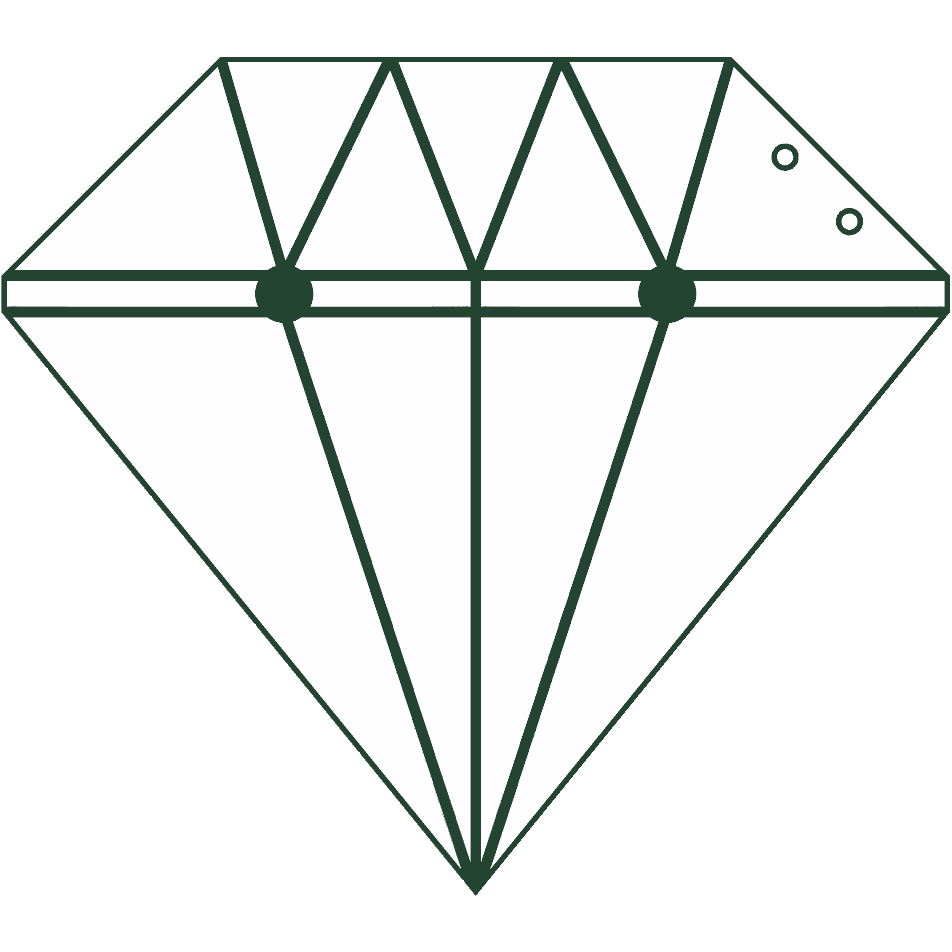
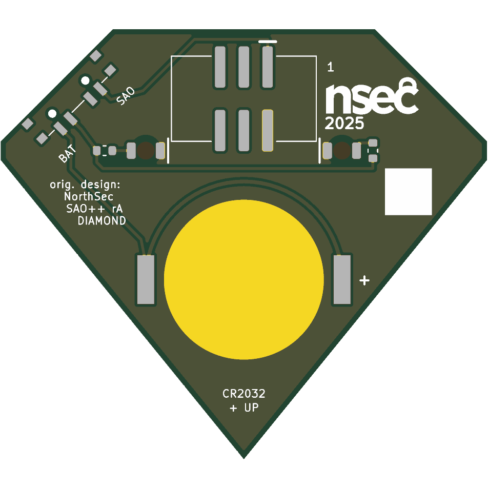

# NorthSec Diamond — SAO++ edition

The circuit is **Sao_Diamond**, one of the add-ons published with the **NorthSec 2025** conference badge by the NorthSec badge team: https://github.com/nsec/nsec-badge/tree/nsec25/hw/2025/sao/Sao_Diamond (ported from commit `0ea779f`, 2025-07-14). **The gem on the front and the board outline are SAO++'s own drawing**, not NorthSec's.

**Licence of the original: MIT** (the repository's root `LICENSE`, copied to `original/LICENSE`; it applies "except otherwise stated in respective files", and no file of this board states an exception). The MIT notice must stay with the design; it is kept here. SAO++'s gem drawing is CC-BY-SA-4.0 like the rest of this project's art.

> **Why the art was redrawn.** NorthSec's diamond was traced from a third-party picture: a small web thumbnail of a gold gem logo template lettered "DIAMOND LOGO / COMPANY TAGLINE HERE", source and licence unknown, embedded in the maker's board file at the board's size. NorthSec's MIT licence cannot cover a picture that is not theirs. So neither that picture nor the outline and facets traced from it are in this repository, not even in `original/` (see `original/README.md` for exactly what was cut).

> **The logo is NorthSec's.** The back carries the "nsec 2025" mark. The MIT licence covers the design files, not the right to trade under NorthSec's name. Before selling boards with the logo on them, ask NorthSec, or drop the logo and keep the text credit (a few lines in the build script).

 

## What the original actually is

The maker left no description, so this is read from the files:

- **A 41.0 × 35.4 mm diamond-shaped board.** The front is white silkscreen facets with thin dark gaps between them. There is no copper artwork.
- **Two ordinary 3 mm through-hole LEDs stand on the front**, where facets meet at each end of the widest line. Their legs, and the legs of two 330 Ω through-hole resistors mounted on the back, are soldered through the board, so eight solder joints show on the front. The LED colour is not recorded anywhere.
- **An SMD 2×3 SAO connector on the back**, using only 3.3 V and ground. SDA, SCL and both GPIO pins are unconnected. No battery, no switch: the LEDs are on whenever the badge is.
- **Back silkscreen:** the "nsec 2025" logo and a blank 5 × 5 mm white box (probably for writing on; the files do not say).

## The SAO++ gem

A brilliant-cut stone seen from the side, generated in `hardware/build_board.py` from six numbers (`GEM`) and saved on its own as `art/gem.svg`:

- a flat **table** on top, 28 mm wide (54 % of the stone's width, the proportion of a real brilliant cut);
- a **crown** of seven triangles in a zigzag: four standing on the girdle, three hanging from the table;
- a **girdle band**, 2 mm tall, right across the widest part, which also gives the outline two short upright sides (seven corners in all);
- a **pavilion** of four long facets running down to the point.

Fifteen facets in white silkscreen, 0.6 mm apart. 52 × 46 mm. **The two lights sit on the girdle, 10.5 mm either side of the middle, where five facet lines meet** (two from the crown, the girdle line both ways, one pavilion line): the natural "sparkle" points of the drawing.

## What SAO++ makes of it

| | Original (2025) | SAO++ rev A |
|---|---|---|
| Shape | 41.0 × 35.4 mm diamond (traced; not reproduced) | 52 × 46 mm gem, SAO++'s own drawing |
| Connector | SMD 2×3 header, middle of the back | 6-pin SAO v1.69bis shrouded, keyed SMD connector, top centre of the back, key slot up |
| Power | Badge only | Slide switch **SAO / OFF / BAT** on a crown edge (upper left seen from the back), and a CR2032 in the shared clip in the pavilion. The cell slides in over the bottom point |
| LEDs | Two 3 mm through-hole LEDs standing on the front | Two **white** LEDs on the back, shining through the board at the two girdle junctions. A 3.2 mm round window is left clear of white ink over each |
| Resistors | Two 330 Ω through-hole | One 1.3 kΩ (the shared value) per LED |
| Front | Facets, plus two LEDs and eight solder joints | Facets only. Two 0.9 mm holes in the right crown facet (the switch's locating pegs) |
| Back | Logo, white box, tracks | Logo at 0.75 size, white box at full size; ground copper everywhere; labels SAO / BAT, pin 1, +, CR2032 + UP, DIAMOND, SAO++ rA, orig. design: NorthSec |

**Parts shared with the rest of SAO++:** connector, switch, cell clip, white through-board LED and 1.3 kΩ resistor: the same five reels as Mad Cat. **No new part.**

**Light level (calculated, not measured):** about 0.45 mA per LED on badge power and about 0.2 mA on a fresh cell. White is the weakest colour on a coin cell: **best on badge power.** At that current a CR2032 lasts hundreds of hours.

## Why it is bigger than NorthSec's board

The house standard asks for the 20 mm coin cell in its 24 × 17 mm clip, the 15 mm connector and the switch, all on the back. On a 41 × 35 mm diamond the cell and the connector cannot both be on the board, wherever they go: a 20 mm cell pushed right down into the point still leaves under 10 mm above it, and the connector's pads alone are 11.2 mm tall. The gem was therefore drawn at the smallest size that holds everything with ground copper round it: 52 × 46 mm.

If the owner would rather have a board of NorthSec's size, the only way is **badge power only** (connector, two LEDs, two resistors; no cell, no switch), which breaks the house rule that every board has both.

## Layout notes

- **Switch on the right crown edge (front view).** A part on the back is mirrored, so on this edge the switch's badge contact lands next to the connector's supply pin and its cell contact toward the cell. On the left crown edge they land the wrong way round and the tracks would have to cross. With this choice everything routes on the back alone: **no vias, no copper on the front.**
- **Logo at 0.75 size.** The crown corners beside the connector are the only free back area, and NorthSec's 13.7 × 7.9 mm logo does not fit one at full size. It is the same artwork, scaled, with its "2025" line.
- **LED colour is a guess.** White suits a gem and is on the approved list. Red (SAOPP-LED-10) drops into the same pads and is far brighter on a coin cell.

## Things to check on the first prototype

1. **Brightness through the board.** The LEDs shine through 1.6 mm of board and solder mask instead of standing on the front. Check on badge power and on a fresh cell. If too dim: 330 Ω resistors (SAOPP-R-02, already approved), or red LEDs.
2. **Switch labels.** The datasheet does not show which way the knob sits for position 1. The silkscreen assumes knob toward "SAO" = badge power. If it is the other way round, swap the two labels (nothing electrical changes; OFF is the middle either way).
3. **Knob reach.** The knob ends 0.97 mm past the crown edge.
4. **Cell clip direction.** The clip fits its pads both ways round. Its open side must face the **bottom point**; the closed end goes toward the connector. Tell the assembler.
5. **Tight spots that only hardware shows.** Each LED is 0.8 mm from the connector's plastic body; each LED's pads end 1.9 mm above the clip's closed end; the clip's solder tabs have 1.6 mm of board outside them.
6. **Pin 1 position.** The connector keeps VCC in the same corner as Mad Cat and Fat Pika. Confirm against a v1.69bis badge.
7. **The two peg holes** in the right crown facet: check they are acceptable on the front.
8. **Mask colour.** Owner's choice. The facets are white ink, so the mask colour is the colour of the lines between them and of the two light windows.

## Files

- `hardware/nsec-diamond.kicad_pro` — KiCad 10 project (schematic + board). ERC: 0 issues. DRC: 0 errors, 0 unconnected, schematic matches board. 2 warnings remain, both "footprint does not match the library copy": the cell clip (its silkscreen arrow and "+" are moved to the fab layer, as on other boards) and the switch (it sits at 45°, which turns its drawn rectangles into polygons; pads and holes are unchanged).
- `hardware/circuit.json` — the circuit as data; `tools/gen_schematic.py nsec-diamond` and `hardware/build_board.py` both read it.
- `hardware/build_board.py` — draws the gem and builds the board; every placement and routing decision is in there with a comment. It also writes `hardware/outline.json` and `art/gem.svg`.
- `art/gem.svg` — the gem on its own (SAO++, CC-BY-SA-4.0).
- `production/` — everything a board house needs, for one board (`single/`) and a 2 × 2 panel (`panel/`). Start with [production/README.md](production/README.md).
- `original/` — NorthSec's circuit (schematic, board file without its outline and facets, footprints) with their MIT licence. `original/README.md` lists exactly what was cut.

## Parts cost (parts only, list prices checked 2026-11-10 in docs/parts.md)

| Part | Qty | Each @ ~100 boards |
|---|---|---|
| Connector XFCN BH254VS-6P (LCSC C492445) | 1 | $0.10 |
| Switch C&K PCM13SMTR (Digikey) | 1 | ~$0.90 |
| CR2032 clip TE BAT-HLD-001 (LCSC C7501066) | 1 | $0.61 |
| White LED Lite-On LTW-C230DS (LCSC C575513) | 2 | $0.055 |
| Resistor 0603 1.3 kΩ (LCSC C22767) | 2 | <$0.01 |
| **Total** | | **about $1.75** |

Not included: the CR2032 cell and the bare board.
