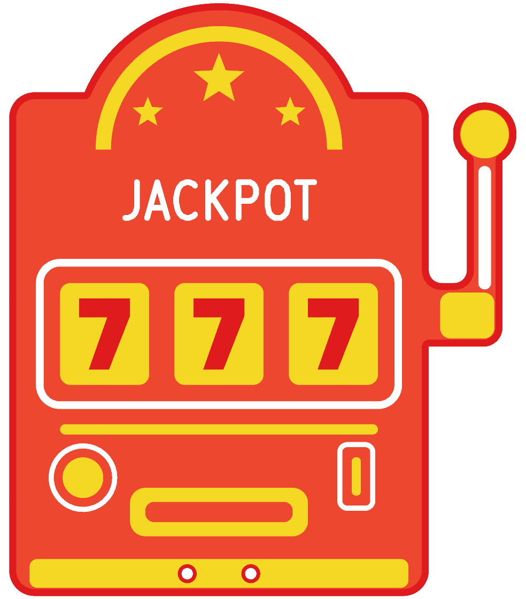
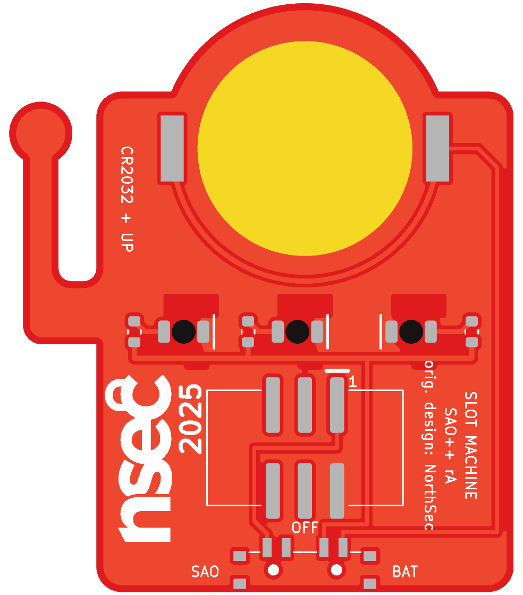

# Slot Machine — SAO++ edition

After **Sao_SlotMachine_v2** by the **NorthSec 2025 badge team**, one of the add-ons for the NorthSec 2025 conference badge:
https://github.com/nsec/nsec-badge/tree/0ea779f281ac538fa21b333b027250784b5d3cbf/hw/2025/sao/Sao_SlotMachine_v2

**Licence of the original: MIT** (the repository's root licence, "except otherwise stated in respective files"; none of this board's files states an exception). The MIT text is kept in [original/LICENSE](original/LICENSE).

> **What is NorthSec's and what is not**
> - **NorthSec's:** the idea (a slot machine add-on with three lit 7s) and the circuit (three always-on LEDs, one resistor each).
> - **SAO++'s own (CC-BY-SA-4.0):** the outline and every line of the front art. NorthSec's own outline and art were drawn over a third-party slot-machine icon of unknown origin, so none of it is used or kept here. The new drawing is made from numbers in `hardware/build_board.py` and saved as [art/front.svg](art/front.svg).
> - **Still to settle:** the back carries NorthSec's **"nsec 2025" logo**, their event branding. Selling boards with it needs NorthSec's agreement; otherwise remove it (the text credit "orig. design: NorthSec" is printed beside it either way).

 

A 39.9 × 46.6 mm slot machine: a cabinet with a round marquee, three gold reels, a lever with a ball, a payout tray. Each reel shows a 7 that glows red: the 7 is a window of bare board in the gold, with an LED face-down behind it. Runs from the badge or from its own coin cell.

(The pictures are KiCad renders with a red solder mask. The mask colour is the buyer's choice; red, black and purple all suit it.)

## The drawing

- **Outline:** a 33 mm wide cabinet with rounded corners and a flat bottom; a round marquee on top, 23 mm across; on the right a lever: a 5 mm ball on a 2.8 mm arm that joins the cabinet through an elbow, with a 3 mm gap between arm and cabinet.
- **Gold (bare copper):** an arch and three stars in the marquee, the three reels, a trim line, a button, the payout tray, the base, the lever's ball and elbow.
- **White silkscreen:** "JACKPOT", a frame round the reels, the lever arm, a ring round the button, a coin slot. All lines 0.4 mm or wider.
- **Background:** solder mask over copper. The whole front is copper, so light from the LEDs comes out only through the 7s.
- **The 7s** are bare-board windows, not slots. Reasons: the front stays unbroken, there are no narrow slots for the board house to refuse (the original's were 0.5 and 0.7 mm), the LED pads do not have to dodge a cut, and the shared reverse-mount LED is made to shine into the board this way.
- It was designed around the parts: the marquee is round because the coin cell sits behind it; the bottom is flat because the switch is there; the base band hides the switch's two locating holes.

## What the original is

Read from the maker's files (there are no notes): a 27.7 × 34.8 mm board; three hand-solder 1206 LEDs (colour not recorded) lying across three 7-shaped slots, with a 330 Ω resistor each; a bare 2×3 surface-mount pin header using only 3.3 V and GND; no chip; badge power only. The older v1 beside it (not ported) had 0402 LEDs with three transistors, three capacitors and six resistors, a blinker that chased the light round the reels; v2 dropped the blinking.

## What changed

| | NorthSec original | SAO++ rev A |
|---|---|---|
| Size, outline, front art | 27.7 × 34.8 mm, traced over an icon | 39.9 × 46.6 mm, SAO++'s own drawing |
| The 7s | slots through the board | bare-board windows in gold reels |
| Connector | bare 2×3 SMD pin header | 6-pin SAO v1.69bis shrouded, keyed SMD header in the middle of the cabinet, key slot up, more than 5 mm from every edge |
| Power | badge only | slide switch at the bottom edge: **SAO / OFF / BAT**. CR2032 clip behind the marquee; the cell slides in over the top |
| LEDs | 3 × 1206, colour unknown, about 4 mA each | 3 × red reverse-mount 1206, about 1.1 mA each on the badge, about 0.85 mA each on a fresh cell |
| Resistors | 3 × 330 Ω 0805 | 3 × 1.3 kΩ 0603 (the shared LED resistor) |
| Back | tracks, logo, a white write-on square | ground copper, the logo turned on its side, labels |

**Coin-cell safety:** the badge's 3.3 V and the cell are on separate switch contacts with OFF between them and never meet. This is an LED-only board (I2C and GPIO pins not connected), so no diode is needed on the cell.

**Battery life (calculated, not measured):** three red LEDs at about 0.85 mA is about 2.5 mA, so a CR2032 should last roughly 80 hours, dimming toward the end.

**Why red:** red lights at under 2 V, so it stays bright as the cell drains, and it is already on the parts list. Lucky sevens are red anyway.

## Compromises and things to check on the first prototype

1. **Brightness and evenness of the 7s.** Each 7 is 4 × 5.6 mm with the LED behind the middle of its stem. Check the whole 7 glows, not just the middle, in room light, on badge power and on a half-used cell. If dim, change the three resistors to 330 Ω (SAOPP-R-02): about 4 mA each on the badge, and a shorter battery life.
2. **Connector position.** The connector is in the middle of the cabinet, but the cell (the heaviest part) is above it, so the balance point is about 15 mm above the connector (estimated). It cannot be nearer: the cell and the connector cannot overlap. Check the board sits firmly in a badge.
3. **Two small holes in the base.** The switch's locating pegs need two 0.9 mm holes; they come through the gold base band on the front, 5 mm apart. They look like bolts, but they are holes in the art.
4. **Switch labels.** The datasheet does not draw which way the knob sits for position 1. The silkscreen assumes "knob toward the SAO label = badge power". If it is the other way round, swap the SAO and BAT labels (OFF is the middle either way).
5. **Battery clip direction.** The clip fits its pads both ways round. Its open side must face the top of the marquee. Tell the assembler.
6. **Cell entry.** A panel tab leaves a small rough spot at the very top of the marquee, where the cell slides in. File it flat before fitting a cell.
7. **Pin 1 position** against a real v1.69bis badge, and **knob reach** (the tip ends 1.0 mm past the bottom edge).
8. **The lever.** A 2.8 mm wide arm of 1.6 mm board, 10 mm long. It should be strong enough, but it is the part most likely to catch on clothing.

## Files

- `hardware/nsec-slot-machine.kicad_pro` — KiCad 10 project. ERC: 0 issues. DRC: 0 errors, 0 unconnected, schematic matches board. 2 warnings remain: the logo's library is not installed, and the cell clip differs from its library copy (its arrow was moved off the silkscreen, as on other boards).
- `hardware/build_board.py` — draws the outline and the art and places and routes everything, from the numbers at its top. It reads nothing from the maker's board file.
- `hardware/circuit.json` — the circuit as data; `tools/gen_schematic.py nsec-slot-machine` and the build script both read it.
- `art/front.svg` — the front art as a picture (generated by the build script; lettering is approximate there).
- `production/` — files for a board house, one board (`single/`) and a 2 × 2 panel (`panel/`). See [production/README.md](production/README.md).
- `original/` — NorthSec's circuit files and licence, with the traced outline and art cut out. [original/README.md](original/README.md) lists exactly what was cut.

## Parts cost (parts only, list prices checked 2026-11-10 in docs/parts.md)

| Part | Qty | Each @ ~100 boards |
|---|---|---|
| Connector XFCN BH254VS-6P (LCSC C492445) | 1 | $0.10 |
| Switch C&K PCM13SMTR (Digikey) | 1 | ~$0.90 |
| CR2032 clip TE BAT-HLD-001 (LCSC C7501066) | 1 | $0.61 |
| LED Lite-On LTST-C230KRKT red (LCSC C125107) | 3 | $0.037 |
| Resistor 0603 1.3 kΩ (LCSC C22767) | 3 | <$0.01 |
| **Total** | | **about $1.75** |

The CR2032 cell and the bare board are not included.
