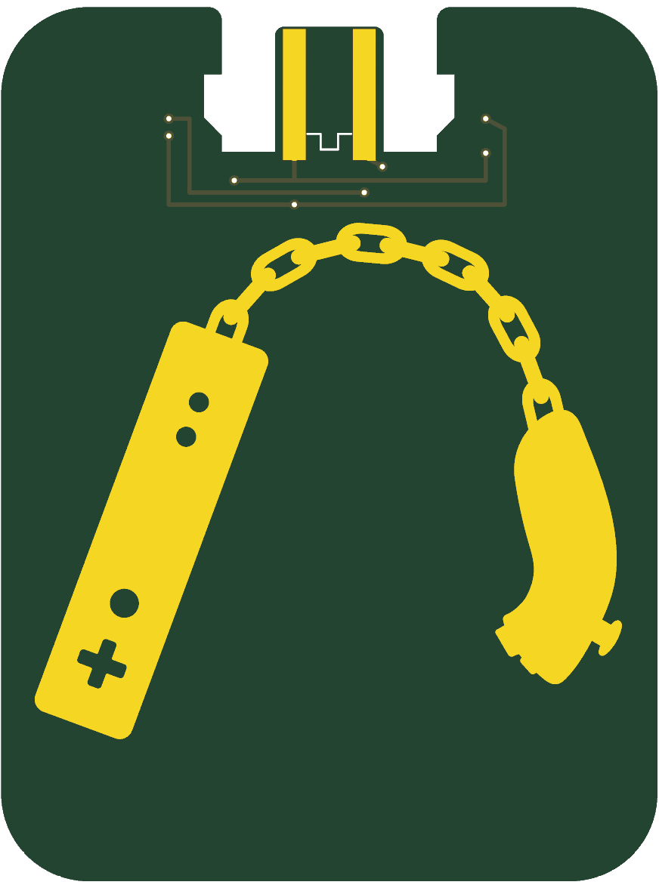
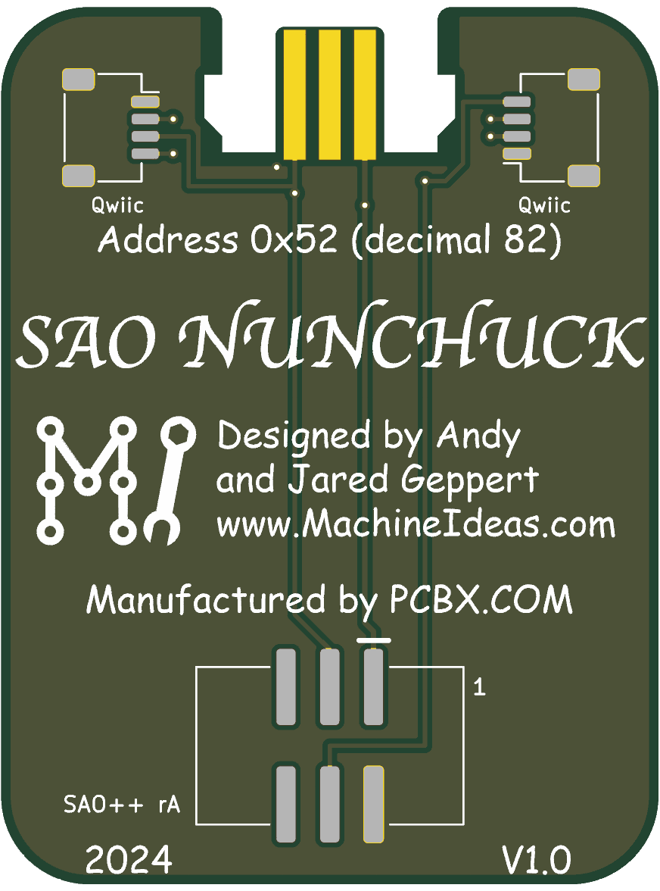

# SAO Nunchuck — SAO++ edition

Originally the **SAO Nunchuck V1.0** by **Andy and Jared Geppert** (GitHub `ageppert`, Machine Ideas), 2024: https://github.com/ageppert/SAO_Nunchuck (commit 6b02ca0), project page https://hackaday.io/project/198000-sao-nunchuck

> **Open licence (MIT).** The maker's repository is under the MIT licence: *Copyright (c) 2024 Andrew Geppert*. The full notice is kept unchanged in [original/LICENSE.md](original/LICENSE.md) and must travel with these files. No permission request is needed. (The board's own lettering credits Andy and Jared Geppert; the licence file names Andrew Geppert as the copyright holder.)
>
> **The controllers belong to someone else.** The front shows a Wii Remote and a Wii Nunchuk swung like nunchaku, and the board exists to plug in a Wii Nunchuk. Those two shapes are Nintendo product designs, and *Wii* and *Nunchuk* are Nintendo trademarks. The MIT licence covers the Gepperts' drawing and board, not Nintendo's rights: anything sold needs its own check.

 

A 38 × 51 mm board that lets a badge use a **Wii Nunchuk** (stick, two buttons, motion sensor) as a game controller. The Nunchuk's own cable plug slides onto a gold-fingered tongue at the top. Two **Qwiic** sockets pass the same connection on to other small I2C boards.

## This board has no switch, no battery and no chip — on purpose

Most SAO++ boards get the SAO / OFF / BAT switch and a coin cell. This one does not, because it would have nothing to run:

- There is **no chip on the board**. The Nunchuk *is* the device: the badge's own processor talks to it over the SAO connector's two I2C wires, at address 0x52 (fixed by the Nunchuk; nothing on this board can change it).
- A coin cell would only light the Nunchuk up with nobody listening.
- A XIAO controller would turn a simple adapter into a second computer that has to pass every reading on to the badge. The maker designed it as a plain adapter, and that is what a badge expects.

So the board is **badge-driven**: SAO pin 1 (3.3 V) goes straight to the Nunchuk and to both Qwiic sockets. That is a recorded exception to the house rule that pin 1 only goes to the power switch. There is no cell on the board, so nothing can ever push current into one.

The software half of this board is therefore **a driver for the badge**, not firmware for the board: see [firmware/README.md](firmware/README.md).

## What changed from the maker's board

| | Maker's 2024 board | SAO++ rev A |
|---|---|---|
| Size | 38.1 × 50.8 mm (1.5 × 2 in) | The same. Not scaled |
| Nunchuk tongue | Gold fingers on both sides of a tongue cut into the top edge | **Exactly the same**: outline, slots, fingers, place, true size |
| SAO connector | 2×3 through-hole header, plus gold fingers along the bottom edge so the board could also be pushed straight into a badge's socket | The shared shrouded, keyed SMD connector J1 on the back, key slot toward the tongue, same centre line, 1.5 mm higher. The bottom-edge fingers and the six holes are gone (see below) |
| Qwiic sockets | Two, top left and right, openings at the side edges | The same two, same places. Their metal tabs now go to ground |
| Wiring | 16 open vias; tracks on both sides, including a visible band of lines on the front under the tongue | **8 vias, covered by solder mask on both sides**; three tracks down the back; short links on the front in the same band under the tongue, where the maker had his |
| Ground | No ground copper | Back copper is ground, kept off the tongue |
| Front art | Copper-and-gold Wii Remote, Nunchuk and chain | Unchanged |
| Back lettering | "Address 0x52 (decimal 82)", "SAO NUNCHUCK", Machine Ideas logo, "Designed by Andy and Jared Geppert www.MachineIdeas.com", "Manufactured by PCBX.COM", "2024", "V1.0" | All kept, same words, size and place, and now in **the maker's exact letter shapes** (see below). New small labels: "1" at pin 1, "SAO++ rA", "Qwiic" at each socket |

### Why the bottom-edge fingers went

The maker's header doubled as a card-edge plug: gold fingers on the bottom edge let the board go straight into a badge's 2×3 socket with no header fitted. SAO++ uses one shrouded, keyed connector on every board, so a board cannot go in backwards or one row off. Keeping the fingers as well would put copper on the front and need a hard-gold edge. **Owner's call** if you want them back as an extra: they cost nothing in parts, but would add front copper at the bottom edge and two or three more vias.

### Why there are vias at all

A Nunchuk plug touches the tongue from both sides, so two of its five fingers (clock and ground) are on the front: those two vias would be needed anyway. The other six come from the two Qwiic sockets. Each carries the same four wires in the same order, and placed as mirror images they cross over each other (two identical sockets on the same side of a board always need a crossing somewhere). The crossings are short links on the front, in the dark strip between the tongue and the chain, where the maker ran his own front tracks. All eight vias are 0.3 mm holes, covered by mask, in that strip.

### The lettering

The maker set his back lettering in TrueType fonts (Apple Chancery for "SAO NUNCHUCK", Comic Sans MS for the rest). Most computers and factories do not have those fonts, and KiCad then draws the text in a substitute that is wider: "SAO NUNCHUCK" ran off both sides of the board. His file also stores the letters exactly as his own computer drew them, and those match his 2024 factory files. Those exact shapes are used, so the lettering looks as he made it, on any machine.

"Manufactured by PCBX.COM" is the maker's thank-you to the factory that sponsored his batch. It is kept unchanged as his credit; **owner's call** whether to keep it on boards made elsewhere.

## Power

Everything runs from the badge's 3.3 V: the Nunchuk, plus whatever is plugged into the two Qwiic sockets. The board adds no load of its own.

- **Nunchuk current: not measured here.** It is commonly reported as a few milliamps; measure it on the prototype.
- **Qwiic sockets:** anything plugged in draws from the same SAO pin. SAO++ budgets 50 mA per add-on; a Qwiic display or LED board can exceed that on its own. The README for users should say so.
- **3.3 V only.** A genuine Nunchuk runs at 3.3 V. Nothing here makes 5 V.
- **No pull-up resistors on this board** (as the SAO standard asks: the badge provides them). Some Qwiic boards carry their own; with several chained the bus gets stiffer, which is usually fine.

## Parts

| Ref | Part | Where | Note |
|---|---|---|---|
| J1 | SAOPP-CONN-01 shrouded SMD SAO connector (shared) | back, bottom middle | |
| J2 | Wii Nunchuk tongue | the top edge | Gold fingers on the board itself: nothing to buy or place, not in the BOM |
| J3, J4 | JST SH 4-pin side-entry socket (Qwiic), **SM04B-SRSS-TB(LF)(SN)** | back, top right and top left | Local part; LCSC number not filled in yet |

Footprints: J2 is the maker's own tongue footprint, cut out of his board file (its outline lines are now part of the board outline). J3/J4 use KiCad's stock JST SH footprint, the same pattern the maker used.

## Rule checks (as built)

- Schematic (ERC): 0 problems.
- Board (DRC, with schematic check): 0 errors, 0 warnings, 0 unconnected, 0 schematic mismatches.
- 4-up panel: 0 errors, 0 warnings, 0 unconnected.
- One extra rule (`hardware/nunchuck.kicad_dru`): the tongue's fingers run to within 0.19 mm (back) and 0.14 mm (front) of the tongue tip, as the maker drew them; the plug has to reach them. Every other pad is at least 0.25 mm from the edge.

## What only a prototype can tell us

1. **That a real Nunchuk plug fits the tongue and latches.** It is the maker's tongue unchanged, so it should, but it has not been tried on an SAO++ board. Ask the factory for **1.6 mm** board and ENIG finish; the tongue's width and slots are milled, so check the factory can mill the 1 mm side notches.
2. That the badge reads the Nunchuk through J1 (key slot up, VCC top-left seen from the front) with the badge's own pull-ups.
3. The Nunchuk's current from the badge's 3.3 V, and whether a clone Nunchuk behaves the same as a genuine one.
4. That a Qwiic board plugged into either socket works at the same time.
5. That the front links and vias in the strip under the tongue are as unobtrusive as the maker's own tracks were.

## Files

- `hardware/build_board.py` rebuilds `hardware/nunchuck.kicad_pcb` from the maker's file in one run; `hardware/make_local_footprints.py` writes the two local footprints; `hardware/circuit.json` is the circuit (the schematic is generated from it by `tools/gen_schematic.py`, then `hardware/fix_schematic.py` marks the tongue "not in BOM").
- `production/` has the ordering files and their notes.
- `firmware/nunchuck-driver/` is the badge-side Rust driver.
- `original/` is the maker's repository as published (large binaries left out), with his MIT licence.
