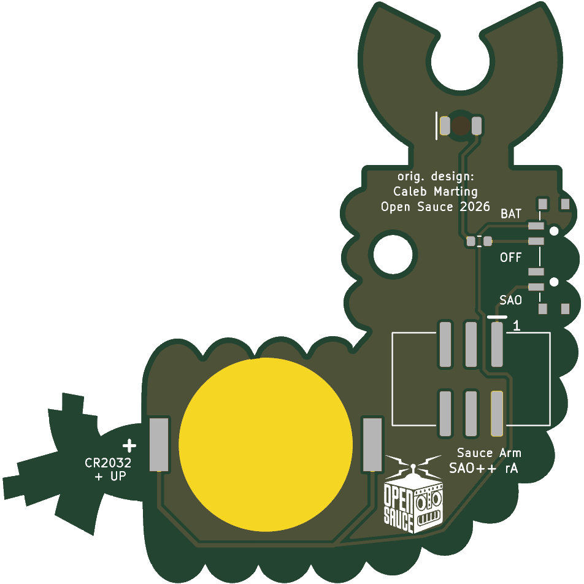

# Sauce Arm — SAO++ edition

Originally the **Sauce Arm SAO** by **Caleb Marting**, one of the add-ons for the Open Sauce 2026 badge: https://github.com/calebmarting/os2026-badge (folder `Board Files/Sauce Arm`, commit d74a6c2 of 2026-07-30).

> **License of the original: MIT**, © 2026 Caleb Marting. The full text is in [original/LICENSE](original/LICENSE) and must stay with any copy of this design. Nothing narrower was found in this board's files or in the maker's README.

> **A small Open Sauce logo is on the back, and that is not yet decided.** The logo is the Open Sauce event's trademark. The MIT license covers the maker's design files, not the trademark, and SAO++'s own licenses (CERN-OHL-S for hardware, CC-BY-SA for artwork) do not cover it either. The repo owner approved the logo on the Open Sauce Logo board only (2026-11-12). On this board it is kept as the maker had it, behind one switch in the build script (`OPEN_SAUCE_LOGO`); setting that to `False` and rebuilding leaves it off. The front has no logo: it is the maker's own drawing of a robot arm.

 

The round "palm" at the base of the gripper glows red from behind, through the board.

## What the original actually is

Read from the maker's board and schematic (the survey listed it as "unknown"):

- **A solder-it-yourself kit**, 44.4 × 44.7 mm, in the shape of a bent robot arm: a two-jawed gripper at the top, a ribbed upper arm, a round elbow joint, a ribbed forearm and a torn-off end with wires hanging out. The front is one sheet of ground copper under the solder mask, white silkscreen line art, and bare gold for the two jaws, the elbow ring, one wire and two wire ends.
- **One light.** A 5 mm through-hole LED whose legs go through the round palm of the gripper and whose body is bent up to lie in the notch between the jaws, so the arm is holding the LED. One 1 k through-hole resistor across the collar under the gripper. The LED's colour is not written in the files.
- **Badge or battery, not both.** A 2×3 through-hole SAO header and a through-hole CR2032 holder (MYOUNG BS-02-A1AJ010) are drawn on top of each other on the forearm; the holder hangs 9 mm past the torn end. A builder fitted one or the other. The cell and SAO pin 1 share one supply net, which is only safe because both were never fitted.
- **The 3-pad solder jumper (VCC / GPIO2) does not choose badge or battery.** It chooses what feeds the LED: SAO pin 1 (3.3 V, always on: the default, pre-bridged) or SAO pin 6 (GPIO2), so the badge could blink it.
- **A 12 mm bare pad** marked "Pin Back" behind the elbow for a brooch pin, and a **3 mm "Keyring Hole"** in the upper arm.
- The back silkscreen is assembly instructions plus a small **Open Sauce logo**. There is no maker's name on the board.
- No chip, no firmware.

## What changed

| | Original (2026) | SAO++ rev A |
|---|---|---|
| **Size** | 44.4 × 44.7 mm | **56.9 × 57.2 mm: everything 28 % larger** (outline, art, hole, back logo). See "Why it is bigger" |
| Connector | 2×3 through-hole header on the forearm, pins visible on the front | 6-pin SAO v1.69bis shrouded, keyed SMD connector behind the elbow, key slot up. Nothing shows on the front |
| Power | Badge **or** a coin cell, never both | Slide switch on the outer edge of the upper arm: **SAO / OFF / BAT**. The shared CR2032 clip is on the forearm; the cell slides in from above, in the crook of the arm |
| Light | One 5 mm LED held between the jaws, 1 k (about 1.4 mA on badge power) | One flat red LED on the back, behind the palm, 1.3 k (about 1 mA). **The palm glows; nothing sits between the jaws any more** |
| Blink from the badge | Optional, by moving the solder jumper to GPIO2 | **Not carried over.** The light is on whenever the switch is on SAO or BAT |
| Pin back | 12 mm pad for a brooch pin | Gone: the connector is there |
| Key-ring hole | 3 mm | Kept, 3.84 mm |
| Front art | — | The same picture. No copper under the palm any more (it may look a shade darker than the other dark areas). The bare-gold shapes stop 0.55 mm from the edge, which shows most on the two small wire ends (a thin rim of mask round each). Two 0.9 mm holes in two white rib lines at the left edge of the upper arm (the switch's locating pegs). The white print no longer runs across the key-ring hole |
| Back | Kit assembly instructions and a small Open Sauce logo | "Sauce Arm", "SAO++ rA", "orig. design: Caleb Marting / Open Sauce 2026", SAO / OFF / BAT, "CR2032 + UP", "+" at the clip, "1" at pin 1. The logo is kept, moved from the upper arm (the switch is there now) to below the connector |

**Parts shared with the rest of SAO++:** connector, switch, cell clip, red through-board LED and 1.3 kΩ resistor: all five are already on the list and on other boards. **No new part.**

**Battery life (calculated, not measured):** one red LED at about 1 mA should give roughly 150–200 hours from a CR2032.

**Coin-cell safety:** the badge's 3.3 V and the cell are on separate switch contacts and never meet. SDA, SCL and both GPIO pins are not connected to anything, so no series diode is needed.

### Why it is bigger

The arm is narrow. Between the ribs the upper arm and the forearm are about 16 mm wide, and the shared cell clip needs a 17 mm bare disc under the cell plus a solder foot 10.5 mm either side of its middle. **At the maker's size the clip cannot be placed anywhere on the board**: a search over every position and angle (0.5 mm and 15° steps) found none where the disc and both feet are on the board. From about 10 % larger the clip fits by itself; the clip, the connector (15 × 11 mm, upright) and the switch only fit beside each other, with the key-ring hole kept, from about 24–25 %, and then with 0.2–0.4 mm between the connector's plastic, the clip and the board edge. **28 % was used** so those gaps are about 1 mm. Each extra 1 % adds about 0.4 mm of room and 0.45 mm of board.

### Other options, if the owner prefers

| Option | What it costs |
|---|---|
| **A. Built (above):** all of the standard, 28 % larger | Board is 12.5 mm wider and taller than the maker's |
| **B. 25 % larger** (55.5 × 55.9 mm) | Saves 1.4 mm each way. Connector shroud 0.2 mm from the board edge and 0.4 mm from the clip's foot; two overlapping keep-out boxes to sign off |
| **C. About 20 % larger, without the key-ring hole** (53 mm) | The connector goes where the hole is. Loses a feature the maker drew and labelled; not worked through in detail |
| **D. Maker's size, badge power only:** connector, LED, resistor; no cell, no switch | Breaks the house rule that every board has the switch and cell. Keeps the size exactly |

## The light is in the palm, not between the jaws

The point of the maker's design is that the gripper holds a real LED. The approved parts cannot do that: a surface-mount LED on the back cannot stand in the notch. The through-board LED sits behind the round palm (inside the white ring, where the maker's LED legs went through) and lights it from behind. An edge-lighting LED shining into the notch was considered: SAO++ has the part numbers (LED-01 to 04) but no footprint for them in the shared library yet, and seen from the front it would only light the rim of the notch. **Owner's call** whether the glowing palm is close enough to the original idea.

## Things to check on the first prototype

1. **Glow through the solder mask.** The palm keeps its solder mask, with bare board (no copper) underneath on both sides, so the light has to come through the mask. That works with red, green, blue, yellow, purple or white mask and **not with black**. If it is too dim, change R1 to 330 Ω (SAOPP-R-02, already approved): about 4 mA, roughly 50 hours per cell.
2. **Mask and LED colour** are not recorded in the maker's files. Red was chosen for the LED because it is the brightest on a coin cell. ENIG (gold) finish is needed for the jaws and the elbow to look as intended.
3. **Switch knob on a ribbed edge.** The edge beside the switch is not straight: it has two ribs. The knob's tip is between 0.3 and 1.8 mm past the edge along its travel (0.75 mm on average), least at the top of a rib. Check it is easy to move with a fingernail when the board is on a badge. The two peg holes are 0.5 mm from the edge at the bottom of the grooves between ribs; check they do not break out.
4. **Switch labels.** The datasheet does not draw which way the knob sits for position 1. The silkscreen assumes "knob toward the SAO label = badge power". If it is the other way round, swap the SAO and BAT labels (nothing electrical changes; OFF is the middle either way).
5. **Cell clip direction.** The clip fits its pads both ways round. Its open side must face **up, toward the gripper**. Tell the assembler.
6. **Cell and the ribs.** The seated cell's edge shows in two grooves on top of the forearm, by up to 1.2 mm, when seen from the front. The cell is put in by sliding it down into the crook of the arm; the bottom of the upper arm is beside its path but nothing stands there.
7. **Clip against the bottom edge.** The clip's closed end (as drawn, a plain rectangle) comes to within 0.04 mm of the board edge in two grooves under the forearm. If the real clip's corners overhang, they overhang into a groove.
8. **Connector near the edge.** The connector's plastic body is 0.45 mm from the board edge at its lower left corner (front view), far less than the 3 mm the standard asks for; its solder pads are 4 mm in. It is 1.0 mm from the clip and 1.6 mm from the switch. Check the joint feels solid and that all three can be placed.
9. **Pin 1 position.** The connector keeps VCC in the same corner as Mad Cat and Fat Pika. Confirm against a v1.69bis badge before a production run.
10. **Where it hangs from.** The connector is behind the elbow, 20 mm to the side of the coin cell, so the board hangs from one corner of its L shape. Check it sits straight on a badge.

## How the back is wired (for whoever edits it)

There are no vias; everything is on the back. The cell's track has to get from the clip to a switch on the board edge, and any such track cuts the ground copper in two. To keep the three ground points (connector pin 2, the cell's contact disc, the LED) on one side of it, the track runs along inside the lower left edge of the elbow, goes **under the connector** (up past the left end of its pads, across between the two rows, up between pins 1 and 3) and then passes **between the two pads of the resistor** on its way to the switch: the resistor is the bridge that lets the LED's supply cross it. Four patches of back copper that end up on the wrong side of that track (the outer rim of the elbow and forearm, the wire stub, a strip beside the switch) are left bare rather than floating; the front copper covers them. The cell track is 87 mm long and 0.25–0.4 mm wide, which is nothing at 1 mA.

## Files

- `hardware/open-sauce-arm.kicad_pro` — KiCad 10 project (schematic + board). ERC: 0 issues. DRC: 0 errors, 0 unconnected, schematic matches board. 1 warning remains: the cell clip differs from the library copy (its silkscreen arrow and "+", which land off the board edge and against the connector, were moved to the fab layer; the back has its own "+" and "CR2032 + UP").
- `hardware/circuit.json` — the circuit as data; `tools/gen_schematic.py open-sauce-arm` and `hardware/build_board.py` both read it.
- `hardware/build_board.py` — rebuilds the board from `original/` plus the SAO++ changes; the enlargement is one number (`SCALE`), the logo is one switch (`OPEN_SAUCE_LOGO`), and every placement and routing decision is in there with a comment.
- `hardware/open-sauce-arm.kicad_dru` — the art rule only (no keep-out exceptions were needed).
- `hardware/outline.json` — the enlarged outline and hole, written by the build script.
- `production/` — everything a board house needs, for one board (`single/`) and a 2×2 panel (`panel/`). Start with [production/README.md](production/README.md).
- `original/` — the maker's untouched KiCad 10 project for this board and the repository's `LICENSE`. **Left out:** `Art/Silohuette.svg` (it embeds a hidden picture that is not part of the board; `Art/Black.svg` and `Art/Bronze.svg` are kept), the folder `JLCImport.3dshapes` (a 1.4 MB 3D model of the old battery holder), and everything else in the maker's repository (the badge itself, the other add-ons, firmware, photos).

## Parts cost (parts only, list prices checked 2026-11-10)

| Part | Qty | Each @ ~100 boards |
|---|---|---|
| Connector XFCN BH254VS-6P (LCSC C492445) | 1 | $0.12 |
| Switch C&K PCM13SMTR (Digikey) | 1 | ~$0.90 |
| CR2032 clip TE BAT-HLD-001 (LCSC C7501066) | 1 | $0.61 |
| Red through-board LED Lite-On LTST-C230KRKT (LCSC C125107) | 1 | $0.04 |
| Resistor 0603 1.3 kΩ (LCSC C22767) | 1 | <$0.01 |
| **Total** | | **about $1.68** |

Not included: the CR2032 cell and the bare board (56.9 × 57.2 mm, ENIG).
