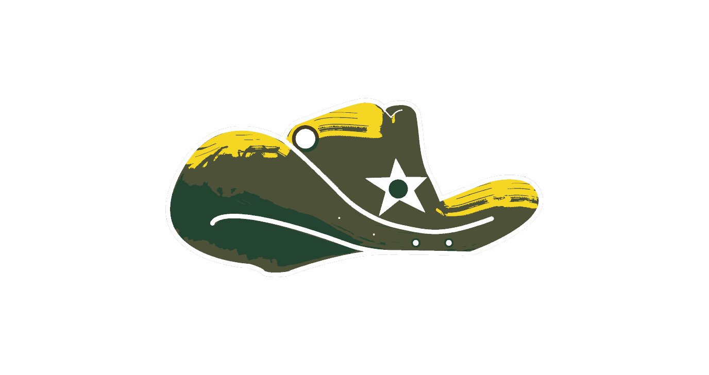
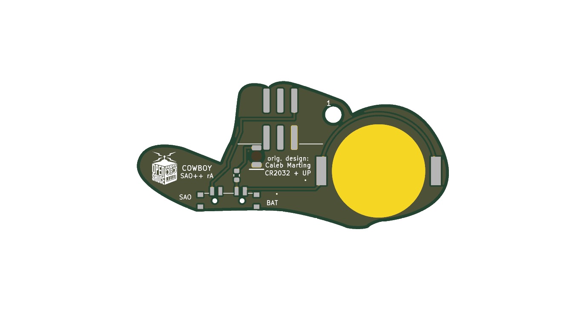

# Cowboy — SAO++ edition

Originally the **Cowboy SAO** by **Caleb Marting**, one of the add-ons made for the Open Sauce 2026 badge: https://github.com/calebmarting/os2026-badge (folder `Board Files/Cowboy`, commit `d74a6c2`, 2026-07-30).

**License of the original: MIT**, © 2026 Caleb Marting. The full notice is in [`original/LICENSE`](original/LICENSE) and must stay with any copy. Nothing in this board's files or the maker's README narrows it. The MIT licence covers the board files; it does **not** cover the Open Sauce name and logo, which are that event's trademark (see "Open Sauce logo" below).

 

(The pictures use KiCad's default green. The maker's concept drawing shows a red hat; see "Things to check".)

A cowboy hat with a sheriff's star. The middle of the star glows red.

## What the original actually is

The maker's README describes the badge, not this board, so this is read from his KiCad files:

- **The board** is a 57 × 27 mm hat. The front is copper under solder mask for the shading, bare (gold) copper brush strokes for the highlights, a white silkscreen rim, two white crease lines and a white five-pointed star.
- **The light** is one ordinary 5 mm through-hole LED, pushed through the middle of the star **from the front** ("Long Leg" / "Thru Circle" on the back tell the builder which way round), with a 1 kΩ through-hole resistor.
- **It is a solder-it-yourself kit**: a through-hole 2×3 SAO header, a through-hole CR2032 holder (BS-02-A1AJ010), a 12 mm bare copper disc marked "Pin Back" for soldering on a brooch pin, and a 3 mm hole marked "Key Ring". So it could be worn three ways: on a badge, as a pin, or on a key ring.
- **The solder jumper does not choose badge or battery.** It is marked "LED SELECT" and chooses whether the LED is fed from the badge's **VCC** (always on; the default, already bridged) or from the badge's **GPIO2** pin (so the badge can blink it).
- **The coin cell is wired straight to the LED, with no switch.** With the jumper in its default position the cell's plus is also joined directly to the badge's 3.3 V. Plugging the original into a badge with a cell fitted pushes badge power into a non-rechargeable lithium cell, which is the one thing the SAO++ power rules exist to prevent. The battery holder's minus leg also shares a hole with the header's ground pin, so the maker may have meant "header or holder, not both".

## What SAO++ makes of it

| | Original (2026) | SAO++ rev A |
|---|---|---|
| Connector | Through-hole 2×3 header near the bottom edge; six solder joints show on the front | 6-pin SAO v1.69bis shrouded, keyed, surface-mount connector on the back of the crown, key slot up. Nothing shows on the front |
| Power | Badge and coin cell wired together; no switch | Slide switch on the bottom edge: **SAO / OFF / BAT**. The badge and the cell are on separate switch contacts and never meet |
| Coin cell | Through-hole holder | Shared surface-mount CR2032 clip on the back of the left brim (seen from the front). The cell slides in from the bottom edge |
| Light | 5 mm red LED standing proud of the star, 1 kΩ | One red LED on the back shining **through** the board; the middle of the star glows. Shared 1.3 kΩ resistor, about 1 mA |
| LED from the badge's GPIO2 | Possible, by re-soldering the jumper | **Not carried over.** The jumper is gone and GPIO2 is not connected (see decisions) |
| Front art | — | Same outline, copper, gold strokes, white rim, creases and star. **Changed:** a 2.9 mm round opening in the white of the star where the light comes through (the old LED covered a 5 mm circle there); two 0.9 mm holes near the bottom edge (the switch's pegs); two pin-prick covered vias. The eleven solder joints are gone. The key-ring hole stays |
| Back | Assembly labels for the kit; "Pin Back" disc; Open Sauce logo | The kit labels are gone (no kit parts left). **The "Pin Back" disc is gone**: the connector sits there. The Open Sauce logo moves, same size, to the right-hand brim (it was under the cell). New small labels: SAO, BAT, "CR2032 + UP", COWBOY, SAO++ rA, pin 1, "orig. design: Caleb Marting" |

**Parts shared with the rest of SAO++:** all five (connector, switch, cell clip, red through-board LED, 1.3 kΩ resistor). **No new part.**

**Battery life (calculated, not measured):** one red LED at about 1 mA, so a CR2032 should last roughly 150–200 hours.

## Why things are where they are

The star fixes the light, and the hat is only 27 mm tall, so there was one workable arrangement:

- **The connector** cannot stay at the maker's spot: a surface-mount connector there would hang 1.7 mm over the bottom edge, and anywhere near it covers the star. The only place wide and tall enough is the crown, above the star. Its top pads end about 0.4 mm from the top edge of the hat (the house rule asks for 3 mm; Mad Cat has the same compromise).
- **The star's light** sits 0.27 mm below the exact middle of the star so that its upper solder pad clears the connector's plastic body (0.33 mm; the LED itself is 0.75 mm from it).
- **The cell clip** fills the left brim. It is as far left as its solder tab can go, and low enough that the clip's metal top plate clears the connector body by 0.25 mm. That pushes the cell **0.7 mm past the bottom edge** along about 7 mm of the brim. From the front that shows as a thin silver sliver below the hat when a cell is fitted.
- **The switch** uses the only straight stretch of edge (11 mm along the bottom, right of centre). Its knob sticks out 1.0 mm.
- **Two covered vias.** The cell's supply track runs between the cell and the connector, which leaves the ground copper on the back joined only by narrow necks. Two vias tie both sides to the front copper, which is ground just as on the maker's board.
- **The key-ring hole is hemmed in.** It is kept where the maker put it, but on the back the connector's shroud is now 0.5 mm to one side of it and the cell clip 1.7 mm below it. A thin split ring should still pass; a thick one may not.

## Open Sauce logo

The small box-robot logo on the back is the Open Sauce event's mark. It was on the maker's board, and it is kept (moved, not redrawn). The owner approved keeping it on the sister "Open Sauce Logo" board but **has not been asked about this one**. To build without it, set `KEEP_OPEN_SAUCE_LOGO = False` at the top of `hardware/build_board.py` and rebuild; nothing else changes.

## Decisions for the owner

1. **Keep the Open Sauce logo on the back?** Recommended: same answer as the sister board (keep), recorded in `board.yml`.
2. **Is losing "LED from GPIO2" acceptable?** Recommended: yes. Bringing it back needs a solder jumper and the series cell diode (SAOPP-D-01) that the house rules require on any board wired to a badge signal pin, on a board with no room to spare.
3. **Is losing the pin-back disc acceptable?** Recommended: yes. The connector stands 9 mm off the back anyway, so the SAO++ version would not sit flat as a brooch.
4. **Solder mask colour.** Not recorded in the maker's board files; his concept drawing is a red hat. Recommended: red mask, white silkscreen, ENIG (gold) finish.

## Things to check on the first prototype

1. **Brightness through the board.** This is the big unknown. The maker's LED stood on the front; this one shines through 1.6 mm of board and the solder mask. Check in room light on badge power and on a fresh cell. If too dim: change R1 to 330 Ω (SAOPP-R-02, already approved; about 3–4 mA, so roughly a quarter of the battery life).
2. **The star window.** The white ink is opened in a 2.9 mm circle; copper is cleared 3.2 mm. Check the glow looks centred and round, and whether the mask colour tints it.
3. **Cell clip direction and fit.** The clip fits its pads both ways round. Its **open side must face the bottom edge**; its closed end faces the top of the brim. Tell the assembler. Then check the clip's top plate does not touch the connector's shroud (0.25 mm on paper) and that a cell slides in and out from below.
4. **Cell overhang.** 0.7 mm past the bottom edge of the brim. Check it does not snag.
5. **Switch labels.** The datasheet does not draw which way the knob sits for position 1. The silkscreen assumes "knob toward the SAO label = badge power". If it is the other way round, swap the SAO and BAT labels (nothing electrical changes; OFF is the middle either way). There is no room for an "OFF" label: it is the middle position.
6. **Connector strength.** The connector's top pads are 0.4 mm from the edge and the board hangs below it with the cell out on the brim. Check it sits firmly in a badge.
7. **Pin 1 position.** VCC is in the same corner as Mad Cat and Fat Pika. Confirm against a v1.69bis badge before a production run.
8. **From the front.** Check the two peg holes and two covered vias are not distracting on the hat band.

## Files

- `hardware/open-sauce-cowboy.kicad_pro` — KiCad 10 project (schematic + board). ERC: 0 issues. DRC: 0 errors, 0 unconnected, schematic matches the board. 3 warnings remain: the maker's white rim runs to the board edge (as on his board), and the cell clip and the connector differ from their library copies (their own silkscreen strokes, which would print on the cell contact or over the edge, moved to the fab drawing).
- `hardware/circuit.json` — the circuit as data; `tools/gen_schematic.py open-sauce-cowboy` and `hardware/build_board.py` both read it.
- `hardware/build_board.py` — rebuilds the board from `original/` plus the SAO++ changes; every placement and routing decision is in there with a comment.
- `hardware/open-sauce-cowboy.kicad_dru` — three extra rules: fine gaps inside the artwork are allowed, and the connector's keep-out box may overlap the cell clip's and the LED's (the parts themselves do not touch; the distances are in the file).
- `hardware/outline.json` — the maker's outline, unchanged, and his key-ring hole.
- `docs/` — front and back pictures and the schematic.
- `production/` — everything a board house needs, for one board (`single/`) and a 2×2 panel (`panel/`). Start with [production/README.md](production/README.md).
- `original/` — the maker's `Board Files/Cowboy` folder and the repo's `LICENSE`. **Left out** (not needed for the port): `JLCImport.3dshapes/` (8 MB of 3D models for parts this version does not use) and `Art/Cowboy SAO.svg` (4.7 MB; the maker's drawing with a hidden embedded concept sheet that also shows the Open Sauce logo and an xTool-branded drawing). The four per-layer drawings in `Art/` that the board was made from are kept. Everything is still at the maker's repo.

## Parts cost (parts only; list prices from `docs/parts.md`, checked there 2026-11-10, not re-checked for this board)

| Part | Qty | Each @ ~100 boards |
|---|---|---|
| Connector XFCN BH254VS-6P (LCSC C492445) | 1 | $0.10 |
| Switch C&K PCM13SMTR (Digikey) | 1 | ~£0.70 |
| CR2032 clip TE BAT-HLD-001 (LCSC C7501066) | 1 | $0.61 |
| LED Lite-On LTST-C230KRKT red (LCSC C125107) | 1 | $0.037 |
| Resistor 0603 1.3 kΩ (LCSC C22767) | 1 | <$0.01 |
| **Total** | | **about $0.75 plus the switch (~£0.70)** |
