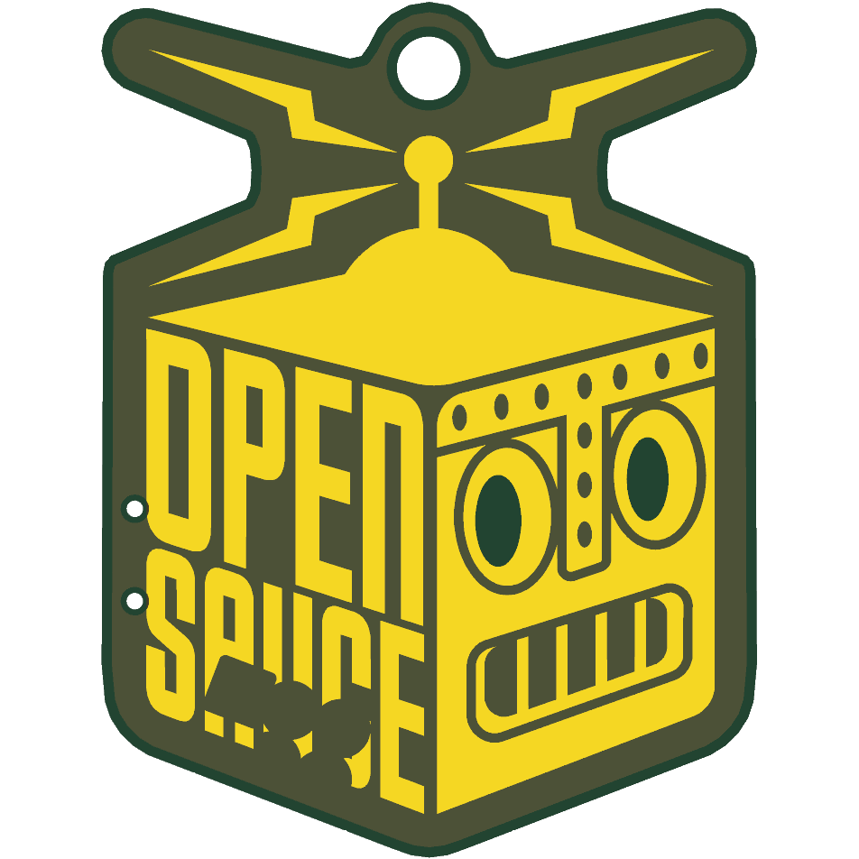
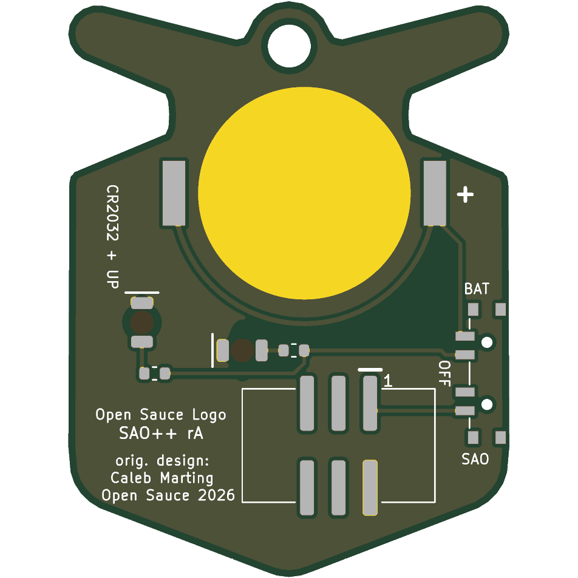

# Open Sauce Logo — SAO++ edition

Originally the **Open Sauce Logo SAO** by **Caleb Marting**, one of the add-ons for the Open Sauce 2026 badge: https://github.com/calebmarting/os2026-badge (folder `Board Files/Open Sauce Logo SAO`, commit d74a6c2 of 2026-07-30).

> **License of the original: MIT**, © 2026 Caleb Marting. The full text is in [original/LICENSE](original/LICENSE) and must stay with any copy of this design. Nothing narrower was found in this board's files or in the maker's README.

> **The logo belongs to Open Sauce.** The whole front of this board is the Open Sauce logo, which is that event's trademark. The MIT license covers the maker's design files, not the trademark, and **SAO++'s own licenses (CERN-OHL-S for hardware, CC-BY-SA for artwork) do not cover the logo either**. The repo owner approved porting this board with the logo on it on 2026-11-12. Anyone making or selling boards with the logo on them needs to settle that with Open Sauce.

 

The robot's two pupils glow red from behind, through the board.

## What the original actually is

Read from the maker's board and schematic (the survey only guessed):

- **A solder-it-yourself kit**, 30.9 × 40.3 mm, in the shape of the logo. Both sides are one solid sheet of ground copper. The picture is made only of openings in the front solder mask: bare gold where the logo is light, mask colour where it is dark. There is no front silkscreen at all.
- **Two 5 mm red through-hole LEDs**, pushed through the robot's eyes from the front so the LED bodies *are* the eyes, and **two 1 k through-hole resistors** lying along the lightning bolts on the back.
- **Badge or battery, not both.** A 2×3 through-hole SAO header and a through-hole CR2032 holder (MYOUNG BS-02-A1AJ010) are drawn on top of each other in the lower half of the back; a builder fitted one or the other. The cell and SAO pin 1 share one supply net, which is only safe because both were never fitted.
- **The 3-pad solder jumper ("LED SELECT", VCC / IO2) does not choose badge or battery.** It chooses what feeds the LEDs: SAO pin 1 (3.3 V, always on: the default, pre-bridged) or SAO pin 6 (GPIO2), so the badge could blink the eyes.
- **A 12 mm bare pad** marked "PIN BACK" for soldering on a brooch pin, and a **3 mm hole** in the loop at the top.
- The header is turned 20°, to suit the slanted ports on the Open Sauce badge.
- All the writing on the back is assembly instructions ("1K Resistor", "Red LED / Long Leg / Thru Circle", "CR2032 HOLDER", "SAO PORT", "PIN BACK", "LED SELECT"). There is no maker's name on the board.
- `Art.svg` in the maker's folder is a different drawing (other lettering on the cube's left face), not what is on the board. The board's art was taken from `logo.kicad_pcb`.

## What changed

| | Original (2026) | SAO++ rev A |
|---|---|---|
| **Size** | 30.9 × 40.3 mm | **35.5 × 46.3 mm: everything 15 % larger** (outline, art, hole). See "Why it is bigger" |
| Connector | 2×3 through-hole header, turned 20°, pins visible in the lettering | 6-pin SAO v1.69bis shrouded, keyed SMD connector, upright, key slot up. Nothing shows on the front |
| Power | Badge **or** a coin cell, never both | Slide switch on the edge: **SAO / OFF / BAT**. The shared CR2032 clip sits behind the top of the cube; the cell slides in from the top |
| Lights | Two 5 mm red LEDs standing in the eyes, 1 k each (about 1.4 mA on badge power) | Two flat red LEDs on the back, one behind each pupil, 1.3 k each (about 1 mA). The pupils glow; nothing sticks out of the front |
| Blink from the badge | Optional, by moving the solder jumper to GPIO2 | **Not carried over.** The eyes are on whenever the switch is on SAO or BAT |
| Pin back | 12 mm pad for a brooch pin | Gone: the coin cell is there |
| Front art | — | The same picture. No copper under the two pupils any more (they may look a shade darker than the rest of the dark areas). Two 0.9 mm holes in the plain border left of the lettering (the switch's locating pegs). **The letters A, U and C of "SAUCE" keep the bites the maker cut out of them for the old header's pads** (see below) |
| Back | Kit assembly instructions | Board name, "SAO++ rA", "orig. design: Caleb Marting / Open Sauce 2026", SAO / OFF / BAT, "CR2032 + UP", "+" at the clip, "1" at pin 1 |

**Parts shared with the rest of SAO++:** connector, switch, cell clip, red through-board LED and 1.3 kΩ resistor: all five are already on the list and on other boards. **No new part.**

**Battery life (calculated, not measured):** two red LEDs at about 1 mA each is about 2 mA, so a CR2032 should last roughly 70–100 hours.

**Coin-cell safety:** the badge's 3.3 V and the cell are on separate switch contacts and never meet. SDA, SCL and both GPIO pins are not connected to anything, so no series diode is needed.

### Why it is bigger

The eyes are in the middle of the right half of the board, and the lights have to be behind them. At the maker's size the cell clip (24 × 17 mm, with a closed end and side walls a part cannot sit under), the connector (15 × 11 mm) and the switch (12 mm of straight edge) cannot all be placed clear of the two eye LEDs: every position for the clip either puts an LED under the clip's metal, puts one of the clip's solder feet off the board in the notch beside the neck, or leaves no room for the connector or the switch. This was worked through by calculation (not an exhaustive computer search) with the clip upright, on its side, tilted along the line of the eyes, and hanging over the edge. By the same calculation everything first fits at about 12 % larger; 15 % was used so the coin cell also stays clear of the hole in the loop and the gaps are not at their minimum.

### Other options, if the owner prefers

| Option | What it costs |
|---|---|
| **A. Built (above):** all of the standard, 15 % larger | Board is 4.6 mm wider and 6 mm taller than the maker's |
| **B. Maker's size, badge power only:** connector, two LEDs, two resistors; no cell, no switch | Breaks the house rule that every board has the switch and cell. Keeps the size exactly |
| **C. Maker's size, lights moved off the eyes** | The eyes are the point of the board; not recommended |

## The bitten letters

The maker's mask art has round bites out of the bottoms of the A, U and C in "SAUCE": that is where the old through-hole header's six pads were, and on his board the pads filled them. With the header gone the bites show as blobs of mask colour. They are left exactly as the maker's file has them, because no clean copy of the lettering is in his repository and the logo is a trademark, not something to redraw by eye. **Recommended: ask Caleb Marting or Open Sauce for the clean logo artwork** and rebuild (the build script takes the art from one place).

## Things to check on the first prototype

1. **Glow through the solder mask.** The pupils keep their solder mask, with bare board (no copper) underneath, so the light has to come through the mask. That works with red, green, blue, yellow, purple or white mask and **not with black**. If it is too dim, open the mask over the pupils (they would then show as bare board colour instead of mask colour: an art change, owner's call), or change R1 and R2 to 330 Ω (SAOPP-R-02, already approved): about 4 mA each, roughly a day per cell.
2. **Mask colour** is not recorded in the maker's files. Pick one from the list above; ENIG (gold) finish is needed for the logo to look as intended.
3. **LEDs beside the clip.** The left-eye LED's pads are 0.77 mm below the clip's closed end and the right-eye LED's pads 0.75 mm from the clip's side. The clip is the cell's + contact. Check on the first boards that neither LED's solder touches the clip.
4. **Cell and the loop hole.** The seated cell's edge is 0.18 mm from the edge of the 3.45 mm hole, and the cell slides in across the loop. A ring or cord through the hole has to come off to change the cell.
5. **Switch labels.** The datasheet does not draw which way the knob sits for position 1. The silkscreen assumes "knob toward the SAO label = badge power". If it is the other way round, swap the SAO and BAT labels (nothing electrical changes; OFF is the middle either way).
6. **Cell clip direction.** The clip fits its pads both ways round. Its open side must face the **top** (the loop). Tell the assembler.
7. **Pin 1 position.** The connector keeps VCC in the same corner as Mad Cat and Fat Pika. Confirm against a v1.69bis badge before a production run.
8. **Connector near the edge.** The connector's plastic body is about 1.8 mm from the lower-left slanted edge at its nearest corner, less than the 3 mm the standard asks for. There is ground copper all round it. Check the joint feels solid.
9. **Switch-peg holes** from the front: two 0.9 mm holes in the dark border beside the "P" and the "S".

## Files

- `hardware/open-sauce-logo.kicad_pro` — KiCad 10 project (schematic + board). ERC: 0 issues. DRC: 0 errors, 0 unconnected, schematic matches board. 1 warning remains: the cell clip differs from the library copy (its silkscreen arrow and "+", which land on the loop and the hole, were moved to the fab layer).
- `hardware/circuit.json` — the circuit as data; `tools/gen_schematic.py open-sauce-logo` and `hardware/build_board.py` both read it.
- `hardware/build_board.py` — rebuilds the board from `original/` plus the SAO++ changes; the enlargement is one number (`SCALE`), and every placement and routing decision is in there with a comment.
- `hardware/open-sauce-logo.kicad_dru` — the art rule plus two keep-out exceptions (each eye LED beside the clip), each with the real gap.
- `hardware/outline.json` — the enlarged outline and hole, written by the build script.
- `production/` — everything a board house needs, for one board (`single/`) and a 2×2 panel (`panel/`). Start with [production/README.md](production/README.md).
- `original/` — the maker's untouched KiCad 10 project for this board and the repository's `LICENSE`. **Left out** to keep the repo small: the folder `JLCImport.3dshapes` (twelve 3D part models, 8 MB, for parts this port does not use) and everything else in the maker's 449 MB repository (the badge itself, the other add-ons, firmware, photos).

## Parts cost (parts only, list prices checked 2026-11-10)

| Part | Qty | Each @ ~100 boards |
|---|---|---|
| Connector XFCN BH254VS-6P (LCSC C492445) | 1 | $0.12 |
| Switch C&K PCM13SMTR (Digikey) | 1 | ~$0.90 |
| CR2032 clip TE BAT-HLD-001 (LCSC C7501066) | 1 | $0.61 |
| Red through-board LED Lite-On LTST-C230KRKT (LCSC C125107) | 2 | $0.04 |
| Resistor 0603 1.3 kΩ (LCSC C22767) | 2 | <$0.01 |
| **Total** | | **about $1.72** |

Not included: the CR2032 cell and the bare board (35.5 × 46.3 mm, ENIG).
