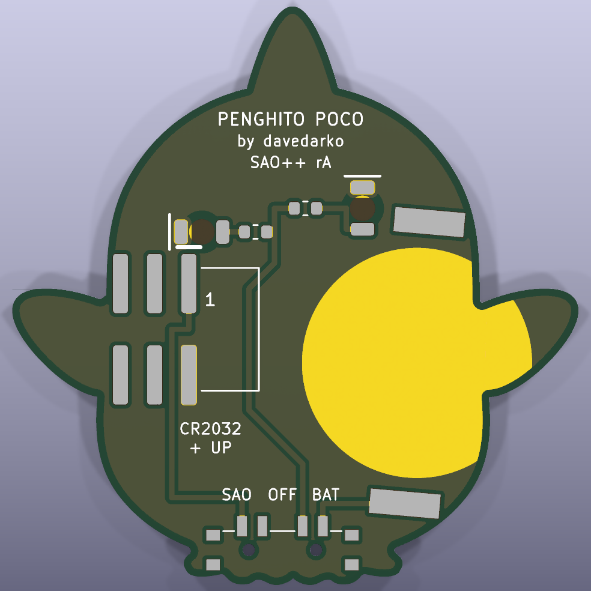

# Penghito Poco — SAO++ edition

Originally **Penghito Poco** by **davedarko (Dave Darko)**, from his Simple-Add-ons-SAO collection: https://github.com/davedarko/Simple-Add-ons-SAO/tree/main/Penghito%20Poco ("Small version of the Phengicorn Badge as a simple Add-on").

> **Permission pending — this board is not open-licensed.** The maker's repository states no license, and davedarko has not yet been asked or answered (draft request: [../han-saolo/docs/permission-request.md](../han-saolo/docs/permission-request.md)). These files were built locally on 2026-11-11; **the repo owner has not yet decided whether to publish them before permission arrives.** Until the maker says otherwise:
> - the original design in `original/`, the outline and all artwork remain **© davedarko, all rights reserved**; the repo's CERN-OHL-S / CC-BY-SA licenses would cover only the SAO++ additions (new parts placement, routing, scripts, documentation), not the original work
> - do not treat these files as cleared for manufacture or sale
>
> **davedarko, or anyone with rights in this design:** open an issue and it will be changed or removed.
>
> **Where the character comes from is not recorded.** This penguin-unicorn is a small version of the maker's larger "Penghicorn" badge. Nothing in the files says who created that character: it may be davedarko's own or someone else's. Ask the maker; that question is separate from permission for the board.

 

The penguin's two eyes light up white from behind, through the bare board.

## What changed from the original

| | Original (Eagle) | SAO++ rev A |
|---|---|---|
| Connector | 4-pin through-hole header on the right wing (pins and pads visible on the art side) | 6-pin SAO v1.69bis, surface-mount, shrouded and keyed, on the back just inside the right shoulder. Nothing shows on the front except two small corners of the plastic shroud (see below) |
| Power | Badge only | Slide switch on the bottom edge, between the feet: **SAO / OFF / BAT**. Runs from the badge or from its own CR2032, clipped to the lower left of the back |
| LEDs | 2 × 5 mm round LEDs in the eyes, wired straight to the badge's 3.3 V with **no resistor** | 2 × white reverse-mount 1206 LEDs on the back, at exactly the same two centres, one 1.3 kΩ resistor each |
| Brightness and current | Not limited by anything on the board (each LED took whatever the badge's 3.3 V pushed through it, likely 10 mA or more) | About 0.45 mA per LED on badge power, about 0.2 mA on a fresh cell. **Much dimmer on purpose**, so a coin cell lasts weeks. See the prototype checklist |
| Front art | — | The same shapes: face and belly (silkscreen), horn, beak and feet (bare gold), everything else dark. Changes: the eight old holes are gone; a 2 mm bare-board dot in the middle of each eye; two 0.9 mm holes in the inner toes (the switch's pegs) |
| Back | All copper (ground), nothing printed | Ground copper again, plus the parts and small labels: board name, "by davedarko", "SAO++ rA", SAO / OFF / BAT, "CR2032 + UP", and "1" beside the connector's pin 1 |
| Size | 42.1 × 43.0 mm | Same outline |

### How the eyes look now

The old board had two domed 5 mm LEDs standing about 8 mm proud of the front, one in each eye, like two glass beads. **Those are gone, and that is a visible change of character.** The front is now flat: each eye is a dark disc with a small 2 mm dot of bare board in its centre, which looks like a pale pupil or glint when off and glows white when on. The glow is soft and diffused by the board rather than a bright point, and much less bright than the old LEDs. Whether the owner accepts this trade (a flat, robust board with a gentle glow, instead of two eyes that stick out) is a decision for the owner.

**Why white:** the two LEDs are the eyes, sitting exactly where pupils go. White reads as a glint in the eye; red eyes would make a cute penguin-unicorn look menacing. The maker's files do not record the original LED colour. White is the same LED Mad Cat uses for its eyes, so it adds no new part. Its cost: white is the weakest colour on a coin cell (see below).

## Where the parts went (and what it cost)

The board is small and the eyes sit right in the middle of it, and nothing can sit on top of an eye's LED. The 20 mm cell, the 15 × 9 mm connector and the switch therefore cannot all sit on the centre line. Every arrangement was searched; **no layout keeps the cell inside the outline while the connector stays clear of the eye LEDs.** The one chosen:

- **Connector:** 10 mm right of centre, just under the right shoulder, near where the maker's old header was. Its pads end 0.4 mm from the edge, so it is not the 3 mm from the edge the house rule asks for. Its plastic shroud pokes past the outline in two small corners: up to 1.4 mm into the notch between head and right wing, and up to 1.0 mm below the wing. From the front these show as two small dark corners beside the right wing.
- **Coin cell:** lower left, with its open side facing the left edge so the cell slides in from there. **A fitted cell overhangs the left side by up to 3.3 mm**, below and above the left wing, and shows from the front as a silver crescent. The clip's 17 mm ground disc would also cross the edge there, so this board's copy of the disc is trimmed 0.6 mm inside the edge. The cell still rests on the rest of the disc.
- **Switch:** the only straight stretch of edge left is the bottom, between the feet. Its knob points down and sticks out 0.2 to 0.6 mm past the toes (Mad Cat's sticks out 0.75 mm). Its two locating pegs need two 0.9 mm holes, which land in the inner toes.
- **Resistors** sit between the eyes. The left-eye LED stands upright so its pad stays clear of the clip's top pad.

**The alternative**, for the owner: the connector centred between the eyes, with its pads between the two eye LEDs, and the cell centred lower down. Everything then fits inside the outline, but the connector's plastic body would sit over both eye LEDs. That only works if a real connector stands high enough off the board to clear a real LED, and nobody has checked that. The switch would also have to move to the head or a wing. It was not built.

**Parts shared with the rest of SAO++:** connector, switch, cell clip, white LED and resistor are the same reels as Mad Cat. **No new parts.**

**Battery life (calculated, not measured):** two white LEDs at about 0.2 mA each is about 0.4 mA, so a CR2032 should last a few hundred hours, getting dimmer toward the end. White LEDs need most of a coin cell's voltage, so they fade early: **best on badge power.**

## Things to check on the first prototype

1. **Brightness.** The LEDs run at a small fraction of the original current. Check the eyes in room light on badge power, then on a fresh cell, then a half-used one. If too dim, change both resistors from 1.3 kΩ to 330 Ω (SAOPP-R-02, already approved): about 1.5 mA per LED on the badge.
2. **The eye windows from the front.** The dot of bare board should glow evenly. Check the light does not spill into a ring around the dot (the copper is cleared 3.2 mm across and the solder mask 2 mm across).
3. **Cell overhang.** The cell overhangs the left side by up to 3.3 mm. Check it looks acceptable from the front, and that the cell slides in from the left and stays put when the board hangs from a badge.
4. **Clip beside the connector.** The clip's closed end sits 0.42 mm from the connector's plastic shroud (calculated from the drawings). Check both sit flat.
5. **Connector shroud corners.** Two corners of the shroud overhang the edge beside the right wing by up to 1.4 mm. Check they do not catch on anything, and that the connector holds firmly. Its pads end 0.4 mm from the edge.
6. **Knob reach.** The knob tip ends only 0.2 to 0.6 mm past the toes. Check it can be slid with a fingernail. If not, the fallback is a board rev that trims the toes behind the knob (a change to the maker's outline, so ask first).
7. **Pin 1 position.** VCC is in the same corner as on Mad Cat and the other boards. Confirm against a v1.69bis badge before a production run.
8. **Switch labels.** As on Mad Cat, the silkscreen assumes "knob toward the SAO label = badge power". If it is the other way round, swap the SAO and BAT labels (OFF is the middle either way).
9. **Weight.** A 42 × 43 mm board on a connector right of centre, with the cell on the left. Check it hangs straight and the solder joints survive being knocked.

## Files

- `hardware/penghito-poco.kicad_pro`: KiCad 10 project (schematic + board). ERC: 0 issues. DRC: 0 errors, 0 unconnected, schematic matches the board. 2 warnings: the cell clip differs from its library copy (its ground disc is trimmed at the edge) and the connector differs from its library copy (the silkscreen strokes that would print off the board moved to the fab drawing).
- `hardware/circuit.json`: the circuit as data. `tools/gen_schematic.py penghito-poco` and `hardware/build_board.py` both read it.
- `hardware/extract_art.py`: reads the maker's Eagle file and writes `art/art.json`, the outline and art turned upright and seen from the art side. The maker drew the penguin at 45 degrees, on Eagle's bottom layers.
- `hardware/build_board.py`: builds the whole board from `art/art.json` and `circuit.json`. Every placement and routing decision is in there with a comment.
- `hardware/penghito-poco.kicad_dru`: the art rule, plus two rules that let keep-out boxes overlap where the parts themselves do not touch (real gaps are listed in the file).
- `production/`: everything a board house needs, for one board (`single/`) and a 2×2 panel (`panel/`). Start with [production/README.md](production/README.md).
- `original/`: the maker's untouched Eagle board and schematic, the OSH Park picture and readme.

## Parts cost (parts only, list prices checked 2026-11-10 for Mad Cat)

| Part | Qty | Each @ ~100 boards |
|---|---|---|
| Connector XFCN BH254VS-6P (LCSC C492445) | 1 | $0.12 |
| Switch C&K PCM13SMTR (Digikey) | 1 | ~$0.90 |
| CR2032 clip TE BAT-HLD-001 (LCSC C7501066) | 1 | $0.61 |
| LED Lite-On LTW-C230DS white (LCSC C575513) | 2 | $0.055 |
| Resistor 0603 1.3 kΩ (LCSC C22767) | 2 | <$0.01 |
| **Total** | | **about $1.75** |

The CR2032 cell and the bare board are not included.
