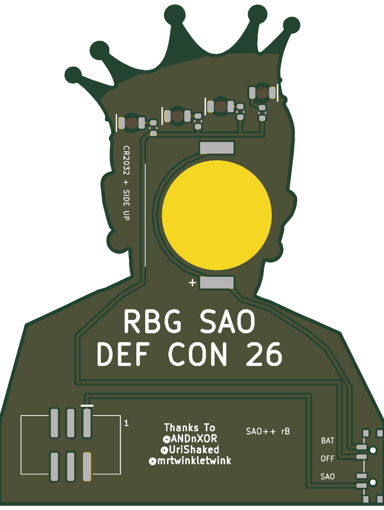

# RBG — SAO++ edition

Originally the **RBG SAO** ("DEF CON 26 RBG SAO Badge") by **lemons4all**, made for DEF CON 26 (2018): https://hackaday.io/project/161508

> **Permission pending — this board is not open-licensed.** The original hackaday.io page states no license, and lemons4all has not yet been asked or answered (draft request: [docs/permission-request.md](docs/permission-request.md)). The repo owner chose on 2026-11-10 to publish this port anyway. Until the maker says otherwise:
> - the original design in `original/`, the outline and all artwork remain **© lemons4all, all rights reserved**; the repo's CERN-OHL-S / CC-BY-SA licenses cover only the SAO++ additions (new parts placement, routing, scripts, documentation), not the original work
> - do not treat these files as cleared for manufacture or sale
>
> **lemons4all, or anyone with rights in this design:** open an issue and it will be changed or removed.
>
> **The artwork shows a real person.** It is a portrait of U.S. Supreme Court Justice Ruth Bader Ginsburg wearing a crown, with the words "NOTORIOUS R.B.G.". "Notorious R.B.G." is also the title of a book and a line of merchandise by other people. Using her likeness and that phrase is a separate question from the maker's permission, and the maker's answer does not settle it.

 

The four jewels of the crown glow red from behind, through the bare board.

## Scale (rev B)

Rev B is the 2018 board made **1.06 times bigger** in every direction: outline, crown, face, lettering and the two lines of credit text on the back all grow together and keep their proportions. The board goes from **57.0 × 73.7 mm to 60.5 × 78.1 mm**. The parts do not grow (they are real parts of fixed size); the four jewel LEDs move with the jewels.

Why: at the maker's size the CR2032 cell stuck out about 1 mm past the left ear. The owner decided on 2026-11-12 that a board may be scaled up rather than carry that kind of compromise. 1.06 is the smallest factor tried that fits cleanly:

| Factor | Best the cell could do | Result |
|---|---|---|
| 1.00 | even the best spot leaves it about 0.3 mm past the edge with no room for the wiring beside the clip; rev A's spot overhung about 1 mm | overhang |
| 1.03 | under 0.2 mm inside, and only with less ground room than the board needs | too tight |
| 1.05 | about 0.35 mm inside | tight; the ground copper that feeds the middle of the board needs a strip between the clip and the LED wiring, which pushes the cell down toward the jaw |
| **1.06** | **0.49 mm inside**, clip pads 3.7 mm inside, room for full-width wiring and ground | chosen |
| 1.07 | 0.64 mm inside | works, but bigger than needed |

## What changed from the 2018 board

| | 2018 original | SAO++ rev B |
|---|---|---|
| Size | 57.0 × 73.7 mm | 60.5 × 78.1 mm: the whole board and all its art scaled by 1.06 (see above) |
| Connector | 4-pin through-hole at the bottom right (pins visible on the art side) | 6-pin SAO v1.69bis, surface-mount shrouded and keyed, over the same spot (scaled with the art). 3.3 mm from the nearest edge. Nothing shows on the front |
| Power | Badge only | Slide switch on the straight left edge near the bottom: **SAO / OFF / BAT**. Runs from the badge or from its own CR2032, which clips to the back of the head, wholly on the board |
| LEDs | 4 × 3 mm through-hole LEDs on the back, legs through the crown's jewels, one resistor each | 4 × red reverse-mount 1206 LEDs at the same centres, shining through the board, one 1.3 kΩ resistor each |
| Brightness and current | not recorded (the 2018 files give the resistors no value) | about 1.2 mA per LED on badge power (~5 mA total), about 1.0 mA per LED on a fresh cell |
| Front art | — | Unchanged (only 6% bigger), apart from: the two plated holes inside each jewel are gone, the header's four holes and its little pin-1 dot are gone, and there are two 0.9 mm holes on the left edge beside "R.B.G." (the switch's locating pegs) |
| Back | — | "RBG SAO / DEF CON 26" and "Thanks To @ANDnXOR @UriShaked @mrtwinkletwink" untouched (scaled with the art, in the same place); no part or track touches them. The eight small +/- marks for the old LEDs are removed (they would have sat on the new pads). Five small labels added (SAO / OFF / BAT, the cell type, the revision, connector pin 1) |

**The jewels.** In 2018 each jewel was already a bare oval in the gold crown (no copper, no solder mask, about 3.8 × 5.5 mm), with the old LED's two plated holes inside it. The holes are gone, so each jewel is now a plain bare oval of board with the LED behind it. The gold shape of the crown is exactly as drawn (only trimmed 0.28 mm back from the board's outer edge). On the back, the ground copper is cleared in a 3.2 mm circle behind each jewel, and the LED's own footprint opens a 1.9 mm window in the back solder mask, so light goes into the board from behind.

**Parts shared with the rest of SAO++:** connector, switch, cell clip, red LED and resistor are the same reels as Fat Pika. No new part.

**Battery life (calculated, not measured):** four red LEDs at about 1 mA each is about 4 mA, so a CR2032 should last roughly 50 hours.

## Things to check on the first prototype

1. **Brightness through the jewels.** Check them in room light on badge power and on a fresh cell. The jewels are bare board, so light should come through well; if too dim, change the four resistors to 330 Ω (SAOPP-R-02).
2. **Pin 1 position.** The new connector keeps VCC and GND in the same corner as on Mad Cat. Confirm against a v1.69bis badge before a production run.
3. **Switch labels.** The datasheet does not draw which way the knob sits for position 1. The silkscreen assumes "knob toward the SAO label = badge power" (knob down = SAO, up = BAT, seen from the back). If it is the other way round, swap the SAO and BAT labels (nothing electrical changes; OFF is the middle either way).
4. **Battery clip direction.** The clip fits its pads both ways round. Its open side must face the left ear (front view; the right side seen from the back), so the cell slides in from the side of the head. The clip's own printed arrow would land past the board edge there, so it is on the assembly drawing only, not printed; tell the assembler.
5. **Cell edge.** The cell now sits wholly on the board, its edge about 0.5 mm inside the left ear (front view). Check it does not show from the front and that it slides in without catching.
6. **Weight on the connector.** The connector is at the bottom right and the cell sits high in the head, so the board is top-heavy hanging from one surface-mount connector. Check it sits firmly in a badge and survives a knock.
7. **Knob reach.** The knob ends about 0.75 mm past the left edge. Confirm it is comfortable to slide.
8. **Peg holes.** The two 0.9 mm holes sit in plain shirt left of "R.B.G.". Check they are not distracting from the front.

## Files

- `hardware/rbg.kicad_pro` — KiCad 10 project (schematic + board). ERC: 0 issues. DRC: 0 errors, 0 unconnected, schematic matches board. 4 warnings remain: 2 silkscreen-at-the-edge (the front collar lace, drawn to the shoulder edge in 2018), 1 "art library not installed", and 1 "cell clip differs from the library copy" (its insertion arrow was moved off the silkscreen).
- `hardware/build_board.py` has the scale as one number at the top (`SCALE = 1.06`); everything else follows from it.
- `hardware/circuit.json` — the circuit as data; `tools/gen_schematic.py rbg` and `hardware/build_board.py` both read it.
- `hardware/build_board.py` — rebuilds the board from `original/` plus the SAO++ changes; every placement and routing decision is in there with a comment.
- (rev A had `hardware/rbg.kicad_dru`, an extra rule allowing fine gaps inside the artwork. It turned out not to be needed, at either size, and is gone.)
- `production/` — everything a board house needs, for one board (`single/`) and a 2×2 panel (`panel/`). Start with [production/README.md](production/README.md).
- `original/` — the untouched 2018 KiCad 5 project and zip from hackaday.io.

## Parts cost (parts only, list prices checked 2026-11-10)

| Part | Qty | Each @ ~100 boards |
|---|---|---|
| Connector XFCN BH254VS-6P (LCSC C492445) | 1 | $0.12 |
| Switch C&K PCM13SMTR (Digikey) | 1 | ~$0.90 |
| CR2032 clip TE BAT-HLD-001 (LCSC C7501066) | 1 | $0.61 |
| LED Lite-On LTST-C230KRKT red (LCSC C125107) | 4 | $0.037 |
| Resistor 0603 1.3 kΩ (LCSC C22767) | 4 | <$0.01 |
| **Total** | | **about $1.80** |

The CR2032 cell and the bare board (60.5 × 78.1 mm) are not included.
