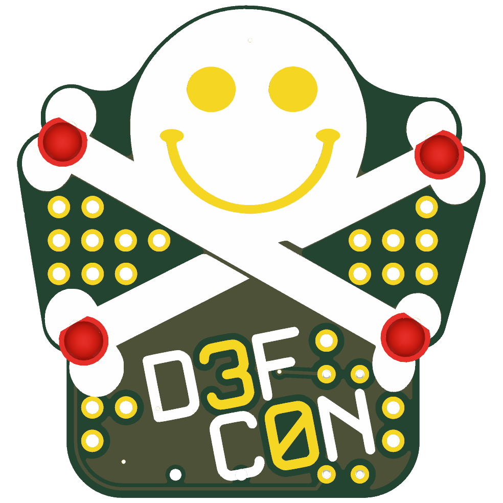
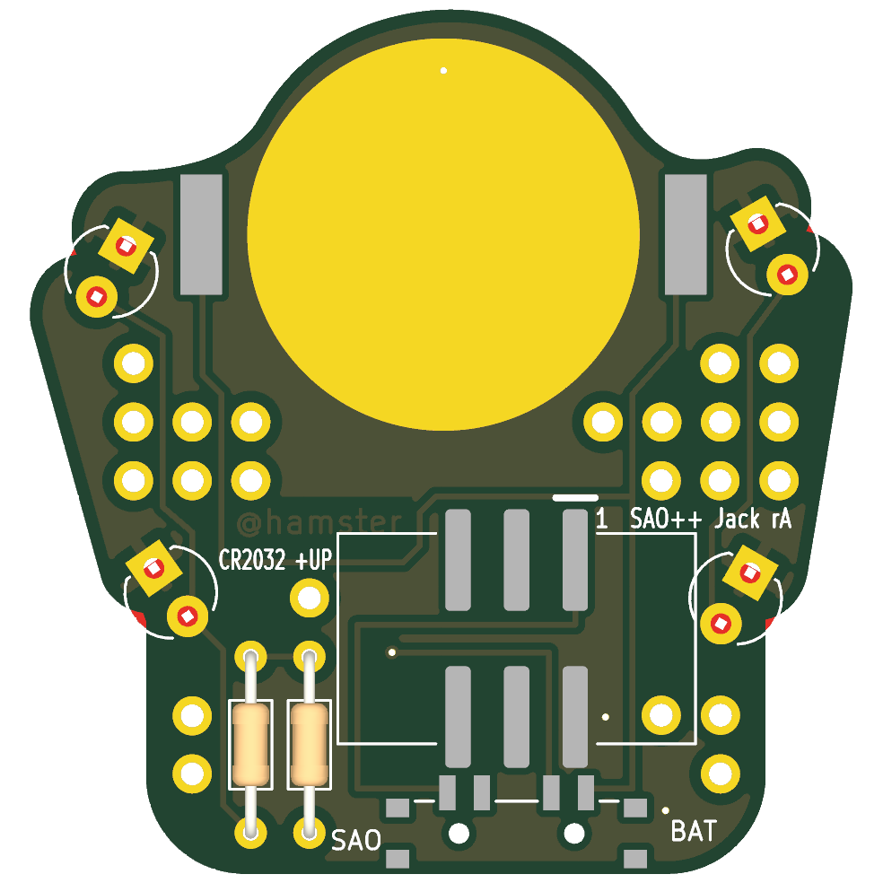

# SAO Jack — SAO++ edition

Originally **SAO Jack 1.0** by **hamster** ([@hamster](https://twitter.com/hamster)), one of his two add-ons for DEF CON 30 (2022): https://github.com/hamster/defcon30/tree/cc53e6e/jack

**License:** hamster's design is MIT (© 2022 hamster; his notice is kept in [original/LICENSE](original/LICENSE)). His soldering guide and photos stay on his page and are linked, not copied.

> **This board breaks one SAO++ house rule on purpose, and the owner has not said yes yet.**
> The standard says: front is art only, every part on the back, no visible through-hole joints. SAO Jack is a **learn-to-solder kit**: four LEDs stand on the front, two resistors are soldered through to the front, and soldering them yourself is the whole point. This port **keeps it a kit** (the orchestrator's recommendation). The owner was asked and has not answered. Until `standard_exception.decided_by` in [board.yml](board.yml) names the owner and a date, treat this as a proposal. What changes if the answer is no is at the bottom of this page.

> **The artwork is DEF CON's.** The smiling skull and crossbones is DEF CON's "Jack" mark, and "D3FC0N" is DEF CON's name. Those are DEF CON's trademarks. hamster made the board for DEF CON 30 itself; his MIT license covers his board design and cannot hand on the right to use DEF CON's marks. Whether SAO++ may publish, and above all sell, boards with this art is a question for DEF CON and a decision for the owner.

 

(Pictures: front with the four kit LEDs fitted; back with the two kit resistors fitted. The connector, switch and cell clip are not drawn by the renderer: the grey pads are where they sit.)

## What the original actually is

Read from hamster's board file, schematic, parts list and soldering guide:

- **A 35.6 × 37.4 mm kit**, already on the 6-pin SAO v1.69bis connector. Badge power only, no battery.
- **Four 3 mm through-hole LEDs**, one at each end of the crossbones, **standing on the front**, legs soldered on the back. His parts list has two green and two red. "It doesn't matter which color you put where. Get crazy with it" (hamster's guide).
- **Two small through-hole resistors** lying on the back, soldered on the front. Each one feeds two LEDs side by side: one the left pair, one the right pair.
- **A through-hole shrouded header** on the back, soldered on the front.
- **The front:** the skull, the bones and the letters D, F, C, N are white ink. The eyes, the smile, the "3" and the "0" are bare gold-coloured copper. Behind it all is one ground copper area. Scattered round the art are **25 loose plated holes** on the same 2.54 mm grid as the parts, joined to nothing: decoration, and camouflage, since the real part holes look just the same.
- **The back:** "D3FC0N" again in white ink, a hand-drawn circuit diagram (battery, resistors, a diode symbol beside each LED), and "@hamster" written in copper.

Three things the survey guess did not have:

1. **The resistor value disagrees with itself.** The schematic and board say 140 Ω; the parts list he bought from says 100 Ω.
2. **The LEDs are on the front and the resistors on the back**, so there are hand-soldered joints on both sides.
3. **The 25 dots are real plated holes**, not printed dots. They are the reason the new parts were hard to place.

## What SAO++ makes of it

Still a kit. Now it also runs from its own coin cell, picked with a switch.

| | Original (2022) | SAO++ rev A |
|---|---|---|
| The kit: 4 LEDs, 2 resistors | Through-hole, soldered by the buyer | **The same, in the same twelve holes** (the standard exception) |
| Resistors | 100 Ω bought (140 Ω drawn) | **680 Ω** (why: below) |
| Connector | Through-hole header, soldered by the buyer, six joints on the front | 6-pin SAO v1.69bis shrouded, keyed, surface-mount connector on the back, key slot up, already fitted. Nothing of it shows on the front |
| Power | Badge only | Slide switch at the bottom edge: **SAO / OFF / BAT**. A CR2032 clips to the back of the skull's head; the cell slides in over the top of the head |
| Front art | — | Same skull, bones, lettering and bare copper. Small differences listed below |
| Back | "D3FC0N", circuit diagram, "@hamster" | "@hamster" kept (moved). The lettering and diagram are **gone**: the cell, connector and switch now cover that space. New small labels: SAO / BAT at the switch, "CR2032 +UP", "SAO++ Jack rA", pin 1 |

### Why 680 Ω

The standard asks for about 1 mA per LED so a coin cell lasts. Here each resistor feeds **two** LEDs, so it should pass about 2 mA.

- hamster's 100 Ω on the badge's 3.3 V gives roughly 13 mA per pair, 6–7 mA per LED. Four LEDs like that would ask a CR2032 for about 25 mA; a coin cell cannot give that for more than minutes.
- **680 Ω** gives a red pair about 1.9 mA on a 3.0 V cell (0.95 mA per LED) and about 2.3 mA on the badge; a green or yellow pair a little less (about 0.8 mA per LED on a cell). One value for both supplies.
- All four lit: about 3.5 mA. A CR2032 should last **roughly 40–60 hours** (calculated from the standard's own figure, not measured).
- 680 Ω is a standard value found in every resistor assortment. No part number is chosen: any 1/8 W axial resistor with a body about 3.6 mm long fits.

The house resistor is 1.3 kΩ. It was not used here because it would halve the brightness again (two LEDs share it), and because the house part is surface-mount and cannot be a kit part anyway.

**Mixing colours:** two LEDs share each resistor, so the safe way is **the same colour on both left holes and the same colour on both right holes**. When two different colours share a resistor, the one that needs less voltage takes more of the current. hamster's own photo has green on top and red at the bottom (one of each per resistor) and all four light, but that was at 6–7 mA each; at 1 mA the split will be less even and the green one may look dim (not tried: prototype check 1). Blue, white and pure-green LEDs need about 3 V: fine on the badge, dim or dark on a coin cell, and they will not light at all beside a red one.

### How to solder the kit (changes from hamster's guide)

hamster's guide with photos: https://github.com/hamster/defcon30/blob/cc53e6e/jack/README.md. It still applies, with these differences:

1. **Take the coin cell out first**, and unplug from the badge.
2. LEDs: lens on the front, **short leg in the square hole** (the upper one of each pair). Solder on the back, clip the legs. The top two LEDs sit 1 mm from the cell clip's solder tabs: do not let solder run across.
3. Resistors: from the back, into the two pairs of holes beside the connector (outlined in white). Solder on the front, clip the legs.
4. The connector is already on. The hand-drawn diagram on the back that the guide points to is no longer there; the square holes and the outlines are.

### What moved or went, and why

The board is small and the back was the maker's canvas. The cell clip is 23 mm wide, the connector 15 mm, the switch 11 mm, and the only way all three fit is stacked down the middle: clip in the head, connector under it, switch at the bottom edge.

- **Three of the 25 dots are gone** (two in the middle under the bones' crossing, one just above the letter D). Each would have touched a solder pad of the new connector. The dots and the connector pins sit on the same 2.54 mm pitch, so sliding the connector sideways does not clear them. 22 remain, untouched. The old header's six holes are gone too (they were among the dots at the lower left).
- **The connector and switch sit 2.6 mm left of centre** (seen from the front), to clear the two resistors, which stay put.
- **The cell is bigger than the skull's head.** It shows past the top of the head by up to 0.56 mm, as a thin silver rim when a cell is fitted.
- **The maker's back lettering and circuit diagram are removed.** Every one of its 58 pieces lay under the cell, the clip, the connector, the switch or a new label. Nothing was redrawn. "D3FC0N" is still on the front.
- **"@hamster" moved 8.5 mm**, unchanged, from under the new connector to just beside it, where it can be read.
- **Two peg holes for the switch** (0.9 mm) at the bottom of the front. One lands in the foot of the white letter C. There is nowhere along the bottom edge that misses both the lettering and the bare-copper "0".
- **Four tiny covered holes (vias)** and **one hair-thin track on the front.** The badge supply, the cell and the switched supply have to cross between the switch and the connector, and one LED pair is on the far side of the connector from its resistor. That cannot all be done on the back. One via sits on the skull's forehead under the white ink, three in the lower half. The track runs from the left resistor round the bottom-left corner to the left LEDs, in the outermost 0.8 mm of the board where the ground copper's rim was, so the copper area keeps the maker's shape. Under solder mask they show as a faint line and four pin-pricks.
- **Ground copper on the back** is new (the standard asks for it round the surface-mount connector). It is left out where a pocket of it could not be tied to ground.

### Parts

**Fitted by the assembly house (all shared with the rest of SAO++, no new reel):** connector, switch, cell clip. Three parts.

**Kit bag, soldered by the buyer (not on the SAO++ parts list, and not chosen here):** four 3 mm LEDs in two colours, two 680 Ω resistors. hamster's 2022 list names HLMP1540 (green), LTL-4211N (red) and CF18JT100R (100 Ω resistor: the wrong value now); none of these was re-checked for stock or price. They add nothing to the assembly line: no reel, no placement.

## Things to check on the first prototype

1. **Brightness at 1 mA, and mixed colours.** Old-style 3 mm LEDs like the 2022 ones were made for 10–20 mA and may look dim at 1 mA. Modern high-brightness 3 mm LEDs are bright at 1 mA. Try both, on a cell and on a badge, before choosing what goes in the kit bag; also try one red and one green on the same resistor, as in hamster's photo. If too dim: 330 Ω roughly doubles the current and halves the battery life.
2. **Soldering beside the clip.** The top two LEDs' pads are 1.0 mm and 1.1 mm from the clip's solder tabs (the LED's own two pads are 0.74 mm apart). A solder bridge there would short the cell, which is why step 1 of the guide is "take the cell out". Watch a beginner do it.
3. **Resistor beside the connector.** 0.5 mm between the connector's plastic and the left resistor's body. Check a resistor drops in, and that the iron on the front does not need to touch anything.
4. **Switch labels.** The datasheet does not draw which way the knob sits for position 1. The silkscreen assumes "knob toward the SAO label = badge power". If it is the other way round, swap the two labels (nothing electrical changes; OFF is the middle either way).
5. **Cell clip.** The clip fits its pads both ways round; its open side must face the **top** of the head. Its closed end is 0.85 mm from the connector's top pads, with a track of the clip's own supply running between them. Seven of the loose dots lie under the clip's corners: they are joined to nothing, but look at them with a clip fitted.
6. **Cell overhang.** Check the 0.56 mm of cell showing past the head looks acceptable.
7. **Knob reach.** The knob ends 1.0 mm past the bottom edge.
8. **Pin 1 position.** The connector keeps VCC in the same corner as Mad Cat and Fat Pika. Confirm against a v1.69bis badge before a production run.
9. **The front.** Check the four vias, the edge track and the peg hole in the C are quiet enough.
10. **Colours and finish.** Nothing in the files records them. hamster's photos show a black board, white ink and a silver-coloured finish. SAO++ asks for ENIG (gold-coloured) because the cell rests on a bare copper disc, so the eyes, smile, "3", "0" and the dots would be gold, not silver.

## If the owner says no to the kit

Converting to surface-mount LEDs on the back would change this:

| | Kit (built) | Surface-mount instead |
|---|---|---|
| House rule | Exception: parts and joints on the front | Met: front is art only |
| What the buyer does | Solders 4 LEDs and 2 resistors | Nothing; it arrives finished |
| The lights | Four domed LEDs standing proud of the front, any colours, can be bent outward | Either four red or white glows *through* the board at the bone ends (the white ink and copper there would need a 3 mm clear window each: the art changes), or four side LEDs lighting the board's edge |
| Parts | 3 machine-placed + 6 loose kit parts | 11 machine-placed, all on the approved list: 4 more LEDs, 4 house resistors (one per LED), no kit parts |
| Holes on the front | 12 kit holes stay | The 12 kit holes go, or stay as empty dots |
| Risk at the clip | Hand soldering 1 mm from the cell tabs | None |
| What it is | hamster's learn-to-solder kit, on SAO++ power | A DEF CON skull add-on; no longer the thing he made |

## Files

- `hardware/sao-jack.kicad_pro` — KiCad 10 project (schematic + board). **ERC: 0 issues. DRC: 0 errors, 0 unconnected, schematic matches board, 42 warnings**, all read:
  - 26 about silkscreen: 25 are the maker's own art (white ink drawn over LED pads and bare copper, LED outlines at the board edge; his original file gives 30 of the same kind); 1 is new (the connector's outline touches one LED outline on the back).
  - 11 "plated hole inside a part's keep-out box": loose dots under the clip's and connector's boxes. Normally an error; lowered to a warning for this board because the dots carry nothing. See prototype check 5.
  - 4: the maker's art library `lib_fp` is not installed (the art is in the board file itself).
  - 1: the cell clip differs from the library copy (its printed arrow, which would land on the bare cell contact, moved to the fab layer).
- `hardware/circuit.json` — the circuit as data; `tools/gen_schematic.py` and `hardware/build_board.py` both read it. `hardware/fix_schematic.py` then marks the six kit parts "not in BOM".
- `hardware/build_board.py` — rebuilds the board from `original/` plus the SAO++ changes; every placement and routing decision is in there with a comment.
- `hardware/parts_local.py`, `hardware/sao-jack-local.pretty/`, `hardware/make_local_footprints.py` — the two kit footprints, lifted unchanged from hamster's board file.
- `hardware/sao-jack.kicad_dru` — the art rule plus three keep-out exceptions (connector/clip, connector/switch, connector/resistor), each with the real gap.
- `hardware/outline.json` — the maker's outline as one polygon.
- `production/` — everything a board house needs, for one board (`single/`) and a 2×2 panel (`panel/`). Start with [production/README.md](production/README.md).
- `original/` — hamster's KiCad 6 project files and his LICENSE, from commit cc53e6e. His photos, Illustrator and Photoshop art, parts spreadsheet and Gerbers are **not** copied: see https://github.com/hamster/defcon30/tree/cc53e6e/jack/images

## Parts cost (machine-placed parts only, list prices checked 2026-11-10 in docs/parts.md)

| Part | Qty | Each @ ~100 boards |
|---|---|---|
| Connector XFCN BH254VS-6P (LCSC C492445) | 1 | $0.12 |
| Switch C&K PCM13SMTR (Digikey) | 1 | ~$0.90 |
| CR2032 clip TE BAT-HLD-001 (LCSC C7501066) | 1 | $0.61 |
| **Total** | | **about $1.65** |

Not included: the kit bag (four LEDs, two resistors: not priced, because no part is chosen), the CR2032 cell, the bare board.
