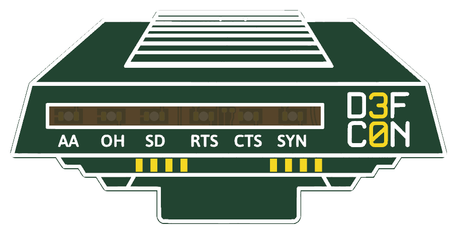
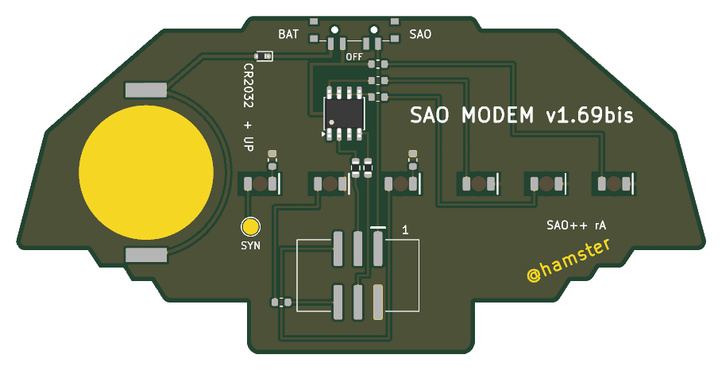

# SAO Modem 1.69bis — SAO++ edition

Originally **SAO Modem 1.69bis** by **hamster** ([@hamster](https://twitter.com/hamster)), made for DEF CON 30 (2022): https://github.com/hamster/defcon30/tree/cc53e6e/modem

> **License of the original: MIT**, © 2022 hamster. The full text is in [original/LICENSE](original/LICENSE) and must stay with any copy. The design in `original/`, the outline and all artwork are hamster's work; the SAO++ additions (parts placement, routing, scripts, documentation) are under this repo's licenses.
>
> **"D3F C0N" on the front** is the DEF CON event's name in its own letter style. The MIT license covers hamster's design, not that name. It is kept because it is part of the maker's art; it is a question for the owner if boards are ever sold (see "Decisions for the owner").

 

A little external modem with six red lights that blink with what the badge is doing. The maker's photos (not copied here): [front, lit](https://github.com/hamster/defcon30/blob/cc53e6e/modem/images/IMG_3419.JPG), [front](https://github.com/hamster/defcon30/blob/cc53e6e/modem/images/IMG_3407.JPG).

| Light | What it shows |
|---|---|
| AA | The board has power (from the badge or from its cell, whichever the switch selects) |
| OH | Flickers while the badge talks on its I2C clock line (SCL) |
| SD | Flickers while the badge talks on its I2C data line (SDA) |
| RTS | On while the badge holds GPIO1 high |
| CTS | On while the badge holds GPIO2 high |
| SYN | Wired to a bare pad on the back marked SYN: connect it to anything you like (3.3 V lights it) |

## What the original really is

Read from the maker's board file, schematic and parts spreadsheet:

- A 43.9 × 21.5 mm board, 1.2 mm thick, black with white print. The lights shine through a strip of bare board.
- Six red LEDs of the sideways-shining kind (Lite-On LTST-S220KRKT), each with a 47 Ω resistor: roughly 25 mA per light, which is very bright and a real load on a badge pin.
- **One transistor part, Diodes Incorporated DMP3085LSD-13**: two P-channel MOSFETs in one 8-pin package. One half switches the OH light, the other the SD light. Each gate is joined to its I2C line through one resistor (4.7 kΩ on SCL, 10 kΩ on SDA) and to nothing else, so the bus only "sees" the gate. A light is on while its line is **low**; an idle bus is high, so both are dark until the badge talks.
- RTS and CTS have no transistor: the badge's GPIO pin feeds the LED directly.
- AA sits straight across the badge's 3.3 V.
- A through-hole 6-pin header, soldered by the buyer.

Nothing on the board carries the name "U.S. Robotics" or "Courier" or any logo; only the shape and the light names recall that modem.

## What changed

| | 2022 original | SAO++ rev A |
|---|---|---|
| **Size** | 43.9 × 21.5 mm | **87.7 × 43.0 mm: everything enlarged exactly 2 times.** See below |
| Connector | 6-pin through-hole, pins visible on the foot | 6-pin SAO v1.69bis, surface-mount shrouded and keyed, on the back of the foot. Nothing shows on the front |
| Power | Badge only | Slide switch on the top edge: **SAO / OFF / BAT**. Runs from the badge or from its own CR2032, which slides in from the right-hand edge behind "D3F C0N" |
| LEDs | 6 × red, shining sideways into the board | 6 × the shared red reverse-mount LED, shining through the board behind the same window strip |
| LED resistors | 6 × 47 Ω (about 25 mA per light) | 6 × the shared 1.3 kΩ (about 1.1 mA per light on the badge, about 0.7 mA on the cell). **Much dimmer than the original on purpose** |
| Transistor and its two resistors | DMP3085LSD, 4.7 kΩ, 10 kΩ | The same three parts, wired the same way |
| RTS / CTS | Badge pin → LED → 47 Ω | Badge pin → 1.3 kΩ → LED: the badge pin now gives about 1 mA instead of about 25 |
| Cell protection | — | Series diode right after the cell clip (required: the board is wired to all four signal pins) |
| Wiring | Back, plus three tracks and four vias on the front | Back only, no vias |
| Front art | — | Unchanged apart from the size, two 0.9 mm holes in the lid's grille (the switch's locating pegs), and the six header holes, which are gone |
| Back art | "SAO MODEM v1.69bis" top centre; "@hamster" as bare copper letters | "@hamster" in the same place, twice the size. The title moved to the left of the switch and is 1.5× its old size (at 2× it is wider than any free stretch of the back). Labels added: SAO, OFF, BAT, CR2032 + UP, SYN, pin 1, SAO++ rA |

### Why it is twice the size

The row of six lights runs across the middle of the board for two thirds of its width, and a coin cell cannot sit over LEDs. At the maker's size nothing else fits either; the limits, worked out on the real outline:

| Enlargement | Board | What fits |
|---|---|---|
| 1.3× | 57 × 28 mm | Connector and switch. **No cell** |
| 1.8× | 79 × 39 mm | The bare 20 mm cell would just clear the lights, but not the clip that holds it |
| 1.9× | 83 × 41 mm | The clip fits only turned to an odd angle, with no spare room |
| **2.0×** | **88 × 43 mm** | Clip square to the board, 0.6 mm inside the edge, 1.4 mm from the SYN light |

So the choice is between this 2× board and a small board without a battery. It is the first question for the owner below.

## Coin-cell safety and the badge's signal pins

This board is wired to SDA, SCL, GPIO1 and GPIO2, so [standard.md section 3](../../docs/standard.md#3-power-sao--off--battery) applies in full. What can and cannot happen, in every switch position:

**Can anything push current into the cell? No.**

- The badge's 3.3 V and the cell are on separate contacts of the switch, as on every SAO++ board. They never touch.
- SDA and SCL each go through a resistor to one transistor gate and nowhere else. A MOSFET gate is an insulated input: the datasheet limit is 0.1 µA of leakage at 20 V, and here it sees 3.3 V. There is no protection diode from the gate to the supply for current to sneak through (which is the usual route with a microcontroller).
- GPIO1 and GPIO2 go to an LED and a resistor to ground. They are not connected to the board's supply at all.
- The SYN pad is the same: pad → LED → resistor → ground.
- On top of that, the series diode D7 sits between the cell and the switch, pointing away from the cell, so even a fault elsewhere could not charge it. (Its tiny reverse leakage at these voltages is still a "to check" item in the parts list.)

**What does the board do to the badge's I2C bus?**

- It never pulls a line down and has no pull-ups. All it adds is the transistor's gate: roughly 0.6 nF on each line (datasheet: 563 pF typical), hidden behind 4.7 kΩ on SCL and 10 kΩ on SDA. That is exactly the maker's circuit. His own warning stands: at ordinary speed (100 kHz) it worked on his badges; a badge that runs fast I2C or has weak pull-ups may see its signals slowed. Fitting higher values at R7 and R8 lightens the load.
- **The load is the same in all three switch positions**, because the gate is insulated whether the board is powered or not.
- **Switch OFF, board plugged in:** the transistor has no supply, so OH and SD stay dark and take nothing from the bus. An unpowered board does not drag the bus down. AA is dark.
- **Switch BAT, board plugged in:** the lights run from the cell (about 2.7 V after the diode). The badge's lines idle at 3.3 V, a little above that; this only holds the transistors more firmly off. When a line goes low its light comes on, paid for by the cell.

**What about RTS and CTS when the switch is OFF?** They still light whenever the badge drives GPIO1 or GPIO2 high, in every switch position, because the badge's own pin is what powers them (as on the original). It is about 1 mA per pin and harms nothing, but the switch does not turn them off. Making them obey the switch would need another kind of transistor that is not on the parts list; see the decisions below.

**Unplugged, on the cell:** only AA lights (and SYN, if you wire its pad to something). There is no bus to watch.

## Things to check on the first prototype

1. **OH and SD on the cell.** The transistor needs between 1 and 3 V on its gate to switch on (typically about 1.8 V). On badge power it gets 3.3 V, enough even for a worst-case part. On the cell it gets about 2.7 V falling toward 2.2 V as the cell empties: fine for a typical part, **not guaranteed for every part**. If OH and SD are dark or dim on the cell but fine on the badge, this is why.
2. **Brightness.** The lights run at about 1/25 of the maker's current. Check all six through the board in room light. If too dim, change the six resistors to 330 Ω (SAOPP-R-02, already on the list): about 4 mA per light.
3. **The badge's I2C still works** with the board plugged in, in all three switch positions, on at least one real badge that uses its I2C bus.
4. **Weight and leverage.** This is now a wide board hanging from a surface-mount connector in its foot, with the cell out at one end. Check it sits firmly and survives a knock.
5. **Switch labels.** As on the other boards, the datasheet does not draw which way the knob sits for position 1. The print assumes "knob toward the SAO label = badge power". If it is the other way round, swap the SAO and BAT labels.
6. **Cell clip direction.** The clip fits its pads both ways round. Its open side must face the board edge nearest to it (the right-hand edge seen from the front). Tell the assembler.
7. **Pin 1.** VCC and GND are where the maker's header had them (which worked on DEF CON 30 badges); confirm against a v1.69bis badge.
8. **Shadows in the window strip.** Three thin tracks and two small resistors cross behind the bare strip between RTS and CTS. Check they do not show as lines when the lights are on.
9. **Peg holes.** Two 0.9 mm holes come through the white grille lines at the top of the front.

## Decisions for the owner

1. **Size.** With a coin cell this board cannot be smaller than twice the original (88 × 43 mm). Without one it could be about 1.3× (57 × 28 mm), with the connector and an SAO / OFF switch. Worth knowing: away from a badge the cell only lights AA, because the other lights show badge signals. *Recommendation: decide by holding a paper cut-out of both sizes against a badge. If the 2× size looks wrong, this is the one board where dropping the cell loses very little.* The files here are the 2× version with the cell, as the brief asked.
2. **The transistor (DMP3085LSD-13).** It is the maker's part and the board's function depends on it, so it is a board-only part. **Not yet checked at a distributor**: no stock, price or LCSC number is recorded, and the assembly files leave that column empty. It costs one extra reel line. *Recommendation: keep it for the prototype; check item 1 above before a production run, and if it fails look for a pin-compatible part that switches on at a lower voltage.*
3. **The 4.7 kΩ and 10 kΩ resistors.** Two more values, one piece each, **not yet checked at a distributor**. They set the load on the badge's I2C lines, so the house 1.3 kΩ or 330 Ω would be wrong here (lower values load the bus more). One value for both (10 kΩ) would save a reel line and load the bus less, at the risk of a dimmer OH light. *Recommendation: keep the maker's two values on the prototype, then try 10 kΩ in both places.*
4. **RTS and CTS ignore the switch** (they run from the badge's pins, as the maker designed). *Recommendation: leave it; it needs no new part and now draws only 1 mA per pin.*
5. **"D3F C0N" on the front.** *Recommendation: keep it for boards given away; ask DEF CON or replace the wording before selling any.*
6. **Title size.** The maker's "SAO MODEM v1.69bis" is 1.5× rather than 2× and has moved. *Recommendation: accept.*

## Files

- `hardware/sao-modem.kicad_pro` — KiCad 10 project (schematic + board). ERC: 0 issues. DRC: 0 errors, 0 unconnected, schematic matches board. 7 warnings remain: the maker's art library and KiCad's test-pad library are not installed (4), the cell clip differs from the library copy (its printed arrow, which fell off the board, moved to a non-printing layer) (1), and two from the maker's own front art (the white outline sits on the board edge; the white frame overlaps the bare window strip). ERC ignores "label connected to only one pin": the SYN pad is board-only (bare copper, no schematic symbol).
- `hardware/circuit.json` — the circuit as data; `tools/gen_schematic.py sao-modem` and `hardware/build_board.py` both read it. Picture: [docs/schematic.svg](docs/schematic.svg).
- `hardware/build_board.py` — rebuilds the board from `original/` plus the SAO++ changes; every placement and routing decision is in there with a comment.
- `hardware/make_outline.py` — enlarges the maker's outline (as curves, so the corners stay smooth) for `outline.json`.
- `hardware/parts_local.py`, `hardware/make_local_footprints.py`, `hardware/sao-modem-local.pretty/` — the board-only parts: the transistor, the two gate resistors, the cell diode, the SYN pad. All use KiCad's stock land patterns.
- `production/` — everything a board house needs, for one board (`single/`) and a 2×2 panel (`panel/`). Start with [production/README.md](production/README.md).
- `original/` — the maker's KiCad 6 project (board, schematic, his art footprints), his outline drawing and the MIT license. His photos, panel, Gerbers and Illustrator files are not copied; they are at the link above.

## Build notes

- Everything is on one copper layer (the back) with no vias. That works because four LED resistors (R1, R2, R3, R5) were put on the supply side of their LED: a 0603 resistor leaves room for one thin track between its pads, so they act as bridges over the badge-supply track and the GPIO1 track. GPIO1 goes the long way round the connector for the same reason.
- The ground copper reaches the connector's ground pin through a 0.75 mm neck between the SDA track and the CTS light. That is why the CTS window is 1 mm shorter on one side. It carries a few milliamps at most.
- Ten small patches of the back that are shut in between tracks are left without copper rather than as floating islands.
- The cell clip is turned 0.1° off square: KiCad 10 reports its outline as faulty at an exact right angle (see the repo's CLAUDE.md).
- Datasheet read for the transistor: Diodes Incorporated DS36194 rev. 3-2 (July 2019), fetched from diodes.com on 2026-11-11.

## Parts cost (parts only; list prices from [docs/parts.md](../../docs/parts.md), checked 2026-11-10 / 11)

| Part | Qty | Each |
|---|---|---|
| Connector XFCN BH254VS-6P (LCSC C492445) | 1 | $0.10 |
| Switch C&K PCM13SMTR (Digikey) | 1 | about $0.90 |
| CR2032 clip TE BAT-HLD-001 (LCSC C7501066) | 1 | $0.61 |
| LED Lite-On LTST-C230KRKT red (LCSC C125107) | 6 | $0.037 |
| Resistor 0603 1.3 kΩ (LCSC C22767) | 6 | <$0.01 |
| Cell diode RB751S40T1G (LCSC C232576) | 1 | $0.039 |
| Transistor DMP3085LSD-13 | 1 | **not priced** |
| Resistors 0603 4.7 kΩ and 10 kΩ | 1 + 1 | **not priced** (a cent or less each is typical) |
| **Total** | | **about $1.90 plus the transistor** |

The bare board is four times the area of the original, which is what the board house charges by.

**Battery life (calculated, not measured):** AA draws about 0.7 mA all the time on the cell; OH and SD add a little only while the badge talks. A CR2032 should last roughly 200–300 hours.
