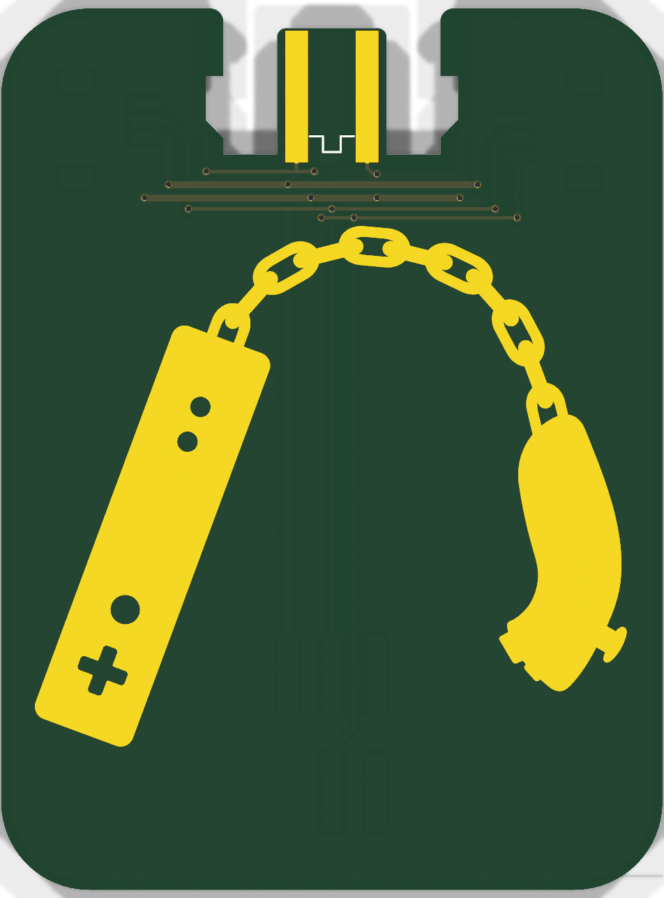
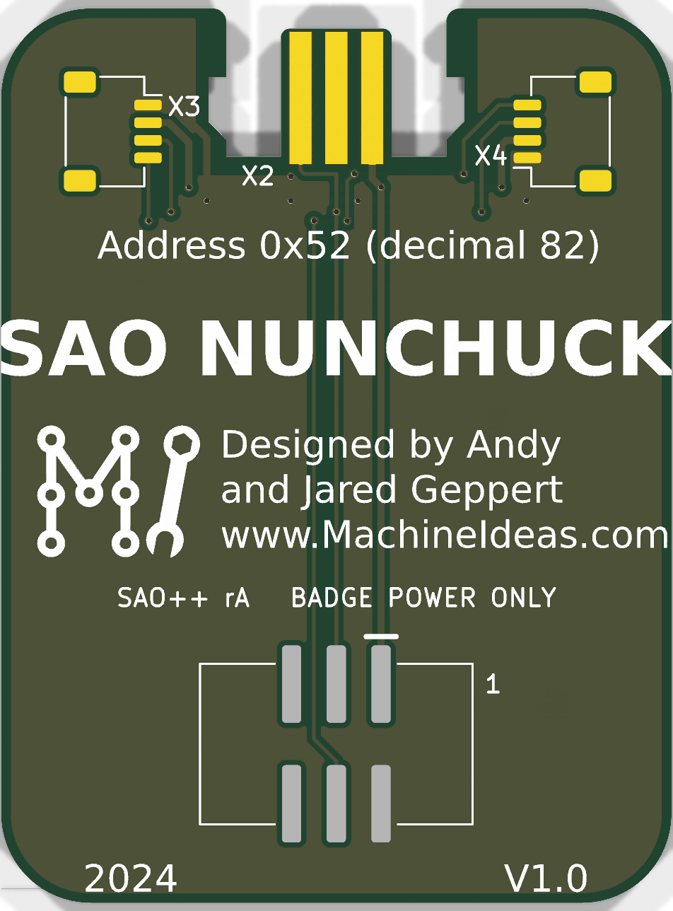

# SAO Nunchuck — SAO++ edition

Originally the **SAO Nunchuck** (hardware V1.0, 2024) by **Andy and Jared Geppert** (ageppert, www.MachineIdeas.com): https://github.com/ageppert/SAO_Nunchuck (project page: https://hackaday.io/project/198000-sao-nunchuck)

**License:** the original is MIT-licensed, "Copyright (c) 2024 Andrew Geppert" ([original/LICENSE.md](original/LICENSE.md)). The license sits at the top of the maker's repository and no file inside carries a different notice, so it covers the board design as well as the demo code. That notice must stay with any copy.

> **The names and shapes are Nintendo's.** "Wii" and "Nunchuk" are Nintendo trademarks. The board says "SAO NUNCHUCK" on the back (the maker's spelling) and shows the outline of a Wii Remote and a Nunchuk controller on the front, joined by a chain like a pair of nunchaku. There is no Nintendo logo on it. The maker's MIT license covers his drawing; it cannot give anyone rights in Nintendo's names or product shapes. If boards are sold, describe them as "for use with" the controller, never as a Nintendo product. The owner should decide whether that is enough (see "Decisions for the owner").

 

## What the original actually is

Read from the maker's files (the survey guessed "pass-through, hardly any art"; the first half is right, the second is not):

- **A plug-in adaptor with no parts that do anything.** A Nunchuck controller talks I2C (the same two-wire bus an SAO port has) and runs on 3.3 V. The board joins the badge's 3.3 V, ground, SDA and SCL straight to the controller's plug. No chip, no LED, no resistor, no pull-ups. The badge's own program reads the joystick, two buttons and tilt sensor at I2C address 0x52 (printed on the back).
- **The board is the socket.** There is no bought connector for the controller. The top edge has a notch with a 6.3 mm wide tongue in it, carrying five gold fingers (three on the back, two on the front). The controller's plug slides over the tongue; the notch is shaped to take the plug's body and latches. One of the six plug contacts ("device detect") lands on a finger that is not connected to anything; the sixth has no finger.
- **Two Qwiic sockets** (small 4-pin JST SH connectors, the SparkFun / Adafruit plug-and-play I2C standard) on the back near the top corners, wired to the same four lines, so the board can also join a Nunchuck to a Qwiic gadget, or chain other I2C boards off the badge.
- **The SAO header** was a through-hole 2×3 at the bottom, with six extra gold fingers on the bottom edge so a right-angle socket could be soldered on instead (that is what the maker's photo shows).
- **It does have art:** a Wii Remote and a Nunchuck as a pair of nunchaku, in bare gold copper on a black board, 38.1 × 50.8 mm.
- **Demo code** (`original/Firmware/`, Arduino, for an RP2040 board) shows how to read the controller. It is the badge's job, not the add-on's: there is nothing on this board to program.

## What SAO++ makes of it

The same adaptor, with the house connector on the back. **One part to buy and place.**

| | Original (V1.0) | SAO++ rev A |
|---|---|---|
| SAO connector | Through-hole 2×3 at the bottom (six holes through the front), plus six edge fingers | 6-pin SAO v1.69bis shrouded, keyed SMD connector on the back, in the same three columns, key slot up. Nothing shows on the front |
| Power | Badge 3.3 V only | **Badge 3.3 V only** (no coin cell, no switch: see below). "BADGE POWER ONLY" is printed on the back |
| Nunchuck plug | Five gold fingers on a tongue in the top notch | **Unchanged**: same notch, same tongue, same fingers, same wiring |
| Qwiic sockets | Two JST SH 4-pin sockets fitted | **Pads only, not fitted.** The pads and wiring are all there; solder a socket on by hand if you want one |
| Front art | — | Unchanged, apart from the old header's six holes and three bottom fingers, which are gone |
| Back | — | Title, I2C address, makers' credit and logo, "2024" and "V1.0" untouched. "Manufactured by PCBX.COM" removed (it would not be true of these boards). Added: "SAO++ rA   BADGE POWER ONLY", a pin-1 mark, and a ground copper fill under the mask |

**How to use it:** plug the board into a badge's SAO port, then push a Nunchuck plug onto the tongue at the top until it clicks. The badge needs a program that reads a Nunchuck (libraries are linked in the maker's README).

## Why there is no coin cell and no switch (a recorded exception to the house standard)

Every other SAO++ board so far has the CR2032 clip and the SAO / OFF / BAT switch. This one does not, on purpose:

- **Nothing on it lights up or runs on its own.** A Nunchuck with nobody reading it does nothing, and the only thing that can read it is the badge. A cell would power a controller that is not being listened to.
- **A cell here would be the risky case in the standard.** Section 3 warns that when the badge's I2C lines are connected to something powered by the cell, a little current can leak from the badge into the cell. This board is *only* I2C lines. Fitting a cell would mean adding the protective diode as well, three parts in all, to guard a feature nobody can use.
- **It keeps the board to one shared part.**

So SAO pin 1 (3.3 V) goes straight to the plug and the Qwiic pads, as the maker drew it, instead of through a switch (the standard's pin-1 rule assumes a switch exists). With no cell on the board there is nothing to back-feed.

## Other compromises, each one deliberate

- **Two gold fingers are on the front.** The house rule is "front = art only". A Nunchuck plug has contacts on both faces of the tongue, so two fingers must be on the front. They are the maker's and are part of the look.
- **The maker's tracks on the front stay.** Five thin tracks cross the front just above the chain (under the mask, faintly visible) with 16 small vias. They are his way of getting four lines to both Qwiic positions. They were left exactly as drawn rather than re-routed.
- **Connector at the bottom, not the middle.** The standard prefers the connector near the board's centre of weight. The middle of the back is the maker's title and credit, and the original header was at the bottom too. The connector's pads end 3.4 mm inside the bottom edge (rule: 3 mm). The controller's cable will pull on the top of the board while the connector holds the bottom: see the checklist.
- **Qwiic sockets not fitted.** The JST SH socket is not on the shared parts list, and fitting it would add a reel that only this board uses. The pads cost nothing. The maker's files name the part as JST **SM04B-SRSS-TB** (his file also carries LCSC C160404 and a Digi-Key number; none of these was re-checked here).
- **"V1.0" and "2024" stay** on the back as the maker's version of the design, next to the new "SAO++ rA".
- **The title is slightly wider than the board.** The maker's "SAO NUNCHUCK" lettering runs 0.2–0.4 mm past both side edges, so the tips of the S and K are trimmed, exactly as on his boards. Left alone.
- **Ground copper fill on the back** is new (the standard asks for copper round the connector to stiffen the joint). It stops 0.55 mm from the edge and stays off the tongue and out of the notch.

## Things to check on the first prototype

1. **Plug fit.** Push a real Nunchuck plug on. It should slide over the tongue, click, and not wobble. The tongue, notch and fingers are the maker's, unchanged, and he built and used his, but **the board must be 1.6 mm thick** for the plug's springs to grip.
2. **Does it work.** On a badge with a Nunchuck program (or the maker's Arduino demo on an RP2040 board), check the joystick and buttons read correctly. Check with a genuine controller and, if you have one, a clone: some clones need pull-up resistors that genuine ones have built in, and this board, like the original, has none (the badge is expected to provide them).
3. **Pin 1 position.** The connector keeps 3.3 V in the same corner as every other SAO++ board. Confirm against a v1.69bis badge before a production run. A wrong guess here would put 3.3 V and ground the wrong way round on the controller.
4. **Current.** Measure what the controller draws from the badge. It was not measured here; the house budget is 50 mA.
5. **Cable pull.** With the controller plugged in and hanging or being used, check the SMD connector's solder joints are not being levered. If they are, the fix is the connector higher up the board, which means moving the maker's credit block (owner's call).
6. **Clearance behind the board.** The plug's body is thicker than the board and sticks out behind it at the top. The SAO connector holds the board about 9 mm off the badge, which should be enough; check on a real badge.
7. **Gold finger wear.** ENIG gold is thin. It is fine for occasional plugging; if a board is going to be plugged hundreds of times, ask the fab about hard gold.

## Files

- `hardware/sao-nunchuck.kicad_pro` — KiCad 10 project (schematic + board). ERC: 0 issues. DRC: 0 errors, 0 unconnected, schematic matches board. 2 warnings remain: the maker's logo library is not installed (the logo itself is in the board), and the maker's title lettering touches the board edge (see above).
- `hardware/circuit.json` — the circuit as data; `tools/gen_schematic.py sao-nunchuck` and `hardware/build_board.py` both read it. `hardware/fix_schematic.py` then marks the fingers and the Qwiic pads "not in BOM".
- `hardware/build_board.py` — rebuilds the board from `original/` plus the SAO++ changes; every decision is in there with a comment. It also re-applies the project's rule settings (the maker's 6 mil spacing between his tracks and vias is kept as the board's minimum).
- `hardware/sao-nunchuck.kicad_dru` — one extra rule: the plug fingers may run to within 0.1 mm of the tongue's tip (the maker's are 0.14 and 0.19 mm).
- `hardware/parts_local.py`, `hardware/sao-nunchuck-local.pretty/`, `hardware/make_local_footprints.py` — the two footprints kept from the maker (plug fingers; Qwiic pads), lifted out of his board file.
- `hardware/outline.json` — the maker's outline as one polygon.
- `production/` — everything a board house needs, for one board (`single/`) and a 2×2 panel (`panel/`). Start with [production/README.md](production/README.md).
- `original/` — the maker's KiCad 8 project, schematic PDF, Gerbers, SVG art, Arduino demo, README and LICENSE (commit 6b02ca0). Left out: his two photos (see his repository) and KiCad's 3.5 MB footprint cache file.

## Parts cost (parts only)

| Part | Qty | Each |
|---|---|---|
| Connector XFCN BH254VS-6P (LCSC C492445) | 1 | $0.10 @340 (docs/parts.md, checked 2026-11-10) |
| **Total** | | **about $0.10** |

Not included: the bare board (38.1 × 50.8 mm, ENIG), assembly, and the controller. Optional Qwiic sockets are not priced: no price was checked.
