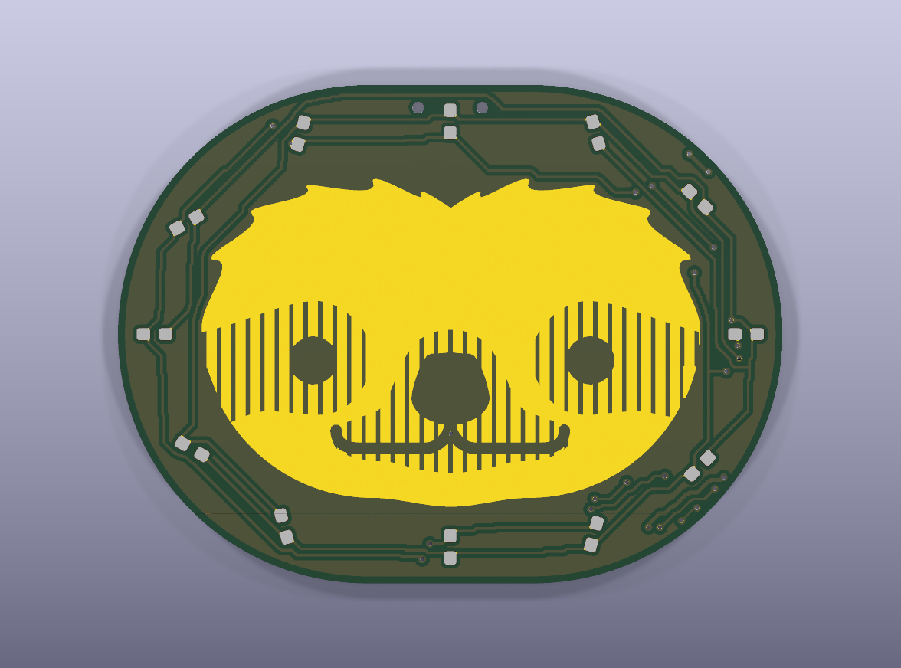
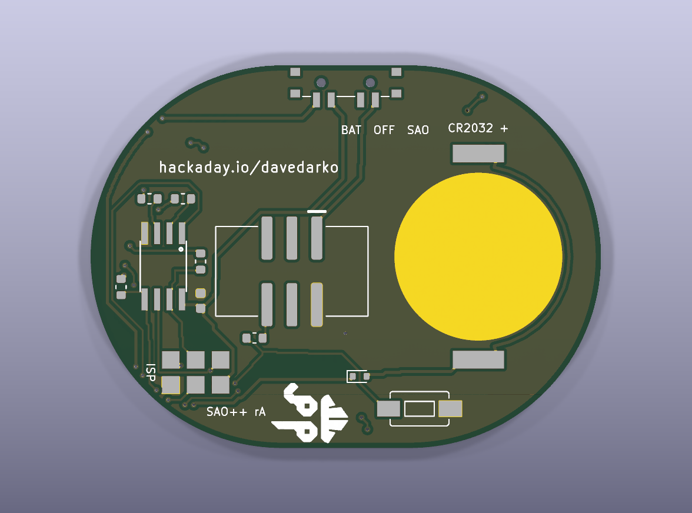

# Sloth Badge — SAO++ edition

Originally the **Sloth Badge** by **davedarko (Dave Darko)**: https://hackaday.io/project/28330-sloth-badge, files at https://github.com/davedarko/Simple-Add-ons-SAO/tree/main/Sloth%20Badge

> **Permission pending — this board is not open-licensed.** The maker's repository states no license, and davedarko has not yet been asked or answered (draft request: [../han-saolo/docs/permission-request.md](../han-saolo/docs/permission-request.md)). The repo owner chose on 2026-11-12 to publish this port anyway. Until the maker says otherwise:
> - the original design in `original/`, the outline and all artwork remain **© davedarko, all rights reserved**; the repo's licenses would cover only the SAO++ additions (parts placement, routing, scripts, documentation), not the original work
> - do not treat these files as cleared for manufacture or sale
>
> **Where the sloth comes from.** The maker's readme says the badge was "inspired by some cute pimoroni pins". The drawing appears to be his own, but whether it follows a Pimoroni design closely is not recorded. Worth asking him along with the permission.
>
> **davedarko, or anyone with rights in this design:** open an issue and it will be changed or removed.

 

A sloth's face in bare gold, ringed by twelve small red lights. A small chip lights them one at a time in patterns; a push button on the back changes the pattern (once a program is written — see Firmware). It was a brooch; now it plugs into a badge, or runs from its own coin cell.

## Which of the maker's files this is built from

The maker's folder has two designs, both from November 2017:

- **`REV1`** is the badge itself: the rounded 40 × 30 mm board with the sloth, the twelve lights round it, the chip, programming pads, a button and a coin-cell holder. **This is the one rebuilt here.**
- **`programTester`** is not a badge. It is a rectangular test jig with a socket for the chip, the same twelve lights in a straight row and a programming header; its silkscreen reads "SLOTHBADGE TESTER". The maker would have used it to program and try chips before soldering them onto badges. It is not used.

## What changed from the maker's board

| | Maker's board (Eagle, REV1) | SAO++ rev A |
|---|---|---|
| Size | 40.0 × 30.0 mm | **52.0 × 39.0 mm**: the whole board, outline and art together, scaled up **1.3 times**, same proportions (see below) |
| What it hangs from | A brooch pin, glued or soldered to two bare copper pads at the top of the back | The SAO connector. The two brooch pads are gone |
| Connector | none | The shared shrouded, keyed SAO connector on the back, key slot up, right of centre |
| Power | CR2032 in a surface-mount holder, no switch | **SAO / OFF / BAT** switch, knob out of the flat top edge; CR2032 in the shared clip on the back, left half |
| Lights | 12 forward-facing 0805 LEDs round the face (colour not recorded) | **The same 12 spots and directions, still on the front**, as red 0603 LEDs (the part Knight Rider already uses) |
| Light resistors | 4 × 150 Ω | 4 × 330 Ω (a shared part) |
| Chip | ATtiny85 (wide SOIC; his back silkscreen says "ATTINY13A") | ATtiny85**V**: same chip and pins, rated down to 1.8 V (the part Knight Rider already uses) |
| Programming pads, button | 6 pads, 1 button | Kept: the maker's own pad and button land patterns |
| New parts | — | Safety diode on the cell (required), a 330 Ω resistor between the button line and the badge, a 100 nF capacitor |
| Back text | "hackaday.io/davedarko", his logo, an OSH Park logo, notes "150 Ohm", "ATTINY13A", "ISP", "R1" | His credit line and his logo are kept, same words, in the same place (scaled up with the board). The OSH Park logo (the board maker's mark) and the four notes, which are no longer true, are left off. New small labels: "BAT OFF SAO", "CR2032 +", "ISP", "SAO++ rA" |

### Size: scaled up 1.3 times

At 40 × 30 mm the board cannot hold the SAO connector (15 mm wide), the coin-cell clip (24 × 17 mm), the switch, and the maker's chip, programming pads and button, while keeping clear of his credit line (which runs across the right half of the back) and his logo (bottom middle). A 1.2 version was tried first: the parts just fit, but there was no room left to wire them. At **1.3** everything fits with room for the wiring, so that is what is used (owner rule of 12 November 2026: scale up rather than overhang the cell, move a credit or add layers). The parts keep their real sizes; the lights move with the art.

### Where the parts went (seen from the back, which is a mirror image of the front view below)

In the **front view** (looking at the sloth):

- **Coin cell:** the left half, centred behind the left eye. Its open side faces the left edge; the cell slides in from there.
- **Connector:** right of centre, behind the nose and the right eye, key slot toward the top.
- **Switch:** middle of the flat top edge, knob sticking up about 1.3 mm.
- **Chip:** upper right, below the maker's credit line; its programming pads just below it, beside the connector; the four light resistors around the chip.
- **Button:** bottom left, below the cell. **Safety diode:** beside the clip's lower contact.

Everything that wires to the chip sits below the maker's credit line; only the switch is above it. No wire crosses his lettering or his logo.

### Parts and wires on the front

SAO++ normally keeps the front for art only. Here the twelve lights are part of the art and sit on the front where the maker put them, so their wiring runs on the front too, exactly as on the maker's own board (his had wires and 12 through-holes on the art side). What that looks like:

- **thin wires under the solder mask in the dark ring between the gold face and the edge**: never through the gold;
- **25 small through-holes (vias), all covered by solder mask**: 12 for the light wiring, 12 more where four of the chip's lines (2 each for MISO and MOSI, 4 for reset) and the cell feed (4) hop over other wiring through the dark ring, and 1 that ties the front copper to ground, in the dark gap in the middle of the mouth;
- the switch's two 0.9 mm locating pegs come through at the top edge, beside the top light.

The gold sloth itself is untouched: no wire, hole or gap cuts into it.

### How the chip is wired to the badge

The chip has six pins to spare for anything; the maker used all of them. Four drive the lights, one reads the button, one is the reset pin needed for programming. So the only line that can go to the badge is the **button line (PB1)**: it is wired to the badge's **GPIO2** through a 330 Ω resistor. A badge can read the button, or "press" it by pulling GPIO2 low. GPIO1, SDA and SCL are left unconnected.

**Why the safety diode is needed:** because the chip is wired to GPIO2, a badge could push current through the chip into the coin cell. The diode D13 right after the cell stops that.

### Light current

The maker's circuit lights one light at a time ("charlieplexing": four pins, each through its own resistor, drive twelve lights). A lit light has two resistors in its path.

| Supply | Current in the lit light |
|---|---|
| 3.3 V (badge) | about 2.3 mA |
| Coin cell, after the diode (about 2.7 V) | about 1.4 mA |
| Maker's 150 Ω on a fresh cell (for comparison) | about 4 mA |

The change to 330 Ω roughly halves the current, so the cell lasts about twice as long; the lights should still be clearly bright (the house aims for about 1 mA). Expect several days of continuous running on a CR2032, longer if the program blinks.

## Firmware

**There is no program in the maker's folder** (`original/` holds only board and circuit files; the silkscreen note "ATTINY13A" suggests he ran an ATtiny13A program). A program for this board needs:

- an ATtiny85 build (Arduino with the ATTinyCore board package, or avr-gcc), running at 1 MHz on the internal clock, brown-out detector off or at 1.8 V, so it runs down the coin cell;
- the light wiring. To light one light, set its "+" pin as an output HIGH, its "−" pin as an output LOW, and the other two light pins as inputs (no pull-ups):

  | Light | + pin | − pin | | Light | + pin | − pin |
  |---|---|---|---|---|---|---|
  | D1 | PB0 | PB2 | | D7 | PB0 | PB3 |
  | D2 | PB2 | PB0 | | D8 | PB3 | PB0 |
  | D3 | PB2 | PB3 | | D9 | PB2 | PB4 |
  | D4 | PB3 | PB2 | | D10 | PB4 | PB2 |
  | D5 | PB3 | PB4 | | D11 | PB0 | PB4 |
  | D6 | PB4 | PB3 | | D12 | PB4 | PB0 |

  Going clockwise round the face (front view) from the top: D12, D1, D2, D3 (right), D4, D5, D6 (bottom), D7, D8, D9 (left), D10, D11;
- the button on PB1 (pressed = low; turn on the internal pull-up). The same pin goes to the badge's GPIO2 through 330 Ω, so the program should not drive it as an output;
- a 6-pin AVR programmer (USBasp, AVRISP mkII or Arduino-as-ISP) set to **3.3 V**, pressed onto the programming pads JP1, with the power switch on **OFF** and the board **unplugged from any badge**. PB0 and PB2 are also light pins, so the lights flicker while it programs; that is how the maker designed it.

## Things to check on the first prototype

1. **Button part number (owner to-do).** The button uses the maker's land pattern, SparkFun's "1101NE" 6 × 3.5 mm two-pad switch with 6.3 mm pad spacing; the same open item as Knight Rider. One part number with that spacing has to be chosen before ordering assembly (both boards can share it).
2. **Light colour and brightness.** The maker's files do not record the colour; red is used because it is already a chosen part and works best on a coin cell. Check brightness at 1.4–2.3 mA.
3. **Chip on the cell.** The ATtiny85V should run down to about 2 V; check the lights keep going as the cell runs down.
4. **Switch labels.** "BAT OFF SAO" is printed below the switch, in the order the knob positions sit as seen from the back. Which end of the knob travel is SAO is not yet confirmed (as on every SAO++ board).
5. **Tight spots.** The connector's plastic body sits 0.27 mm from the clip's closed end, and the diode's pad 0.40 mm from the clip (recorded in `hardware/sloth.kicad_dru`). Check the first assembled boards.
6. **Front wiring.** The thin wires and 25 covered holes in the dark ring show faintly up close; check they do not spoil the look. The cell's feed to the switch goes the long way round (down the right edge and along the bottom); that only matters if it picks up interference, which at these currents it should not.

## Files

- `hardware/sloth.kicad_pro` — KiCad 10 project.
  - ERC: 0.
  - DRC: 0 errors, 0 unconnected, 0 schematic mismatches.
  - 10 warnings, none electrical:
    - 4 thin slivers in the front copper where the light wiring cuts it (crumbs smaller than 1 mm² are left off);
    - 6 "footprint differs from library": the cell clip and the ISP pads (their silk outlines were moved to the fab layer because they ran under the cell or past the curved edge) and the four lights that sit at exact right angles (D3, D6, D9, D12; the footprints are the library ones).
- `hardware/sloth.kicad_dru` — the art rule, plus one commented rule for the keep-clear boxes that overlap around the connector and the clip, with the real gaps.
- `hardware/build_board.py` — rebuilds the board in one run (about 2 minutes of computer time): art, parts, routing (via `router.py`), ground copper, labels.
- `hardware/router.py` — the small two-layer router (from Knight Rider, made faster and given a 5-minute cap).
- `hardware/extract_art.py` — reads the maker's Eagle board and writes the outline, the gold sloth, the light positions, his credit line and logo into `art/art.json`, scaled by 1.3.
- `hardware/circuit.json` — the circuit as data; `tools/gen_schematic.py sloth` and `build_board.py` both read it.
- `hardware/parts_local.py`, `hardware/make_local_footprints.py`, `hardware/sloth-local.pretty/` — the five parts the shared library does not have, all copied from Knight Rider: chip, front light, button, programming pads, diode.
- `production/` — order files for one board and a 2×2 panel. Start with [production/README.md](production/README.md).
- `original/` — the maker's files, untouched.

## Parts

| Part | Qty | Shared? |
|---|---|---|
| SAO connector XFCN BH254VS-6P | 1 | yes |
| Switch C&K PCM13SMTR | 1 | yes |
| CR2032 clip TE BAT-HLD-001 | 1 | yes |
| 330 Ω resistors, 100 nF capacitor | 5 / 1 | yes |
| ATtiny85V-10SU | 1 | Knight Rider's local part (now on two boards) |
| Red 0603 LED, front-facing, Lite-On LTST-C191KRKT | 12 | Knight Rider's local part (now on two boards) |
| 6 × 3.5 mm push button | 1 | Knight Rider's local part, part number still to be chosen |
| Schottky diode RB751S40T1G (SAOPP-D-01) | 1 | Knight Rider's local part, the planned shared cell diode |

No new part types: everything is either shared or already chosen for Knight Rider. The ATtiny85V, the red 0603 LED, the button and the ISP pads are now used by two boards each and could move to the shared library.
