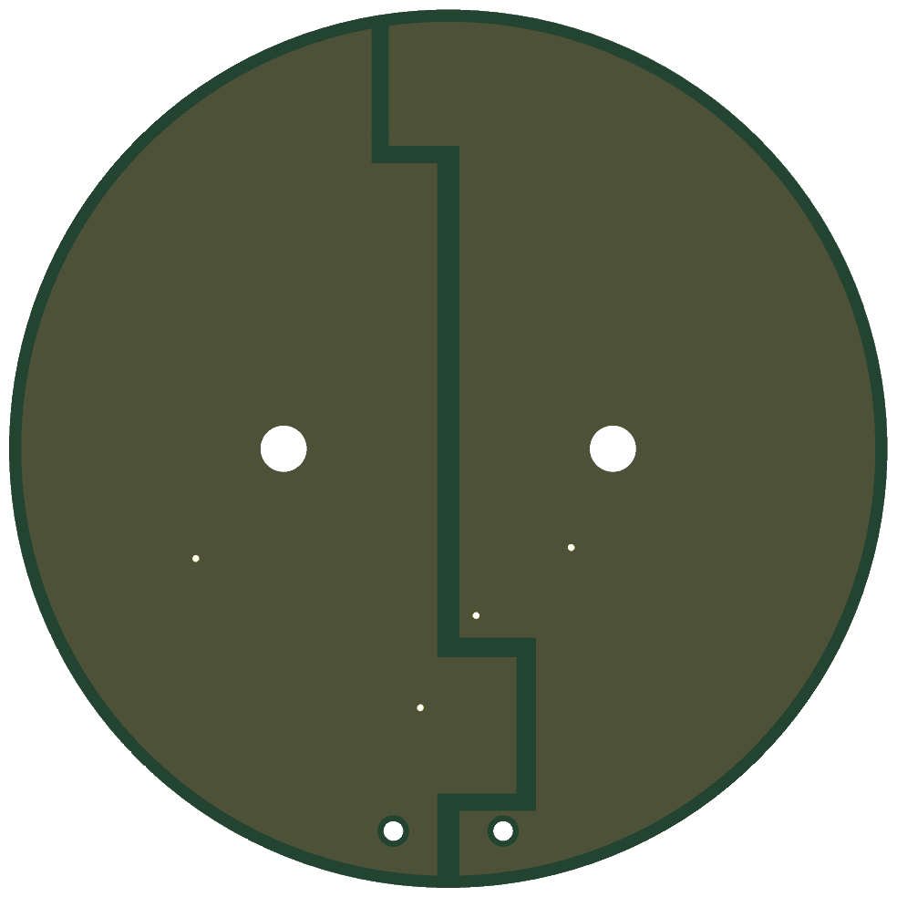
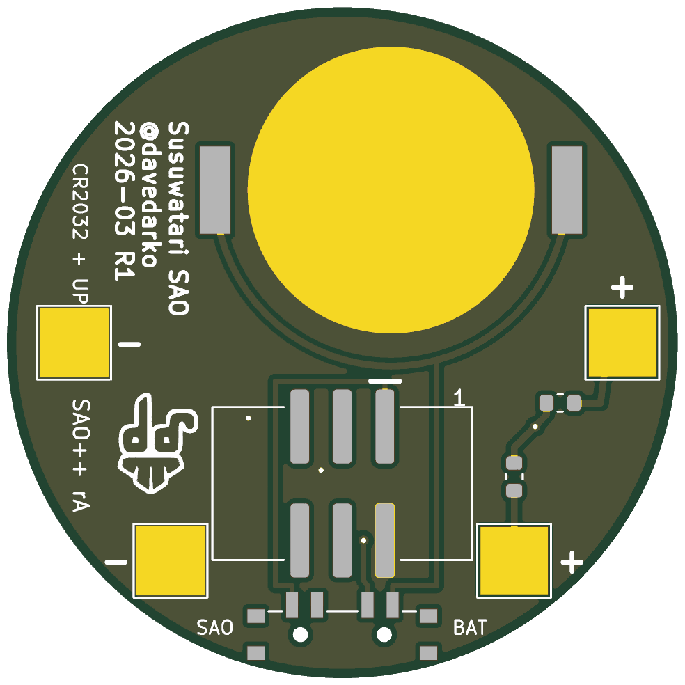

# Soot Sprite — SAO++ edition

Originally the **Susuwatari SAO** (2026-03 R1) by **davedarko (Dave Darko)**: https://github.com/davedarko/Simple-Add-ons-SAO/tree/main/Ghibli (project page printed on his handout cards: https://hackaday.io/project/205207)

> **Permission pending — this board is not open-licensed.** davedarko's repository states no license, and he has not yet been asked or answered (draft request: [../han-saolo/docs/permission-request.md](../han-saolo/docs/permission-request.md)). The repo owner chose on 2026-11-11 to publish this port anyway. Until the maker says otherwise:
> - the original design in `original/`, the outline and all artwork remain **© davedarko, all rights reserved**; the repo's CERN-OHL-S / CC-BY-SA licenses would cover only the SAO++ additions (new parts placement, routing, scripts, documentation), not the original work
> - do not treat these files as cleared for manufacture or sale
>
> **davedarko, or anyone with rights in this design:** open an issue and it will be changed or removed.

> **The character is Studio Ghibli's.** A susuwatari (soot sprite) is the little black fuzzball from *My Neighbor Totoro* and *Spirited Away*. That likeness belongs to Studio Ghibli, which is a separate question from davedarko's permission for the board: selling or publishing boards that show the character needs Ghibli's permission, or a design that is not the character.

 

## What the original actually is

The maker left no description (the `readme.md` in his folder is empty), so this is read from his files:

- **The board** is a 40 mm round sprite (not 16 × 20 mm: the outline is a 40.00 mm circle). The front is two halves of copper under solder mask, split by a zigzag gap, with two white silkscreen eyes. Under black mask that reads as a fuzzy black ball. The two halves are not just art: the left half is ground and the right half is the supply, joined to the back by five small holes at the top and bottom edge.
- **The light is not on the board.** The four big 4 × 4 mm square pads on the back (two marked VCC, two GND, at the sprite's sides and feet) are for the legs of ordinary 5 mm through-hole LEDs, soldered by hand. The LED's two legs bent round become the sprite's arms, or its feet, and the LED is held out in front of it.
- **The SCAD file** (`Kompeito.scad`, for OpenSCAD) makes a *konpeitō* (the star-shaped sugar candy the soot sprites eat in *Spirited Away*): a random lumpy ball of overlapping spheres with a pocket in the middle exactly the shape of a 5 mm LED and a 3 mm slot underneath for its legs. 3D-print it in clear or white, push it over the LED, and the sprite is carrying a glowing sweet.
- **The resistor** was a 1206 part in the badge's supply line only, shorted out by a copper track until you cut it ("cut before adding resistor"). On a coin cell the LEDs ran with no resistor at all, the way an "LED throwie" does: the cell's own internal resistance limits the current.
- **Badge or battery, not both.** The 2×3 header and the Keystone 1060 coin-cell holder are drawn on the same spot in the middle of the back, so a builder fitted one or the other. There was no switch, and the cell and the header were wired to the same supply (fine, since only one was ever fitted).
- The other files are the maker's paper-craft: `soot.svg` is a sheet of 36 face variations (eye shapes) at board size, `soot_print_eyes.svg` a sheet of red eye shapes, `drawing.svg` a page of handout cards with a QR code (`project205207.svg`) to the project page.

## What SAO++ makes of it

The same sprite, carrying up to two hand-soldered konpeitō LEDs, now working from **either** the badge **or** its own coin cell, picked with a switch.

| | Original (2026-03 R1) | SAO++ rev A |
|---|---|---|
| Connector | 2×3 SMD header in the middle (only if no battery) | 6-pin SAO v1.69bis shrouded, keyed SMD connector just below the middle, key slot up. Nothing shows on the front |
| Power | Badge **or** a coin cell in a Keystone 1060 holder, never both | Slide switch at the bottom edge: **SAO / OFF / BAT**. The shared CR2032 clip sits at the top of the back; the cell slides in from the top edge |
| LED pads | Four 4 × 4 mm pads: right side VCC, left side GND (front view) | Same four pads, **+ and − swapped**: the two left pads (arm and foot) are now +, the right pads ground. Each + pad has its own 1.3 kΩ resistor |
| LED current | Unlimited on a cell (throwie style); a resistor of your choice on the badge | About 1 mA per red LED on either supply (0.4 mA on the badge for white or blue, which will be dim on a cell). **Much dimmer than a throwie on purpose**, so a cell lasts days |
| Front art | — | Unchanged: same halves, same gap, same eyes. The five old edge vias are gone; four new tiny covered vias and two 0.9 mm switch-peg holes at the bottom edge are added (see below) |
| Back | — | The credit "Susuwatari SAO / @davedarko / 2026-03 R1" is **untouched**. The maker's logo moved, same size, from beside the old holder to the other side (see below). Small labels added: SAO / BAT at the switch, "CR2032 + UP", "SAO++ rA", pin 1, and + / − at each pad |

**How to light it:** take a 5 mm LED (any single colour), print a candy from `original/Soot Sprites/Kompeito.scad`, solder the LED's **long leg to a pad marked +** (on the right when you look at the back) and its short leg to a pad marked −, and push the candy on. Two LEDs: one across the arm pads, one across the foot pads. Each + pad has its own resistor, so two LEDs can be mixed colours.

**Parts shared with the rest of SAO++:** connector, switch, cell clip and resistor are the same reels as Fat Pika and Mad Cat. **No new part.** The four pads are bare copper (nothing to buy); their footprint is KiCad's stock `TestPoint_Pad_4.0x4.0mm`, the one the maker used.

**Battery life (calculated, not measured):** two red LEDs at about 1 mA each is about 2 mA, so a CR2032 should last roughly 70–100 hours (one LED: about twice that).

## Why things moved (it is a 40 mm circle, but the back was already full)

The maker's back has his credit block down the upper left (seen from the back), his logo on the upper right, and four 4 mm pads near the edge, leaving only a middle column free. The shared parts need more than his holder did:

- **The cell clip** is 24 × 17 mm with its solder tabs 22.8 mm apart. The gap between the maker's logo and his credit is only 17.9 mm, so at the height of those two the clip cannot sit without covering one of them; lower down, the clip and the connector do not fit above the foot pads. Every position for the clip was checked: **one of the maker's two back marks has to move.** The credit is kept exactly where it was (the clip sits 1.9 mm off-centre so its right tab clears the lettering by 0.28 mm), and the smaller logo moves, unchanged, to the other side.
- **The connector** (15.3 mm wide) fits between the clip and the foot pads only if the foot pads step outward: left foot pad 2.25 mm, right foot pad 2.75 mm. The left arm pad moves 0.7 mm left, clear of the clip's side rail.
- **+ and − swap sides.** A part on the back is mirrored, so with its pins facing the connector the switch's badge contact can only be on the right and its cell contact on the left. The supply therefore leaves to the left, and the left pads become the + pads. Nothing visible changes.
- **Four tiny covered holes (vias).** The badge supply, the cell and the switched supply all have to cross each other between the switch and the connector, which cannot be done on the back alone. The fix is the maker's own: the two front halves carry power, the left half the switched supply, the right half ground. Three vias sit under the connector's plastic body; the fourth is beside the two resistors on the left (front view). They are covered by solder mask on both sides and show only as tiny bumps in the black. The maker's original had five.
- **The switch knob only just reaches the edge.** On a circle there is no straight edge, and the switch's outer solder tabs have to stay on the board, so its knob ends only about 0.2 mm past the round bottom edge (Mad Cat's sticks out 0.75 mm). It sits in the gap between the sprite and the badge and should be slid with a fingernail. See the checklist.

### Other options, if the owner prefers

| Option | What it costs | Numbers |
|---|---|---|
| **A. Built (above):** cell, switch, connector, all on the 40 mm circle | Maker's logo moves; pads move 0.7–2.75 mm; four tiny vias; knob nearly flush | 4 shared parts (5 placements) |
| **B. Badge power only:** connector + two resistors, no cell, no switch | Loses battery mode. In exchange the back keeps the maker's layout exactly: logo, credit, VCC / GND labels and all four pads where he drew them, connector in his spot in the middle | 2 shared parts (3 placements); likely no vias |
| **C. Cell clip hanging over the top edge** | Cell shows above the sprite's head as a silver crescent up to ~3.5 mm tall. **Does not save the logo or credit** (the clip's solder tabs must be on the board, and they land on them anyway); only buys room for the connector | ~3.5 mm overhang |
| **D. Bigger circle** | Changes the sprite's size (the eyes look smaller); still moves the foot pads | about 46–48 mm across instead of 40 to fit the cell below the credit and the connector below the cell |
| **E. Glowing eyes** (could be added to A) | Two shared through-board LEDs + two 1.3 k resistors behind the white eyes, so the sprite lights up with no hand-soldering | The left eye sits just outside the cell and under the clip's side rail; it would need the clip moved again. Not built: the maker's light is the hand-held candy, not the eyes |

## Things to check on the first prototype

1. **Knob reach.** The switch knob ends about 0.2 mm past the round bottom edge. Check it can be slid comfortably with the sprite on a badge. If not, the fix is a small notch in the outline at the bottom, which changes the round shape slightly (owner's call).
2. **Switch labels.** The datasheet does not draw which way the knob sits for position 1. The silkscreen assumes "knob toward the SAO label = badge power". If it is the other way round, swap the SAO and BAT labels (nothing electrical changes; OFF is the middle either way).
3. **Brightness.** About 1 mA through a 5 mm LED inside a printed candy is far dimmer than the maker's throwie-style cell wiring. Check a red LED in room light on badge power and on a fresh cell. If too dim, change R1 and R2 to 330 Ω (SAOPP-R-02, already approved): about 4 mA per red LED, roughly a day of wear per cell.
4. **Cell clip direction.** The clip fits its pads both ways round. Its open side must face the **top** edge, where the cell slides in. Tell the assembler.
5. **Clearances that only hardware shows.** The connector's top pads are 0.85 mm from the clip's closed end; its plastic shroud is 0.6 mm from each foot pad (you solder LED legs there: keep the iron off the shroud); the left arm pad is 0.3 mm from the clip's side rail (the rail is above the board). Check all three on the first board.
6. **Pin 1 position.** The connector keeps VCC in the same corner as Mad Cat and Fat Pika. Confirm against a v1.69bis badge before a production run.
7. **Vias from the front.** Check that the four covered vias and the two switch-peg holes are invisible enough on the black face.
8. **Mask colour.** Not recorded in the maker's files. Black mask on both sides is the obvious choice for a soot sprite.

## Files

- `hardware/soot-sprite.kicad_pro` — KiCad 10 project (schematic + board). ERC: 0 issues. DRC: 0 errors, 0 unconnected, schematic matches board. 2 warnings remain: the maker's logo library is not installed, and the cell clip differs from the library copy (its silkscreen arrow, which fell off the board, moved to the fab layer). ERC ignores "label connected to only one pin": the + pads are board-only (bare copper, no schematic symbol), so the resistor labels have nothing else to meet in the schematic.
- `hardware/circuit.json` — the circuit as data; `tools/gen_schematic.py soot-sprite` and `hardware/build_board.py` both read it.
- `hardware/build_board.py` — rebuilds the board from `original/` plus the SAO++ changes; every placement and routing decision is in there with a comment.
- `hardware/soot-sprite.kicad_dru` — the art rule plus three keep-out exceptions (connector/clip, connector/foot pads, arm pad/clip), each with the real gap.
- `hardware/soot-sprite-local.pretty/` — an unchanged copy of KiCad's stock `TestPoint_Pad_4.0x4.0mm` (the maker's pad).
- `hardware/outline.json` — the maker's 40 mm circle as one polygon.
- `production/` — everything a board house needs, for one board (`single/`) and a 2×2 panel (`panel/`). Start with [production/README.md](production/README.md).
- `original/` — davedarko's untouched KiCad 9 project, SVG art and OpenSCAD candy, from his repository (commit 1a08593).

## Parts cost (parts only, list prices checked 2026-11-10)

| Part | Qty | Each @ ~100 boards |
|---|---|---|
| Connector XFCN BH254VS-6P (LCSC C492445) | 1 | $0.12 |
| Switch C&K PCM13SMTR (Digikey) | 1 | ~$0.90 |
| CR2032 clip TE BAT-HLD-001 (LCSC C7501066) | 1 | $0.61 |
| Resistor 0603 1.3 kΩ (LCSC C22767) | 2 | <$0.01 |
| **Total** | | **about $1.65** |

Not included: the CR2032 cell, the bare board (40 mm round), the hand-soldered 5 mm LEDs and the 3D-printed candies.
