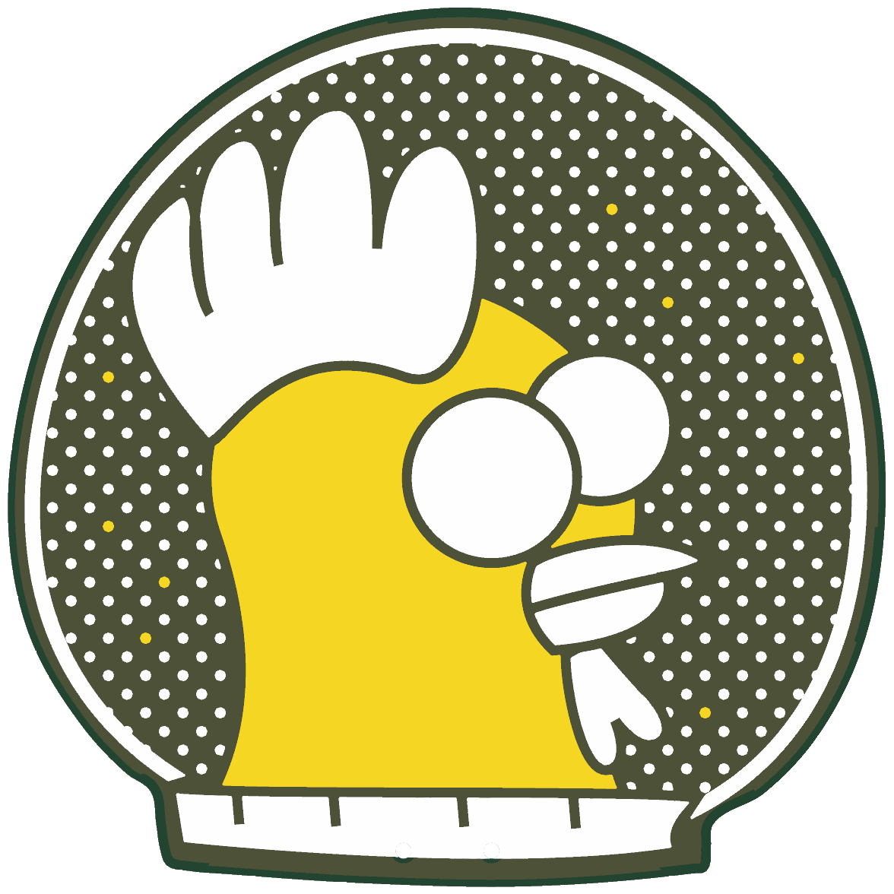
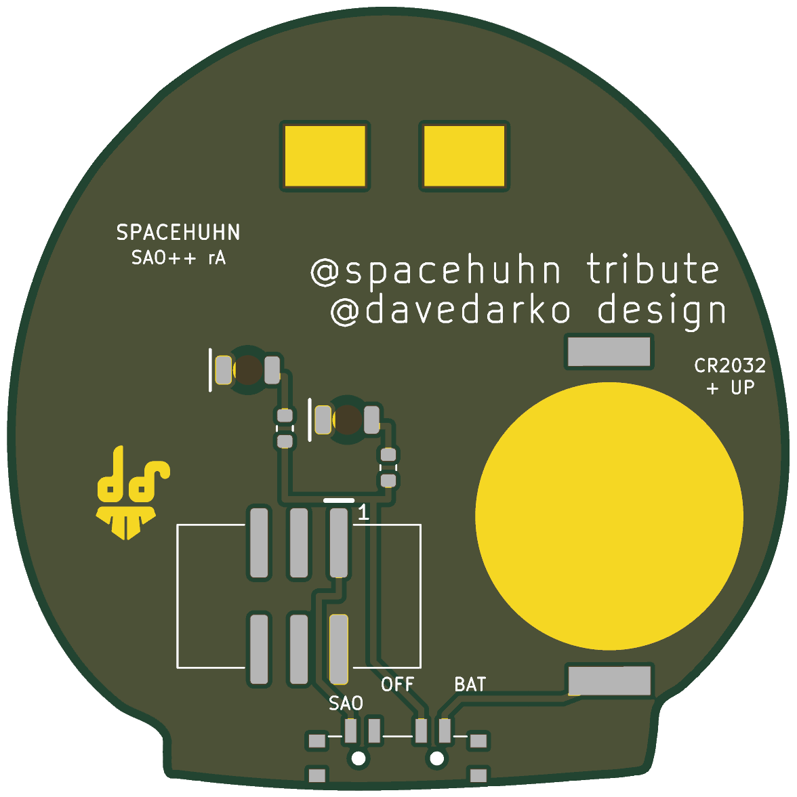

# Spacehuhn — SAO++ edition

Originally the **retro Spacehuhn badge** by **davedarko (Dave Darko)**, a pin badge, from his Simple-Add-ons-SAO collection: https://github.com/davedarko/Simple-Add-ons-SAO/tree/main/SpaceHuhn%20Badge (project page: https://hackaday.io/project/33886-spacehuhn-badge).

> **Permission pending — this board is not open-licensed.** davedarko's repository states no license, and he has not yet been asked or answered (draft request: [../han-saolo/docs/permission-request.md](../han-saolo/docs/permission-request.md)). The repo owner has **not yet decided** whether to publish this port before permission (built locally on 2026-11-12). Until the maker says otherwise:
> - the original design in `original/`, the outline and all artwork remain **© davedarko, all rights reserved**; the repo's CERN-OHL-S / CC-BY-SA licenses would cover only the SAO++ additions (new parts placement, routing, scripts, documentation), not the original work
> - do not treat these files as cleared for manufacture or sale
>
> **davedarko, or anyone with rights in this design:** open an issue and it will be changed or removed.

> **The chicken is someone else's logo.** The chicken in a space helmet is the logo of **Spacehuhn (Stefan Kremser)**. davedarko's own credit on the back calls the board "@spacehuhn tribute". The logo is a third party's: it is not SAO++'s, and it is not davedarko's to license. So the permission question for this board involves **two people**: davedarko for the board design, and Spacehuhn for the logo. Publishing or selling boards that show it needs both.

 

The chicken's two big eyes light up white from behind, through the board.

## Which of the maker's files

His folder holds three boards with one identical schematic: the top level, `rev2` and `rev3`. The top level and rev2 have the parts at odd angles (65 and 115 degrees); **rev3** has them square to the board, the most artwork (349 silkscreen shapes against 296 and 294) and a newly imported outline. rev3 is the newest and is the one used.

## What the original is

Read from his files:

- A 50 × 50 mm **pin**, shaped like a space helmet on a stand. The art side has the chicken's face and beak in bare gold copper, a white comb, two large white eyes and a wing, a helmet ring and polka dots in white silkscreen, and nine tiny gold stars.
- **The circuit is a throwie with a switch:** two 5 mm through-hole LEDs, one in the middle of each eye, wired straight across a CR2032 in an SMD holder, with a small slide switch in the cell's ground lead. No resistor, no chip. The maker describes the eyes as colour-changing RGB LEDs, the self-cycling kind that change colour on their own.
- **The back** carries his gold "dd" logo, two credit lines (**@spacehuhn tribute** / **@davedarko design**), and two bare-copper rectangles near the top. The maker mentions "markers used for multicolor PCBs"; these two rectangles are the only marks of that kind in the file, and they are kept exactly as drawn.

## What SAO++ makes of it

| | Original (rev3) | SAO++ rev A |
|---|---|---|
| Connector | None: a pin | 6-pin SAO v1.69bis, surface-mount, shrouded and keyed, on the back, lower middle, key slot up. Nothing shows on the front |
| Power | CR2032 in an SMD holder, on/off switch on the side edge | Slide switch on the straight bottom edge of the helmet's stand: **SAO / OFF / BAT**. Runs from the badge or its own CR2032 in the shared clip, lower left of the back |
| Eyes | 2 × 5 mm self-cycling RGB LEDs, legs through the board, straight on the cell | 2 × white reverse-mount LEDs on the back at **exactly the same two centres**, one 1.3 kΩ resistor each, shining through the board into the white eyes |
| Brightness and current | Whatever the cell gave (typically 10–20 mA per LED) | About 0.45 mA per LED on badge power, about 0.2 mA on a fresh cell. **Much dimmer, on purpose** |
| Front art | — | Unchanged: same face, beak, comb, eyes, wing, helmet, dots and stars. The copper under the middle of each eye is removed (invisible under the white eye). The four LED holes and three old ground holes in the stand are gone; two 0.9 mm switch-peg holes are new, in the white band of the stand |
| Back art | — | The maker's logo, both credit lines and both marker rectangles are kept where he drew them. Small labels added: SAO / OFF / BAT, "1" at the connector's pin 1, "CR2032 + UP", "SPACEHUHN SAO++ rA" |
| Size | 49.9 × 50.0 mm | **Same outline, not scaled** (scale 1.0): everything fits at the original size |

**No vias**, no new parts: connector, switch, clip, white LED and resistor are the same reels as Mad Cat and Penghito Poco.

## The eyes: the decision, and the other way

The house rules are "nothing through-hole showing on the front" and "fewest different parts". Two ways were weighed:

**A. Built:** a shared white through-board LED behind each eye, with a 1.3 kΩ resistor. No new part, nothing on the front, the front stays flat. **Cost: the colour-changing effect is gone.** The eyes glow a steady soft white instead of cycling through colours.

**B. Not built:** keep 5 mm through-hole pads at the two eye centres for the maker's self-cycling RGB LEDs. That is a new hand-soldered part, the LED bodies stand about 8 mm proud of the front in the eyes, and their legs go through the board, as in the original.

Why A: the eye art does not depend on the LED bodies. The maker drew each eye as a complete solid white disc (about 8.8 and 7.3 mm across), with nothing left open for an LED; his file even draws the LED's outline on the parts side of the board. A steady glow from behind fills the drawn eye.

**If the owner prefers B:** it is a small change. Two pairs of 0.8 mm plated holes 2.54 mm apart at the eye centres, the maker's own `LED5MM` land pattern (in `original/rev3/badge_spacehuhn.brd`), replacing D1, D2, R1 and R2, which frees room on the back. Things to know: (1) self-cycling RGB LEDs draw roughly 10–20 mA each, while the board budgets about 1 mA per LED, so the cell would last hours rather than days; (2) they want 3 V or more, so a resistor of some tens of ohms is advisable on badge power; (3) two plated holes would sit in each white eye, and the LED legs need hand-soldering. It would be a new local part (the LED itself, to be chosen); no LCSC number is filled in.

**Why white, not red:** the eyes are white discs. White light keeps them white; red would make them glow pink. Red uses the same footprint and resistor, so swapping costs nothing but the reel.

## Where the parts went

The back already has the maker's things on it: the two marker rectangles at the top, his two credit lines across the upper middle, his logo on the right at eye height (left when seen from the back), and the two eyes right of centre. So the new parts all go in the lower half:

- **Cell clip:** lower left (seen from the front), with its open side toward the left edge, so the cell slides in from there. The cell stays 0.7 mm inside the edge; nothing overhangs.
- **Connector:** lower middle, just right of the clip's closed end (1.1 mm clear of it). Its centre is 6.3 mm right of and 12.6 mm below the middle of the board; its pads are 6.5 mm from any edge.
- **Switch:** the only straight edge is the bottom of the helmet's stand. The knob points down and shows 0.7 mm below it (Mad Cat's: 0.75 mm). Its two locating pegs need two 0.9 mm holes, which land in the white band of the stand.
- **LEDs** at the maker's two LED centres; each resistor stands just below-left of its eye. All wiring is on the back; the supply runs up under the connector's plastic body, beside its pads.

## Things to check on the first prototype

1. **Brightness through the white eye.** This is the big unknown. The light has to pass through the board, the solder mask **and the white silkscreen** of the eye (the maker's eye art was left untouched, unlike Penghito Poco, which opened a 2 mm window). Check on badge power, then on a fresh cell. If too dim: first change R1 and R2 to 330 Ω (SAOPP-R-02, already approved): about 1.5 mA per LED on the badge. If still too dim, the next step changes the art: a small opening in the mask in the middle of each eye (a "pupil"), owner's call.
2. **Glow outline.** The copper is cleared 3.2 mm across behind the middle of each eye. Check the lit spot looks even and does not show a hard ring.
3. **Knob reach.** The knob shows 0.7 mm below the stand. Check it can be slid with a fingernail while the board hangs on a badge.
4. **Switch labels.** As on Mad Cat, the silkscreen assumes "knob toward the SAO label = badge power". If it is the other way round, swap the SAO and BAT labels (OFF is the middle either way).
5. **Cell clip direction.** The clip fits its pads both ways round. Seen from the back, its open side must face the **right-hand** edge (the left edge seen from the front). Tell the assembler.
6. **Pin 1 position.** VCC is in the same corner as on Mad Cat and the other boards. Confirm against a v1.69bis badge before a production run.
7. **Weight and hang.** A 50 mm board hanging from a connector below and right of its middle, with the cell on the other side. Check it hangs acceptably straight.
8. **Mask colour.** Not recorded in the maker's files. Choose one that makes the gold face and white art read well (the renders use dark green).

## Files

- `hardware/spacehuhn.kicad_pro`: KiCad 10 project (schematic + board). ERC: 0 issues. DRC: 0 errors, 0 unconnected, schematic matches the board. 1 warning: the cell clip differs from its library copy (its silkscreen arrow and outline moved to the fab drawing; labels added instead).
- `hardware/circuit.json`: the circuit as data. `tools/gen_schematic.py spacehuhn` and `hardware/build_board.py` both read it.
- `hardware/extract_art.py`: reads the maker's Eagle rev3 file and writes `art/art.json` (outline, art, back marks, LED centres), mirrored to the art side.
- `hardware/build_board.py`: builds the whole board from `art/art.json` and `circuit.json`. Every placement and routing decision is in there with a comment.
- `hardware/spacehuhn.kicad_dru`: the art rule only.
- `production/`: everything a board house needs, for one board (`single/`) and a 2×2 panel (`panel/`). Start with [production/README.md](production/README.md).
- `original/`: the maker's untouched Eagle files (top level, `rev2`, `rev3`).

Two small things differ from the maker's files and are not visible in normal use: Eagle draws its filled shapes with a 0.15 mm pen, and that pen width is kept (each shape grows 0.076 mm, as Eagle printed it); the credit lines are re-set in KiCad's stroke font at the same 1.778 mm height and position, with a 0.15 mm stroke (Eagle's 8 % would be 0.142 mm, below what fabs print reliably).

## Parts cost (parts only, list prices checked 2026-11-10 for Mad Cat)

| Part | Qty | Each @ ~100 boards |
|---|---|---|
| Connector XFCN BH254VS-6P (LCSC C492445) | 1 | $0.12 |
| Switch C&K PCM13SMTR (Digikey) | 1 | ~$0.90 |
| CR2032 clip TE BAT-HLD-001 (LCSC C7501066) | 1 | $0.61 |
| LED Lite-On LTW-C230DS white (LCSC C575513) | 2 | $0.055 |
| Resistor 0603 1.3 kΩ (LCSC C22767) | 2 | <$0.01 |
| **Total** | | **about $1.75** |

The CR2032 cell and the bare board are not included.
