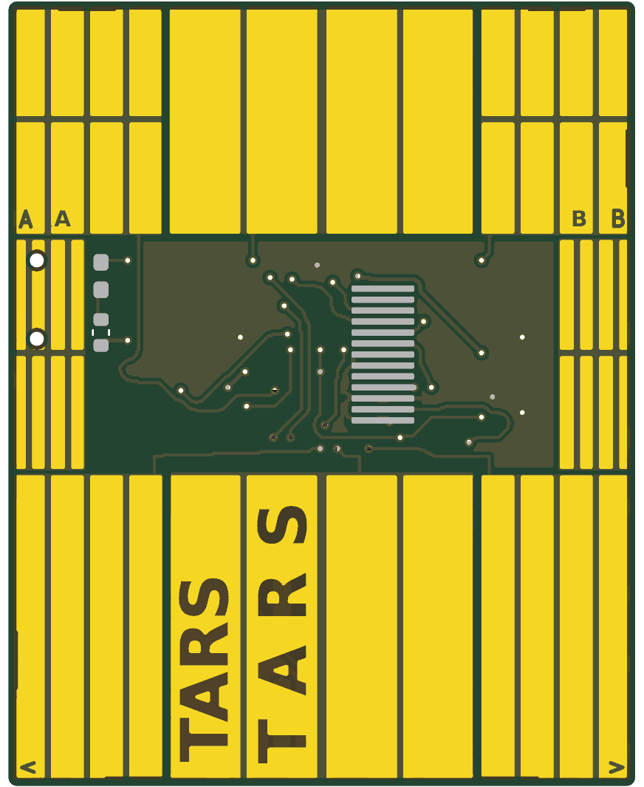
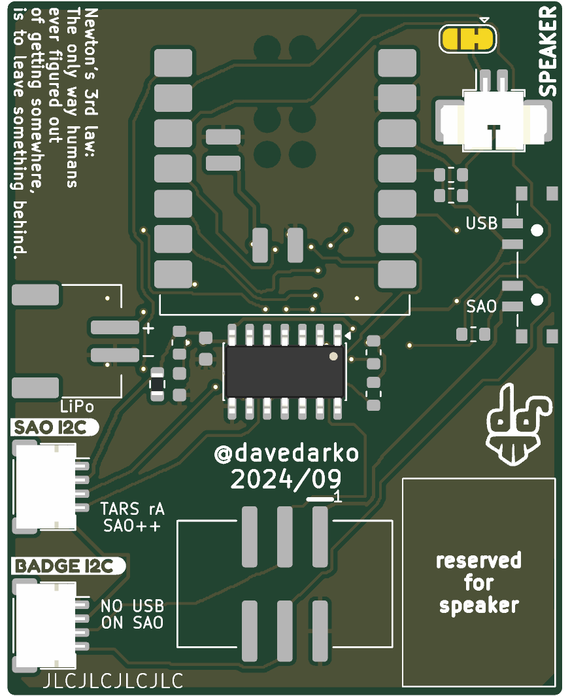

# TARS — SAO++ edition

Originally the **TARS inspired Simple Add-on** by **davedarko (Dave Darko)**, 2024: https://github.com/davedarko/TARS-SAO (commit d87f3ed). Open-licensed (MIT); see the credit below.

> **Credit and licence.** The original design is © 2024 davedarko and published under the **MIT licence** (the full text is in [`original/LICENSE`](original/LICENSE)):
>
> *MIT License. Copyright (c) 2024 davedarko. Permission is hereby granted, free of charge, to any person obtaining a copy of this software and associated documentation files (the "Software"), to deal in the Software without restriction, including without limitation the rights to use, copy, modify, merge, publish, distribute, sublicense, and/or sell copies of the Software, and to permit persons to whom the Software is furnished to do so, subject to the following conditions: The above copyright notice and this permission notice shall be included in all copies or substantial portions of the Software. THE SOFTWARE IS PROVIDED "AS IS", WITHOUT WARRANTY OF ANY KIND.*
>
> No permission request is needed. The licence asks that the copyright line and notice travel with the design: they are in `original/LICENSE`, here and in the firmware.
>
> **The character is someone else's.** TARS is the robot from the film *Interstellar* (Warner Bros. / Paramount, 2014): the slab shape, the "TARS" lettering and the quote on the back come from the film. That is separate from the maker's licence and matters most if boards are sold.

 

A 40 × 50 mm add-on shaped like TARS: four gold slabs on the front, a small colour display in the middle, six touch areas (A, B, up, down, left, right) and a speaker on a lead. On the maker's board a small RP2040 module on the back ran it; on this one a Seeed Studio XIAO ESP32 module does, so it works from the badge, from USB-C or from a small LiPo cell.

## What changed from the 2024 board

| | 2024 original | SAO++ rev A |
|---|---|---|
| Size | 40 × 50 mm | **Unchanged** (no scale-up needed) |
| Controller | Waveshare RP2040-Tiny module on the back | **Seeed Studio XIAO ESP32** (C3, S3 or C6) soldered flat on the back, in the same spot; its USB-C socket sits at the middle of the top edge |
| Touch areas | Six of the gold slabs, each read by one microcontroller pin through a 1 M resistor | The same six areas, read by a **new touch chip** (Microchip CAP1206) on the back: see "Why a touch chip" |
| Display | 0.96 in 80 × 160 colour display on the front, ribbon soldered to pads under the glass | **Unchanged** and in the same place. Its chip-select is now tied to ground and its reset comes from a resistor and capacitor at power-up (no XIAO pin was left for them) |
| Cue light | Small LED on the front, left of the display | **Same place**, red (the maker's colour is not recorded); now lit by pulling its pin low |
| Speaker | 2-pin PicoBlade socket for a speaker on a lead, driven straight from two pins; a solder jumper to choose push-pull or one-sided | **Same socket and jumper**, now through 165 Ω (two 330 Ω side by side) so it cannot draw more than about 19 mA. The jumper's wiring is fixed: on his board its second position grounded the pin rather than the speaker |
| Qwiic sockets | Two: "BADGE I2C" (the badge's bus) and "SAO I2C" (the module's own bus) | **Both kept**, same places and labels. "BADGE I2C" is still on the badge's bus; "SAO I2C" is now on the XIAO's private bus, shared with the touch chip |
| Badge I2C | 4.7 k pull-ups on the add-on | Removed (the SAO standard: the badge provides them) |
| Connector | 2×3 SMD header | 6-pin SAO v1.69bis, surface-mount, shrouded and keyed, **same spot**, key slot up. GPIO1/2 unconnected as on his board |
| Power | Badge only | Slide switch on the left edge: **SAO** (badge power) / **OFF** / **USB-BAT** (USB-C or a LiPo on the new JST-PH socket on the right edge, which the XIAO charges) |
| Front | Gold slabs, touch areas, "TARS" lettering, display, cue light | **Unchanged**. New, all hidden under the display glass: covered vias and short tracks. Visible: six 1 mm bare-copper dots, one inside the gold of each touch area (they tell the design software where each touch area is), and the switch's two 0.9 mm peg holes at the left edge |
| Back | Newton's-third-law quote, @davedarko 2024/09, his logo, speaker box, "SPEAKER", the Qwiic labels, and labels naming the old module's pins | All kept **except the pin labels** (USB, GND, VCC, CL, DA, DC, CS, RST, CUE LIGHT, SAO SCL/SDA, B R D U L A, "?"), which described the RP2040 module and would now be wrong. SAO++ labels added |

## Why a touch chip (the one real design decision)

The XIAO has 11 pins (D0–D10). This board needs 16 jobs: three for the display (clock, data, data/command; chip-select and reset were already done without pins), six touch areas, two for the speaker, one for the cue light, two for the badge's I2C, one for the power switch, and the house's two SAO GPIO pins. Even with SAO GPIO unused (as on the maker's board) and the house's addressable-LED pin given another job, it is **five pins short**.

Options looked at:
- **Share pins** (touch areas on the display's wires, the cue light on the speaker): saves two or three at most, and both tricks are fragile.
- **A pin expander**: cannot time touch areas, so it saves nothing where the shortage is.
- **A touch chip (chosen):** a CAP1206 reads all six areas and talks over two wires. It sits on the XIAO's own (private) I2C bus, together with the maker's second Qwiic socket, so the badge's bus is untouched. That frees four pins and gives better touch sensing than timing pins by hand. It is a **new part** for SAO++ (one more reel), in a hand-solderable SOIC-14, with one 100 nF capacitor (shared part).

The private bus uses D0 and D8 with 1.3 k pull-ups: on the C3 those are start-up pins that must not be low at power-up, and the pull-ups hold them high, which is what they want.

## Pin map

| XIAO pin | Goes to |
|---|---|
| D0 | private I2C data: touch chip U3, Qwiic socket J4 ("SAO I2C"), pull-up R11 |
| D1 | power switch OFF sense, through R13 (330 Ω) |
| D2 | speaker side B, through jumper JP1 |
| D3 | display data |
| D4 / D5 | badge I2C SDA / SCL (SAO pins 3 / 4 and Qwiic socket J3 "BADGE I2C"); the XIAO is a target at 0x27 |
| D6 | display data/command |
| D7 | display clock |
| D8 | private I2C clock, pull-up R12 |
| D9 | cue light D1 (pulled low to light). On the C3 this is also the BOOT button, which then lights it too |
| D10 | speaker side A, through R14 ∥ R15 (165 Ω) |
| 3V3, GND | the 3.3 V rail (switch common) and ground |
| BAT+ / BAT− (under the module, both positions) | the JST-PH LiPo socket J5 |
| 5V | not connected |

Display (U1): chip-select to ground; reset from R16 (1.3 k) and C1 (100 nF); backlight from the rail through R9 (11 Ω, the maker's value), always on.

## How the power switch works here

| Knob | Badge 3.3 V | What runs the board |
|---|---|---|
| **SAO** | connected to the XIAO's 3V3 pin, the display and the touch chip | the badge |
| **OFF** | disconnected | nothing from the badge. With USB or a LiPo attached the XIAO still powers the rail, so the switch tells it (D1) to go quiet and sleep |
| **USB-BAT** | disconnected | the XIAO's own regulator, from USB-C or the LiPo |

- **Never plug in USB while the knob is on SAO and the board is on a badge** (printed on the back).
- **OFF does not turn the display's backlight off.** The maker wired the backlight straight to the supply, and there was no pin left to switch it. With a LiPo plugged in, OFF still draws roughly 20–30 mA (backlight) plus the sleeping module: **unplug the cell for storage.** A future revision could feed the backlight from D9 instead of the cue light (owner's choice; see below).
- Feeding the XIAO through its 3V3 pin is how badge power reaches it, as on Hack-Man: the first thing to test.

## Current from a badge (calculated, not measured)

| | About |
|---|---|
| XIAO C3 at 80 MHz, radio off | 20 mA |
| Display backlight through 11 Ω | 20–30 mA (depends on the panel's LED; the maker's value) |
| Touch chip, display logic, cue light | 2 mA |
| Speaker, while a note plays (30 % push-pull through 165 Ω) | 12 mA average |
| **Total** | **about 45–65 mA**, over the 50 mA SAO++ budget while sound plays |

The maker's board drew about the same (his speaker had no resistor at all). If the owner wants it inside 50 mA on badge power: a larger R9 (dimmer backlight), or no sound on badge power (firmware).

## Front copper and vias

All new routing on the front is **under the display glass** (28 × 13.3 mm), where nothing shows; the covered vias are there too. There are **38 covered vias** (0.3 mm hole, 0.6 mm pad, solder mask over them), every one inside the area the glass covers. The only other new front copper is a short track from each touch area's dot across the dark line into the hidden area, and the cue light's short tracks beside the display, where the maker had his. Everything else is on the back, with the back ground copper kept 0.55 mm from the edge. The maker's own board had 30 vias in the same area.

The routing was done by `hardware/router.py`, a small grid router (negotiated congestion, then a strict finishing pass), capped at 8 minutes of run time; its result is saved in `hardware/routes.json`, which the build replays (`TARS_REROUTE=1` routes again from scratch, about 7 minutes on this machine).

## Firmware

New Rust firmware is in [`firmware/`](firmware/): it reproduces the maker's menu, piano, click and display demos, reads the touch chip, and answers the badge at I2C address **0x27**. 40 tests pass on the computer and it builds for the XIAO ESP32-C3 and C6; **it has never run on a real board**, and the S3 is not supported yet. See its README for what the first board must check (display offsets and colour order, the touch chip's registers).

## Things to check on the first prototype

1. **The display**: picture position, mirroring and colours (offsets and colour order are set in firmware), and that it starts reliably with chip-select tied low and the resistor/capacitor reset, including after a USB re-flash.
2. **Touch chip**: that it answers at 0x28 with product ID 0x67, and the sensitivity on these large slabs.
3. **Badge power into the XIAO's 3V3 pin**, and the current with the backlight on and a note playing.
4. **Speaker loudness** through 165 Ω (the maker drove it directly); the speaker itself is not specified in his files.
5. **Backlight current** with R9 = 11 Ω on 3.3 V: the panel's LED forward voltage decides it.
6. **USB-C plug fit** at the top edge (socket face flush with the edge).
7. **Switch knob** at the left edge; which end is "SAO" is not drawn in the datasheet (labels assume position 1 = SAO).
8. **LiPo polarity** (Adafruit / SparkFun convention, "+" printed); the battery reaches the XIAO through pads under the module.
9. **Connector position and pin 1** against a v1.69bis badge.

## Decisions for the owner

1. **The new touch chip** (CAP1206, one more reel), or a different way to find five pins (see above).
2. **Backlight on OFF**: accept "unplug the LiPo for storage", or a revision that switches the backlight from D9 (losing the controllable cue light).
3. **Badge current** over 50 mA while sound plays: accept, or a bigger R9 / quieter firmware.
4. **The *Interstellar* character** (above), if boards are sold.
5. **The cue light colour** (red here; the maker's is not recorded).

## Files

- `hardware/tars.kicad_pro`: KiCad 10 project (schematic + board). ERC: 0. DRC: 0 errors, 0 unconnected, schematic matches the board; 1 warning (the maker's "ds" logo comes from his own footprint library, which this project does not include: it is art, and is kept as drawn). Panel DRC: 0 errors, 0 unconnected; 112 warnings of the same "library not configured" kind (the logo and the panel's own fiducials and holes).
- `hardware/circuit.json`: the circuit as data (written by `hardware/make_circuit.py`); `tools/gen_schematic.py tars` then `hardware/fix_schematic.py` make the schematic, `hardware/build_board.py` the board.
- `hardware/build_board.py`: rebuilds the whole board from the maker's file in one run (about 2 minutes with the saved routes); every choice is commented there. The maker's front zones are filled and then frozen into plain copper shapes so `tools/panelize.py` can copy them.
- `hardware/router.py`, `hardware/routes.json`: the router and its saved result.
- `hardware/parts_local.py`, `hardware/make_local_footprints.py`, `hardware/tars-local.pretty/`: the parts the shared library does not have.
- `hardware/tars.kicad_dru`: the house art rule only.
- `production/`: everything a board house needs. Start with [production/README.md](production/README.md).
- `firmware/`: the Rust firmware.
- `original/`: the maker's untouched KiCad files, sketches, readme and licence.

## Parts cost (parts only, LCSC list prices from docs/parts.md, checked 2026-11-10/11)

| Part | Qty | Each @ ~100 boards |
|---|---|---|
| Connector XFCN BH254VS-6P (C492445) | 1 | $0.10 |
| Switch C&K PCM13SMTR (Digikey) | 1 | ~$0.90 |
| LiPo socket JST S2B-PH-SM4-TB (C295747) | 1 | $0.16 |
| Resistors 330 Ω / 1.3 k, capacitor 100 nF (shared) | 7 + 2 | <$0.01 each |
| Red 0603 LED LTST-C191KRKT (C125099) | 1 | $0.014 |
| **Total of the priced parts** | | **about $1.25** |
| Touch chip CAP1206-1-SL, 11 Ω resistor, PicoBlade socket, two JST SH sockets | | not priced yet (orchestrator to check) |
| Display, XIAO module, speaker | | not priced here (the owner sources them) |
