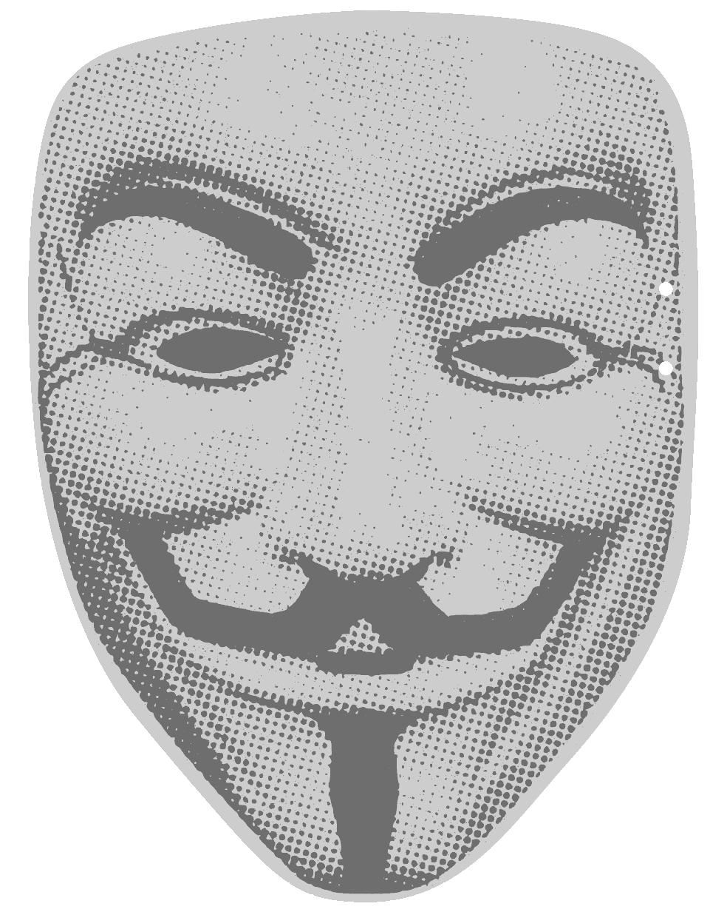
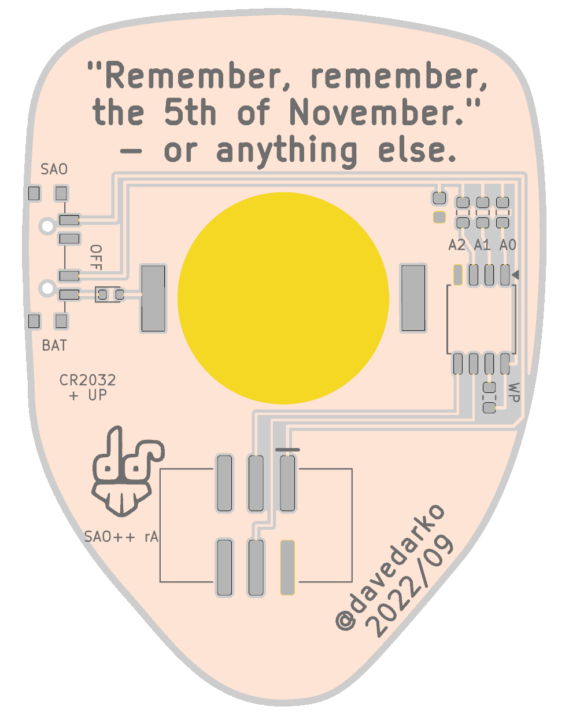

# Guy Fawkes remembers (Vendetta) — SAO++ edition

Originally the **Guy Fawkes remembers Vendetta SAO** by **davedarko (Dave Darko)**, 2022: https://github.com/davedarko/Simple-Add-ons-SAO/tree/main/Guy%20Fawkes%20remembers%20Vendetta%20SAO

> **Permission pending — this board is not open-licensed.** davedarko's repository states no license, and he has not yet been asked or answered (draft request: [../han-saolo/docs/permission-request.md](../han-saolo/docs/permission-request.md)). This port was built locally on 2026-11-12; the repo owner has **not yet decided** whether to publish it before permission arrives. Until the maker says otherwise:
> - the original design in `original/`, the outline and all artwork remain **© davedarko, all rights reserved**; the repo's licenses cover only the SAO++ additions (parts placement, routing, scripts, documentation), not the original work
> - do not treat these files as cleared for manufacture or sale
>
> **The mask is someone else's too.** The front is a Guy Fawkes mask in the stylised form made famous by *V for Vendetta* (the comic and the film; Warner Bros. / DC). That look is a third-party likeness: it is not SAO++'s, and not davedarko's to license. It needs its own check before anything is sold, separately from davedarko's permission.
>
> **davedarko, or anyone with rights in this design:** open an issue and it will be changed or removed.

 

A mask-shaped add-on with a memory chip on the back "for things to remember": the maker's quote on the back reads *"Remember, remember, the 5th of November." – or anything else.* The badge can store up to 32 KB in it over the SAO's I2C pins and read it back later.

**This board has no lights.** Nothing on it lights up or moves. The only electronics are the memory chip and its capacitor. See "Does the coin cell do anything?" below before ordering.

## Which of the maker's files this is built from

The maker's folder has one board, `original/VendettaSAO/` (KiCad 6, the credit says 2022/09; its order files are `vendettaSAO.zip` and the newer `vendettaSAOV2.zip` of 20 September 2022). The loose `vendettaSAO.svg` and `.kicad_mod` files next to it are that board's mask art and outline. That board is rebuilt here.

## Scaled up 1.23 times

**Old size 34.4 × 45.7 mm, new size 42.3 × 56.3 mm** (factor 1.23, outline and every piece of art together, same proportions).

At the maker's size the back has to hold the quote (across the top), the maker's "dd" logo (lower left), his "@davedarko 2022/09" credit (lower right, at an angle), the 20 mm coin cell in its 24 × 17 mm clip, and the 15 mm SAO connector. They do not all fit: whatever way the clip and connector are arranged, either the cell covers part of the quote or the logo, or the connector covers the credit or hangs off the narrow chin. Following the owner's rule of 12 November 2026, the whole board is scaled up instead of moving the maker's lettering or letting the cell hang over the edge. 1.23 is the smallest factor (tried in 0.01 steps) at which the cell, centred under the quote, and the connector below it clear the quote, the logo and the credit. A wider search (clip anywhere on the back, square to the board, connector anywhere) found no fit at 1.18 or below; 1.19-1.22 were not searched that widely, so a slightly smaller board with a less tidy layout may exist. Nothing is redrawn: the lettering is 23 % bigger (quote 1.85 mm, credit 1.48 mm tall), and the mask's halftone dots are 23 % bigger, which only makes them easier to print.

## What changed from the maker's board

| | Maker's 2022 board | SAO++ rev A |
|---|---|---|
| Size | 34.4 × 45.7 mm | 42.3 × 56.3 mm (×1.23, see above) |
| Which side is the art | Mask on the back silkscreen; parts, quote and credit on the other side | Board turned over: the mask is the front, the parts, quote, logo and credit are the back. Nothing redrawn |
| Connector | SMD 2×3 pin socket | The shared shrouded, keyed SAO connector on the back, key slot up, between the logo and the credit, 2.2 mm left of centre |
| Power | Badge only | **SAO / OFF / BAT** switch, knob out of the side (left edge seen from the back); CR2032 clip under the quote |
| Memory chip | CAT24C256, 256 kbit, wide (208 mil) SOIC-8 | The same chip, package and land pattern |
| Capacitor | 0805, value not given | 100 nF 0603 (the shared part) |
| Address / write-protect resistors (A0, A1, A2, WP) | Four 0805 spots, value not given | Four 0603 spots for the shared 1.3 kΩ resistor, **not fitted** (see below) |
| New parts | — | Safety diode on the cell (required) |
| Back text | Quote, "dd" logo, "@davedarko 2022/09", "A0 A1 A2 WP", "JLCJLCJLCJLC" | Quote, logo and credit unchanged in wording and place. "A0 A1 A2 WP" redrawn as small labels by the new resistor spots. "JLCJLCJLCJLC" only told the factory where to print its order number; it is left off. New labels: SAO, OFF, BAT, "CR2032 + UP", "SAO++ rA" |
| Holes through the art | None | Two 0.9 mm pinholes at the right edge of the face (front view), level with the eyes: the switch's locating pegs |

Wiring is on the back copper only, no through-holes (vias). The rest of the back copper is ground, as on the maker's board. The front has no copper at all, as on the maker's board.

### Why the safety diode is needed

The memory chip sits on the badge's SDA and SCL lines. The badge's pull-up resistors can push a little current into the chip, and from there into the coin cell, even with the switch on BAT. A coin cell must never be charged, so the diode D1 sits right after the cell (house rule, `docs/standard.md` section 3).

### The address and write-protect spots

The maker gave the chip four optional resistors to its supply: A0, A1, A2 set the chip's I2C address, WP locks it against writing. This board leaves all four **empty**, because the chip pulls those pins low itself when they are left open:

- the chip answers at address **0x50** (the address badges use for an SAO's ID memory);
- the badge can write to it.

To change the address, solder a resistor (1.3 kΩ, or anything up to about 10 kΩ) on A0, A1 and/or A2: the address becomes 0x50 + 1 for A0, + 2 for A1, + 4 for A2. A resistor on WP makes the whole chip read-only.

## Does the coin cell do anything?

Plainly: **no, not on this board.** It was added because the owner asked for the standard treatment on every board, and it does fit after scaling, but:

- The memory chip only does something when a badge talks to it, and a badge that talks to it is also powering it through the SAO connector. Running the chip from a coin cell while nothing is talking to it achieves nothing: the chip keeps its data with no power at all.
- There are no lights for the cell to run.
- When the board is plugged into a badge, the switch must be on **SAO**. On BAT it should still work, but the chip then runs from the cell at about 2.8 V while the badge's I2C lines sit at 3.3 V, a little above the chip's own supply, and it uses up the cell for nothing.

**The least-bad alternative, for the owner to decide:** leave out the switch, the clip and the diode and wire the badge's 3.3 V straight to the chip, as the maker did. That:

- saves three parts per board (including the switch, which is the dearest part on a simple board and is out of stock at LCSC);
- removes the two pinholes through the face;
- probably lets the board stay at the maker's own size (34.4 × 45.7 mm): without the clip, the connector fits between the logo and the credit at that size (checked), and the chip has the whole middle of the back (not drawn);
- breaks one house rule, "badge VCC goes only to the power switch" (`docs/standard.md` section 1), for a board that has nothing else to power. It would need to be written down as an exception.

A second option is to keep the standard treatment and give the cell a job by adding a light behind the eyes, but that adds to the maker's design rather than porting it, so it is not done here.

## Firmware

There is no program in the maker's folder and none is needed: the board has no processor. The badge's own firmware reads and writes the chip over I2C:

- address 0x50 (7-bit) with the straps empty;
- 32,768 bytes, two address bytes per access (high byte first), writes in pages of up to 64 bytes, about 5 ms per write;
- the SAO ID convention (byte 0 year, byte 1 maker id, byte 2 type id; `docs/standard.md` section 1) can be written into the first bytes if the badge expects it.

## Things to check on the first prototype

1. **Memory chip part number.** The maker's files name only "CAT24C256" on a wide (208 mil, "EIAJ") SOIC-8 land pattern. The part chosen for that package is onsemi **CAT24C256XI-T2**; its LCSC listing, stock and price are not yet checked (orchestrator).
2. **Badge talks to it.** Plug into a badge with the switch on SAO, write a few bytes to 0x50, power off, read them back.
3. **Switch labels.** "SAO" is printed at the top end of the switch and "BAT" at the bottom (seen from the back). Which end of the knob travel is SAO is not yet confirmed (as on every SAO++ board). The knob sticks about 0.75 mm out of the side.
4. **Cell insertion.** The clip opens upward, toward the quote: the cell slides in from the top, over flat board (nothing but printing there).
5. **Clip and connector.** The clip's closed end and the connector's top pins are 1.7 mm apart (the closest pair of parts on the board).
6. **Board colours.** The maker's files do not record them. The halftone mask reads correctly as **black print on a white board** (white face, black brows, eyes and moustache); the renders and the order notes assume that.

## Files

- `hardware/vendetta.kicad_pro` — KiCad 10 project.
  - ERC: 0.
  - DRC: 0 errors, 0 unconnected, 0 schematic mismatches.
  - 3 warnings, none electrical:
    - 2 "library not found" for the maker's two art footprints (mask and logo), which come from his own libraries;
    - 1 "footprint differs from library" on the cell clip (its silk arrow and "+" were moved to the fab layer because they landed on the quote).
- `hardware/vendetta.kicad_dru` — the art rule only.
- `hardware/build_board.py` — rebuilds the board in one run from the maker's file: scale, turn over, place, route, ground copper, labels, board colours.
- `hardware/circuit.json` — the circuit as data; `tools/gen_schematic.py vendetta` and `build_board.py` both read it. Then `hardware/fix_schematic.py` marks R1–R4 "not fitted".
- `hardware/parts_local.py`, `hardware/make_local_footprints.py`, `hardware/vendetta-local.pretty/` — the two parts the shared library does not have: the memory chip and the cell diode.
- `hardware/outline.json` — the scaled outline, written by `build_board.py`.
- `production/` — order files for one board and a 2×2 panel. Start with [production/README.md](production/README.md).
- `original/` — the maker's files, untouched.

## Parts

| Part | Qty | Shared? |
|---|---|---|
| SAO connector XFCN BH254VS-6P | 1 | yes |
| Switch C&K PCM13SMTR | 1 | yes |
| CR2032 clip TE BAT-HLD-001 | 1 | yes |
| 100 nF capacitor | 1 | yes |
| 1.3 kΩ resistor spots R1–R4 | 0 fitted | yes (if fitted) |
| EEPROM CAT24C256 (onsemi CAT24C256XI-T2), wide SOIC-8 | 1 | new (this board) |
| Schottky diode RB751S40T1G (the house's SAOPP-D-01) | 1 | already used by Knight Rider |
