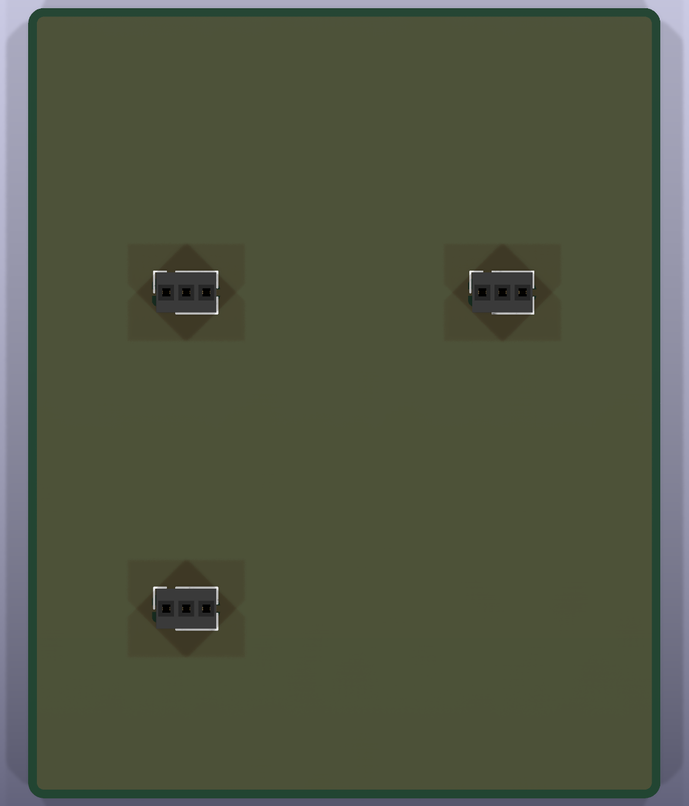
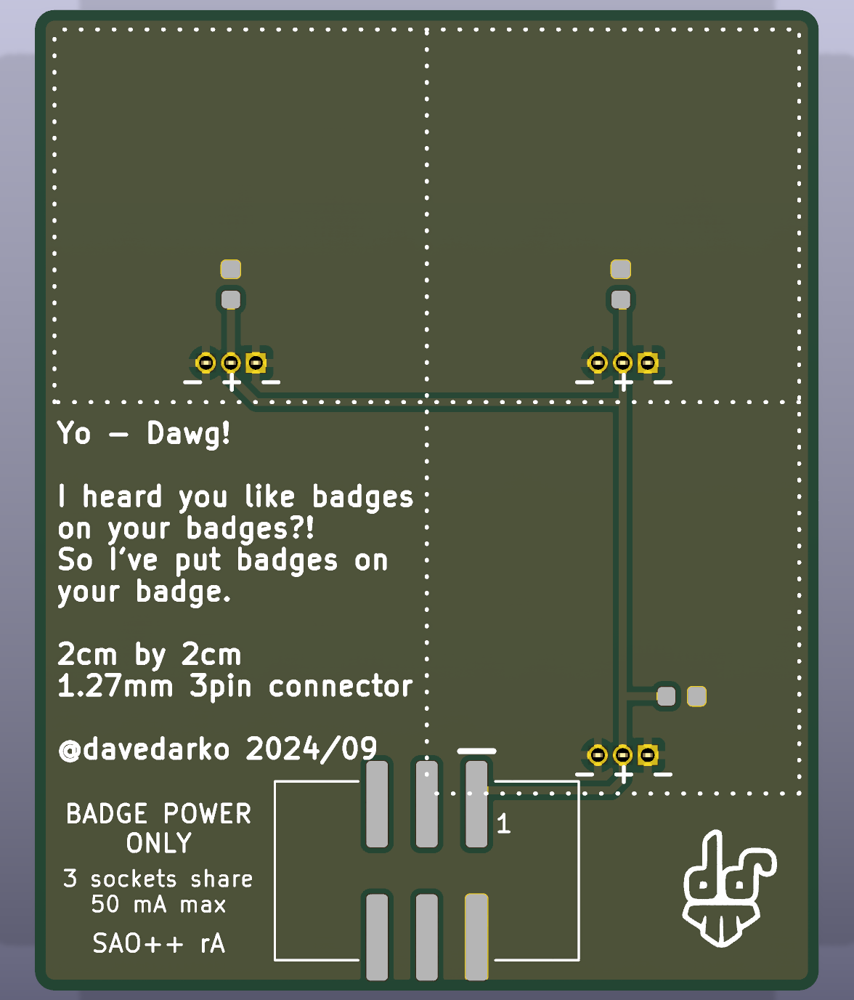

# Yo Dawg (SAO++ rev A)

"Yo dawg, I heard you like badges on your badges." davedarko's 2024 add-on that carries add-ons: a 40 × 50 mm board with three small sockets on its front. Each socket takes a 19 × 19 mm mini board and gives it power from the badge. This is the SAO++ version of the mother board.

**Status: designed and rule-checked only. No board has been built.**

| Front | Back |
|---|---|
|  |  |

The pictures are computer renders in KiCad's default green. The maker's board was **white with black print**.

## Credit and licence

Original design: **davedarko (Dave Darko)**, "Yo Dawg SAO", 2024/09, https://github.com/davedarko/YoDawgSAO (commit `4dd3db0`). His repository is under the **MIT licence** (copyright 2024 davedarko; text in [original/LICENSE](original/LICENSE)), which allows this port, with credit. His lettering ("Yo - Dawg! … @davedarko 2024/09") and his logo are on the back, unchanged and where he put them.

## Decision needed first: the portrait

The maker's front is one picture: a dithered black-and-white **portrait of the rapper Xzibit**, the face of the "Yo Dawg" meme (from the TV show Pimp My Ride). It was made from a photograph. Two things follow:

- it is the likeness of a real person, and
- the photograph belongs to someone else, so davedarko's MIT licence cannot give anyone rights to it.

So **the portrait is not in this repository and not on rev A**. The front of rev A is plain, with only the three sockets. The copy of the maker's board file in `original/` has the portrait taken out.

If the owner decides to use it, nothing has to be redrawn: download the maker's untouched `dawg/dawg.kicad_pcb` and build with it (the command is at the top of `hardware/build_board.py`). That was tried: the board still passes the rule check with the portrait on. The alternative is new front art that owes nothing to the photograph.

## What the original really is

- A passive power splitter. The badge's 3.3 V and ground go straight to three 3-pin sockets (1.27 mm pin spacing) wired ground, 3.3 V, ground, so a mini board works either way round. One small capacitor sits beside each socket.
- No lights, no chip, no battery on the mother board. I2C and the two GPIO pins are not connected and are not passed on.
- The mini boards are a separate thing (in the maker's `badges/` folder: a Hackaday logo, the xHain hackerspace logo, an Iron Man face, a 32-LED "Super Cluster"). **They are not ported here.** Three of the four carry other people's logos or characters, and they use LEDs that are not on the SAO++ parts list.

## What changed

| Maker's board | SAO++ rev A |
|---|---|
| 2×3 through-hole header (its six solder joints showed on the front) | The shared surface-mount SAO connector on the back, key slot up, in the same place (0.6 mm higher). Nothing shows on the front |
| Three unmarked capacitors (0805 size) | Three of the shared 100 nF capacitor, same places |
| Three sockets on the front | The same, same places |
| Ground copper 0.5 mm from the edge | 0.55 mm, the house rule for panels |
| Portrait on the front | Left out, pending the decision above |
| "JLCJLCJLCJLC" (a slot for one board house's order number) | Removed |
| — | Added on the back: "BADGE POWER ONLY", "3 sockets share 50 mA max", "SAO++ rA", a "1" beside connector pin 1 |

Everything else on the back (his lettering, the three "- + -" labels, the dotted squares that show where the mini boards sit, his logo) is exactly where he drew it.

## Where this board departs from the house standard

1. **Badge power only: no coin cell, no switch.** The board has nothing of its own to light, and the standard cell clip does not fit: at the top it would sit on the sockets' solder joints, and anywhere else it pushes the connector to the far end of the board and the maker's lettering off it. Making the board bigger does not help, because it has to match the maker's 19 mm mini boards. Three sister boards (GPIO-16 and others) made the same exception. The cost: it does nothing away from a badge.
2. **Parts on the front.** The three sockets are on the front, with their solder joints on the back. That is what the board is for.
3. **Connector close to the bottom edge.** Its plastic body ends 1.65 mm from the edge (standard: 3 mm) and its lower pads 0.5 mm from it. It is in the maker's spot; any higher and it lands on his "@davedarko 2024/09" line. The full-size pads are kept.

## Power: what a splitter does to the 50 mA budget

SAO++ boards promise to draw no more than 50 mA from the badge. This board draws nothing itself, but **everything plugged into it draws from the same badge port**, so the three mini boards together must stay under 50 mA: about 16 mA each if shared equally. That is printed on the back. What the maker's own mini boards draw is not recorded (his files give no resistor values or LED types).

## Parts

| Ref | Part | Note |
|---|---|---|
| J1 | SAO connector, shared part `SAOPP-CONN-01` | back |
| C1, C2, C3 | 100 nF capacitor, shared part `SAOPP-C-01` | back |
| J2, J3, J4 | 3-pin socket strip, 1.27 mm spacing, through-hole | front. **Board-only part, not chosen.** The maker names no manufacturer or part number; the footprint is KiCad's stock one, the same he used. A real part has to be picked and checked against it before ordering. If chosen at LCSC it adds one more reel or bag to the project's parts |

Parts cost without the sockets: about $0.12 per board (connector $0.10, three capacitors under $0.02; LCSC list prices from docs/parts.md, checked 2026-11-10). Board and assembly are not included.

## Things to check on the first prototype

1. **Connector pin order**, as on every SAO++ board (docs/standard.md): confirm 3.3 V and ground against a real badge.
2. **Socket part**: that the chosen socket fits the 0.7 mm holes, and how high a mini board then stands off the front.
3. **Connector strength** so close to the bottom edge, with three mini boards' weight on the board.
4. **Mini-board fit**: the three sockets are 20 mm apart, as the maker drew them, for 19 mm boards.
5. **Hand soldering** of the sockets' ground pins: they join the ground copper through three 0.4 mm spokes each, on both sides.

## What is unproven

Everything physical. No current has been measured. No mini board exists in SAO++ form.

## Files

- `hardware/yo-dawg.kicad_pro` — KiCad 10 project. ERC: 0 issues. DRC: 0 errors, 0 unconnected, schematic matches board. 5 warnings remain: the maker's logo library is not installed (1), and his dotted mini-board frame runs under the new connector's pads and printed outline, as it ran under his header (4).
- `hardware/circuit.json` — the circuit as data; the schematic and the board script both read it.
- `hardware/build_board.py` — rebuilds the board from `original/` plus the SAO++ changes, and re-applies the rule settings to the project file.
- `hardware/parts_local.py`, `hardware/yo-dawg-local.pretty/` — the socket.
- `docs/` — front and back renders, schematic drawing.
- `production/` — ordering files for one board and a 2 × 2 panel; see [production/README.md](production/README.md). Panel DRC: 0 errors, 0 unconnected (48 warnings: the same five per board, plus "library not found" for every renumbered part, as on other panels).
- `original/` — the maker's files and licence; see [original/readme.md](original/readme.md) for what is and is not copied.
